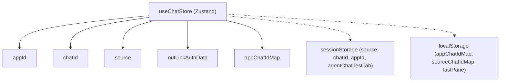
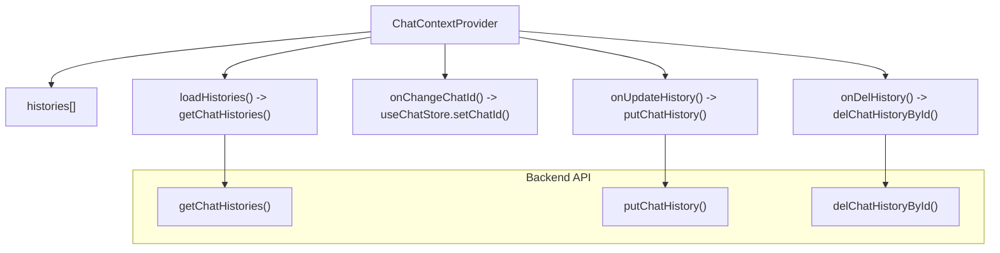
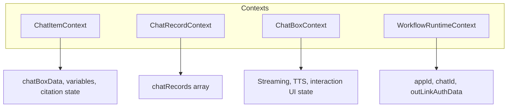
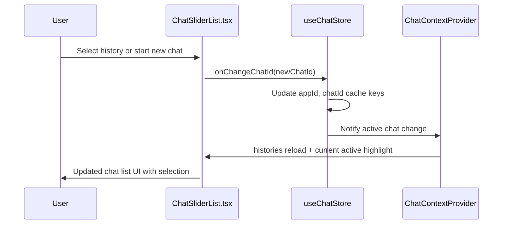
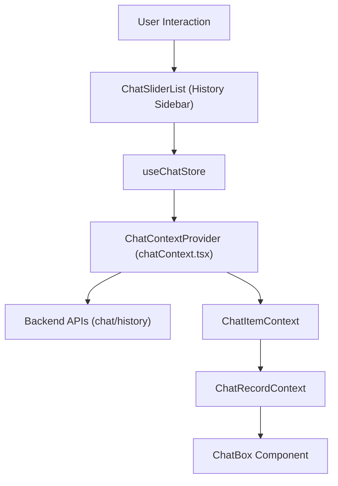

<!-- source: DeepWiki mcp.deepwiki.com · repo labring/FastGPT · page 8.2 Chat Context and State Management · fetched 2026-10-29 -->

# Chat Context and State Management

<details>
<summary>Relevant source files</summary>

The following files were used as context for generating this wiki page:

- [.agents/design/core/chat/input-draft-cache.md](.agents/design/core/chat/input-draft-cache.md)
- [packages/global/test/core/workflow/modelPublishPolicy.test.ts](packages/global/test/core/workflow/modelPublishPolicy.test.ts)
- [packages/web/components/common/Textarea/JsonEditor/index.tsx](packages/web/components/common/Textarea/JsonEditor/index.tsx)
- [packages/web/hooks/useSafeTranslation.ts](packages/web/hooks/useSafeTranslation.ts)
- [packages/web/hooks/useScrollPagination.tsx](packages/web/hooks/useScrollPagination.tsx)
- [packages/web/i18n/en/chat.json](packages/web/i18n/en/chat.json)
- [packages/web/i18n/ko-KR/chat.json](packages/web/i18n/ko-KR/chat.json)
- [packages/web/i18n/zh-CN/chat.json](packages/web/i18n/zh-CN/chat.json)
- [packages/web/i18n/zh-Hant/chat.json](packages/web/i18n/zh-Hant/chat.json)
- [projects/app/src/components/core/chat/ChatContainer/ChatBox/Input/ChatInput.tsx](projects/app/src/components/core/chat/ChatContainer/ChatBox/Input/ChatInput.tsx)
- [projects/app/src/components/core/chat/ChatContainer/ChatBox/components/AIChatBubble/index.tsx](projects/app/src/components/core/chat/ChatContainer/ChatBox/components/AIChatBubble/index.tsx)
- [projects/app/src/components/core/chat/ChatContainer/ChatBox/components/AppChatMain.tsx](projects/app/src/components/core/chat/ChatContainer/ChatBox/components/AppChatMain.tsx)
- [projects/app/src/components/core/chat/ChatContainer/ChatBox/components/ChatItem.tsx](projects/app/src/components/core/chat/ChatContainer/ChatBox/components/ChatItem.tsx)
- [projects/app/src/components/core/chat/ChatContainer/ChatBox/components/ChatVariableForm.tsx](projects/app/src/components/core/chat/ChatContainer/ChatBox/components/ChatVariableForm.tsx)
- [projects/app/src/components/core/chat/ChatContainer/ChatBox/constants.ts](projects/app/src/components/core/chat/ChatContainer/ChatBox/constants.ts)
- [projects/app/src/components/core/chat/ChatContainer/ChatBox/hooks/useChatGenerate.ts](projects/app/src/components/core/chat/ChatContainer/ChatBox/hooks/useChatGenerate.ts)
- [projects/app/src/components/core/chat/ChatContainer/ChatBox/hooks/useChatInputForm.ts](projects/app/src/components/core/chat/ChatContainer/ChatBox/hooks/useChatInputForm.ts)
- [projects/app/src/components/core/chat/ChatContainer/ChatBox/index.tsx](projects/app/src/components/core/chat/ChatContainer/ChatBox/index.tsx)
- [projects/app/src/pageComponents/app/detail/Edit/FormComponent/checkAppForm.ts](projects/app/src/pageComponents/app/detail/Edit/FormComponent/checkAppForm.ts)
- [projects/app/src/pageComponents/app/detail/WorkflowComponents/Flow/ChatTest.tsx](projects/app/src/pageComponents/app/detail/WorkflowComponents/Flow/ChatTest.tsx)
- [projects/app/src/pageComponents/app/detail/WorkflowComponents/Flow/components/NodeTemplates/list.tsx](projects/app/src/pageComponents/app/detail/WorkflowComponents/Flow/components/NodeTemplates/list.tsx)
- [projects/app/src/pageComponents/app/detail/WorkflowComponents/Flow/nodes/render/RenderInput/templates/Reference.tsx](projects/app/src/pageComponents/app/detail/WorkflowComponents/Flow/nodes/render/RenderInput/templates/Reference.tsx)
- [projects/app/src/pageComponents/app/detail/useChatTest.tsx](projects/app/src/pageComponents/app/detail/useChatTest.tsx)
- [projects/app/src/pageComponents/chat/ChatHeader.tsx](projects/app/src/pageComponents/chat/ChatHeader.tsx)
- [projects/app/src/pageComponents/chat/ChatTeamApp/List.tsx](projects/app/src/pageComponents/chat/ChatTeamApp/List.tsx)
- [projects/app/src/pageComponents/chat/ChatWindow/AppChatWindow.tsx](projects/app/src/pageComponents/chat/ChatWindow/AppChatWindow.tsx)
- [projects/app/src/pageComponents/chat/ChatWindow/HomeChatWindow.tsx](projects/app/src/pageComponents/chat/ChatWindow/HomeChatWindow.tsx)
- [projects/app/src/pageComponents/chat/slider/ChatSliderList.tsx](projects/app/src/pageComponents/chat/slider/ChatSliderList.tsx)
- [projects/app/src/pages/chat/index.tsx](projects/app/src/pages/chat/index.tsx)
- [projects/app/src/pages/chat/share.tsx](projects/app/src/pages/chat/share.tsx)
- [projects/app/src/web/core/app/api/tool.ts](projects/app/src/web/core/app/api/tool.ts)
- [projects/app/src/web/core/chat/context/chatContext.tsx](projects/app/src/web/core/chat/context/chatContext.tsx)
- [projects/app/src/web/core/chat/context/chatItemContext.tsx](projects/app/src/web/core/chat/context/chatItemContext.tsx)
- [projects/app/src/web/core/chat/context/chatPageContext.tsx](projects/app/src/web/core/chat/context/chatPageContext.tsx)
- [projects/app/src/web/core/workflow/utils.ts](projects/app/src/web/core/workflow/utils.ts)
- [projects/app/test/pageComponents/app/detail/Edit/FormComponent/checkAppForm.test.ts](projects/app/test/pageComponents/app/detail/Edit/FormComponent/checkAppForm.test.ts)
- [projects/app/test/pageComponents/app/detail/WorkflowComponents/Flow/components/NodeTemplates/useNodeTemplates.test.ts](projects/app/test/pageComponents/app/detail/WorkflowComponents/Flow/components/NodeTemplates/useNodeTemplates.test.ts)
- [projects/app/test/web/core/app/tool/templates.test.ts](projects/app/test/web/core/app/tool/templates.test.ts)
- [projects/app/test/web/core/app/workflow/utils.test.ts](projects/app/test/web/core/app/workflow/utils.test.ts)

</details>


This document provides a comprehensive and detailed technical overview of the chat context and state management system in FastGPT. It explores the architecture and interplay of key React contexts (`ChatContextProvider`, `ChatItemContext`, `ChatRecordContext`), the global Zustand store (`useChatStore`), and history handling mechanisms essential for managing chat sessions, app-level state, message records, and user interactions efficiently.

---

## 1. Global Chat State with `useChatStore`

`useChatStore` is the global state management hook built on Zustand located at:

- `projects/app/src/web/core/chat/context/useChatStore.ts`

This store governs persistent session-wide values like the current active `appId`, `chatId`, chat `source`, out-link authentication details (`outLinkAuthData`), and UI state for sidebar tabs. It is the root of truth for chat session identity across the frontend.

### Custom Storage Layer

To balance isolation across browser tabs and persistence through reloads, the store uses a composite custom storage strategy:

- Session-scoped info (`source`, `chatId`, `appId`, `agentChatTestTab`) is persisted in **`sessionStorage`** to keep state isolated per browser tab session.
- Cross-tab persisting data (like `lastChatAppId`, `lastChatId`, `appChatIdMap`, `sourceChatIdMap`, `lastPane`) is saved in **`localStorage`**, supporting persistence without crossover of session-sensitive data.

This dual scheme is implemented in `createCustomStorage` inside the store and keeps different aspects of app and chat state cleanly segregated.

### Cache Key Composition

Chat cache keys are generated by `getAppChatIdCacheKey`, which varies caching semantics based on chat source:

- For normal online chats: key=`${source}:${appId}`
- For out-link (shared URL) chats, keys include the full out-link identity: `${source}:${shareId}:${outLinkUid}:${appId}`

This avoids credential leaks and collisions across out-links while keeping clean caching for normal users.



**Sources:** [projects/app/src/web/core/chat/context/useChatStore.ts:1-125]()

---

## 2. Conversation History Context (`ChatContextProvider`)

The `ChatContextProvider` component operates at the application level, managing chat histories' retrieval, pagination, mutations (update, delete), and active chat session control. Its primary source file is:

- `projects/app/src/web/core/chat/context/chatContext.tsx`

### History State and API Integration

- Uses `useScrollPagination` (a custom hook) to fetch paginated history items efficiently from backend API `getChatHistories`, typically fetching 20 items per page.
- Provides `onUpdateHistory` to update history metadata fields such as custom titles, pinning, or deletion through API mutations (`putChatHistory`, `delChatHistoryById`).
- `onChangeChatId` is exposed to switch chat sessions, triggering cache updates in `useChatStore`, marking histories as read, and closing UI sliders or drawers.

### Data Flow Diagram



**Sources:** [projects/app/src/web/core/chat/context/chatContext.tsx:66-260]()

---

## 3. Session and Message Record Contexts

Below the global store (`useChatStore`) and conversation history context, FastGPT establishes dedicated React contexts to finely manage per-session chat UI state, message records, and interactions.

| Context Name        | Source File                                                                        | Responsibility                                                                                                          |
|---------------------|------------------------------------------------------------------------------------|------------------------------------------------------------------------------------------------------------------------|
| `ChatItemContext`   | `projects/app/src/web/core/chat/context/chatItemContext.tsx`                       | Manages current active chat configuration (`chatBoxData`), variable input forms, citation inspection modal state, and permissions for file downloads.              |
| `ChatRecordContext` | `projects/app/src/web/core/chat/context/chatRecordContext.tsx`                     | Maintains the array of message records (`chatRecords`), pagination status, and supports record-level updates or deletions.                                |
| `ChatBoxContext`    | `projects/app/src/components/core/chat/ChatContainer/ChatBox/Provider.tsx`         | Handles chat box UI state for streaming, audio, question guide visibility, and per-message interaction states.                                             |
| `WorkflowRuntimeContext` | `projects/app/src/components/core/chat/ChatContainer/context/workflowRuntimeContext.tsx` | Provides minimal workflow runtime context (current `appId`, `chatId`, `outLinkAuthData`) to internally running chat nodes and components.              |

### Key Implementation Notes:

- `ChatItemContext` exposes handlers like `resetVariables`, `clearChatRecords`, and state flags such as `isShowCite`, enabling integrated variable form management and citation display linked to active chats.
- `ChatRecordContext` supports managing an array of chat messages with pagination and loading states synchronized with backend storage.
- `ChatBoxContext` supports streaming chat message generation and TTS (text-to-speech) interactions.
- `WorkflowRuntimeContext` is a lightweight context to share minimal runtime data needed for chat nodes and app internal logic.



**Sources:** [projects/app/src/web/core/chat/context/chatItemContext.tsx](), [projects/app/src/web/core/chat/context/chatRecordContext.tsx](), [projects/app/src/components/core/chat/ChatContainer/ChatBox/Provider.tsx](), [projects/app/src/components/core/chat/ChatContainer/context/workflowRuntimeContext.tsx]()

---

## 4. History Handling and Sidebar Integration

The chat history sidebar lists conversation sessions and supports switching between them, merging in temporarily active but yet unsaved chat sessions, and highlighting the current chat. The primary component managing this is:

- `projects/app/src/pageComponents/chat/slider/ChatSliderList.tsx`

### Dynamic History Merging

To handle new chats that are not yet persisted in backend (e.g., just opened but unsent sessions), `ChatSliderList`:

- Merges a synthetic temporary history item (`isTemporary: true`) with the paginated persistent chat list.
- Ensures UI always has a consistent selected item, reflecting recent chat creation state.
- Supports user selecting existing histories or creating new sessions with immediate response.

### Interaction Flow



This flow guarantees smooth switching between chats, with consistent cache and persistence across application reloads and tab sessions.

**Sources:** [projects/app/src/pageComponents/chat/slider/ChatSliderList.tsx:17-106]()

---

## 5. Bridging Natural Language Concepts to Code Entities

To understand the chat system architecture mappings, here are two diagrams that associate common conceptual terms to actual code components and files.

### Diagram 1: Chat Session State Flow

```mermaid
graph LR
  NLSource["Chat Application (Natural Language User Interaction)"] -->|Session and Chat selection| useChatStore["Global Store (useChatStore)"]
  useChatStore -->|Cache & Persist| sessionStorage["sessionStorage"], localStorage["localStorage"]

  useChatStore -->|Active chat update| ChatContext["ChatContextProvider (chatContext.tsx)"]
  ChatContext -->|History list and Mutations| BackendAPI["Backend: getChatHistories, putChatHistory, delChatHistoryById"]

  ChatContext --> ChatItemContext["ChatItemContext (chatItemContext.tsx)"]
  ChatContext --> ChatRecordContext["ChatRecordContext (chatRecordContext.tsx)"]

  ChatItemContext -->|Holds chat config, variables, citation state| ChatBoxContext["ChatBoxContext (Provider.tsx)"]
  ChatRecordContext -->|Holds chat message records| ChatBoxContext

  ChatBoxContext -->|UI for chat messages and interaction| ChatBoxComp["ChatBox Component (ChatBox/index.tsx)"]
```

### Diagram 2: History Sidebar and Chat Module Interaction



---

# Summary

The chat context and state management system in FastGPT employs a layered architecture with:

- **useChatStore:** Global cross-component persistent state with custom dual-storage strategy.
- **ChatContextProvider:** Pagination, management, and mutation of chat histories plus active chat selection.
- **ChatItemContext & ChatRecordContext:** Focused session and record state management with variable and citation handling.
- **ChatBoxContext & WorkflowRuntimeContext:** Interaction state for the chat UI and workflow runtime data.
- **History Sidebar:** Merges persistent and temporary chat histories for user-friendly UX, tightly integrated with store and context.

This design ensures a robust, performance-optimized, and user-friendly chat environment that gracefully handles multi-tab scenarios, session isolation, and rich runtime chat state management.

---

# References and Source Files

- `projects/app/src/web/core/chat/context/useChatStore.ts`
- `projects/app/src/web/core/chat/context/chatContext.tsx`
- `projects/app/src/web/core/chat/context/chatItemContext.tsx`
- `projects/app/src/web/core/chat/context/chatRecordContext.tsx`
- `projects/app/src/components/core/chat/ChatContainer/ChatBox/Provider.tsx`
- `projects/app/src/components/core/chat/ChatContainer/context/workflowRuntimeContext.tsx`
- `projects/app/src/pageComponents/chat/slider/ChatSliderList.tsx`
- `projects/app/src/components/core/chat/ChatContainer/ChatBox/index.tsx`

---

