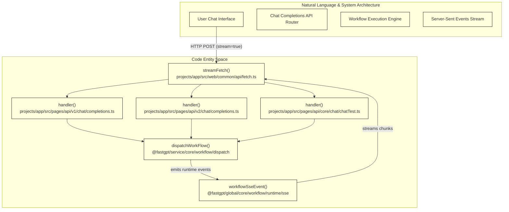
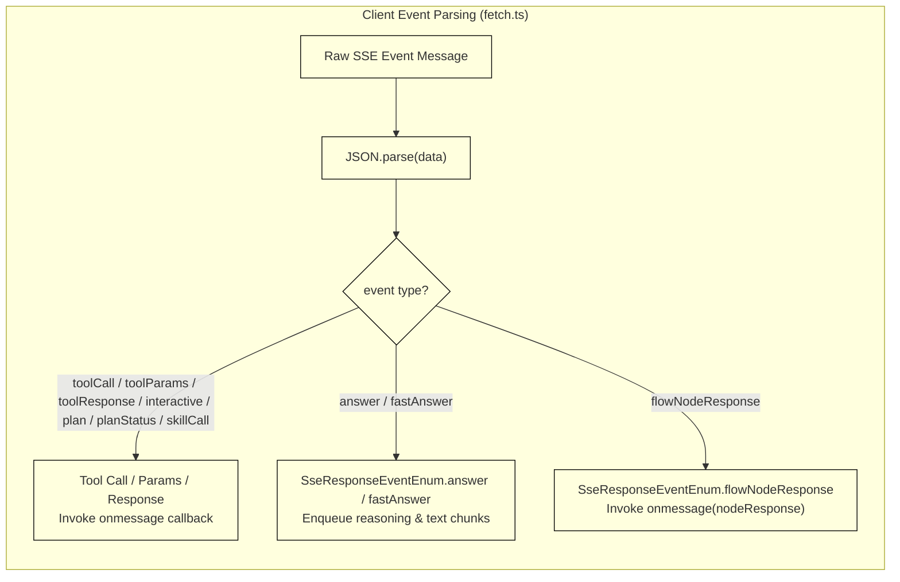
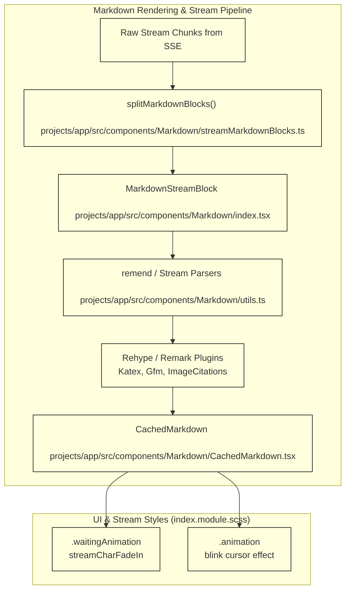

<!-- source: DeepWiki mcp.deepwiki.com · repo labring/FastGPT · page 8.3 Streaming Responses and Real-time Updates · fetched 2026-10-29 -->

# Streaming Responses and Real-time Updates

<details>
<summary>Relevant source files</summary>

The following files were used as context for generating this wiki page:

- [packages/service/core/workflow/dispatch/interactive/formInput.ts](packages/service/core/workflow/dispatch/interactive/formInput.ts)
- [packages/service/core/workflow/dispatch/interactive/userSelect.ts](packages/service/core/workflow/dispatch/interactive/userSelect.ts)
- [projects/app/src/pageComponents/app/detail/WorkflowComponents/Flow/nodes/render/RenderDebug/NodeDebugResponse.tsx](projects/app/src/pageComponents/app/detail/WorkflowComponents/Flow/nodes/render/RenderDebug/NodeDebugResponse.tsx)
- [projects/app/src/pageComponents/app/detail/WorkflowComponents/context/index.tsx](projects/app/src/pageComponents/app/detail/WorkflowComponents/context/index.tsx)
- [projects/app/src/pages/api/core/chat/chatTest.ts](projects/app/src/pages/api/core/chat/chatTest.ts)
- [projects/app/src/pages/api/core/workflow/debug.ts](projects/app/src/pages/api/core/workflow/debug.ts)
- [projects/app/src/pages/api/v1/chat/completions.ts](projects/app/src/pages/api/v1/chat/completions.ts)
- [projects/app/src/pages/api/v2/chat/completions.ts](projects/app/src/pages/api/v2/chat/completions.ts)
- [projects/app/src/web/common/api/fetch.ts](projects/app/src/web/common/api/fetch.ts)

</details>


## Purpose and Scope

This document details FastGPT's streaming response system, providing real-time updates during workflow execution. The system leverages Server-Sent Events (SSE) to deliver incremental AI chat completions, reasoning content, tool call events, execution step statuses, and interactive node prompts without waiting for the entire workflow to complete. It covers server-side API endpoint integration, client-side stream fetching and SSE event parsing, typing queue management for smooth incremental rendering, incremental Markdown stream rendering strategies, and stream resume handling for fault tolerance and reconnection.

---

## 1. Streaming Architecture and Endpoint Handling

FastGPT's streaming response system is centered around SSE-enabled HTTP APIs that stream incremental data as workflows progress. The key endpoints are:

- `/api/v1/chat/completions` — Legacy v1 streaming API supporting SSE chat completions.
- `/api/v2/chat/completions` — Updated v2 streaming chat completion API.
- `/api/core/chat/chatTest` — Workflow debugging endpoint with streaming responses.

Each endpoint validates inputs, performs authentication, prepares workflow resource contexts, and then invokes `dispatchWorkFlow` with streaming enabled. The dispatch workflow engine emits runtime workflow events that are serialized into SSE by `workflowSseEvent`, creating a live data stream to the client.

### Architecture to Code Entity Mapping



**Explanation:**
- Client chat interfaces issue POST requests with `stream` enabled.
- The frontend wrapper function `streamFetch` manages the SSE request and response lifecycle.
- Backend exposes three main handlers that all eventually call `dispatchWorkFlow` to execute the app workflow.
- `dispatchWorkFlow` emits streaming events encapsulated by `workflowSseEvent` into SSE chunks.
- These chunks flow back through the SSE connection to the client for real-time consumption.

**Sources:**
- [projects/app/src/pages/api/v1/chat/completions.ts:93-116]()
- [projects/app/src/pages/api/v2/chat/completions.ts:92-123]()
- [projects/app/src/pages/api/core/chat/chatTest.ts:64-86]()
- [projects/app/src/web/common/api/fetch.ts:35-40]()

---

## 2. Client-Side Transport and Event Parsing

The frontend networking layer uses a dedicated `streamFetch` function to initiate and maintain SSE connections. Internally, it implements `fetchEventSource` from `@fortaine/fetch-event-source` to open and parse streaming HTTP SSE payloads.

Within `streamFetch`:

- Incoming SSE event messages are parsed and dispatched through a handler function `handleEventSourceData`.
- `handleEventSourceData` interprets events by `event` name and JSON payload `data`.
- Different event types trigger different client-side behaviors—some modify UI state immediately, others enqueue stream typing data.

### Event Processing Flow on Client



**Key Event Types:**

- **`SseResponseEventEnum.answer` / `fastAnswer`:**  
  Extract AI-generated token content and associated reasoning content (Chain-of-Thought style). The tokens and reasoning pieces are enqueued into a typing queue for smooth incremental rendering character-by-character or chunk-by-chunk. Splitting is configurable between single characters or larger chunks.
  
- **`SseResponseEventEnum.toolCall`, `toolParams`, `toolResponse`:**  
  These events invoke interactive UI changes notifying the user about tool invocation status, parameters input, or tool output. Events are dispatched immediately to `onmessage` callbacks.

- **`SseResponseEventEnum.flowNodeResponse`:**  
  Streams detailed workflow node execution responses, including partial outputs and statuses, which update the runtime execution view.

- Other types like `interactive`, `plan`, and `skillCall` also relay important interaction and planning steps.

**Source File:**  
`handleEventSourceData` in [projects/app/src/web/common/api/fetch.ts:157-213]()

**Sources:**
- [projects/app/src/web/common/api/fetch.ts:157-213]()

---

## 3. Typing Queue and Incremental Rendering

To create a natural streaming experience resembling a typing effect, FastGPT employs a typing queue with controlled consumption rates:

- While the backend stream remains open and data is arriving, only a small number (typically 1) of characters/chunks are consumed from the queue per tick, avoiding large instantaneous renders that cause UI jank.
- When the stream closes (`finished` flag), the full queue is flushed to render any remaining content at once, ensuring the final answer appears complete and no partial tokens get stuck.
- Reasoning content emitted by the model (for example intermediate chain-of-thought text) is kept separately and drained fully before normal answer text to preserve coherent incremental logic.

The key utility controlling consumption count:

```ts
export const getStreamTypingQueueConsumeCount = ({
  queueLength,
  finished
}: {
  queueLength: number;
  finished: boolean;
}) => {
  if (queueLength <= 0) return 0;

  return finished ? queueLength : Math.min(queueLength, STREAM_TYPING_QUEUE_COUNT_WHILE_STREAMING);
};
```

Where `STREAM_TYPING_QUEUE_COUNT_WHILE_STREAMING` is 1 to ensure a slow reveal of tokens while streaming.

**Sources:**
- [projects/app/src/web/common/api/fetch.ts:128-146]()

---

## 4. Markdown Stream Rendering and Incomplete Tail Handling

Rendering streamed Markdown requires careful handling because incomplete token sequences can cause rendering artifacts or parsing failures:

- Partial Markdown constructs like unclosed code fences, half typed links/images, or partial emphasis markers (e.g., `**`, `_`) produce invalid ASTs if parsed naively on each incremental chunk.
- FastGPT solves this using a layered approach with React components and stream parsing utilities:

### Markdown Stream Architecture



**Explanation:**

- The raw stream is initially split at block boundaries (paragraphs, code fences) by `splitMarkdownBlocks`, which reduces the incremental parse scope.
- Each block is wrapped in a memoized React component `MarkdownStreamBlock` for efficient rendering, avoiding re-parsing of already stable earlier blocks.
- The `remend` library and custom utils repair incomplete tail Markdown fragments. For example, unclosed tags are detected and handled with `repairTailDefs`, `fixUnclosedLinkTail`, and other logic, preventing flickering parse errors during stream expansion.
- `rehype` and `remark` plugins process the Markdown AST for features like KaTeX math rendering, GitHub-flavored Markdown, and citation rendering.
- CSS styles in `index.module.scss` define fade-in animation for new characters and blinking cursors in streaming output blocks, enhancing user experience.

This architecture ensures a smooth and visually stable stream rendering experience for Markdown responses.

**Sources:**
- [projects/app/src/components/Markdown/index.tsx:131-181]()
- [projects/app/src/components/Markdown/utils.ts:20-49]()
- [projects/app/src/components/Markdown/index.module.scss:1-53]()

---

## 5. Stream Resume and Connection Recovery

To improve resilience against unstable network conditions, FastGPT supports stream drop-and-resume semantics:

- When a network failure interrupts the SSE stream, the client may reconnect and ask the server to resume from the last received token offset.
- This is implemented via checked request headers, managed by the utility `shouldSendStreamResumeHeader`, which enables stream resume headers only for selected API routes (e.g. chat completion endpoints).
- Once the server catches up historical frames (past streamed tokens), and successfully transitions the client into the "live" stream phase, the client triggers resume-ready callbacks, ensuring smooth seamless continuation.
- The notifier `createResumeReadyNotifier` signals once per stream connection that the resume phase went live to allow UI state updates accordingly.

```ts
export const createResumeReadyNotifier = (onResumeReady?: () => void) => {
  let notified = false;

  return (phase: string) => {
    if (notified || phase !== StreamResumePhaseEnum.live) return;

    notified = true;
    onResumeReady?.();
  };
};
```

This mechanism enhances user experience by reducing disruptions and preserving partial progress during intermittent disconnects.

**Sources:**
- [projects/app/src/web/common/api/fetch.ts:98-117]()

---

# Summary Table of Key Functions and Classes

| Name                                  | Location                                                   | Role                                                         |
|------------------------------------- |---------------------------------------------------------- |------------------------------------------------------------ |
| `handler`                            | `projects/app/src/pages/api/v1/chat/completions.ts`       | Entry API handler for v1 streaming chat completions.        |
| `handler`                            | `projects/app/src/pages/api/v2/chat/completions.ts`       | Entry API handler for v2 streaming chat completions.        |
| `handler`                            | `projects/app/src/pages/api/core/chat/chatTest.ts`        | Workflow debug streaming API handler.                        |
| `dispatchWorkFlow()`                 | `@fastgpt/service/core/workflow/dispatch`                 | Executes workflow nodes; emits streaming events.           |
| `workflowSseEvent()`                 | `@fastgpt/global/core/workflow/runtime/sse`               | Serializes workflow runtime events as SSE data chunks.      |
| `streamFetch()`                     | `projects/app/src/web/common/api/fetch.ts`                 | Client function managing SSE connection and event parsing.  |
| `handleEventSourceData()`           | `projects/app/src/web/common/api/fetch.ts`                 | Parses SSE data events and dispatches UI updates.           |
| `getStreamTypingQueueConsumeCount()`| `projects/app/src/web/common/api/fetch.ts`                 | Controls typing queue token consumption speed.              |
| `MarkdownStreamBlock`                | `projects/app/src/components/Markdown/index.tsx`           | React component managing incremental Markdown block renders.|
| `splitMarkdownBlocks()`              | `projects/app/src/components/Markdown/streamMarkdownBlocks.ts`| Splits streaming markdown into manageable blocks.           |
| `createResumeReadyNotifier()`        | `projects/app/src/web/common/api/fetch.ts`                 | Notifies when stream resume phase begins on client.         |

---

# Conclusion

FastGPT provides a robust streaming response and real-time update system for interactive AI experiences. By combining server-side workflow event streaming via SSE, a resilient client-side `streamFetch` with incremental event parsing, a typing queue for smooth output, and advanced Markdown stream rendering techniques, FastGPT achieves responsive, low-latency conversational UI updates. Additionally, stream resume protocols enable fault tolerance and reconnection support, ensuring stability across typical network conditions.

This architecture enables FastGPT's chat, agent, and workflow applications to provide rich incremental feedback, intermediate reasoning exposure, and dynamic UI components such as tool invocation cards — all crucial for interactive agent-based AI workflows.

---

**Sources:**

- [projects/app/src/pages/api/v1/chat/completions.ts:1-178]()
- [projects/app/src/pages/api/v2/chat/completions.ts:1-180]()
- [projects/app/src/pages/api/core/chat/chatTest.ts:1-180]()
- [projects/app/src/web/common/api/fetch.ts:1-212]()
- [projects/app/src/components/Markdown/index.tsx:131-181]()
- [projects/app/src/components/Markdown/utils.ts:20-49]()
- [projects/app/src/components/Markdown/index.module.scss:1-53]()

---

