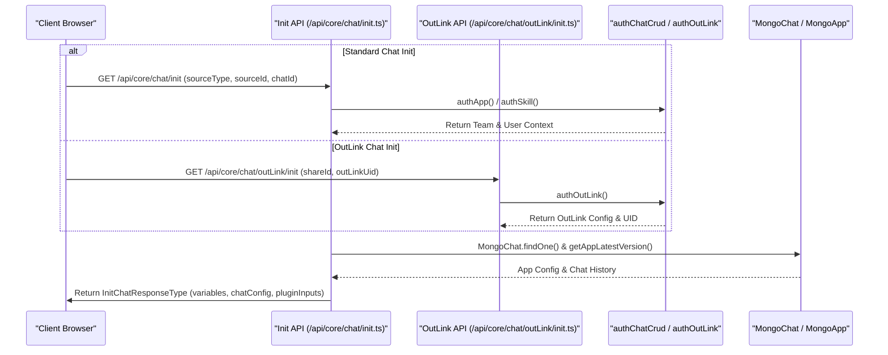
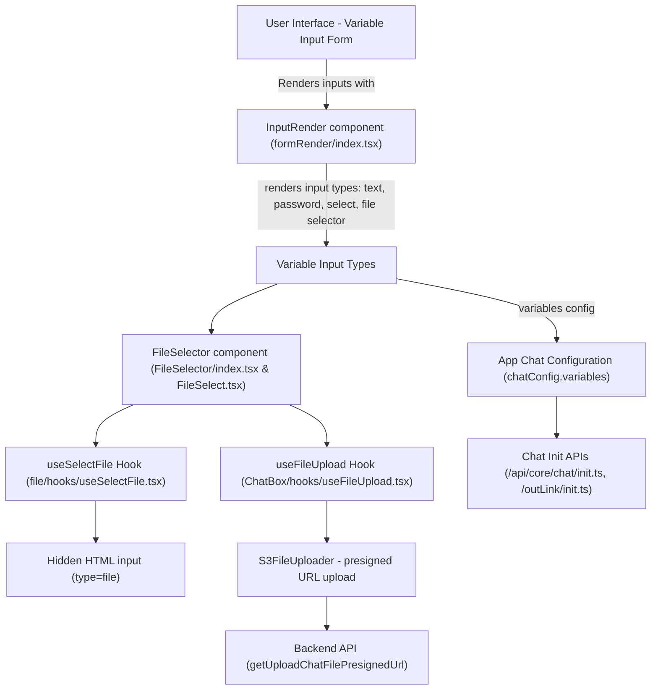

<!-- source: DeepWiki mcp.deepwiki.com · repo labring/FastGPT · page 8.4 Variable Input and Chat Initialization · fetched 2026-10-29 -->

# Variable Input and Chat Initialization

<details>
<summary>Relevant source files</summary>

The following files were used as context for generating this wiki page:

- [packages/web/components/common/Textarea/PromptEditor/plugins/VariableLabelPlugin/components/VariableLabel.tsx](packages/web/components/common/Textarea/PromptEditor/plugins/VariableLabelPlugin/components/VariableLabel.tsx)
- [projects/app/src/components/Select/FileSelectorBox.tsx](projects/app/src/components/Select/FileSelectorBox.tsx)
- [projects/app/src/components/common/Textarea/MyTextarea/index.tsx](projects/app/src/components/common/Textarea/MyTextarea/index.tsx)
- [projects/app/src/components/core/app/AppConfigItem.tsx](projects/app/src/components/core/app/AppConfigItem.tsx)
- [projects/app/src/components/core/app/AutoExecConfig.tsx](projects/app/src/components/core/app/AutoExecConfig.tsx)
- [projects/app/src/components/core/app/FileSelect.tsx](projects/app/src/components/core/app/FileSelect.tsx)
- [projects/app/src/components/core/app/FileSelector/index.tsx](projects/app/src/components/core/app/FileSelector/index.tsx)
- [projects/app/src/components/core/app/FileSelector/type.ts](projects/app/src/components/core/app/FileSelector/type.ts)
- [projects/app/src/components/core/app/FileSelector/utils.ts](projects/app/src/components/core/app/FileSelector/utils.ts)
- [projects/app/src/components/core/app/InputGuideConfig/index.tsx](projects/app/src/components/core/app/InputGuideConfig/index.tsx)
- [projects/app/src/components/core/app/ScheduledTriggerConfig.tsx](projects/app/src/components/core/app/ScheduledTriggerConfig.tsx)
- [projects/app/src/components/core/app/TTSSelect.tsx](projects/app/src/components/core/app/TTSSelect.tsx)
- [projects/app/src/components/core/app/WelcomeTextConfig.tsx](projects/app/src/components/core/app/WelcomeTextConfig.tsx)
- [projects/app/src/components/core/app/WhisperConfig.tsx](projects/app/src/components/core/app/WhisperConfig.tsx)
- [projects/app/src/components/core/app/formRender/index.tsx](projects/app/src/components/core/app/formRender/index.tsx)
- [projects/app/src/components/core/app/formRender/type.ts](projects/app/src/components/core/app/formRender/type.ts)
- [projects/app/src/components/core/chat/ChatContainer/ChatBox/hooks/useFileUpload.tsx](projects/app/src/components/core/chat/ChatContainer/ChatBox/hooks/useFileUpload.tsx)
- [projects/app/src/pageComponents/app/detail/WorkflowComponents/Flow/hooks/useDebug.tsx](projects/app/src/pageComponents/app/detail/WorkflowComponents/Flow/hooks/useDebug.tsx)
- [projects/app/src/pageComponents/app/detail/WorkflowComponents/Flow/hooks/useDebugInput.ts](projects/app/src/pageComponents/app/detail/WorkflowComponents/Flow/hooks/useDebugInput.ts)
- [projects/app/src/pageComponents/app/detail/WorkflowComponents/Flow/nodes/NodeHttp/index.tsx](projects/app/src/pageComponents/app/detail/WorkflowComponents/Flow/nodes/NodeHttp/index.tsx)
- [projects/app/src/pageComponents/app/detail/WorkflowComponents/Flow/nodes/render/RenderInput/templates/CommonInputForm.tsx](projects/app/src/pageComponents/app/detail/WorkflowComponents/Flow/nodes/render/RenderInput/templates/CommonInputForm.tsx)
- [projects/app/src/pageComponents/app/detail/components/QuickCreateDatasetModal.tsx](projects/app/src/pageComponents/app/detail/components/QuickCreateDatasetModal.tsx)
- [projects/app/src/pageComponents/dataset/detail/Import/diffSource/FileLocal.tsx](projects/app/src/pageComponents/dataset/detail/Import/diffSource/FileLocal.tsx)
- [projects/app/src/pages/api/core/chat/getPaginationRecords.ts](projects/app/src/pages/api/core/chat/getPaginationRecords.ts)
- [projects/app/src/pages/api/core/chat/getResData.ts](projects/app/src/pages/api/core/chat/getResData.ts)
- [projects/app/src/pages/api/core/chat/init.ts](projects/app/src/pages/api/core/chat/init.ts)
- [projects/app/src/pages/api/core/chat/outLink/init.ts](projects/app/src/pages/api/core/chat/outLink/init.ts)
- [projects/app/src/pages/api/core/dataset/data/insertImages.ts](projects/app/src/pages/api/core/dataset/data/insertImages.ts)
- [projects/app/src/service/support/permission/auth/chat.ts](projects/app/src/service/support/permission/auth/chat.ts)
- [projects/app/src/web/core/chat/api.ts](projects/app/src/web/core/chat/api.ts)
- [projects/app/test/api/core/dataset/collection/create/images.test.ts](projects/app/test/api/core/dataset/collection/create/images.test.ts)
- [projects/app/test/api/core/dataset/data/insertImages.test.ts](projects/app/test/api/core/dataset/data/insertImages.test.ts)
- [projects/app/test/components/core/app/FileSelector/utils.test.ts](projects/app/test/components/core/app/FileSelector/utils.test.ts)
- [projects/app/test/pageComponents/app/detail/WorkflowComponents/Flow/hooks/useDebugInput.test.ts](projects/app/test/pageComponents/app/detail/WorkflowComponents/Flow/hooks/useDebugInput.test.ts)

</details>


## Purpose and Scope

This document details the implementation of variable input handling, file selectors, and chat session initialization in FastGPT. It covers the lifecycle from user input variable configuration, through file upload management, to chat session creation APIs. It also explains permission guards for secure chat initialization and the outLink sharing mechanism. This page focuses on system details underpinning variable forms rendering, file selection components and hooks, and chat initialization API behavior.

For runtime variable resolution flow, see section 4.3 (Variable Resolution and Data Flow). For interactive workflows and variable collection UI, see 4.4.

---

## Chat Initialization APIs

FastGPT provides multiple endpoints to initialize chat sessions, depending on the chat entry point and context:

### 1. Standard Chat Initialization (`/api/core/chat/init`)

Located at `projects/app/src/pages/api/core/chat/init.ts`, this API endpoint supports different chat source types:

- `app` — standard application chats
- `skillEdit` — chat sessions tied to skill editing
- `chatAgentHelper` — specialized chat agent helpers

Key steps performed:

1. Parse query parameters (`sourceType`, `sourceId`, `chatId`) using `InitChatQuerySchema`.
2. Based on `sourceType`:
   - For `skillEdit`, authenticate skill access (`authSkill`), fetch chat if present, ensure permissions, mark chat as read if relevant, and return init data with empty variables since skills have limited variable inputs.
   - For `chatAgentHelper`, authenticate app access (`authApp`), verify chat permissions, mark chat as read if required, then return config created by `createChatAgentHelperAppConfig`.
   - For `app` (the default case):
     - Authenticate app access (`authApp`) with read permission.
     - Fetch chat if `chatId` is provided and verify user read permissions.
     - Mark chats as read when newly fetched.
     - Get latest app version using `getAppLatestVersion`.
     - Extract the chat config and variable initial values.
     - Presign file URLs for variable file inputs using `presignVariablesFileUrls`.
     - Return `InitChatResponseSchema` including chat metadata, app config, available chat models, and plugin input definitions.

```typescript
async function handler(req: NextApiRequest): Promise<InitChatResponseType> {
  const { sourceType, sourceId, chatId } = parseApiInput({
    req,
    querySchema: InitChatQuerySchema
  }).query;
  
  // ... Authentication, permission, chat lookup logic
  // ... Latest app version retrieval and presign variable file URLs
  return InitChatResponseSchema.parse({
    chatId,
    ...buildChatTargetResponse({ sourceType, sourceId }),
    title: getDisplayChatTitle({ ... }),
    variables,
    chatGenerateStatus,
    hasBeenRead,
    app: appChatConfig
  });
}
```
*Sources: [projects/app/src/pages/api/core/chat/init.ts:28-186]()

### 2. Out-Link Chat Initialization (`/api/core/chat/outLink/init`)

This endpoint (`projects/app/src/pages/api/core/chat/outLink/init.ts`) supports initializing chats accessed via externally shared links, authenticated by `shareId` and `outLinkUid`.

Workflow:

- Parse outLink auth data and optional `chatId`.
- Use `authOutLink` to validate share token and retrieve linked app and user (`uid`).
- Fetch chat by `chatId` if exists, ensure the `outLinkUid` matches.
- Mark chat as read if applicable.
- Load latest app version config and pluginInputs.
- Presign file URLs of variables stored in chat.
- Return `InitOutLinkChatResponseSchema` with session metadata, including app config and chat info.

```typescript
async function handler(req: NextApiRequest): Promise<InitOutLinkChatResponseType> {
  const { chatId, outLinkAuthData } = parseApiInput({
    req,
    querySchema: InitOutLinkChatQuerySchema
  }).query;
  
  const { shareId, outLinkUid } = outLinkAuthData;
  const { uid, appId } = await authOutLink({ shareId, outLinkUid, req });

  const [chat, app] = await Promise.all([
    MongoChat.findOne({ ...buildChatSourceQuery(...), chatId }).lean(),
    MongoApp.findById(appId).lean()
  ]);
  
  if (chat && chat.outLinkUid !== uid) throw new Error('unauthorized'); 

  const appChatConfig = getAppChatConfig({ chatConfig, storeVariables: chat?.variableList });
  const variables = await presignVariablesFileUrls({ variables: chat?.variables, variableConfig: appChatConfig.variables });

  return InitOutLinkChatResponseSchema.parse({
    chatId,
    ...buildChatTargetResponse(...),
    variables,
    chatGenerateStatus: chat?.chatGenerateStatus,
    hasBeenRead: chat?.hasBeenRead,
    app: {
      chatConfig: appChatConfig,
      name: app.name,
      avatar: app.avatar ?? '',
      intro: app.intro ?? '',
      type: app.type,
      pluginInputs
    }
  });
}
```
*Sources: [projects/app/src/pages/api/core/chat/outLink/init.ts:23-100]()

---

## Authentication and Authorization Overview

The chat APIs rely on the authorization layer in `projects/app/src/service/support/permission/auth/chat.ts` to guard access:

- `authChatCrud` is the core function for chat CRUD permissions over cookies, API keys, and outLink credentials.
- It distinguishes between:
  - **OutLink users**: Authenticated by `shareId` and `outLinkUid`. Validates app and chat ownership. OutLink users have restricted `isRoot` permission false and limited control.
  - **App authenticated users**: Authenticated with JWT or API keys. Ensures user/team permissions match the chat ownership and team context, including read access rights.
- The function returns key contextual info (`uid`, `teamId`, flags for content visibility such as citations, running status, skill references, and whether downloads are permitted).

```typescript
export async function authChatCrud({ appId, chatId, shareId, outLinkUid, ...props }) {
  if (shareId && outLinkUid) {
    // OutLink authentication via authOutLink()
    // Validate chat.outLinkUid matches outLinkUid
    // Return contextual flags and user info
  } else {
    // Cookie-based auth with authApp()
    // Validate permission to read chat logs
    // Return contextual info for display and authorization
  }
}
```
*Sources: [projects/app/src/service/support/permission/auth/chat.ts:47-231]()

---

## Variable Input Handling and Configuration

FastGPT supports various variable input types and form rendering for chat initialization and runtime interaction.

### Variable Categorization

- Variables can be **custom**, **internal**, or other types per `VariableInputEnum`.
- Variables have keys, default values, labels, and types defined in the app's chat config.
- Variables are filtered and grouped accordingly before rendering or storing.

### Input Rendering Components

The `InputRender` component (`projects/app/src/components/core/app/formRender/index.tsx`) renders inputs depending on variable input types defined in `InputTypeEnum`, including:

- Rich text inputs (`PromptEditor`)
- Textareas
- Password inputs with secret masking and editing states
- Number inputs (`MyNumberInput`)
- Switches / toggles
- Single / multiple select dropdowns (`MySelect`, `MultipleSelect`)
- JSON editor (`JSONEditor`)
- Model selectors (`AIModelSelector`)
- File selectors (`FileSelector`)
- Time inputs for date/time variables

Common props such as `value`, `onChange`, `isDisabled`, `isInvalid`, and `placeholder` are carefully propagated with localization.

Example rendering password input:

```tsx
if (inputType === InputTypeEnum.password) {
  const isPasswordConfigured = isSecretValue(value);
  // Show masked value or editing input accordingly
  // Allow editing and masking toggle with controlled state
}
```
*Sources: [projects/app/src/components/core/app/formRender/index.tsx:23-211]()

### File Selection Component

The `FileSelect` component (`projects/app/src/components/core/app/FileSelect.tsx`) manages the file selection configuration for an app:

- Allows toggling enable/disable of file/image/audio/video/custom file extensions.
- Limits max files according to team plan or system max.
- Supports custom PDF parsing option with pricing info.
- Uses a modal and sliders for configuring upload limits and allowed extensions.
- Displays contextual tips and payment information via UI.

```tsx
const FileSelect = ({ value, onChange, ...labelStyle }) => {
  // Manage localConfig state and modal visibility
  // Render FileTypeSelectorPanel for extension selection
  // Provide maxFile count slider limited by team quota 
}
```
*Sources: [projects/app/src/components/core/app/FileSelect.tsx:26-173]()

---

## File Upload and Selector Pipeline

File uploading is handled via tightly integrated React hooks, immutable state patterns, and user quota management.

### The `useSelectFile` Hook

This hook (`projects/web/common/file/hooks/useSelectFile.tsx`) manages a hidden `<input type="file" />` element for flexible file picking:

- Parameters for accepted file types, multiple selection, and max files.
- Dynamically resets input when parameters change to ensure browser file dialogs refresh.
- Centralizes file selection handling for reuse across components.

```typescript
export const useSelectFile = ({ fileType, multiple, maxCount }) => {
  // Returns File component (input) and onOpen callback to trigger file dialog
};
```
*Sources: [projects/web/common/file/hooks/useSelectFile.tsx:5-52]()

### The `useFileUpload` Hook

Located in `projects/app/src/components/core/chat/ChatContainer/ChatBox/hooks/useFileUpload.tsx`, this hook orchestrates file upload lifecycle in chat input forms:

- Tracks upload cancelation, abortion, and progress.
- Requests presigned URLs from backend API (`getUploadChatFilePresignedUrl`).
- Uses `S3FileUploader` to perform secure direct uploads.
- Manages controlled react-hook-form `field array` updates for uploaded files.
- Enforces file count and size limits based on user/team quota and module restrictions.
- Supports aborting all ongoing uploads on component unmount or session end.
- Associates upload ownership by chat/user context identifiers to isolate tasks.

```typescript
export const useFileUpload = ({
  fileSelectConfig,
  fileCtrl,
  getValues,
  outLinkAuthData,
  sourceTarget,
  chatId
}) => {
  // Manage upload task state and abort controllers
  // Validate file size and count limits
  // Hook into file selection and update form fields on upload success/failure
}
```
*Sources: [projects/app/src/components/core/chat/ChatContainer/ChatBox/hooks/useFileUpload.tsx:40-190]()

---

## Chat Variable and File Initialization in Workflow Debug Context

The `useDebug` hook (`projects/app/src/pageComponents/app/detail/WorkflowComponents/Flow/hooks/useDebug.tsx`) interacts with variable inputs for chat initiation and debugging:

- Extracts and filters variables from `appDetail.chatConfig.variables`.
- Maintains mapping for custom and internal variables.
- Holds default global variable values aligned with app config.
- Supports runtime node data and edges for workflow execution context.
- Provides validation of workflow nodes and readiness status before starting chat or workflow debug sessions.
- Integrates with form rendering components (`LabelAndFormRender`) and variable input type mappings.
- Enforces file count limits for variables representing upload input.

```typescript
const { filteredVar, customVar, internalVar, variables } = useMemo(() => {
  const variables = appDetail.chatConfig?.variables || [];
  return {
    filteredVar: variables.filter(v => v.type !== VariableInputEnum.custom && v.type !== VariableInputEnum.internal),
    customVar: variables.filter(v => v.type === VariableInputEnum.custom),
    internalVar: variables.filter(v => v.type === VariableInputEnum.internal),
    variables
  };
}, [appDetail.chatConfig?.variables]);
```
*Sources: [projects/app/src/pageComponents/app/detail/WorkflowComponents/Flow/hooks/useDebug.tsx:55-178]()

---

## Architecture Diagrams

### 1. Chat Initialization and Authorization Flow


*Sources: [projects/app/src/pages/api/core/chat/init.ts:28-186](), [projects/app/src/pages/api/core/chat/outLink/init.ts:23-100](), [projects/app/src/service/support/permission/auth/chat.ts:47-188]()


### 2. Variable Input and File Selector Mapping



*Sources: [projects/app/src/components/core/app/formRender/index.tsx:20-211](), [projects/app/src/components/core/app/FileSelector/index.tsx:1-198](), [projects/app/src/components/core/app/FileSelect.tsx:26-173](), [projects/web/common/file/hooks/useSelectFile.tsx:5-52](), [projects/app/src/components/core/chat/ChatContainer/ChatBox/hooks/useFileUpload.tsx:40-190](), [projects/app/src/pages/api/core/chat/init.ts:143-186](), [projects/app/src/pages/api/core/chat/outLink/init.ts:23-100]() 

---

# Summary

This section elucidates how FastGPT implements variable input handling—from form rendering of diverse variable types including file selectors, through coordinated upload task management, to chat session initialization with permission checks and metadata assembly. The architecture is modular with a clear separation between UI components and backend APIs. Variable file inputs adopt presigned URL uploads with quota enforcement. Chat initialization supports multiple entry points, including external shared links with restricted scopes.

The included diagrams map the flow from user-driven natural language input components to lower-level code entities, bridging system design and codebase implementation.

---

Sources:  
- projects/app/src/pages/api/core/chat/init.ts:28-186  
- projects/app/src/pages/api/core/chat/outLink/init.ts:23-100  
- projects/app/src/service/support/permission/auth/chat.ts:47-231  
- projects/app/src/components/core/app/formRender/index.tsx:23-211  
- projects/app/src/components/core/app/FileSelect.tsx:26-174  
- projects/app/src/components/core/app/FileSelector/index.tsx:1-198  
- projects/web/common/file/hooks/useSelectFile.tsx:5-52  
- projects/app/src/components/core/chat/ChatContainer/ChatBox/hooks/useFileUpload.tsx:40-190  
- projects/app/src/pageComponents/app/detail/WorkflowComponents/Flow/hooks/useDebug.tsx:55-178

---

