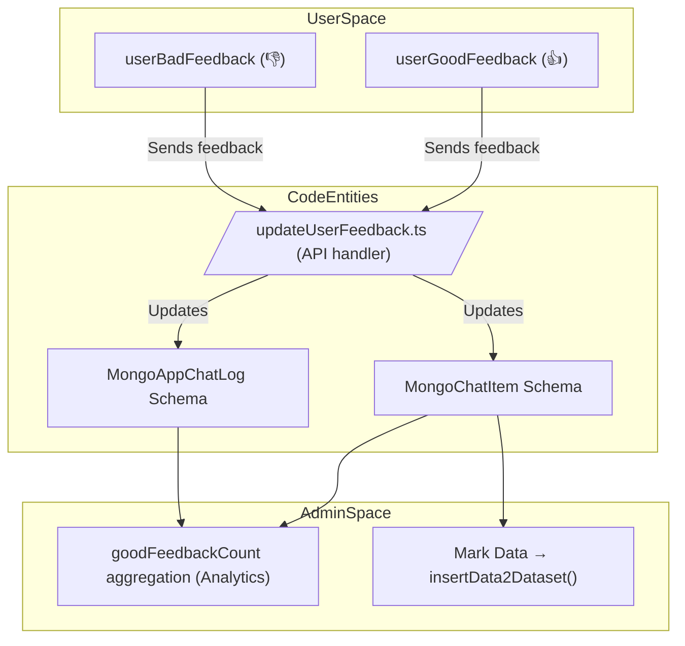
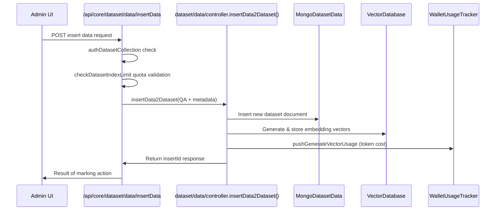
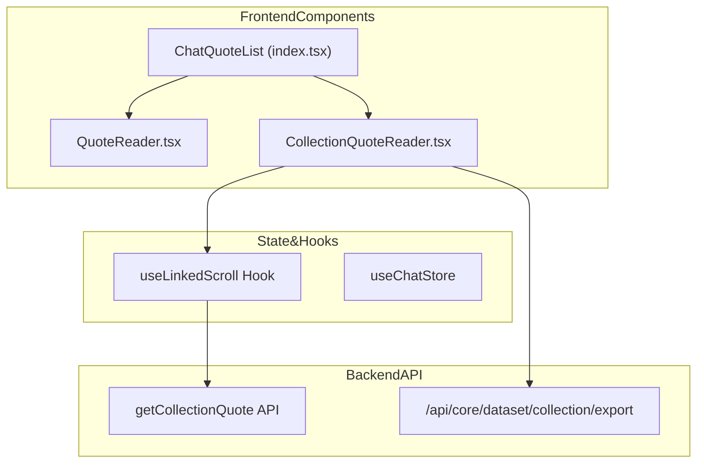
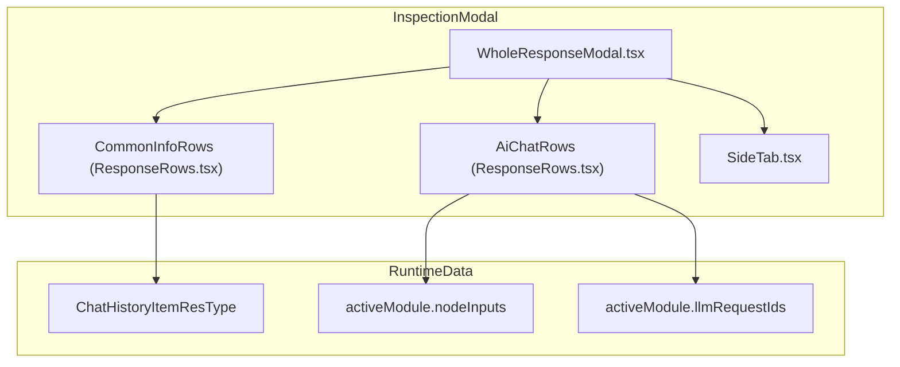
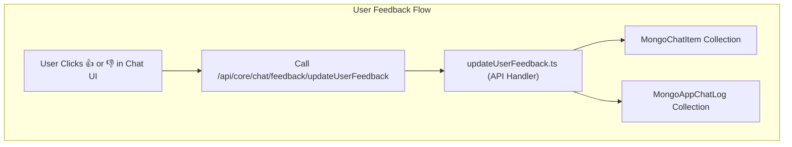
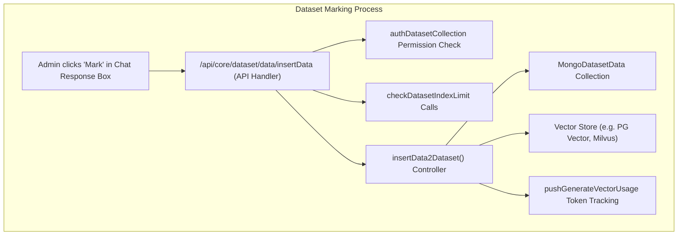

<!-- source: DeepWiki mcp.deepwiki.com · repo labring/FastGPT · page 8.5 Feedback, Citations and Admin Features · fetched 2026-10-29 -->

# Feedback, Citations and Admin Features

Relevant source files

The following files were used as context for generating this wiki page:

- [.agents/skills/system/pr-review/SKILL.md](.agents/skills/system/pr-review/SKILL.md)
- [document/content/self-host/upgrading/4-14/41425.en.mdx](document/content/self-host/upgrading/4-14/41425.en.mdx)
- [document/content/self-host/upgrading/4-14/41425.mdx](document/content/self-host/upgrading/4-14/41425.mdx)
- [packages/global/openapi/core/app/tool/api.ts](packages/global/openapi/core/app/tool/api.ts)
- [packages/global/openapi/core/app/tool/index.ts](packages/global/openapi/core/app/tool/index.ts)
- [packages/global/openapi/core/workflow/node.ts](packages/global/openapi/core/workflow/node.ts)
- [packages/global/test/core/app/tool/openapi.test.ts](packages/global/test/core/app/tool/openapi.test.ts)
- [packages/web/components/common/Icon/icons/common/ellipsis.svg](packages/web/components/common/Icon/icons/common/ellipsis.svg)
- [packages/web/components/common/MyPopover/index.tsx](packages/web/components/common/MyPopover/index.tsx)
- [packages/web/hooks/useLinkedScroll.tsx](packages/web/hooks/useLinkedScroll.tsx)
- [projects/app/src/components/common/folder/Path.tsx](projects/app/src/components/common/folder/Path.tsx)
- [projects/app/src/components/core/chat/ChatContainer/ChatBox/components/SelectMarkCollection.tsx](projects/app/src/components/core/chat/ChatContainer/ChatBox/components/SelectMarkCollection.tsx)
- [projects/app/src/components/core/dataset/SelectModal.tsx](projects/app/src/components/core/dataset/SelectModal.tsx)
- [projects/app/src/components/support/user/team/Info/MemberTag.tsx](projects/app/src/components/support/user/team/Info/MemberTag.tsx)
- [projects/app/src/pageComponents/app/detail/Edit/FormComponent/AppCard.tsx](projects/app/src/pageComponents/app/detail/Edit/FormComponent/AppCard.tsx)
- [projects/app/src/pageComponents/app/detail/ExportConfigPopover.tsx](projects/app/src/pageComponents/app/detail/ExportConfigPopover.tsx)
- [projects/app/src/pageComponents/app/detail/WorkflowComponents/AppCard.tsx](projects/app/src/pageComponents/app/detail/WorkflowComponents/AppCard.tsx)
- [projects/app/src/pageComponents/app/detail/WorkflowComponents/Flow/ImportSettings.tsx](projects/app/src/pageComponents/app/detail/WorkflowComponents/Flow/ImportSettings.tsx)
- [projects/app/src/pageComponents/chat/ChatQuoteList/CollectionQuoteItem.tsx](projects/app/src/pageComponents/chat/ChatQuoteList/CollectionQuoteItem.tsx)
- [projects/app/src/pageComponents/chat/ChatQuoteList/CollectionQuoteReader.tsx](projects/app/src/pageComponents/chat/ChatQuoteList/CollectionQuoteReader.tsx)
- [projects/app/src/pageComponents/chat/ChatQuoteList/QuoteItem.tsx](projects/app/src/pageComponents/chat/ChatQuoteList/QuoteItem.tsx)
- [projects/app/src/pageComponents/chat/ChatQuoteList/QuoteReader.tsx](projects/app/src/pageComponents/chat/ChatQuoteList/QuoteReader.tsx)
- [projects/app/src/pageComponents/chat/ChatQuoteList/index.tsx](projects/app/src/pageComponents/chat/ChatQuoteList/index.tsx)
- [projects/app/src/pageComponents/dashboard/agent/JsonImportModal.tsx](projects/app/src/pageComponents/dashboard/agent/JsonImportModal.tsx)
- [projects/app/src/pageComponents/dashboard/agent/utils/appTemplateParse.ts](projects/app/src/pageComponents/dashboard/agent/utils/appTemplateParse.ts)
- [projects/app/src/pageComponents/dataset/detail/CollectionCard/Header.tsx](projects/app/src/pageComponents/dataset/detail/CollectionCard/Header.tsx)
- [projects/app/src/pageComponents/dataset/detail/NavBar.tsx](projects/app/src/pageComponents/dataset/detail/NavBar.tsx)
- [projects/app/src/web/core/app/api/httpTools.ts](projects/app/src/web/core/app/api/httpTools.ts)
- [projects/app/src/web/core/app/api/mcpTools.ts](projects/app/src/web/core/app/api/mcpTools.ts)
- [projects/app/src/web/core/dataset/components/SelectCollections.tsx](projects/app/src/web/core/dataset/components/SelectCollections.tsx)
- [projects/app/test/pageComponents/dashboard/agent/utils/appTemplateParse.test.ts](projects/app/test/pageComponents/dashboard/agent/utils/appTemplateParse.test.ts)
- [projects/app/test/web/common/api/fetch.test.ts](projects/app/test/web/common/api/fetch.test.ts)

## Purpose and Scope

This document details the implementation and architecture of the feedback mechanisms, citation inspection features, and administrative tooling integrated within FastGPT’s chat system. These components empower users to provide like/dislike feedback on AI responses, browse detailed citation and reference data through quote list viewers and linked scroll readers, conduct deep inspections of complete AI response workflows, and allow administrators to mark valuable responses for dataset inclusion or review feedback analytics.

Related architectural and UI details can be found in the broader Chat Interface and User Interaction sections ([8.1], [8.2]).

---

## Feedback System Architecture

FastGPT’s feedback system distinguishes between end-user sentiment collection (likes/dislikes) and administrative analytics or dataset refinement workflows. Users express feedback directly on chat responses, which the system collects and stores within chat item and chat log documents, enabling downstream analysis or data enrichment.

### Feedback Components and Data Flow

- The user’s thumbs up/down input is sent to the `updateUserFeedback` API route.
- This API updates the `userGoodFeedback` (boolean) and `userBadFeedback` fields in the `MongoChatItem` document.
- The `MongoAppChatLog` schema maintains a redundant `goodFeedbackCount` for aggregate reporting.
- Admins leverage logs and aggregated feedback counts to analyze AI response quality and decide on dataset marking.

### Feedback Mode Details and Source Fields

| Field               | Description                                   | Source Code Location                                         |
|---------------------|-----------------------------------------------|-------------------------------------------------------------|
| `userGoodFeedback`   | Boolean flag indicating positive user feedback (👍) | `projects/app/src/pages/api/core/chat/feedback/updateUserFeedback.ts:20-21` |
| `userBadFeedback`    | Boolean or comment for negative feedback (👎)           | `projects/app/src/pages/api/core/chat/feedback/updateUserFeedback.ts:20-21` |
| `goodFeedbackCount`  | Aggregate positive feedback count (admin logs)         | `projects/app/src/pages/api/core/chat/feedback/updateUserFeedback.ts:87`   |

Sources: `projects/app/src/pages/api/core/chat/feedback/updateUserFeedback.ts:20-90` (), `packages/global/core/chat/constants.ts:3-18` ()

---

## Dataset Marking System

The marking feature allows administrators to elevate high-quality AI-generated responses by inserting them directly into a knowledge base dataset for future retrieval and training.

### Marking Interaction and Data Flow

### Key Implementation Details

- **Quota Check:** Before data insertion, the system validates team quota usage with `checkDatasetIndexLimit` to prevent overuse.  
- **Data Insert:** The `insertData2Dataset` function handles inserting new Question-Answer pairs, generating embeddings, and saving documents [insertData.ts:25-101]().  
- **Audit Log:** Each insert operation logs an audit event, `AuditEventEnum.CREATE_DATA`, for traceability [insertData.ts:88-98]().  
- **Usage Tracking:** Token usage for vector generation is pushed to team wallets via `pushGenerateVectorUsage` [insertData.ts:80-85]().  

Sources: `projects/app/src/pages/api/core/dataset/data/insertData.ts:25-101` (), `projects/app/src/pages/api/core/dataset/data/update.ts:12-63` ()

---

## Quote Lists and Citation Readers

Users can inspect the citations and source chunks linked to AI responses through an integrated quote viewer system. This is critical for transparency of retrieval-augmented generation (RAG) workflows.

### Citation Reader Component Structure

### Component Roles

- **ChatQuoteList:** Manages toggling between collection quote lists and individual chunk readers depending on metadata shape (`GetQuoteProps` vs `GetCollectionQuoteDataProps`) [ChatQuoteList/index.tsx:17-62]().
- **QuoteReader / CollectionQuoteReader:** Renders lists of references, supporting navigation, selection, and single-quote focus modes.
- **useLinkedScroll:** Loads an anchor-centered paginated list of citation chunks, dynamically fetching more as users scroll up/down [useLinkedScroll.tsx:15-116]().
- **Source Exports:** The citation reader enables users with download permission to export source collections as CSV files using `/api/core/dataset/collection/export` [CollectionQuoteReader.tsx:40-167]().

Sources: `projects/app/src/pageComponents/chat/ChatQuoteList/index.tsx:17-72` (), `projects/app/src/pageComponents/chat/ChatQuoteList/CollectionQuoteReader.tsx:23-175` (), `packages/web/hooks/useLinkedScroll.tsx:15-116` ()

---

## Whole-Response Inspection Modal

FastGPT provides a `WholeResponseModal` for detailed internal inspection of AI workflow executions, including intermediate node results, LLM request telemetry, and error tracking.

### Inspection Modal Data Flow

### Features

- **CommonInfoRows:** Displays executed module names, execution status, number of child nodes, errors aggregated per module [ResponseRows.tsx:21-53]().
- **AiChatRows:** Shows granular LLM telemetry, including input tokens, output tokens, tool call tokens, completion reasons, and temperature settings. Also surfaces lists of LLM request IDs for log correlation [ResponseRows.tsx:114-175]().

Sources: `projects/app/src/components/core/chat/components/WholeResponseModal/ResponseRows.tsx:21-182` ()

---

## Permission Control Model

Access to feedback and administrative features (e.g., dataset marking) is governed by a fine-grained permission system. Permissions are typically scoped by resource type (App, Dataset, DatasetData chunk).

### Authentication Functions and Resource Types

| Function          | Purpose                                              | Resource Type                   |
|-------------------|------------------------------------------------------|--------------------------------|
| `authApp`          | Validates user access to app resources and logs      | `PerResourceTypeEnum.app`      |
| `authDataset`      | Validates access to datasets (Knowledge Bases)       | `PerResourceTypeEnum.dataset`  |
| `authDatasetData`  | Validates permissions on specific dataset data chunks| `PerResourceTypeEnum.dataset`  |

### Permission Calculation

Permissions for a given resource are computed by combining the user’s direct role, group role, and organization role using the `sumPer` function. If the resource has permission inheritance enabled (`inheritPermission`), permissions are also inherited from its folder hierarchy [app/auth.ts:89-109](), [dataset/auth.ts:67-87]().

Sources:  
`packages/service/support/permission/app/auth.ts:89-109,128-159` (),  
`packages/service/support/permission/dataset/auth.ts:67-87,102-135` (),  
`projects/app/src/pages/api/core/app/list.ts:166-183` (),  
`projects/app/src/pages/api/core/dataset/list.ts:127-181` ()

---

## UI Customization and Visibility Controls

FastGPT provides administrators fine control over which features and metadata display in the chat playground and interface.

- Admins can toggle visibility of citation cards (`showCite`), the whole-response inspection modal (`showWholeResponse`), and running workflow node status (`showRunningStatus`).
- File upload permissions and allowed extensions during chat sessions are configurable via the app settings [Publish/Playground/index.tsx:18-25](), [core/app/FileSelect.tsx:101-173]().

Sources: `projects/app/src/pageComponents/app/detail/Publish/Playground/index.tsx:18-59` (), `projects/app/src/components/core/app/FileSelect.tsx:101-173` ()

---

# Summary Diagrams Bridging Natural Language to Code Entities

---

# Table: Key Code Entities and Features

| Feature / UI Component               | Code Entity / Files                                   | Responsibilities / Description                                  |
|------------------------------------|------------------------------------------------------|----------------------------------------------------------------|
| User Feedback API                  | `updateUserFeedback.ts`                              | Handles user like/dislike on chat responses                    |
| Chat Item & Chat Log Schema        | `MongoChatItem`, `MongoAppChatLog` schemas          | Stores feedback metrics for analytics and UI display           |
| Dataset Marking API & Controller   | `/api/core/dataset/data/insertData.ts`               | Inserts high-quality QA pairs into Knowledge Base datasets      |
| Citation Reader Components         | `ChatQuoteList.tsx`, `QuoteReader.tsx`, `CollectionQuoteReader.tsx` | UI for browsing citation lists and chunk details             |
| Linked Scroll Hook                 | `useLinkedScroll.tsx`                                | Fetches paginated citation chunks around an anchor item       |
| Whole Response Inspection Modal    | `WholeResponseModal.tsx`, `ResponseRows.tsx`          | UI modal showing detailed workflow execution & token metrics   |
| Permission Checks                  | `authApp`, `authDataset`, `authDatasetData`          | Validates access control for feedback and marking              |
| UI Visibility Controls             | Playground settings (e.g. `showCite`, `showWholeResponse`) | Admin customization of feature visibility                      |

---

# References and Sources

- Feedback API and data models: `projects/app/src/pages/api/core/chat/feedback/updateUserFeedback.ts:20-90`  
- Dataset marking API and controller: `projects/app/src/pages/api/core/dataset/data/insertData.ts:25-101`  
- Citation readers and linked scrolling:  
  - `projects/app/src/pageComponents/chat/ChatQuoteList/index.tsx:17-72`  
  - `projects/app/src/pageComponents/chat/ChatQuoteList/CollectionQuoteReader.tsx:23-175`  
  - `packages/web/hooks/useLinkedScroll.tsx:15-116`  
- Whole-response inspection modal components:  
  - `projects/app/src/components/core/chat/components/WholeResponseModal/ResponseRows.tsx:21-182`  
- Permissions and authentication logic:  
  - `packages/service/support/permission/app/auth.ts:89-109,128-159`  
  - `packages/service/support/permission/dataset/auth.ts:67-87,102-135`  
- Playground UI visibility toggles and file uploads:  
  - `projects/app/src/pageComponents/app/detail/Publish/Playground/index.tsx:18-59`  
  - `projects/app/src/components/core/app/FileSelect.tsx:101-173`  

This concludes section 8.5 covering Feedback, Citations, and Admin Features in the FastGPT codebase.

---

