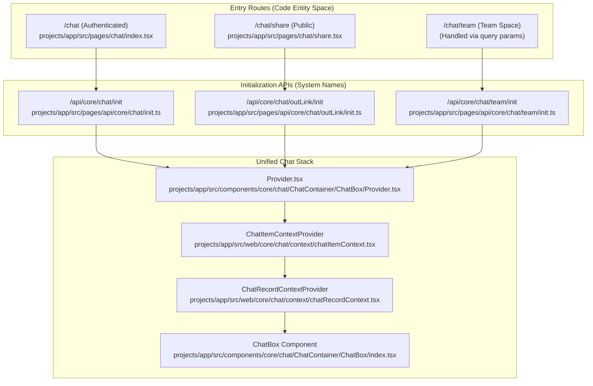
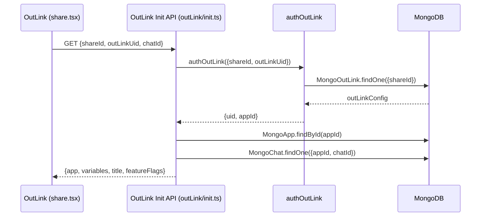
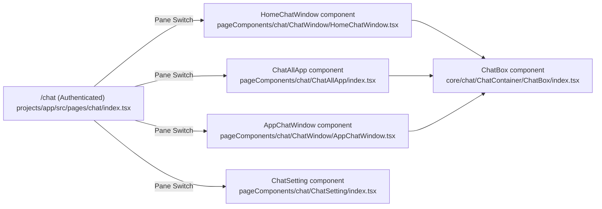
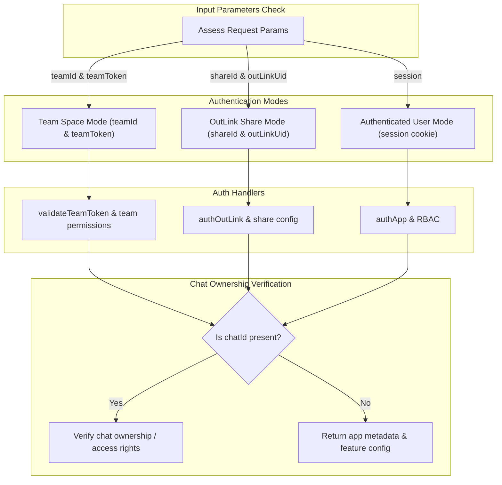

<!-- source: DeepWiki mcp.deepwiki.com · repo labring/FastGPT · page 8.6 Shared vs Authenticated Chat Architecture · fetched 2026-10-29 -->

# Shared vs Authenticated Chat Architecture

Relevant source files

The following files were used as context for generating this wiki page:

- [.agents/design/core/chat/input-draft-cache.md](.agents/design/core/chat/input-draft-cache.md)
- [packages/web/hooks/useScrollPagination.tsx](packages/web/hooks/useScrollPagination.tsx)
- [packages/web/i18n/en/chat.json](packages/web/i18n/en/chat.json)
- [packages/web/i18n/ko-KR/chat.json](packages/web/i18n/ko-KR/chat.json)
- [packages/web/i18n/zh-CN/chat.json](packages/web/i18n/zh-CN/chat.json)
- [packages/web/i18n/zh-Hant/chat.json](packages/web/i18n/zh-Hant/chat.json)
- [projects/app/src/components/core/chat/ChatContainer/ChatBox/Input/ChatInput.tsx](projects/app/src/components/core/chat/ChatContainer/ChatBox/Input/ChatInput.tsx)
- [projects/app/src/components/core/chat/ChatContainer/ChatBox/components/HumanChatBubble/EditForm.tsx](projects/app/src/components/core/chat/ChatContainer/ChatBox/components/HumanChatBubble/EditForm.tsx)
- [projects/app/src/components/core/chat/ChatContainer/ChatBox/hooks/useChatGenerate.ts](projects/app/src/components/core/chat/ChatContainer/ChatBox/hooks/useChatGenerate.ts)
- [projects/app/src/components/core/chat/ChatContainer/ChatBox/hooks/useChatInputForm.ts](projects/app/src/components/core/chat/ChatContainer/ChatBox/hooks/useChatInputForm.ts)
- [projects/app/src/components/core/chat/ChatContainer/ChatBox/index.tsx](projects/app/src/components/core/chat/ChatContainer/ChatBox/index.tsx)
- [projects/app/src/pageComponents/chat/ChatFavouriteApp/index.tsx](projects/app/src/pageComponents/chat/ChatFavouriteApp/index.tsx)
- [projects/app/src/pageComponents/chat/ChatHeader.tsx](projects/app/src/pageComponents/chat/ChatHeader.tsx)
- [projects/app/src/pageComponents/chat/ChatSetting/index.tsx](projects/app/src/pageComponents/chat/ChatSetting/index.tsx)
- [projects/app/src/pageComponents/chat/ChatTeamApp/List.tsx](projects/app/src/pageComponents/chat/ChatTeamApp/List.tsx)
- [projects/app/src/pageComponents/chat/ChatTeamApp/TypeTag.tsx](projects/app/src/pageComponents/chat/ChatTeamApp/TypeTag.tsx)
- [projects/app/src/pageComponents/chat/ChatTeamApp/index.tsx](projects/app/src/pageComponents/chat/ChatTeamApp/index.tsx)
- [projects/app/src/pageComponents/chat/ChatWindow/AppChatWindow.tsx](projects/app/src/pageComponents/chat/ChatWindow/AppChatWindow.tsx)
- [projects/app/src/pageComponents/chat/ChatWindow/HomeChatWindow.tsx](projects/app/src/pageComponents/chat/ChatWindow/HomeChatWindow.tsx)
- [projects/app/src/pageComponents/chat/UserAvatarPopover.tsx](projects/app/src/pageComponents/chat/UserAvatarPopover.tsx)
- [projects/app/src/pageComponents/chat/slider/ChatSliderFooter.tsx](projects/app/src/pageComponents/chat/slider/ChatSliderFooter.tsx)
- [projects/app/src/pageComponents/chat/slider/ChatSliderHeader.tsx](projects/app/src/pageComponents/chat/slider/ChatSliderHeader.tsx)
- [projects/app/src/pageComponents/chat/slider/ChatSliderList.tsx](projects/app/src/pageComponents/chat/slider/ChatSliderList.tsx)
- [projects/app/src/pageComponents/chat/slider/ChatSliderMobileDrawer.tsx](projects/app/src/pageComponents/chat/slider/ChatSliderMobileDrawer.tsx)
- [projects/app/src/pageComponents/chat/slider/ChatSliderSidebar.tsx](projects/app/src/pageComponents/chat/slider/ChatSliderSidebar.tsx)
- [projects/app/src/pageComponents/chat/slider/index.tsx](projects/app/src/pageComponents/chat/slider/index.tsx)
- [projects/app/src/pageComponents/dashboard/agent/utils/appListTypes.ts](projects/app/src/pageComponents/dashboard/agent/utils/appListTypes.ts)
- [projects/app/src/pages/chat/index.tsx](projects/app/src/pages/chat/index.tsx)
- [projects/app/src/pages/chat/share.tsx](projects/app/src/pages/chat/share.tsx)
- [projects/app/src/web/core/chat/context/chatContext.tsx](projects/app/src/web/core/chat/context/chatContext.tsx)
- [projects/app/src/web/core/chat/context/chatPageContext.tsx](projects/app/src/web/core/chat/context/chatPageContext.tsx)
- [projects/app/test/pageComponents/chat/appNameOverflowHover.test.ts](projects/app/test/pageComponents/chat/appNameOverflowHover.test.ts)
- [projects/app/test/pageComponents/dashboard/agent/utils/appListTypes.test.ts](projects/app/test/pageComponents/dashboard/agent/utils/appListTypes.test.ts)

## Purpose and Scope

This document explains the architectural differences among FastGPT's three primary chat entry points:

- **Authenticated Chat** at `/chat` — for logged-in users with full permissions and complex UI.
- **Shared Chat** at `/chat/share` — public shared chat with anonymous or token-based minimal identity.
- **Team Space Chat** at `/chat/team` — scoped team access using team tokens.

All use a largely unified chat UI stack centered on the `ChatBox` React component, but differ in authentication, initialization flows, state management, and feature toggling.

This page covers detailed design, key implementation classes and functions, and data flow, highlighting distinctions relevant for developers maintaining or extending chat.

Sources: [projects/app/src/pages/chat/index.tsx:1-30](), [projects/app/src/pages/chat/share.tsx:1-63]()

---

## High-Level Architecture Comparison

FastGPT shares a core chat UI architecture initialized with route-specific logic according to authentication and access context. The entry routes trigger different initialization APIs, influencing the chat state and features.

### Entry Routes and Initialization

- `/chat` loads via `getInitChatInfo` API routed to `init.ts` for authenticated users.
- `/chat/share` loads via `getInitOutLinkChatInfo` API routed to `outLink/init.ts` for public share links.
- `/chat/team` uses team-specific init API `team/init.ts` integrating team token validation.

The core chat UI uses:

- `ChatBox` React component [projects/app/src/components/core/chat/ChatContainer/ChatBox/index.tsx:1-171]()
- `ChatProvider` context provider [projects/app/src/components/core/chat/ChatContainer/ChatBox/Provider.tsx:1-130]()
- `ChatItemContextProvider` and `ChatRecordContextProvider` for chat message and record state [projects/app/src/web/core/chat/context/chatItemContext.tsx:1-288](), [projects/app/src/web/core/chat/context/chatRecordContext.tsx:1-155]()

Sources: [projects/app/src/pages/chat/index.tsx:1-30](), [projects/app/src/pages/chat/share.tsx:1-63]()

---

## Shared Chat Architecture (`/chat/share`)

Shared chat enables public access via a share link with limited authentication scoped by a unique share ID and anonymous user UID.

### Identity and Authentication

Shared chat emphasizes minimal identity:

- `outLinkUid`: identified by (in priority):
  1. `authToken` URL query param
  2. `customUid` URL query param
  3. Fallback: generated stable random UID from localStorage using `useShareChatStore()` hook.

This allows sessions without standard FastGPT user login.

Sources: [projects/app/src/pages/chat/share.tsx:68-88]()

### Initialization Flow

At page load, the `OutLink` component calls:

- `getInitOutLinkChatInfo()` [projects/app/src/web/core/chat/api.ts:52]() — performs API call to `/api/core/chat/outLink/init`

Backend resolves share info via `MongoOutLink` document, verifies identity and share ID:

- `authOutLink` authenticates the outLink user UID and share config.
- Fetches associated app and chat data.

The client receives:

- App metadata
- Initial variables
- Chat title and records (if any)
- Visibility flags controlling UI features like citations, source text, skill references

Sources: [projects/app/src/pages/chat/share.tsx:131-150](), [projects/app/src/components/core/chat/ChatContainer/ChatBox/index.tsx:1-35]()

### Iframe Communication APIs

Shared chat supports iframe interactions via `window.postMessage` events, enabling integration in embedded environments.

- **Outgoing messages to parent** (from `OutLink` page):
  - `shareChatReady` — when chat data and records loaded
  - `shareChatStart` — when message sending initiates
  - `shareChatFinish` — when AI response generation ends

- **Incoming messages from parent**:
  - `sendPrompt` — triggers sending messages in `ChatBox` event handler subscribed via event bus (`eventBus`) for decoupled command handling.

This message event system is implemented in `projects/app/src/pages/chat/share.tsx` and `ChatBox/index.tsx` [projects/app/src/pages/chat/share.tsx:1-50](), [projects/app/src/components/core/chat/ChatContainer/ChatBox/index.tsx:10-25]().

Sources: [projects/app/src/pages/chat/share.tsx:1-50](), [projects/app/src/components/core/chat/ChatContainer/ChatBox/index.tsx:10-25]()

---

## Authenticated Chat Architecture (`/chat`)

Authenticated chat is designed for signed-in users, featuring robust permission controls and a multi-pane user interface.

### Multi-Pane Layout and Components

The `/chat` page renders a pane-based layout controlled by `ChatPageContext`, supporting:

- Home Chat Pane: `HomeChatWindow` [projects/app/src/pageComponents/chat/ChatWindow/HomeChatWindow.tsx:1-90]()
- All Apps Pane: `ChatAllApp` component
- Recently Used Apps Pane: `AppChatWindow` for chats tied to specific apps [projects/app/src/pageComponents/chat/ChatWindow/AppChatWindow.tsx:1-90]()
- Chat Settings Pane: `ChatSetting` page for user preferences [projects/app/src/pageComponents/chat/ChatSetting/index.tsx]

This model allows managing multiple app chats and settings in a unified user interface.

Sources: [projects/app/src/pages/chat/index.tsx:61-100]()

### Backend Permission Verification

On authenticated chat initialization:

- Authenticated user is verified with `authApp`, ensuring user has read or write permission on the target app.
- If `chatId` provided, verifies chat log access:
  - User must be owner or have read rights.
  - Team member IDs (`tmbId`) and ownership relationships are checked.
- Permission failure leads to restricting access or refreshing UI pane to app list.

Sources: [projects/app/src/pages/chat/index.tsx:1-40](), [projects/app/src/pages/chat/index.tsx:150-182]()

---

## Team Space Chat Architecture (`/chat/team`)

Team space chat provides cross-user chat access within team scopes using team tokens.

### Team Token Authentication

Team chat validates requests by:

- Verifying `teamId` and `teamToken` passed as query parameters.
- Fetching team metadata and checking token validity and expiration.
- Validating team-based permissions for shared app access.
- Mapping team UID to outLink UID if applicable for chat history scoping.

This flow enables team-specific feature toggles and history access without individual user sessions.

Sources: [projects/app/src/pageComponents/chat/ChatTeamApp/index.tsx:1-30]()

---

## Comparative Feature Table

| Feature                     | Authenticated Chat (`/chat`)           | Shared Chat (`/chat/share`)           | Team Space Chat (`/chat/team`)            |
|-----------------------------|---------------------------------------|-------------------------------------|-------------------------------------------|
| **Authentication Method**   | Session cookie, OAuth tokens          | `shareId` + `outLinkUid`            | `teamId` + `teamToken`                     |
| **User Identity Entity**    | `tmbId` (team member / user ID)       | Anonymous or `outLinkUid`           | Derived from `teamToken`                    |
| **Chat Source Type**        | `ChatSourceEnum.online`                | `ChatSourceEnum.share`              | `ChatSourceEnum.team`                       |
| **Permissions Model**       | RBAC with roles (owner, read, write)  | Configured in MongoOutLink          | Team-token scoped with team permissions    |
| **UI Context Provider**     | `ChatPageContextProvider` + multi-pane | `useShareChatStore` hook + shareCtx| Team context with restricted UI             |
| **Chat History Scope**      | Full user-owned history                | Scoped to anonymous UID + shareId  | Scoped to team token and team permissions  |
| **Feature Sliders**         | Full feature set (voice, TTS, sandbox)| Limited toggles per share config   | Configured per team for feature limiting   |
| **Iframe Support**          | None required                         | Supports `postMessage` integration | Rarely used                               |

Sources: [projects/app/src/pages/chat/index.tsx:110-121](), [projects/app/src/pages/chat/share.tsx:87-100]()

---

## Backend Authorization Logic Flow

FastGPT backend distinguishes authorization modes by request parameters to enable the appropriate chat mode.

- Team mode verifies token and sets per-team chat feature sliders.
- Share mode authenticates anonymous user by `outLinkUid` and configures UI feature visibility.
- Cookie mode strictly checks user session, app roles, and permissions for chat history read/write.

Sources: [projects/app/src/pages/chat/share.tsx:60-95](), [projects/app/src/pages/chat/index.tsx:120-182]()

---

## Chat Setting and Slider Features

Feature toggles and user-configurable options in chat are exposed as sliders or settings in various chat contexts:

- **Authenticated chat** provides full chat setting options managed via the `ChatPageContext` and settings pane [projects/app/src/pageComponents/chat/ChatSetting/index.tsx]().
- **Shared chat** feature toggles (like citation display, source text visibility) are controlled by the `MongoOutLink` config and propagated to the frontend on initialization [projects/app/src/pages/chat/share.tsx:131-155]().
- **Team chat** settings can restrict features such as message history visibility or app usage according to the team's policies [projects/app/src/pageComponents/chat/ChatTeamApp/index.tsx]().
- Common UI feature flags include:
  - Voice input enabled
  - Text-to-Speech (TTS)
  - Input guide suggestions
  - Sandbox access
  - Workorder entry
  - Quick replies
  - Feedback controls

These flags originate from backend configurations and feed into the `ChatBoxFeatures` typed props to adjust interactive UI elements dynamically.

Sources: [projects/app/src/components/core/chat/ChatContainer/ChatBox/index.tsx:100-150](), [projects/app/src/pages/chat/share.tsx:115-155]()

---

## Summary

FastGPT uses a robust yet flexible chat UI stack, parameterized by the authentication mode and entry route. Although the `ChatBox` React component is central to all chat experiences, the underlying identity, permissions model, and feature availability drastically differ between:

- Fully authenticated users at `/chat` with comprehensive chat history and RBAC.
- Public anonymous or token-authenticated shared chats at `/chat/share`.
- Scoped team access via tokens at `/chat/team`.

Understanding these distinctions is crucial for implementing enhancements, debugging issues, and integrating external embedding or iframe-based chat use cases.

---

# Appendix: Key Code Entities

| System Name / Concept             | Code Entity / Location                                      | Description                                             |
|---------------------------------|------------------------------------------------------------|---------------------------------------------------------|
| Authenticated Chat Page         | `projects/app/src/pages/chat/index.tsx`                     | Entry point and main UI for logged-in chat              |
| Shared Chat Page                | `projects/app/src/pages/chat/share.tsx`                     | Entry point for share link chat                          |
| ChatBox Component              | `projects/app/src/components/core/chat/ChatContainer/ChatBox/index.tsx` | Core chat UI component, handling input, messages, and streaming |
| ChatProvider                   | `projects/app/src/components/core/chat/ChatContainer/ChatBox/Provider.tsx` | React Context provider for chat state                    |
| ChatItemContext               | `projects/app/src/web/core/chat/context/chatItemContext.tsx` | Manages chat message item state                          |
| ChatRecordContext             | `projects/app/src/web/core/chat/context/chatRecordContext.tsx` | Provides persistent chat record state                    |
| OutLink Initialization API      | `projects/app/src/pages/api/core/chat/outLink/init.ts`       | Backend endpoint for share chat initialization           |
| AuthOutLink Function           | Part of outLink init implementation                         | Verifies share link and user identifiers                 |
| Team Chat Authentication       | `projects/app/src/pageComponents/chat/ChatTeamApp/index.tsx` | Validates team tokens and associated metadata            |
| Chat Page Context Provider     | `projects/app/src/web/core/chat/context/chatPageContext.tsx` | Provides chat page level state and pane switching         |

Sources: As referenced above.

---

# End of document

---

