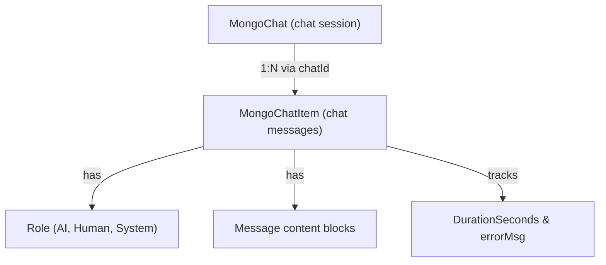
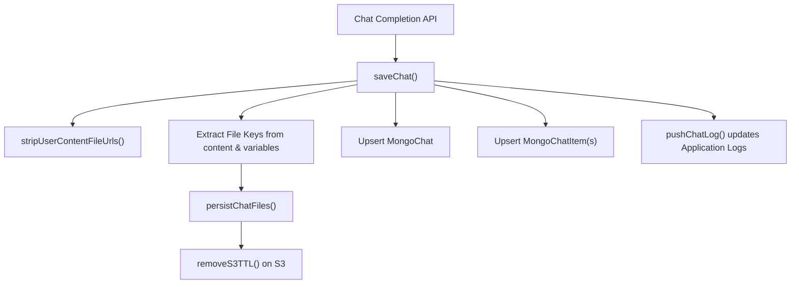
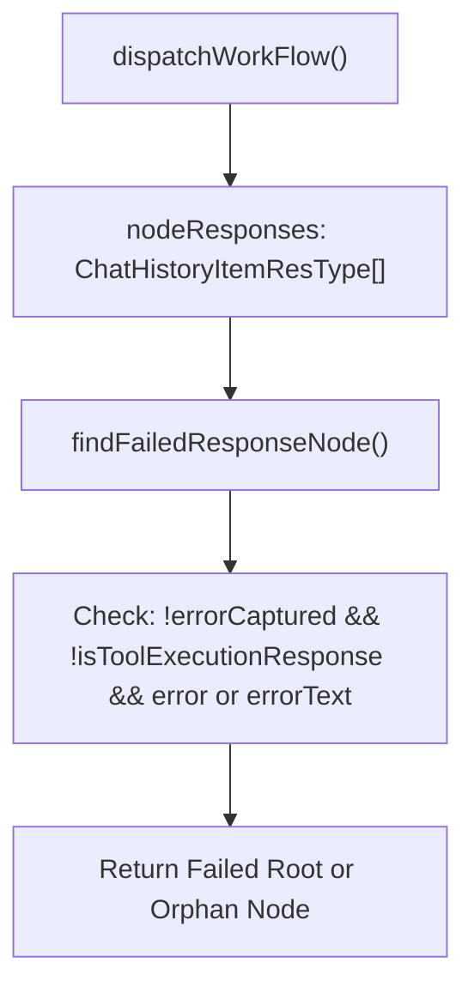
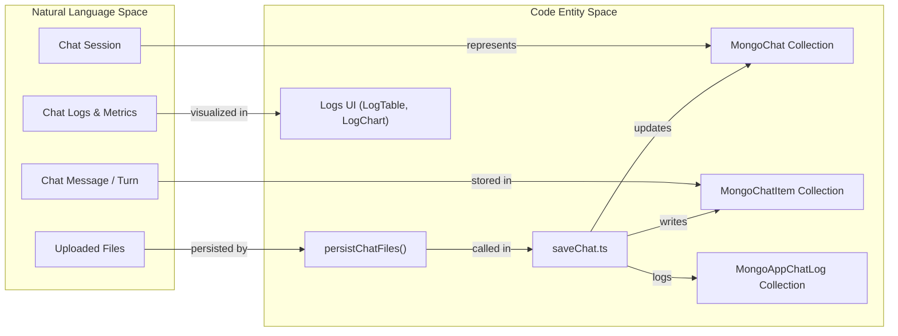

<!-- source: DeepWiki mcp.deepwiki.com · repo labring/FastGPT · page 8.7 Chat Persistence and Logs · fetched 2026-10-29 -->

# Chat Persistence and Logs

<details>
<summary>Relevant source files</summary>

The following files were used as context for generating this wiki page:

- [packages/global/support/outLink/type.ts](packages/global/support/outLink/type.ts)
- [packages/service/core/chat/chatItemSchema.ts](packages/service/core/chat/chatItemSchema.ts)
- [packages/service/core/chat/chatSchema.ts](packages/service/core/chat/chatSchema.ts)
- [packages/service/core/chat/saveChat.ts](packages/service/core/chat/saveChat.ts)
- [packages/service/support/outLink/compatibility.ts](packages/service/support/outLink/compatibility.ts)
- [packages/service/support/outLink/schema.ts](packages/service/support/outLink/schema.ts)
- [packages/service/support/user/schema.ts](packages/service/support/user/schema.ts)
- [packages/service/support/wallet/usage/schema.ts](packages/service/support/wallet/usage/schema.ts)
- [packages/service/test/support/permission/publish/authLink.test.ts](packages/service/test/support/permission/publish/authLink.test.ts)
- [packages/web/components/common/Icon/icons/common/first_page.svg](packages/web/components/common/Icon/icons/common/first_page.svg)
- [packages/web/components/common/Icon/icons/common/latest_page.svg](packages/web/components/common/Icon/icons/common/latest_page.svg)
- [packages/web/components/common/Icon/icons/common/leftArrowLight.svg](packages/web/components/common/Icon/icons/common/leftArrowLight.svg)
- [packages/web/components/common/Icon/icons/common/rightArrow.svg](packages/web/components/common/Icon/icons/common/rightArrow.svg)
- [packages/web/components/common/Icon/icons/common/rightArrowLight.svg](packages/web/components/common/Icon/icons/common/rightArrowLight.svg)
- [packages/web/hooks/usePagination.tsx](packages/web/hooks/usePagination.tsx)
- [projects/app/src/pageComponents/app/detail/Logs/LogTable.tsx](projects/app/src/pageComponents/app/detail/Logs/LogTable.tsx)
- [projects/app/src/pageComponents/app/detail/Logs/index.tsx](projects/app/src/pageComponents/app/detail/Logs/index.tsx)
- [projects/app/src/pages/api/core/ai/agent/createQuestionGuide.ts](projects/app/src/pages/api/core/ai/agent/createQuestionGuide.ts)
- [projects/app/src/pages/api/core/app/logs/list.ts](projects/app/src/pages/api/core/app/logs/list.ts)
- [projects/app/src/pages/app/detail/index.tsx](projects/app/src/pages/app/detail/index.tsx)
- [projects/app/src/service/support/permission/auth/outLink.ts](projects/app/src/service/support/permission/auth/outLink.ts)
- [projects/app/src/web/common/api/request.ts](projects/app/src/web/common/api/request.ts)
- [projects/app/src/web/core/app/api.ts](projects/app/src/web/core/app/api.ts)
- [projects/app/src/web/support/outLink/api.ts](projects/app/src/web/support/outLink/api.ts)
- [projects/app/test/service/support/permission/auth/outLink.test.ts](projects/app/test/service/support/permission/auth/outLink.test.ts)
- [projects/app/test/web/common/api/request.test.ts](projects/app/test/web/common/api/request.test.ts)

</details>


## Purpose and Scope

This page details the architecture and implementation of FastGPT's chat persistence layer, conversation data models (chat and chat items), workflow node response storage, and application log tables. It explains how chat messages and metadata are persisted via the `saveChat` function, how MongoDB schemas structure chat and chat item documents, how node responses (intermediate execution outputs) are stored and accessed, and how application logs support audit and analytics features. The data flow diagrams map natural language concepts like "chat sessions" and "messages" to code symbols like `MongoChat`, `MongoChatItem`, and `saveChat`.

---

## 1. Chat and Chat Item Data Models

FastGPT separates chat persistence into two main MongoDB collections:

- **MongoChat**: Stores conversation-level data including metadata, variables, token summaries, feedback indicators, and status.
- **MongoChatItem**: Stores individual chat turns/messages categorized by roles (Human, AI, System), their content, error information, and runtime metrics per message.

---

### 1.1. `MongoChat` Schema

Defined in `packages/service/core/chat/chatSchema.ts` (lines 16-148), `MongoChat` documents represent an entire conversation thread identified by a unique `chatId`.

Key fields:

| Field             | Type                                      | Description                                      |
|-------------------|-------------------------------------------|------------------------------------------------|
| `chatId`          | `String` (required)                      | Unique ID of the chat session                    |
| `teamId`          | `ObjectId` referencing team collection    | Owner team ID                                    |
| `tmbId`           | `ObjectId` referencing team member         | Team member ID who owns this chat                |
| `sourceType`      | `String` enum `ChatSourceTypeEnum`         | Source type of this chat (e.g., app, share)     |
| `appId`           | `ObjectId` (required)                      | Application ID associated with this chat session|
| `appVersionId`    | `ObjectId` referencing app version         | Optional specific app version ID                  |
| `title`           | `String`                                    | Chat session title                                |
| `variables`       | `Object` (default `{}`)                     | Variable key-value store relevant to this chat  |
| `pluginInputs`    | `Array`                                     | Inputs for plugin/skill interactions             |
| `metadata`        | `Object` (default `{}`)                     | Arbitrary metadata attached to chat session      |
| `chatGenerateStatus` | `Number` enum: generating/done/error       | Status of generation process                       |
| `errorCount`      | `Number` (default 0)                         | Count of errors occurred in this chat             |
| `hasGoodFeedback` | `Boolean`                                   | Whether any positive feedback exists               |
| `hasBadFeedback`  | `Boolean`                                   | Whether any negative feedback exists               |
| `hasUnreadGoodFeedback` | `Boolean`                              | Whether unread positive feedback exists            |
| `hasUnreadBadFeedback`  | `Boolean`                              | Whether unread negative feedback exists            |

Several compound indexes enhance query performance on these fields, including efficient retrieval by `(sourceType, appId, chatId)`, filtering by feedback and error counts, and ordering by update time.


---

### 1.2. `MongoChatItem` Schema

Defined in `packages/service/core/chat/chatItemSchema.ts` (lines 14-98), `MongoChatItem` stores each individual message or turn inside a chat session.

Key fields:

| Field              | Type                                              | Description                                   |
|--------------------|--------------------------------------------------|-----------------------------------------------|
| `teamId`           | `ObjectId` referencing team collection           | Owner team ID                                 |
| `tmbId`            | `ObjectId` referencing team member collection    | Team member ID of author                       |
| `userId`            | `ObjectId` referencing user collection           | Optional user ID of author                      |
| `chatId`            | `String` (required)                              | Parent chat session ID                         |
| `dataId`           | `String` (default: nanoid 24)                     | Unique ID for this chat item                   |
| `sourceType`       | `String` enum `ChatSourceTypeEnum`                | Source type (app, share, etc.)                 |
| `appId`             | `ObjectId` (required)                            | Application ID                                |
| `time`              | `Date` (default: now)                            | Timestamp of message                           |
| `hideInUI`          | `Boolean` (default false)                         | Flag to hide in UI (system or control messages) |
| `obj`               | `String` enum of chat roles (AI, Human, System) | Role of the message sender                      |
| `value`             | `Array` (default [])                              | Content blocks (text, file references, etc.)  |
| `memories`          | `Object`                                          | Memory/context for this message                 |
| `errorMsg`          | `String`                                          | Error message from node execution if any       |
| `durationSeconds`   | `Number`                                          | Response duration in seconds                    |
| `citeCollectionIds`| `Array<String>`                                   | Collection IDs cited in this chat item         |
| `userGoodFeedback` | `String`                                          | User good feedback text                          |
| `userBadFeedback`  | `String`                                          | User bad feedback text                           |
| `customFeedbacks`  | `Array<String>`                                   | Custom feedback notes                            |
| `adminFeedback`    | `Object` with dataset/collection/data/q/a fields| Admin feedback annotation                        |
| `isFeedbackRead`   | `Boolean`                                         | Whether feedback read or not                     |

Indexes enable efficient querying by `(appId, chatId)`, source type filtering, retrieval by role (`obj`), and sorting by creation time.

---

### 1.3. Chat-ChatItem Relation Overview



The system treats `MongoChat` as the main conversation entity that organizes metadata and session variables, while `MongoChatItem` holds granular conversational records, message contents, execution results, and user feedback.

*Sources: `packages/service/core/chat/chatSchema.ts:16-148`, `packages/service/core/chat/chatItemSchema.ts:14-98`*

---

## 2. Chat Persistence Pipeline (`saveChat`)

The `saveChat` function (`packages/service/core/chat/saveChat.ts`) is the core logic invoked when a chat round (user turn + AI completion) finishes and needs durable storage. It manages sanitizing content, storing metadata, persisting files, and updating chat session state atomically.

### 2.1. Key Responsibilities of `saveChat`

- **Prepare content for saving**: For example, it strips temporary file upload URLs from user messages (`stripUserContentFileUrls`) to avoid storing ephemeral references.
- **Persist file references**: Extract file keys embedded in message content and workflow variables, then call `removeS3TTL` to remove temporary TTLs on S3 objects, signaling permanent retention.
- **Save or update documents**: Upsert related `MongoChat` and `MongoChatItem` documents with updated summaries, variables, completion status, and error info.
- **Process workflow runtime summary**: Apply chat round execution stats such as token counts and error summaries.
- **Handle interactive workflows**: Update interactive node statuses and maintain response consistency.
- **Create application logs and feedback statistics**: Push chat logs capturing metadata for auditing and analytics.

### 2.2. File Persistence Detail (`persistChatFiles`)

When chat files are uploaded in the chat UI, they initially receive a temporary TTL on S3 to prevent orphaned file leaks. After the chat message containing them is saved, the system calls `persistChatFiles` to permanently retain these files by removing their TTL.

It scans:

- File references in message content (`value` field, typically arrays of data items with `.file.key`).
- Variables marked with file input types for file keys.
- Special plugin inputs parsed from JSON in chat values.

After collecting unique file keys, it calls:

```ts
await removeS3TTL({ key: allFileKeys, bucketName: 'private', session });
```

to remove the TTL metadata from those objects atomically within the MongoDB session.

### 2.3. Persistence Flow Diagram



*Sources: `packages/service/core/chat/saveChat.ts:1-188`,`packages/service/core/chat/saveChat.ts:88-173`*

---

## 3. Node Response Storage and Error Location

### 3.1. Node Response Storage

FastGPT workflows generate intermediate node responses during execution ("nodeResponses"). These contain detailed AI model outputs, tool call results, error info, and response flags at each node in the graph.

Originally, the `nodeResponse` array was stored inside the `MongoChatItem` document field `nodeResponse` (deprecated now), and full responses moved to dedicated collections for efficiency and scalability.

### 3.2. Detecting Node Execution Failures (`findFailedResponseNode`)

The utility function `findFailedResponseNode` scans an array of node responses for the first root (no parent) node that:

- Has errors or error text.
- Is not an execution retry node for tools and does not merely capture errors.

It prioritizes meaningful root workflow errors for feedback or debugging.

```typescript
export const findFailedResponseNode = (
  responseData: ChatHistoryItemResType[] = []
): ChatHistoryItemResType | undefined => {
  const isCandidate = (item: ChatHistoryItemResType) =>
    !item.errorCaptured && !isToolExecutionResponse(item) && Boolean(item.error || item.errorText);

  // 1. Prioritize root node errors (!item.parentId)
  const rootErrorNode = responseData.findLast((item) => !item.parentId && isCandidate(item));
  if (rootErrorNode) return rootErrorNode;

  // 2. Fallback to orphan nodes or any candidate
};
```

This allows the front end or logs to pinpoint the actual failure node that caused a workflow error, filtering out noise from retry or auxiliary responses.

### Diagram: Node Response to Error Node Mapping



*Sources: `packages/global/core/chat/utils.ts:44-85`*

---

## 4. Application Logging and Audit Tables

Beyond chat messages, FastGPT maintains application-level chat logs for analytics, auditing, and monitoring purposes.

### 4.1. Chat Logs Collection (`MongoAppChatLog`)

- Maintains token counts (`llmInputTokens`, `llmOutputTokens`) per chat session and round for usage accounting.
- Records workflow runtime summary, errors, feedback info.
- Collected asynchronously by `pushChatLog()` after `saveChat` commits a round.

### 4.2. Generate Status Tracking and Cleanup

- The `chatGenerateStatus` flag in `MongoChat` documents indicates if a chat is currently "generating", "done", or "error".
- This enables background jobs to identify and clean up stuck or abandoned chat streams.
- Indexed with partial filter for efficient "generating" status queries.

### 4.3. Chat Logs UI Overview

The application detail page `/app/detail` features a Logs tab with:

- User-selectable date ranges.
- Source type filters (chat, tools, workflows).
- Feedback and error filtering.
- Chart or table view toggles.
- Export capabilities of filtered logs to CSV.

Implemented in UI components like `LogTable` and `LogChart` under `projects/app/src/pageComponents/app/detail/Logs`.

---

## 5. Overview Diagram: Natural Language to Code Entity



*Sources:*  
- `packages/service/core/chat/saveChat.ts:1-188`  
- `packages/service/core/chat/chatSchema.ts:16-148`  
- `packages/service/core/chat/chatItemSchema.ts:14-98`  
- `projects/app/src/pageComponents/app/detail/Logs/index.tsx:1-117`  

---

# Summary

FastGPT's chat persistence and logging subsystem carefully manages message and session storage with clear separation between chat sessions (`MongoChat`) and individual messages (`MongoChatItem`). The `saveChat` function coordinates data sanitization, file permanence, atomic updates, and logging of usage and feedback data. Intermediate workflow node execution responses are stored and filtered to retrieve meaningful error nodes. Application logs aggregate runtime statistics and support the UX for audit and analysis.

This layered approach ensures data durability, efficient query performance, and useful diagnostics while maintaining a rich chat experience with real-time feedback and interaction persistence.


# References

- `packages/service/core/chat/saveChat.ts:1-188,88-173`  
- `packages/service/core/chat/chatSchema.ts:16-148`  
- `packages/service/core/chat/chatItemSchema.ts:14-98`  
- `packages/global/core/chat/utils.ts:44-85`  
- `projects/app/src/pageComponents/app/detail/Logs/index.tsx:1-117`

---

