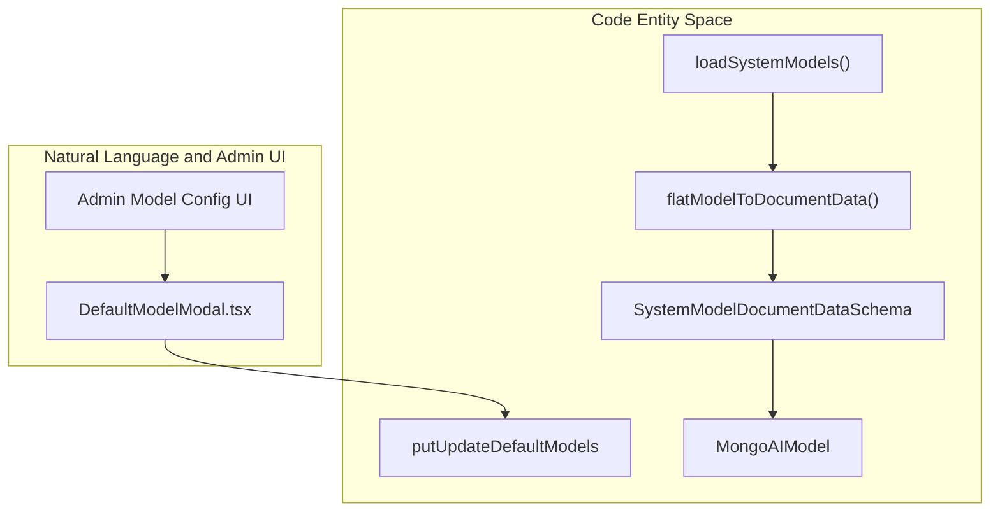
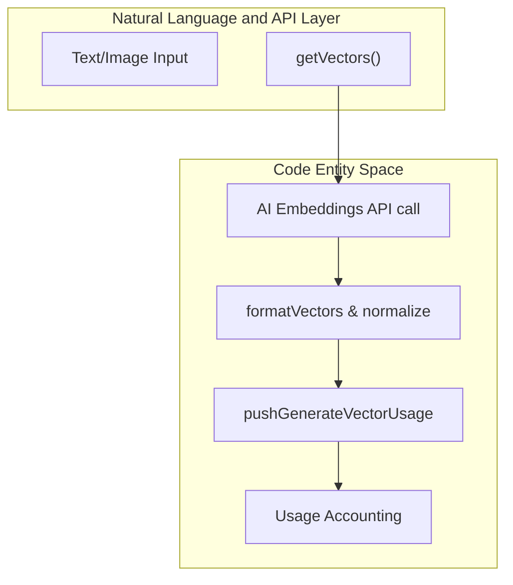
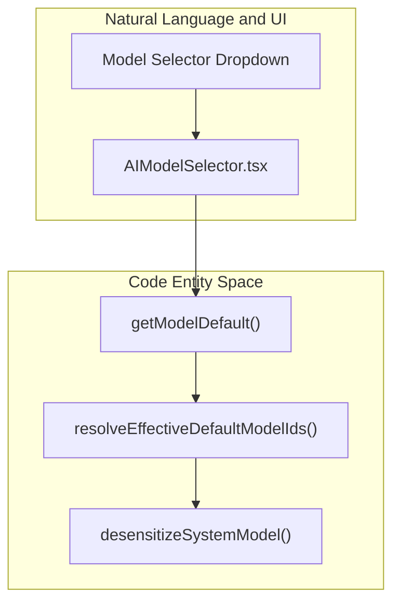

<!-- source: DeepWiki mcp.deepwiki.com · repo labring/FastGPT · page 9 AI Integration and Response Processing · fetched 2026-10-29 -->

# AI Integration and Response Processing

Relevant source files

The following files were used as context for generating this wiki page:

- [packages/service/common/api/axios.ts](packages/service/common/api/axios.ts)
- [packages/service/common/api/serverRequest.ts](packages/service/common/api/serverRequest.ts)
- [packages/service/common/security/network.ts](packages/service/common/security/network.ts)
- [packages/service/core/ai/audio/transcriptions.ts](packages/service/core/ai/audio/transcriptions.ts)
- [packages/service/core/ai/embedding/index.ts](packages/service/core/ai/embedding/index.ts)
- [packages/service/core/ai/rerank/index.ts](packages/service/core/ai/rerank/index.ts)
- [packages/service/test/common/api/axios.test.ts](packages/service/test/common/api/axios.test.ts)
- [packages/service/test/core/ai/rerank/index.test.ts](packages/service/test/core/ai/rerank/index.test.ts)
- [packages/service/thirdProvider/textin/index.ts](packages/service/thirdProvider/textin/index.ts)
- [projects/app/src/pages/api/core/ai/model/test.ts](projects/app/src/pages/api/core/ai/model/test.ts)
- [projects/app/src/service/support/wallet/usage/push.ts](projects/app/src/service/support/wallet/usage/push.ts)

## Purpose and Scope

This document provides a high-level overview of how FastGPT integrates various AI models and services and handles their responses efficiently. It covers the management of model configurations, AI proxy gateways for safe API access, embedding generation, response streaming, and usage accounting. The scope is to introduce core components and show how they connect within FastGPT’s AI architecture.

This is a **parent page**. For in-depth technical details, consult the specific child pages for each sub-topic:
- [AI Model Configuration and Selection](#9.1) — Details model catalogs, schemas for LLM and embedding models, default models, admin UI and AIModelSelector component
- [LLM Request and Response Streaming](#9.2) — Explains message pipelines, token counting, context window management, and streaming tool-call responses
- [Chat Message Adaptation](#9.3) — Covers GPT-format to internal format adaptation, vision and file context handling
- [Embedding, Rerank and Audio Services](#9.4) — Describes text vectorization (`getVectorsByText`), reranking, speech transcriptions, and usage accounting
- [Prompt Engineering and Editors](#9.5) — Discusses prompt templates, system prompts, and the Lexical-based PromptEditor with plugins for dynamic variable and skill labels

---

## 9.1 AI Model Configuration and Selection

FastGPT manages various AI model types—LLMs, embedding models, rerankers, TTS, and STT—using detailed Zod schemas defined in `@fastgpt/global/core/ai/model/schema.ts`. These models are loaded both from static system plugins and the persistent database collection `ai_models`. Synchronization functions like `loadSystemModels` flatten and validate model data for registration. 

An administrative interface (`DefaultModelModal`) facilitates setting system default models, while the `AIModelSelector` UI component enables user-level model selection. The configuration system ensures scope-based authorization and dynamic model overrides per team or channel context.

**High-Level Model Configuration and Loading Pipeline:**

Sources:  
[packages/service/core/ai/config/utils.ts:79-107](), [projects/app/src/pageComponents/model/DefaultModelModal.tsx:65-75]()

For details, see [AI Model Configuration and Selection](#9.1).

---

## 9.2 LLM Request and Response Streaming

The interaction between FastGPT and large language models (LLMs) abstracts the complexity of streaming protocols and tool-calling. Key responsibilities include:

- Maintaining a message pipeline that adapts internal message formats to GPT-format prompts.
- Counting tokens for cost and context window management.
- Using `filterGPTMessageByMaxContext` utility for trimming messages to fit model context limits.
- Parsing streamed AI responses, separating reasoning content, tool invocation payloads, and citations.
- Supporting real-time response updates in chat UI, with incremental rendering.

This decouples the AI model specifics from the application, allowing flexible integration of multiple LLM providers.

Sources:  
[packages/service/core/ai/llm/utils.ts:21-86]()

For details, see [LLM Request and Response Streaming](#9.2).

---

## 9.3 Chat Message Adaptation

FastGPT uses message format adapters to bridge between its internal chat message structures and OpenAI GPT-compatible message formats. The adaptation layer performs:

- Conversion of internal messages into GPT-structured prompts and vice versa (`loadRequestMessages`).
- Multi-modal extensions for vision capabilities and file/image context references.
- Transformation of internal S3 file keys into signed preview URLs for safe client delivery.
- Handling attachments and related context in chat conversations for richer agents.

This layer ensures seamless integration of different chat sources and AI input/output formats.

Sources:  
[packages/service/core/ai/llm/utils.ts:94-217]()

For details, see [Chat Message Adaptation](#9.3).

---

## 9.4 Embedding, Rerank and Audio Services

FastGPT supports various auxiliary AI services:

- **Embeddings**: The `getVectorsByText` function processes text or image inputs into vector embeddings, using configurable models that handle batching, token counting, input truncation, and normalization. Embeddings are crucial for semantic search and RAG (Retrieval-Augmented Generation).

- **Rerank**: Documents retrieved by vector search can be reranked by relevance scores using dedicated rerank models. The reranker splits long documents into chunks to fit token budgets, sends requests via a secure axios instance, and aggregates results to map chunks back to original documents with scores.

- **Audio Services**: Speech-to-text (STT) transcription is supported with streamable file uploads, using model-configured API calls. Similarly, usage accounting tracks token consumption and AI points throughout embedding, rerank, and audio operations, helping integrate billing and quota systems.

**Embedding Processing Flow:**

Sources:  
[packages/service/core/ai/embedding/index.ts:1-210](), [packages/service/core/ai/rerank/index.ts:1-177](), [projects/app/src/service/support/wallet/usage/push.ts:9-127](), [packages/service/core/ai/audio/transcriptions.ts:1-58]()

For details, see [Embedding, Rerank and Audio Services](#9.4).

---

## 9.5 Prompt Engineering and Editors

Prompt engineering in FastGPT allows templating of system and agent prompts with dynamic variable insertion and conditional logic. The `PromptEditor` component, built with the Lexical rich-text editor, supports plugins that enable:

- Variable and variable label insertion, ensuring consistent prompt structures.
- Skill-label annotations to connect prompts to AI skills dynamically.
- Context-aware editing to support agent prompt configuration workflows.

The prompt system is tightly integrated with the AI chat and agent components, enabling flexible exploration and reuse of prompts across use cases.

**AI Model Gateway and Selection UI Flow:**

Sources:  
[packages/service/core/ai/config/utils.ts:112-126](), [projects/app/src/pageComponents/model/DefaultModelModal.tsx:52-60]()

For details, see [Prompt Engineering and Editors](#9.5).

---

# Summary

FastGPT’s AI integration layer is a multi-faceted system managing model configurations, secure and efficient API access, streaming response processing, embeddings, reranking, and audio transcription/synthesis handling. Together with prompt engineering and chat message adaptation, this foundation enables the platform’s AI agent and RAG workflows to function flexibly and reliably.

The child pages linked here provide detailed examination of each major piece of this AI integration architecture.

---

