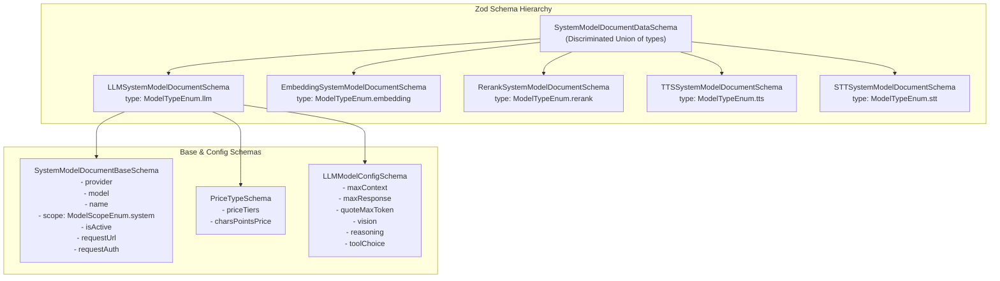
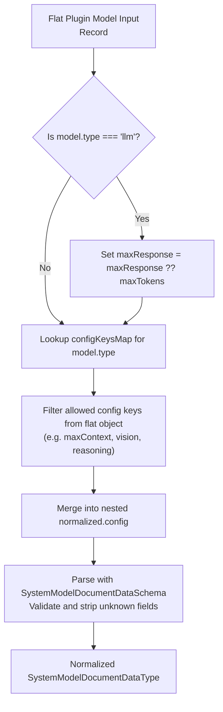
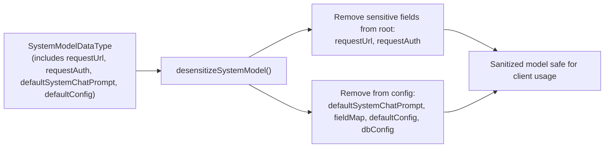
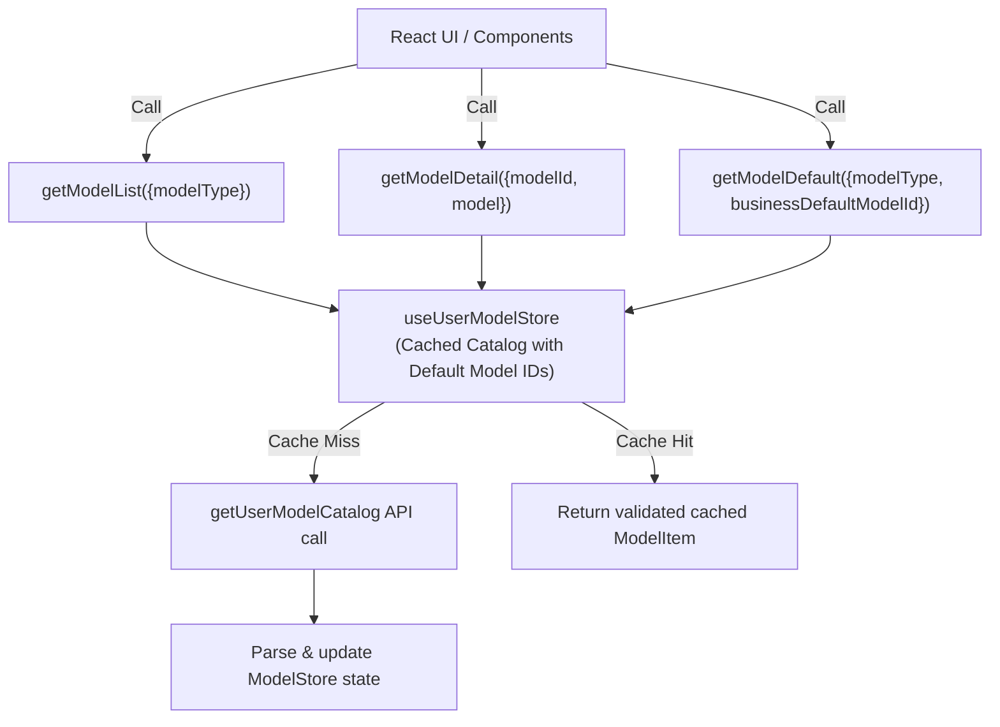
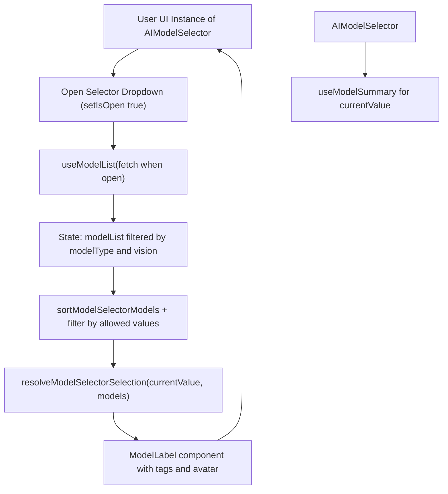
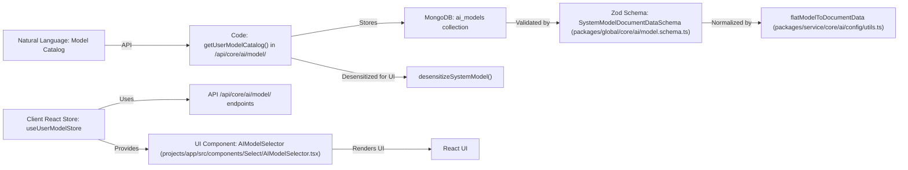
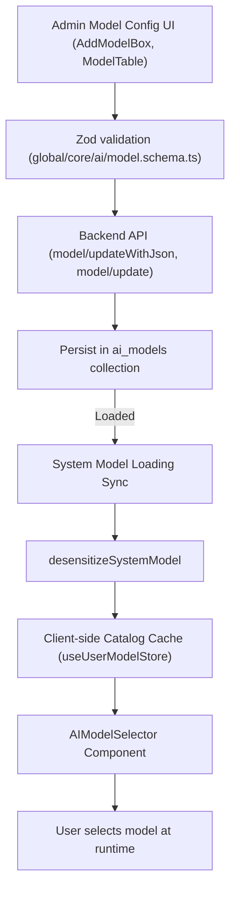

<!-- source: DeepWiki mcp.deepwiki.com · repo labring/FastGPT · page 9.1 AI Model Configuration and Selection · fetched 2026-10-29 -->

# AI Model Configuration and Selection

Relevant source files

The following files were used as context for generating this wiki page:

- [document/content/self-host/upgrading/4-14/41420.en.mdx](document/content/self-host/upgrading/4-14/41420.en.mdx)
- [document/content/self-host/upgrading/4-14/41420.mdx](document/content/self-host/upgrading/4-14/41420.mdx)
- [document/content/self-host/upgrading/4-14/meta.en.json](document/content/self-host/upgrading/4-14/meta.en.json)
- [document/content/self-host/upgrading/4-14/meta.json](document/content/self-host/upgrading/4-14/meta.json)
- [document/content/self-host/upgrading/4-17/meta.en.json](document/content/self-host/upgrading/4-17/meta.en.json)
- [document/content/self-host/upgrading/4-17/meta.json](document/content/self-host/upgrading/4-17/meta.json)
- [document/content/toc.en.mdx](document/content/toc.en.mdx)
- [document/content/toc.mdx](document/content/toc.mdx)
- [document/data/doc-last-modified.json](document/data/doc-last-modified.json)
- [packages/global/common/error/code/app.ts](packages/global/common/error/code/app.ts)
- [packages/global/common/error/code/dataset.ts](packages/global/common/error/code/dataset.ts)
- [packages/service/core/dataset/controller.ts](packages/service/core/dataset/controller.ts)
- [packages/service/core/dataset/delete/processor.ts](packages/service/core/dataset/delete/processor.ts)
- [packages/service/support/permission/schema.ts](packages/service/support/permission/schema.ts)
- [packages/service/test/core/dataset/delete/processor.test.ts](packages/service/test/core/dataset/delete/processor.test.ts)
- [packages/web/hooks/useTableMultipleSelect.tsx](packages/web/hooks/useTableMultipleSelect.tsx)
- [packages/web/i18n/ko-KR/dataset.json](packages/web/i18n/ko-KR/dataset.json)
- [projects/app/src/components/Markdown/components/EChartsCodeBlock.tsx](projects/app/src/components/Markdown/components/EChartsCodeBlock.tsx)
- [projects/app/src/components/Select/AIModelSelector.tsx](projects/app/src/components/Select/AIModelSelector.tsx)
- [projects/app/src/components/Select/AIModelSelector.utils.ts](projects/app/src/components/Select/AIModelSelector.utils.ts)
- [projects/app/src/components/core/ai/ModelTable/index.tsx](projects/app/src/components/core/ai/ModelTable/index.tsx)
- [projects/app/src/components/support/permission/MemberManager/MemberItemCard.tsx](projects/app/src/components/support/permission/MemberManager/MemberItemCard.tsx)
- [projects/app/src/components/support/permission/MemberManager/RoleSelect.tsx](projects/app/src/components/support/permission/MemberManager/RoleSelect.tsx)
- [projects/app/src/components/support/permission/MemberManager/context.tsx](projects/app/src/components/support/permission/MemberManager/context.tsx)
- [projects/app/src/components/support/user/team/OrgTags/index.tsx](projects/app/src/components/support/user/team/OrgTags/index.tsx)
- [projects/app/src/pageComponents/account/team/PermissionManage/index.tsx](projects/app/src/pageComponents/account/team/PermissionManage/index.tsx)
- [projects/app/src/pages/api/core/ai/model/update.ts](projects/app/src/pages/api/core/ai/model/update.ts)
- [projects/app/src/pages/api/core/ai/model/updateWithJson.ts](projects/app/src/pages/api/core/ai/model/updateWithJson.ts)
- [projects/app/src/pages/api/core/app/del.ts](projects/app/src/pages/api/core/app/del.ts)
- [projects/app/src/pages/api/core/dataset/delete.ts](projects/app/src/pages/api/core/dataset/delete.ts)
- [projects/app/test/components/Select/AIModelSelector.utils.test.ts](projects/app/test/components/Select/AIModelSelector.utils.test.ts)
- [projects/app/test/components/support/permission/MemberManager/RoleSelect.test.ts](projects/app/test/components/support/permission/MemberManager/RoleSelect.test.ts)

## Purpose and Scope

This page comprehensively documents the AI model configuration and selection subsystem within FastGPT. It covers the model data schemas, transformation utilities for runtime normalization, system model loading and sanitization, client-side catalog caching and retrieval, and administrative UI elements for model configuration and selection. Focus is on representing how models are defined, validated, secured, and surfaced to users and administrators.

---

## AI Model Schemas and Data Models

FastGPT utilizes Zod-based schema definitions to validate and organize AI model data. Models are classified into five principal types:

- Large Language Models (`llm`)
- Embedding models (`embedding`)
- Rerankers (`rerank`)
- Text-to-Speech (`tts`)
- Speech-to-Text (`stt`)

Each model shares a base structure encompassing identity and billing data, while type-specific parameters live in a nested `config` object according to the model type. The system scope for official models is `ModelScopeEnum.system`.

This schema layout ensures consistent validation and typing across multiple model types and their unique configuration requirements.

Sources: [packages/global/core/ai/model.schema.ts:1-135]()

---

## Model Normalization and Document Conversion

Incoming model data from various plugins or external sources often arrives in a flat structure without the canonical `config` nesting. The backend provides `flatModelToDocumentData` to transform these flat objects into fully normalized canonical documents compliant with `SystemModelDocumentDataSchema`.

The `configKeysMap` strictly lists keys allowed inside `config` per model type to avoid contamination with unsupported or sensitive properties.

Sources: [packages/service/core/ai/config/utils.ts:32-107](), [packages/service/test/core/ai/config/utils.test.ts:9-77]()

---

## System Model Loading, Desensitization, and Catalog Caching

### Loading and Sync

The backend periodically loads installed system models, synchronizes plugin model templates, and generates complete model catalogs. Before relaying models to clients, sensitive fields must be removed or obscured to protect internal credentials and private endpoints.

### Desensitization Data Flow

- `desensitizeSystemModel` strips all upstream URLs and authentication details that shouldn't be exposed outside of privileged backend contexts.
- It also removes internal fields used only by the backend such as default system prompts, editable config maps, and DB binding configs.
- `desensitizeSystemDefaultModels` performs similar sanitization on default role fallback models for chat and RAG use cases.

This process ensures non-admin users and frontend clients receive safe, read-only views of model metadata.

Sources: [packages/service/core/ai/config/utils.ts:112-143](), [packages/service/test/core/ai/config/utils.test.ts:79-149]()

---

## Frontend Model Store and Data Fetching Workflow

Client applications interact with the model catalog through a cached React store `useUserModelStore` that centralizes model lists, details, and default selections. The store syncs via API calls to `/api/core/ai/model/...`.

Key guarantees in catalog consumers (as tested in `modelData.test.ts`) include:

- **Cold Request Deduplication**: Simultaneous fetches share the same in-flight catalog promise, preventing redundant loads.
- **ID Precedence**: Explicit `modelId` identifiers override legacy or string fallback `model` keys.
- **Default Model Resolution**: Checks business-specific override, then system defaults, then falls back to the first qualifying active model with required features.

These protocols keep UI selections consistent and efficient.

Sources: [projects/app/test/web/core/ai/model/modelData.test.ts:1-193](), [projects/app/src/web/core/ai/model/modelData.ts]()

---

## Administrative Model Configuration and UI

Administrators manage AI models through dedicated UI components within the admin dashboard. These components allow full control over model properties, pricing, capabilities, and connectivity.

### Pricing Tier Configuration

Model pricing is defined per tier as step functions over token usage:

| Field       | Description                                                                    |
| ----------- | ------------------------------------------------------------------------------ |
| `threshold` | Token threshold at which this price tier applies                              |
| `price`     | Price (token points per 1000 tokens) at this threshold                        |
| `step`      | Step size for token consumption breakdowns                                   |

These tiers enable customized charging schemes matching various commercial plans.

### Key Configurable Properties

- **Capabilities**: Flags such as `vision`, `audio`, `video`, `reasoning`, `functionCall`, and `toolChoice` control enabled features per model.
- **Request Routing**: Optional overrides for `requestUrl` and `requestAuth` allow specifying private gateways or alternative API endpoints to route calls.
- **Visibility and Status**: Models can be toggled active/inactive and scoped (`system` vs team/user scopes).

These configurations are exposed via React components including `AddModelBox` and `ModelTable` allowing direct row edits and toggling, backed by the OpenAPI-based backend model management APIs.

---

## AIModelSelector React Component

`AIModelSelector` is the main user-facing component for selecting AI models in the UI. It handles:

- Model list retrieval filtered by `modelType` (LLM, embedding, etc.)
- Optional restrictions by allowed value sets or vision capability flags
- Shows model details including icons, tags (`System`, `TestModeBeta`, `MultimodalTag`)
- Respects default unset states and customizable unset labels
- Supports avatar sizing and multi-line display
- Disabled state with user-friendly tooltips explaining reasons

### Component Data Flow and Key Hooks

This component interacts with internal stores (`useUserModelStore`) and provides robust UX for model choice, handling edge cases of cache misses, version mismatches, and restricted option sets.

Sources: [projects/app/src/components/Select/AIModelSelector.tsx:1-196](), [projects/app/src/components/Select/AIModelSelector.utils.ts]()

---

## Summary Mermaid Diagram: From Natural Language Concepts to Code Entities

This diagram illustrates the flow from the conceptual AI model catalog definition down to runtime data entities used in code and UI components.

---

## Summary Mermaid Diagram: AI Model Configuration Workflow and UI

This diagram outlines the administrative model lifecycle from UI configuration through backend persistency and safe client exposure to user consumption.

---

# References and Sources

- `packages/global/core/ai/model.schema.ts` (lines 1-135)
- `packages/service/core/ai/config/utils.ts` (lines 32-107, 112-143)
- `projects/app/test/core/ai/config/utils.test.ts` (lines 9-77, 79-149)
- `projects/app/test/web/core/ai/model/modelData.test.ts` (lines 1-193)
- `projects/app/src/web/core/ai/model/modelData.ts`
- `projects/app/src/components/Select/AIModelSelector.tsx` (lines 1-196)
- `projects/app/src/components/Select/AIModelSelector.utils.ts`

This concludes the detailed technical documentation for AI Model Configuration and Selection in FastGPT.

---

