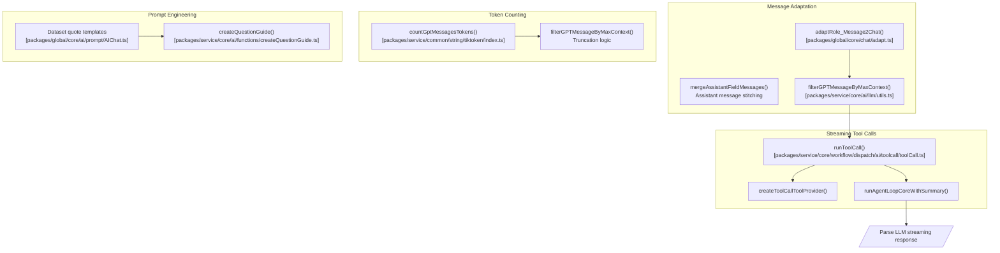
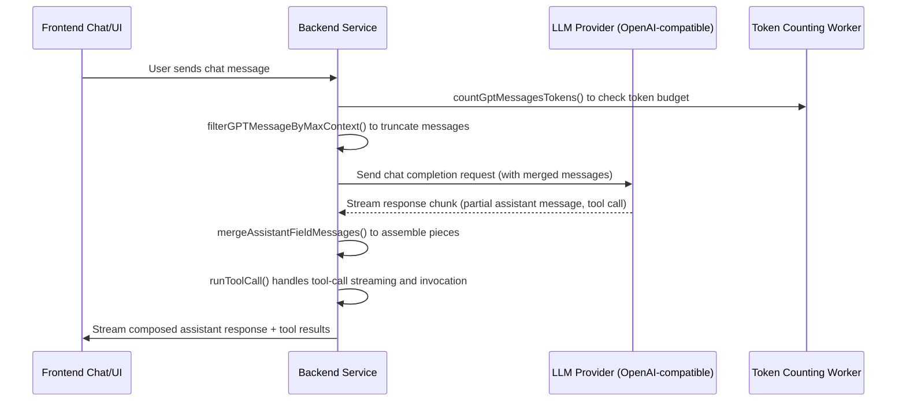

<!-- source: DeepWiki mcp.deepwiki.com · repo labring/FastGPT · page 9.2 LLM Request and Response Streaming · fetched 2026-10-29 -->

# LLM Request and Response Streaming

<details>
<summary>Relevant source files</summary>

The following files were used as context for generating this wiki page:

- [packages/global/core/ai/llm/type.ts](packages/global/core/ai/llm/type.ts)
- [packages/global/core/ai/llm/utils.ts](packages/global/core/ai/llm/utils.ts)
- [packages/global/core/app/formEdit/type.ts](packages/global/core/app/formEdit/type.ts)
- [packages/global/core/chat/adapt.ts](packages/global/core/chat/adapt.ts)
- [packages/global/core/workflow/template/system/toolCall.ts](packages/global/core/workflow/template/system/toolCall.ts)
- [packages/global/test/core/chat/adapt.test.ts](packages/global/test/core/chat/adapt.test.ts)
- [packages/service/core/ai/llm/utils.ts](packages/service/core/ai/llm/utils.ts)
- [packages/service/core/chat/fileStoreValue.ts](packages/service/core/chat/fileStoreValue.ts)
- [packages/service/core/chat/utils.ts](packages/service/core/chat/utils.ts)
- [packages/service/core/workflow/utils/context.ts](packages/service/core/workflow/utils/context.ts)
- [packages/service/test/common/string/tiktoken.test.ts](packages/service/test/common/string/tiktoken.test.ts)
- [packages/service/test/core/ai/llm/utils.test.ts](packages/service/test/core/ai/llm/utils.test.ts)
- [packages/service/test/core/workflow/utils/context.test.ts](packages/service/test/core/workflow/utils/context.test.ts)
- [packages/service/worker/countGptMessagesTokens/count.ts](packages/service/worker/countGptMessagesTokens/count.ts)

</details>


## Purpose and Scope

This page documents the detailed mechanisms of LLM request construction, message streaming responses, token counting, context window management, and tool-call streaming in FastGPT. It covers how internal chat data is adapted to LLM-compatible formats, how streaming output from models (including tool calls) is parsed, and how context and token limits are managed to optimize agent workflows. This is foundational for FastGPT’s real-time chat agents and workflow orchestration.

---

## Message Processing Pipeline

FastGPT maintains an intricate pipeline transforming UI and DB message formats (`ChatItemMiniType[]`) into GPT-compatible messages (`ChatCompletionMessageParam[]`) while managing context windows, checkpoints, and incremental response assembly.

### Context Window Management and Checkpoints

To ensure the total token count stays within the LLM's constraints, historical messages are filtered carefully:

- System and developer messages are preserved always and excluded from normal truncation to keep important system instructions intact.
- Messages before a special **context checkpoint** (a compressed historical summary preserving essential context) are truncated to avoid duplication.
- User-assistant interaction rounds are grouped to preserve coherence — e.g., a user message and its assistant reply are treated as a complete unit.
- Token counting uses a modern GPT tokenizer encoding (`o200k_base`), estimating tokens for multi-modal content with placeholders for media and files.
- The final filtered message list passed to LLM achieves a balance between maximizing context and respecting token limits.

```mermaid
graph TD
    "InputMessages"[("Input Messages\n(ChatItemMiniType[])")] --> "getLatestCheckpointPosition"[("getLatestCheckpointPosition()")]
    "getLatestCheckpointPosition" --> "CheckCheckpoint"{("Checkpoint found?")}
    "CheckCheckpoint" -- Yes --> "getCheckpointAwareMessages"[("getCheckpointAwareMessages()\nFilters pre-checkpoint history")]
    "CheckCheckpoint" -- No --> "FullHistory"[("Retain all messages")]
    "getCheckpointAwareMessages" --> "FilterSystem"[("Keep leading System messages\nand post-checkpoint turns")]
    "FilterSystem" --> "TokenCount"[("filterGPTMessageByMaxContext()\nTruncate to maxContext window")]
    "FullHistory" --> "TokenCount"
```

Sources: [packages/global/core/chat/adapt.ts:77-120](), [packages/service/core/ai/llm/utils.ts:70-147]()

### Assistant Message Merging (`mergeAssistantFieldMessages`)

FastGPT’s chat UI stores assistant responses split into multiple chunks: reasoning content, textual replies, tool calls, etc. However, LLM providers expect a single assistant message for each turn. 

The `mergeAssistantFieldMessages` function:

- Iterates over the GPT message stream.
- Merges consecutive messages with the role `assistant` if they share the same visibility and dataId context.
- Concatenates `reasoning_content` and `content` strings.
- Aggregates tool call arrays into one.
- Ensures that tool/function calls overwrite each other as only one function call should exist per assistant turn.

This consolidation enables correct streaming and incremental expansion of assistant messages from multiple internal partials.

```mermaid
graph TD
    "RawMessages"[("Raw ChatCompletionMessageParam[]")] --> "Loop"[("Iterate messages")]
    "Loop" --> "CheckAssistant"{("role === 'assistant'?")}
    "CheckAssistant" -- Yes --> "CheckContext"[("hasSameAssistantContext()\nMatches hideInUI & dataId")]
    "CheckContext" --> "Merge"[("mergeAssistantMessage()\nConcatenates reasoning_content & content\nCombines tool_calls arrays")]
    "CheckAssistant" -- No --> "PushOther"[("Push non-assistant message")]
    "Merge" --> "Result"[("Return merged ChatCompletionMessageParam[]")]
```

Sources: [packages/global/core/chat/adapt.ts:132-195]()

### Vision and Multimodal Content Adaptation

The internal chat content supports structured multi-modal data parts:

- Text
- Images
- Audio input
- Video input
- File uploads
- File URLs with distinct types (file, video, audio)

FastGPT uses strict Zod schemas for all content parts, ensuring safe, typed conversions between UI, DB, and LLM payloads ([packages/global/core/ai/llm/type.ts]):

- Single text parts are compressed to string for backward compatibility (`simpleUserContentPart`).
- Files and media maintain structured parts avoiding corruption of tokens by embedding large base64 data during token counting.

Sources: [packages/global/core/ai/llm/type.ts](), [packages/global/core/chat/adapt.ts:69-74]()

---

## Streaming Response Parsing and Tool-Call Streaming

FastGPT supports streaming interaction with LLMs, including tool-call triggers embedded in the output, enabling asynchronous calls to external APIs/tools mid-response.

### Tool-Call Streaming Architecture

- The core is the function `runToolCall` which handles initiating a streaming tool call during workflow execution.
- It builds a runtime environment using `createAgentLoopCoreRuntimeEnvironment()`.
- Binds tool call providers with `createToolCallToolProvider`.
- Processes the stream output incrementally, parsing assistant "reasoning", response text, and embedded tool-call instructions.
- Manages execution of these tool calls, gathers invocation token usage, and integrates them into the streaming response.

```mermaid
graph TD
    "Dispatch"[("runToolCall()")] --> "Env"[("createAgentLoopCoreRuntimeEnvironment()")]
    "Env" --> "Provider"[("createToolCallToolProvider()")]
    "Provider" --> "LoopCore"[("runAgentLoopCoreWithSummary()")]
    "LoopCore" --> "StreamParse"[("Parse LLM Stream Output\n(Reasoning / Text / ToolCalls)")]
    "StreamParse" --> "ToolExec"[("Execute Tools via toolRuntime")]
    "ToolExec" --> "Summary"[("Aggregate requestIds & Token Usage")]
```

Sources: [packages/service/core/workflow/dispatch/ai/toolcall/toolCall.ts:38-183]()

### Citation Processing in Markdown

FastGPT supports citing knowledge base sources in responses. Citations use a special format `[id](CITE)` within the response text, which the frontend renders as interactive popovers linked to dataset quote details.

The markdown citation component wrapping is implemented at the frontend in `projects/app/src/components/Markdown/A.tsx`.

Sources: [projects/app/src/components/Markdown/A.tsx:59-170]()

---

## Prompt Templates and Role Injection

FastGPT supports dynamic prompt templates that enrich LLM inputs with dataset search results as context.

### Dataset Quote Templates

FastGPT defines structured formats to embed knowledge base excerpts into LLM prompt text:

| Template Type | Description | Example Source File |
| ------------- | ----------- | ------------------- |
| **Standard JSON-like** | Includes quote ID, source name, padded content (dots), serialized as JSON array with id, sourceName, content fields. | [packages/global/core/ai/prompt/AIChat.ts:253-260]() |
| **QA XML-like** | Tagged question-answer format with `<Question>` and `<Answer>` tags enclosing the texts for formal prompt engineering. | [packages/global/core/ai/prompt/AIChat.ts:266-271]() |

These templates aid retrieval-augmented generation (RAG) and guided prompt expansion.

Sources: [packages/global/core/ai/prompt/AIChat.ts:253-271]()

---

## Token Counting and Management

Token counting is critical for managing model context length and cost.

### Token Counting Implementation

FastGPT delegates token counting to a dedicated worker using a modern `o200k_base` GPT tokenizer that approximates token costs for various message types.

- The main API is `countGptMessagesTokens` which sends messages to the worker for counting.
- If the worker is unavailable, a fallback heuristics based on string length and a multiplier is applied.
- Media and file contents are replaced with placeholders to avoid timeouts and very large token spikes during estimation.
- Tool and function call parameters are also tokenized for budget calculation.
  
```mermaid
graph TB
    "countGptMessagesTokens() Call" --> "getWorkerController()"
    "getWorkerController()" --> "tiktoken Worker Thread"
    "tiktoken Worker Thread" --> "Return Token Count"
    "Return Token Count" -->|Failure| "Fallback to char length * 0.5"
```

Sources: [packages/service/common/string/tiktoken/index.ts:15-46](), [packages/service/core/ai/llm/utils.ts:70-147]()

### Context Window Utility Functions

- `filterGPTMessageByMaxContext`: Implements token-aware truncation preserving important system and checkpoint messages, and full user-assistant rounds. ([packages/service/core/ai/llm/utils.ts:70-147]())
- `createLLMResponse`: A lifecycle manager that accumulates tokens over streaming chunks, handles partial responses, and manages finish reasons and total usage reporting. ([packages/service/core/ai/llm/request.ts:80-221]())

---

## Specialized LLM Request Functions

### Question Guide Generation

The function `createQuestionGuide` uses an LLM call with a specific prompt template to generate suggested questions based on conversation history. It extracts the response JSON array string result and converts it into an array of strings representing questions.

- Prompt template is defined in `[packages/global/core/ai/prompt/agent.ts:164-171]()`.
- Response parsing happens in `[packages/service/core/ai/functions/createQuestionGuide.ts:46-68]()`

### Tool-Call Request Orchestration

`runToolCall` orchestrates tool execution during chat/workflow execution:

- Extracts file contents and generates input payloads via `extractFilesForToolcall`.
- Creates the environment and registers tool providers.
- Streams execution and parses agent responses containing calls to tools.
- Records request token usage for billing/logging.

Sources: [packages/service/core/ai/functions/createQuestionGuide.ts:12-78](), [packages/service/core/workflow/dispatch/ai/toolcall/toolCall.ts:38-183]()

---

# Summary Mermaid Diagram: Natural Language Features to Code Entities



---

# Summary Mermaid Diagram: Request/Response Streaming Flow



---

# References and Sources

- Message adaptation and role mapping: `[packages/global/core/chat/adapt.ts]`
- Context window filtering and token counting: `[packages/service/core/ai/llm/utils.ts:70-147]()`
- Token counting worker and fallback: `[packages/service/common/string/tiktoken/index.ts:15-46]()`
- Streaming tool-call orchestration: `[packages/service/core/workflow/dispatch/ai/toolcall/toolCall.ts:38-183]()`
- Prompt templates and question guide: `[packages/global/core/ai/prompt/AIChat.ts]`, `[packages/service/core/ai/functions/createQuestionGuide.ts]`
- Frontend markdown citations: `[projects/app/src/components/Markdown/A.tsx:59-170]()`

This completes the deep technical overview of FastGPT’s LLM request and response streaming system.

---

