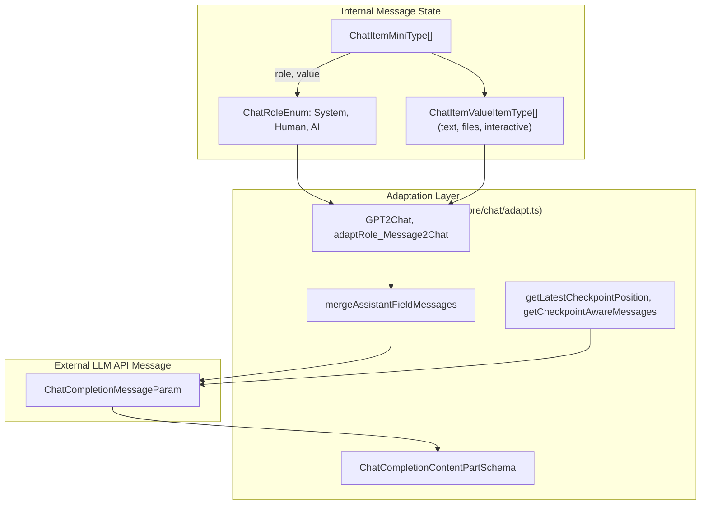
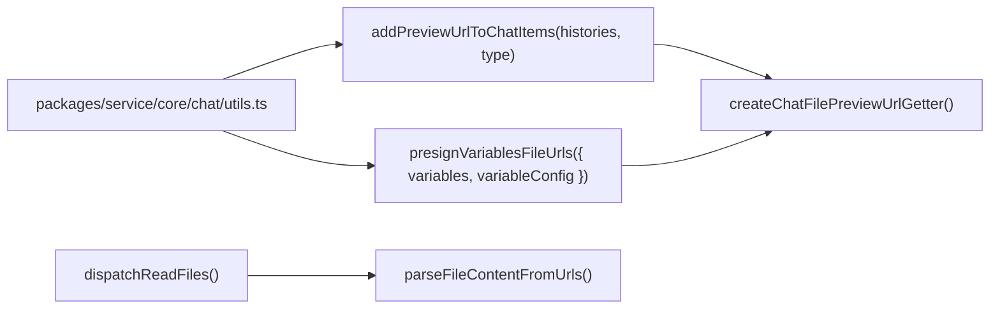
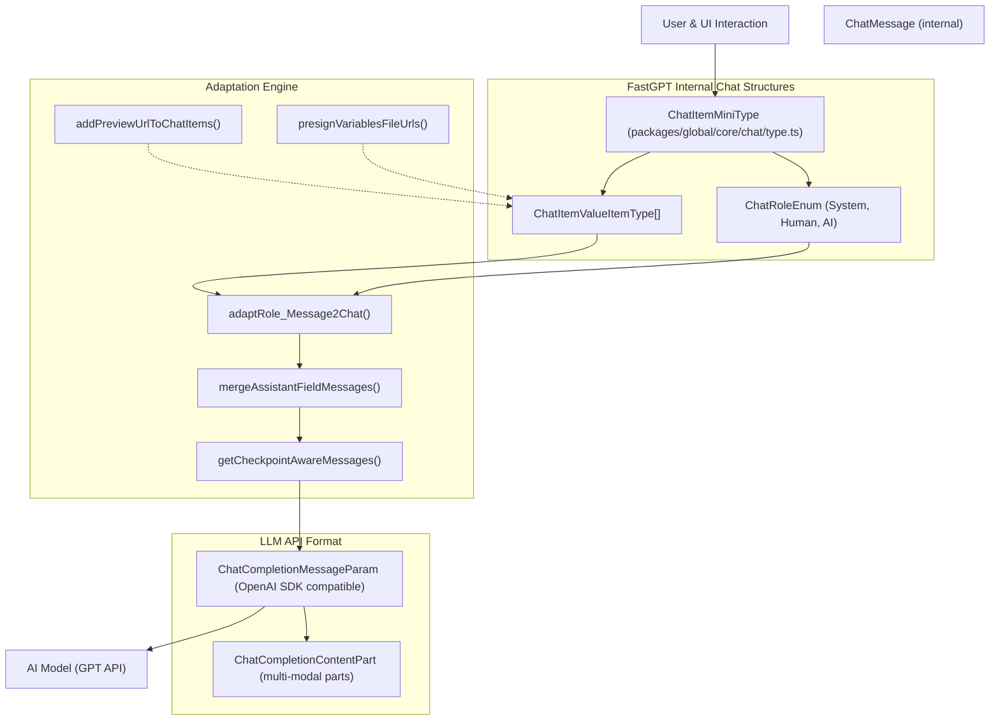

<!-- source: DeepWiki mcp.deepwiki.com · repo labring/FastGPT · page 9.3 Chat Message Adaptation · fetched 2026-10-29 -->

# Chat Message Adaptation

<details>
<summary>Relevant source files</summary>

The following files were used as context for generating this wiki page:

- [packages/global/core/ai/llm/type.ts](packages/global/core/ai/llm/type.ts)
- [packages/global/core/ai/llm/utils.ts](packages/global/core/ai/llm/utils.ts)
- [packages/global/core/ai/prompt/utils.ts](packages/global/core/ai/prompt/utils.ts)
- [packages/global/core/app/formEdit/type.ts](packages/global/core/app/formEdit/type.ts)
- [packages/global/core/chat/adapt.ts](packages/global/core/chat/adapt.ts)
- [packages/global/core/workflow/template/system/readFiles/index.tsx](packages/global/core/workflow/template/system/readFiles/index.tsx)
- [packages/global/core/workflow/template/system/toolCall.ts](packages/global/core/workflow/template/system/toolCall.ts)
- [packages/global/test/core/chat/adapt.test.ts](packages/global/test/core/chat/adapt.test.ts)
- [packages/service/core/ai/llm/utils.ts](packages/service/core/ai/llm/utils.ts)
- [packages/service/core/chat/fileStoreValue.ts](packages/service/core/chat/fileStoreValue.ts)
- [packages/service/core/chat/utils.ts](packages/service/core/chat/utils.ts)
- [packages/service/core/dataset/read.ts](packages/service/core/dataset/read.ts)
- [packages/service/core/workflow/dispatch/tools/readFiles.ts](packages/service/core/workflow/dispatch/tools/readFiles.ts)
- [packages/service/core/workflow/utils/context.ts](packages/service/core/workflow/utils/context.ts)
- [packages/service/test/common/string/tiktoken.test.ts](packages/service/test/common/string/tiktoken.test.ts)
- [packages/service/test/core/ai/llm/utils.test.ts](packages/service/test/core/ai/llm/utils.test.ts)
- [packages/service/test/core/workflow/dispatch/tools/readFiles.test.ts](packages/service/test/core/workflow/dispatch/tools/readFiles.test.ts)
- [packages/service/test/core/workflow/utils/context.test.ts](packages/service/test/core/workflow/utils/context.test.ts)
- [packages/service/worker/countGptMessagesTokens/count.ts](packages/service/worker/countGptMessagesTokens/count.ts)
- [projects/app/src/pages/api/core/dataset/file/getPreviewChunks.ts](projects/app/src/pages/api/core/dataset/file/getPreviewChunks.ts)
- [projects/app/src/pages/api/core/dataset/file/getRawTextPreviewChunks.ts](projects/app/src/pages/api/core/dataset/file/getRawTextPreviewChunks.ts)
- [projects/app/test/pages/api/core/dataset/file/getPreviewChunks.test.ts](projects/app/test/pages/api/core/dataset/file/getPreviewChunks.test.ts)
- [projects/app/test/pages/api/core/dataset/file/getRawTextPreviewChunks.test.ts](projects/app/test/pages/api/core/dataset/file/getRawTextPreviewChunks.test.ts)

</details>


## Purpose and Scope

This document details how FastGPT adapts chat messages between its internal storage/runtime format and the external LLM API formats, primarily those compatible with OpenAI's chat completion API. This adaptation layer enables support for multi-modal message inputs including vision (images), audio, video, and files, while also handling workflow interaction states, file preview URL injection, and message compression features.

Key points covered:
- Role and message structure mapping between FastGPT internal types and GPT external message parameters.
- Assistant message field merging and checkpoint-aware history reconstruction.
- Multi-modal content schema alignment and filtering.
- File/image URL presigning and enhancement in chat histories.
- File content reading integration in workflows.
- Streaming delta response generation and normalization of tool responses.

---

## Message Format Architecture

FastGPT maintains separate representations for chat messages internally and externally to AI model providers.

### Message Format Comparison

| Aspect | Internal Format (`ChatItemMiniType`) | GPT Format (`ChatCompletionMessageParam`) |
|--------|-------------------------------------|-------------------------------------------|
| **Role Types** | `System`, `Human`, `AI` (enum: `ChatRoleEnum`) | OpenAI roles: `system`, `developer`, `user`, `assistant`, `function`, `tool` |
| **Value Structure** | Array of typed value items (`ChatItemValueItemType[]`), possibly including files and interactive forms | Single `content` field (string or array of content parts) |
| **Multi-modality** | Structured `file` objects (`UserChatItemFileItemType`), rich interactive forms | Content parts with typed variants: `image_url`, `input_audio`, `video_url`, `file_url` |
| **Tool-Calling** | Embedded workflow fields in values or interactive objects | Top-level `tool_calls` array or `function_call` field |
| **Reasoning / Thinking** | Separate `reasoning_content` in assistant messages, split into multiple value items | Consolidated in assistant message field `reasoning_content` |

---

### Internal-to-External Adaptation Data Flow



**Figure:** Code entity mapping from FastGPT internal chat item structures to OpenAI GPT message parameters, showing role adaptation, checkpoint and message merging logic.

Sources: [packages/global/core/chat/adapt.ts:48-195](), [packages/global/core/ai/llm/type.ts:33-114]()

---

## Core Adaptation Functions and Role Mapping

The core bidirectional adaptation utilities reside in `packages/global/core/chat/adapt.ts`.

### Role Mapping

FastGPT maps OpenAI/GPT message roles to internal chat roles with the `GPT2Chat` constant and adapter function:

```typescript
export const GPT2Chat = {
  [ChatCompletionRequestMessageRoleEnum.System]: ChatRoleEnum.System,
  [ChatCompletionRequestMessageRoleEnum.Developer]: ChatRoleEnum.System,
  [ChatCompletionRequestMessageRoleEnum.User]: ChatRoleEnum.Human,
  [ChatCompletionRequestMessageRoleEnum.Assistant]: ChatRoleEnum.AI,
  [ChatCompletionRequestMessageRoleEnum.Function]: ChatRoleEnum.AI,
  [ChatCompletionRequestMessageRoleEnum.Tool]: ChatRoleEnum.AI
};

export function adaptRole_Message2Chat(role: ChatCompletionRequestMessageRoleEnum) {
  return GPT2Chat[role];
}
```

Function and tool messages are treated as AI assistant tool context, hence merged into the AI role category internally. This mapping simplifies internal role handling across different LLM communication patterns.

Sources: [packages/global/core/chat/adapt.ts:48-63]()

### Checkpoint-Aware History Reconstruction

FastGPT supports context compression via "checkpoints" embedded in messages to truncate older chat history beyond token limits.

- `getLatestCheckpointPosition(messages)` scans from the end to find the last AI message with a `contextCheckpoint` flag.
- `getCheckpointAwareMessages(messages)` reconstructs a reduced history keeping:
  - All system messages before the checkpoint.
  - The checkpoint AI message (truncated to its checkpointed part).
  - All messages after the checkpoint.

This avoids duplication and excessive context windows in compressed conversations.

Sources: [packages/global/core/chat/adapt.ts:77-120]()

### Assistant Field Merging

FastGPT stores assistant output often split into multiple message value parts: reasoning content, simple text chunks, and tool calls.

The function `mergeAssistantFieldMessages(messages)` merges adjacent assistant messages that share the same context (`hideInUI` and `dataId`) into a single message:

- Concatenates `reasoning_content` and `content` strings.
- Merges multiple `tool_calls` arrays.
- Keeps function calls consistent (last overwrites previous).
- Preserves visibility/context boundaries.

This optimizes the payload sent to LLM APIs, which expect a compressed assistant response per turn.

Sources: [packages/global/core/chat/adapt.ts:132-195]()

---

## File and Multi-Modal Content Adaptation

FastGPT supports rich media inputs including images, audio, video, and files referenced by URLs or base64 content, aligned with external LLM content part schemas from `packages/global/core/ai/llm/type.ts`.

### Multi-Modal Content Part Schemas (Excerpt)

- `image_url` content with detail levels (`auto`, `low`, `high`).
- `input_audio` with base64 encoded data and optional format.
- `video_url` for video streams (Qwen-Omni compatible).
- Extended `file_url` parts for arbitrary files/audio/video URLs with metadata.

FastGPT internal file types are mapped to these via adapters (`isFileUrlChatFileType`, `getFileUrlChatFileType`) [packages/global/core/chat/adapt.ts:26-46]().

### URL Presigning and File Preview Injection

Files stored in S3 require presigned URLs to grant temporary access for preview or processing. FastGPT includes utilities to detect such file references in variables or message values and inject presigned URLs.

#### File preview URL presign workflow



- `addPreviewUrlToChatItems`: Traverses chat histories (for both `chatFlow` and `workflowTool` types), detects `fileSelect` inputs or files in message values and replaces file keys with presigned preview URLs asynchronously [packages/service/core/chat/utils.ts:36-157]().
- `presignVariablesFileUrls`: Scans workflow variable maps with file input types and injects presigned URLs for S3 files [packages/service/core/chat/utils.ts:160-193]().
- `dispatchReadFiles`: Workflow tool node implementation to read file contents from URL lists or historic attachments. Uses the file parser to extract text and buffers the response for workflow tool consumption [packages/service/core/workflow/dispatch/tools/readFiles.ts:40-116]().

Sources: [packages/service/core/chat/utils.ts:36-193](), [packages/global/core/ai/llm/type.ts:51-105](), [packages/service/core/workflow/dispatch/tools/readFiles.ts:40-116]()

---

## AI Response Parsing and Streaming

FastGPT provides utilities to standardize AI response formatting and streaming output for frontends.

### Tool Response Normalization

Because some providers disallow empty or undefined tool call responses, FastGPT normalizes such outputs:

```typescript
export function normalizeToolResponseContent(response?: string) {
  return response === '' || response === undefined ? 'none' : response;
}
```

This provides a fallback string `"none"` so providers will accept the tool response unconditionally.

Sources: [packages/global/core/ai/llm/utils.ts:16-17]()

### Delta Response Streaming

For real-time UI streaming, FastGPT generates OpenAI-compatible delta messages encapsulating incremental assistant text, reasoning, and finish reasons via:

- `createChatCompletionDeltaResponse()`
- `splitDeltaText()`

These functions help construct SSE message payloads with proper typing and streaming semantics for incremental rendering.

Sources: [packages/global/core/ai/llm/utils.ts:1-55]()

---

## Summary Diagram: Natural Language Space to Code Entities



Sources: [packages/global/core/chat/adapt.ts](), [packages/service/core/chat/utils.ts](), [packages/global/core/ai/llm/type.ts]()

---

# References

- Adaptation logic: `packages/global/core/chat/adapt.ts` [lines 1-195]()
- Multi-modal content schemas: `packages/global/core/ai/llm/type.ts` [lines 40-110]()
- Presigning and file preview utilities: `packages/service/core/chat/utils.ts` [lines 36-193]()
- Workflow file handling: `packages/service/core/workflow/dispatch/tools/readFiles.ts` [lines 40-116]()
- Streaming and normalization utilities: `packages/global/core/ai/llm/utils.ts` [lines 1-55]()

---

This page completes the technical documentation of chat message adaptation in FastGPT, connecting internal data models with external AI model API contracts, handling vision and file contexts, and enabling file preview integration seamlessly in conversation history.

---

