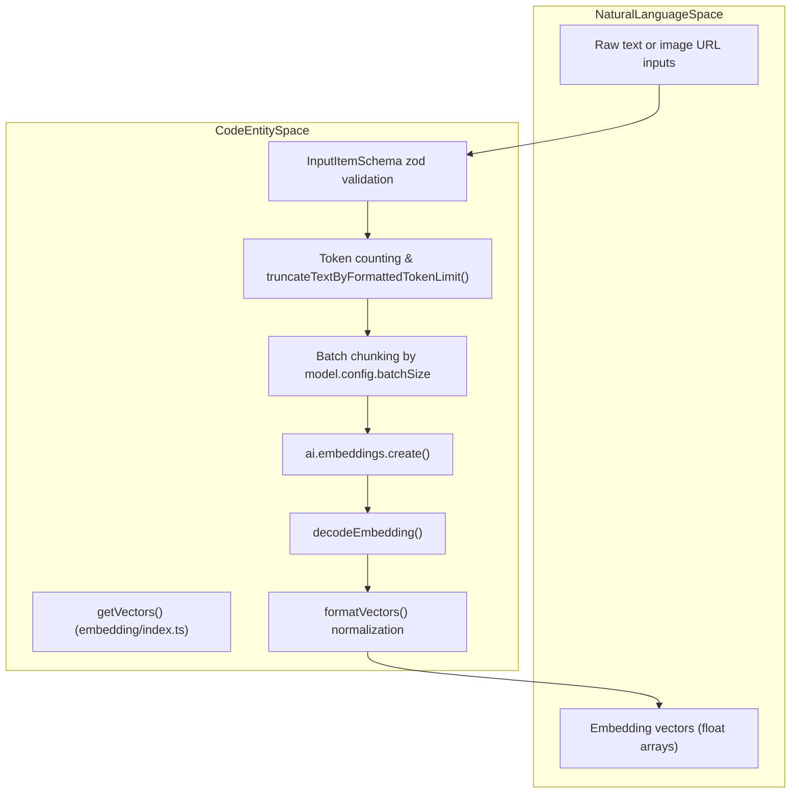
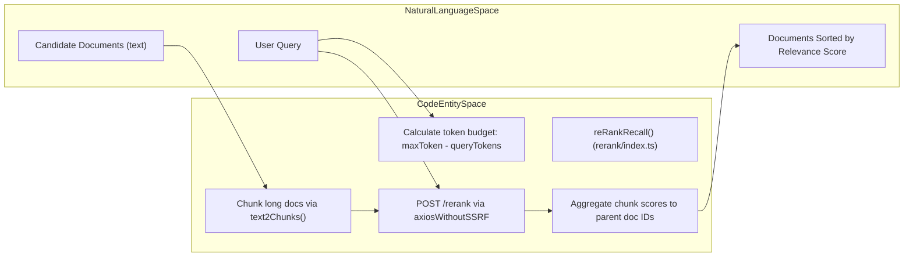
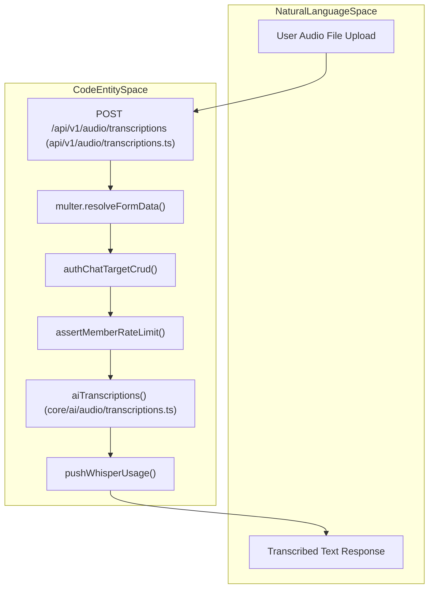
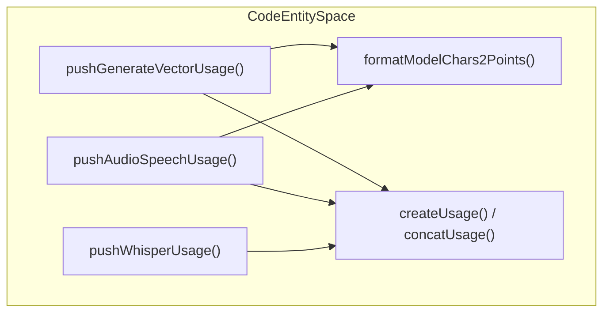

<!-- source: DeepWiki mcp.deepwiki.com · repo labring/FastGPT · page 9.4 Embedding, Rerank and Audio Services · fetched 2026-10-29 -->

# Embedding, Rerank and Audio Services

Relevant source files

The following files were used as context for generating this wiki page:

- [packages/global/openapi/core/app/log/api.ts](packages/global/openapi/core/app/log/api.ts)
- [packages/service/common/api/axios.ts](packages/service/common/api/axios.ts)
- [packages/service/common/api/serverRequest.ts](packages/service/common/api/serverRequest.ts)
- [packages/service/common/security/network.ts](packages/service/common/security/network.ts)
- [packages/service/core/ai/audio/transcriptions.ts](packages/service/core/ai/audio/transcriptions.ts)
- [packages/service/core/ai/embedding/index.ts](packages/service/core/ai/embedding/index.ts)
- [packages/service/core/ai/rerank/index.ts](packages/service/core/ai/rerank/index.ts)
- [packages/service/core/chat/controller.ts](packages/service/core/chat/controller.ts)
- [packages/service/test/common/api/axios.test.ts](packages/service/test/common/api/axios.test.ts)
- [packages/service/test/core/ai/rerank/index.test.ts](packages/service/test/core/ai/rerank/index.test.ts)
- [packages/service/thirdProvider/textin/index.ts](packages/service/thirdProvider/textin/index.ts)
- [projects/app/src/pages/api/core/ai/model/test.ts](projects/app/src/pages/api/core/ai/model/test.ts)
- [projects/app/src/pages/api/core/chat/clearHistories.ts](projects/app/src/pages/api/core/chat/clearHistories.ts)
- [projects/app/src/pages/api/core/chat/delHistory.ts](projects/app/src/pages/api/core/chat/delHistory.ts)
- [projects/app/src/pages/api/core/chat/getHistories.ts](projects/app/src/pages/api/core/chat/getHistories.ts)
- [projects/app/src/pages/api/core/chat/history/batchDelete.ts](projects/app/src/pages/api/core/chat/history/batchDelete.ts)
- [projects/app/src/pages/api/core/chat/history/clearHistories.ts](projects/app/src/pages/api/core/chat/history/clearHistories.ts)
- [projects/app/src/pages/api/core/chat/history/delHistory.ts](projects/app/src/pages/api/core/chat/history/delHistory.ts)
- [projects/app/src/pages/api/core/chat/history/getHistories.ts](projects/app/src/pages/api/core/chat/history/getHistories.ts)
- [projects/app/src/pages/api/core/chat/history/updateHistory.ts](projects/app/src/pages/api/core/chat/history/updateHistory.ts)
- [projects/app/src/pages/api/core/chat/updateHistory.ts](projects/app/src/pages/api/core/chat/updateHistory.ts)
- [projects/app/src/pages/api/v1/audio/transcriptions.ts](projects/app/src/pages/api/v1/audio/transcriptions.ts)
- [projects/app/src/service/support/wallet/usage/push.ts](projects/app/src/service/support/wallet/usage/push.ts)
- [projects/app/src/web/common/hooks/useSpeech.ts](projects/app/src/web/common/hooks/useSpeech.ts)
- [projects/app/src/web/common/utils/voice.ts](projects/app/src/web/common/utils/voice.ts)
- [projects/app/test/api/core/chat/history/updateHistory.test.ts](projects/app/test/api/core/chat/history/updateHistory.test.ts)

This document details FastGPT's implementation of embedding vector generation, reranking for document relevance, speech transcription and synthesis, along with usage accounting related to those services. It covers key classes, functions, the data flow, and includes diagrams bridging natural language concepts with the code.

---

## Purpose and Scope

The embedding, rerank and audio services module handles:

- Generating embedding vectors from text or images through configurable AI models (`getVectors()`) [packages/service/core/ai/embedding/index.ts:13-210]().
- Reranking document recall results using token budget-aware chunking and external rerank models (`reRankRecall()`) [packages/service/core/ai/rerank/index.ts:33-177]().
- Speech-to-text transcription workflows with dedicated endpoints and STT model orchestrations (`aiTranscriptions()`) [packages/service/core/ai/audio/transcriptions.ts:8-57]() and `/api/v1/audio/transcriptions` API [projects/app/src/pages/api/v1/audio/transcriptions.ts:19-86]().
- Client-side speech recording, waveform processing, and audio playback hooks (`useSpeech` and `useAudioPlay`) [projects/app/src/web/common/hooks/useSpeech.ts:1-180](), [projects/app/src/web/common/utils/voice.ts:3-195]().
- Detailed usage tracking and billing integration for embeddings, reranking calls, audio speech synthesis, and transcriptions [projects/app/src/service/support/wallet/usage/push.ts:9-127]().

Sources:  
`packages/service/core/ai/embedding/index.ts:13-210`,  
`packages/service/core/ai/rerank/index.ts:33-177`,  
`packages/service/core/ai/audio/transcriptions.ts:8-57`,  
`projects/app/src/pages/api/v1/audio/transcriptions.ts:19-86`,  
`projects/app/src/web/common/hooks/useSpeech.ts:1-180`,  
`projects/app/src/web/common/utils/voice.ts:3-195`,  
`projects/app/src/service/support/wallet/usage/push.ts:9-127`

---

## 1. Embedding Generation Service

The embedding service converts textual or image inputs into numeric fixed-dimensional vectors compatible with vector databases and similarity search.

### Data Flow and Main Functions

### Implementation Highlights

- **Input Parsing and Validation**: Inputs are validated using a Zod schema that accepts type (`text` or `image`) and a string input. Text inputs are trimmed [packages/service/core/ai/embedding/index.ts:22-65]().

- **Token Counting & Truncation**: Text inputs are token-counted with `countPromptTokensBatch`, then truncated to fit the maximum token limit per model config, ensuring no individual request exceeds allowed context [packages/service/core/ai/embedding/index.ts:72-93]().

- **Batching Requests**: Inputs are split into chunks respecting the model's batch size setting, and processed sequentially with retries handled by `retryFn` [packages/service/core/ai/embedding/index.ts:107-142]().

- **Embedding Request**: Calls the AI provider's `embeddings.create()` interface with processed inputs, handling configuration overrides for database indexing or query use cases [packages/service/core/ai/embedding/index.ts:124-189]().

- **Decoding and Normalization**: The service decodes base64-encoded IEEE 754 Float32 vectors and normalizes embeddings according to the model's configured normalization scheme to maintain consistent vector representations [packages/service/core/ai/embedding/index.ts:176-198]().

Sources:  
`packages/service/core/ai/embedding/index.ts:13-210`

---

## 2. Rerank Service

The rerank service improves the ranking of retrieved documents against a query by rescoring chunks using dedicated rerank models.

### Process Flow

### Implementation Details

- **Model and Query Token Budget**: The rerank model's max token capacity minus the query's token count defines the maximum token length for each chunk of documents [packages/service/core/ai/rerank/index.ts:62-67]().

- **Document Chunking**: Documents exceeding the token budget are split into smaller chunks using `text2Chunks()`, mapping each chunk back to the original document ID via `chunkIdToDocIdMap` for score aggregation [packages/service/core/ai/rerank/index.ts:73-93]().

- **API Request**: A POST request sends the query and chunk texts to the rerank model API. Axios is configured with SSRF protection and timeout handling [packages/service/core/ai/rerank/index.ts:104-118]().

- **Scoring & Deduplication**: Results contain scores per chunk. These are aggregated by matching chunk IDs back to their parent document IDs, ensuring only the highest score per document is retained [packages/service/core/ai/rerank/index.ts:143-159]().

- **Error Handling & Logging**: The service logs slow or failed requests and wraps errors using internal error normalization.

Sources:  
`packages/service/core/ai/rerank/index.ts:33-177`

---

## 3. Audio Services (Speech and Transcriptions)

FastGPT supports both speech-to-text transcription and text-to-speech synthesis with streaming and UI waveform visualization.

### Audio Transcription Flow

### Speech Synthesis and Playback

- The `useAudioPlay` hook manages streaming playback of synthesized audio. It requests audio from the backend API `/api/core/chat/record/getSpeech`, handles `MediaSource` streaming, creates Blob URLs and controls the `HTMLAudioElement` for playback [projects/app/src/web/common/utils/voice.ts:56-180]().

- It supports TTS via in-browser speech synthesis voices or server-side model-generated audio streams.

- The `useSpeech` hook (in React) manages microphone recording, audio waveform generation, and transcription streaming for user input.

Sources:  
`projects/app/src/pages/api/v1/audio/transcriptions.ts:19-86`  
`packages/service/core/ai/audio/transcriptions.ts:8-57`  
`projects/app/src/web/common/hooks/useSpeech.ts:1-180`  
`projects/app/src/web/common/utils/voice.ts:3-195`

---

## 4. Usage Accounting and Token Billing

All AI-related compute usage and token consumption are tracked and pushed to the wallet/usage subsystem for billing, subscriptions, and analytics.

### Core Functions for Usage Push

- `pushGenerateVectorUsage` computes points based on input tokens and model parameters, manages extension/deep search points, and writes usage records [projects/app/src/service/support/wallet/usage/push.ts:9-127]().

- `pushAudioSpeechUsage` converts character length in speech synthesis to points for billing [projects/app/src/service/support/wallet/usage/push.ts:166-201]().

- `pushWhisperUsage` records token or duration-based usage for transcription calls, invoked normally by the transcription API after successful transcription [projects/app/src/pages/api/v1/audio/transcriptions.ts:63-68]().

Sources:  
`projects/app/src/service/support/wallet/usage/push.ts`  
`projects/app/src/pages/api/v1/audio/transcriptions.ts`

---

## Summary of Key Functions and Files

| Function / Hook          | Path                                                         | Purpose                                              |
|-------------------------|--------------------------------------------------------------|------------------------------------------------------|
| `getVectors`            | `packages/service/core/ai/embedding/index.ts`                | Main embedding vector generation from text/images |
| `reRankRecall`          | `packages/service/core/ai/rerank/index.ts`                   | Document reranking with chunk splitting and scoring |
| `aiTranscriptions`      | `packages/service/core/ai/audio/transcriptions.ts`           | Speech-to-text transcription call to AI services    |
| Transcription API       | `projects/app/src/pages/api/v1/audio/transcriptions.ts`      | REST API endpoint for audio file transcription       |
| `useAudioPlay`          | `projects/app/src/web/common/utils/voice.ts`                 | Frontend audio streaming and TTS playback            |
| `useSpeech`             | `projects/app/src/web/common/hooks/useSpeech.ts`             | Frontend audio recording and speech waveform generation |
| `pushGenerateVectorUsage`| `projects/app/src/service/support/wallet/usage/push.ts`     | Usage tracking for embeddings                         |
| `pushAudioSpeechUsage`  | `projects/app/src/service/support/wallet/usage/push.ts`      | Usage tracking for speech synthesis                   |
| `pushWhisperUsage`      | Triggered by transcription API after STT                      | Usage tracking for audio-to-text transcription       |

---

This module connects the natural language inputs (text, images, audio) with AI model providers for embeddings, document ranking, and speech processing, while carefully handling token limits, batch processing, streaming media, and usage accounting for billing.

Sources:  
All cited file ranges in the sections above

---

