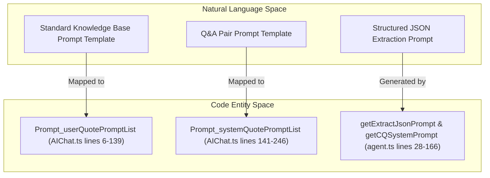
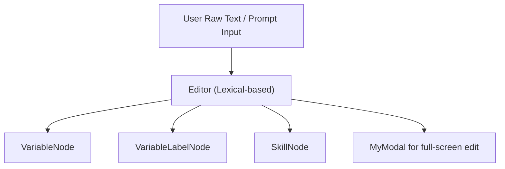
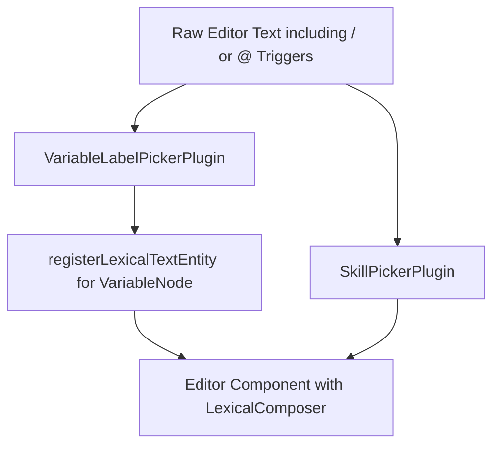
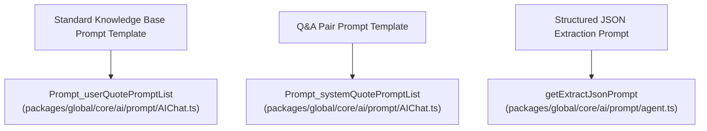
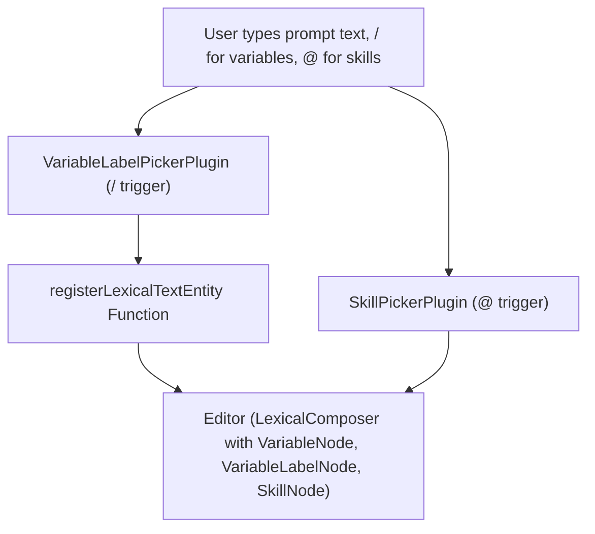

<!-- source: DeepWiki mcp.deepwiki.com · repo labring/FastGPT · page 9.5 Prompt Engineering and Editors · fetched 2026-10-29 -->

# Prompt Engineering and Editors

Relevant source files

The following files were used as context for generating this wiki page:

- [packages/global/core/ai/prompt/AIChat.ts](packages/global/core/ai/prompt/AIChat.ts)
- [packages/global/core/ai/prompt/agent.ts](packages/global/core/ai/prompt/agent.ts)
- [packages/global/core/workflow/template/input.ts](packages/global/core/workflow/template/input.ts)
- [packages/global/core/workflow/template/system/aiChat/index.ts](packages/global/core/workflow/template/system/aiChat/index.ts)
- [packages/global/test/core/ai/prompt/agent.test.ts](packages/global/test/core/ai/prompt/agent.test.ts)
- [packages/service/core/ai/functions/createQuestionGuide.ts](packages/service/core/ai/functions/createQuestionGuide.ts)
- [packages/service/core/workflow/dispatch/ai/extract.ts](packages/service/core/workflow/dispatch/ai/extract.ts)
- [packages/service/core/workflow/dispatch/tools/runUpdateVar.ts](packages/service/core/workflow/dispatch/tools/runUpdateVar.ts)
- [packages/service/core/workflow/dispatch/tools/textEditor.ts](packages/service/core/workflow/dispatch/tools/textEditor.ts)
- [packages/service/test/core/ai/functions/createQuestionGuide.test.ts](packages/service/test/core/ai/functions/createQuestionGuide.test.ts)
- [packages/service/test/core/workflow/dispatch/ai/extract.test.ts](packages/service/test/core/workflow/dispatch/ai/extract.test.ts)
- [packages/web/components/common/Icon/icons/core/workflow/template/variable.svg](packages/web/components/common/Icon/icons/core/workflow/template/variable.svg)
- [packages/web/components/common/Input/HttpInput/Editor.tsx](packages/web/components/common/Input/HttpInput/Editor.tsx)
- [packages/web/components/common/Input/HttpInput/index.tsx](packages/web/components/common/Input/HttpInput/index.tsx)
- [packages/web/components/common/Textarea/PromptEditor/Editor.tsx](packages/web/components/common/Textarea/PromptEditor/Editor.tsx)
- [packages/web/components/common/Textarea/PromptEditor/index.module.scss](packages/web/components/common/Textarea/PromptEditor/index.module.scss)
- [packages/web/components/common/Textarea/PromptEditor/index.tsx](packages/web/components/common/Textarea/PromptEditor/index.tsx)
- [packages/web/components/common/Textarea/PromptEditor/plugins/OnBlurPlugin/index.tsx](packages/web/components/common/Textarea/PromptEditor/plugins/OnBlurPlugin/index.tsx)
- [packages/web/components/common/Textarea/PromptEditor/plugins/SkillLabelPlugin/node.tsx](packages/web/components/common/Textarea/PromptEditor/plugins/SkillLabelPlugin/node.tsx)
- [packages/web/components/common/Textarea/PromptEditor/plugins/VariableLabelPickerPlugin/index.tsx](packages/web/components/common/Textarea/PromptEditor/plugins/VariableLabelPickerPlugin/index.tsx)
- [packages/web/components/common/Textarea/PromptEditor/plugins/VariableLabelPlugin/index.tsx](packages/web/components/common/Textarea/PromptEditor/plugins/VariableLabelPlugin/index.tsx)
- [packages/web/components/common/Textarea/PromptEditor/plugins/VariableLabelPlugin/node.tsx](packages/web/components/common/Textarea/PromptEditor/plugins/VariableLabelPlugin/node.tsx)
- [packages/web/components/common/Textarea/PromptEditor/plugins/VariableLabelPlugin/utils.ts](packages/web/components/common/Textarea/PromptEditor/plugins/VariableLabelPlugin/utils.ts)
- [packages/web/components/common/Textarea/PromptEditor/plugins/VariablePlugin/index.tsx](packages/web/components/common/Textarea/PromptEditor/plugins/VariablePlugin/index.tsx)
- [packages/web/components/common/Textarea/PromptEditor/plugins/VariablePlugin/node.tsx](packages/web/components/common/Textarea/PromptEditor/plugins/VariablePlugin/node.tsx)
- [packages/web/components/common/Textarea/PromptEditor/plugins/VariablePlugin/utils.ts](packages/web/components/common/Textarea/PromptEditor/plugins/VariablePlugin/utils.ts)
- [packages/web/components/common/Textarea/PromptEditor/utils.ts](packages/web/components/common/Textarea/PromptEditor/utils.ts)
- [packages/web/test/components/common/Textarea/PromptEditor/tagEditing.test.ts](packages/web/test/components/common/Textarea/PromptEditor/tagEditing.test.ts)
- [projects/app/src/components/core/app/QGConfig.tsx](projects/app/src/components/core/app/QGConfig.tsx)
- [projects/app/src/pageComponents/app/detail/WorkflowComponents/Flow/nodes/render/RenderInput/templates/SettingQuotePrompt.tsx](projects/app/src/pageComponents/app/detail/WorkflowComponents/Flow/nodes/render/RenderInput/templates/SettingQuotePrompt.tsx)
- [projects/app/src/pageComponents/app/detail/WorkflowComponents/context/workflowInitContext.tsx](projects/app/src/pageComponents/app/detail/WorkflowComponents/context/workflowInitContext.tsx)
- [projects/app/src/web/core/app/utils.ts](projects/app/src/web/core/app/utils.ts)
- [projects/app/src/web/core/workflow/adapt.ts](projects/app/src/web/core/workflow/adapt.ts)

## Purpose and Scope
This section details the prompt engineering framework used in FastGPT, covering the built-in AI chat and agent prompt templates, and the editor component `PromptEditor` built on Meta’s Lexical framework. The editor supports sophisticated prompt authoring with variable insertion, labeled variables, and skill-integration plugins triggered by slash (`/`) and at-sign (`@`) syntaxes.

Sources: [packages/web/components/common/Textarea/PromptEditor/Editor.tsx:1-49](), [packages/global/core/ai/prompt/AIChat.ts:1-10]()

---

## Prompt Template Architecture and AIChat Templates

FastGPT organizes a set of built-in prompt templates categorized as user and system prompt lists, system knowledge quote templates, and structured agent prompts related to RAG and extraction use cases.

### Key Prompt Template Collections

- **`Prompt_userQuotePromptList`** — User-facing prompt templates for knowledge base retrieval, QA pairing, and strict format templates, providing content instructions and citation rules to the LLM. Multiple prompt versions keyed by system versions exist to maintain backward compatibility.  
- **`Prompt_systemQuotePromptList`** — System-level prompts used internally for generating completions in various AIChat workflows, with similar template structures and citation rules.  
- **`Prompt_QuoteTemplateList`** — Defines quote rendering templates for knowledge base content such as JSON structures or XML-like question-answer tags.  
- **Agent Prompt Generators** — Specialized prompt construction functions like `getExtractJsonPrompt`, `getCQSystemPrompt`, focused on structured JSON extraction and classification tasks according to contextual inputs.

Sources: [packages/global/core/ai/prompt/AIChat.ts:6-139](), [packages/global/core/ai/prompt/agent.ts:28-166]()

---

## Lexical-Based PromptEditor Architecture

The `PromptEditor` component facilitates rich prompt composition using Lexical, a modern extensible text editor framework. It supports plain text and rich text modes and registers custom Lexical nodes to represent workflow variables and skills inline.

### Core Components and Data Flow

- **`Editor` Component**  
  The `Editor` initializes Lexical with custom nodes registered:
  - `VariableNode` for inline workflow variables  
  - `VariableLabelNode` for labeled variables inserted via `/` triggers  
  - `SkillNode` for skill labels inserted via `@` triggers  
  - Rich text nodes (headings, lists, quotes, code) optionally included when `isRichText` is enabled.  
 
  It accepts props like `variables` and `variableLabels` for data source feeding, and handler callbacks for editing events (`onChange`, `onChangeText`, `onBlur`) [packages/web/components/common/Textarea/PromptEditor/Editor.tsx:113-172]().
  
- **`PromptEditor` wrapper**  
  Wraps the `Editor` providing modal expansion support (full-screen editing modal) and sanitization of the `value` prop to text string. It also provides disabled state overlays and integrates with Chakra UI Modal for UX [packages/web/components/common/Textarea/PromptEditor/index.tsx:11-128]().
  
- **System Variables**  
  A set of predefined global workflow variables (e.g., `userId`, `appId`, `chatId`, `histories`, `cTime`) are exposed as selectable variables in editor plugins [projects/app/src/web/core/app/utils.ts:91-128]().
  

Sources: [packages/web/components/common/Textarea/PromptEditor/Editor.tsx:113-172](), [packages/web/components/common/Textarea/PromptEditor/index.tsx:11-128](), [projects/app/src/web/core/app/utils.ts:91-128]()

---

## Advanced Plugins and Variable Pickers

To support structured prompt building and variables insertion, the `PromptEditor` integrates multiple Lexical plugins managing entity detection, input triggers, and typeahead UI.

### Key Plugins

- **`VariableLabelPickerPlugin`**  
  Implements a typeahead dropdown triggered by the slash (`/`) character, showing a filtered list of workflow variables. Upon selection, it inserts a variable label node as `{{$<nodeId>.<key>$}}` syntax into the text. This plugin maintains internal query state, selection highlight, and scroll syncing [packages/web/components/common/Textarea/PromptEditor/plugins/VariableLabelPickerPlugin/index.tsx:30-180]().
  
- **`VariablePlugin` and `VariableLabelPlugin`**  
  Provide text entity registration and transformation logic. They parse and convert textual variable placeholders into lexical nodes and vice versa, enabling syntax highlighting and editing control inside the prompt text [packages/web/components/common/Textarea/PromptEditor/utils.ts:33-196]().
  
- **`SkillPickerPlugin` and `SkillLabelPlugin`**  
  Handle skill insertion via `@` triggers similarly to the variable label picker, thus enabling embedding workflow "skills" as prompt entities inline.

Sources: [packages/web/components/common/Textarea/PromptEditor/plugins/VariableLabelPickerPlugin/index.tsx:30-180](), [packages/web/components/common/Textarea/PromptEditor/utils.ts:33-196](), [packages/web/components/common/Textarea/PromptEditor/Editor.tsx:23-50]()

---

## Summary

FastGPT's prompt engineering system combines carefully crafted prompt templates and a powerful Lexical-based prompt editor that supports rich inline entities representing variables and skills. This design greatly aids authors in composing dynamic and context-aware AI prompts crucial for building AI chat agents and workflows.

---

# References to Implementation Files

| Concept                             | File Path & Lines                                       |
|-----------------------------------|--------------------------------------------------------|
| Built-in user/system prompt list  | packages/global/core/ai/prompt/AIChat.ts:6-274         |
| Agent prompt utilities            | packages/global/core/ai/prompt/agent.ts:1-166          |
| PromptEditor component core       | packages/web/components/common/Textarea/PromptEditor/Editor.tsx:1-208 |
| PromptEditor wrapper with modal   | packages/web/components/common/Textarea/PromptEditor/index.tsx:11-128 |
| VariableLabelPickerPlugin (typeahead) | packages/web/components/common/Textarea/PromptEditor/plugins/VariableLabelPickerPlugin/index.tsx:30-180 |
| Lexical Text Entity Registration  | packages/web/components/common/Textarea/PromptEditor/utils.ts:33-196 |
| System workflow variables         | projects/app/src/web/core/app/utils.ts:91-128          |

---

# Detailed Mermaid Diagrams
### Mapping Natural Language Prompt Templates to Code Entities

### `PromptEditor` Text Input to Entity Node Flow

---

This concludes the technical documentation for the "Prompt Engineering and Editors" section.

---

