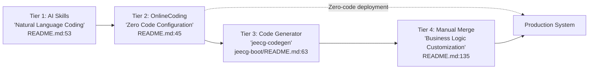
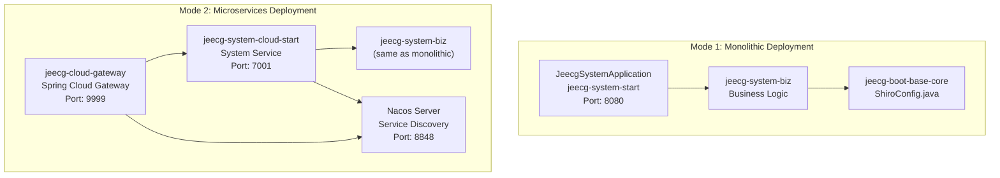
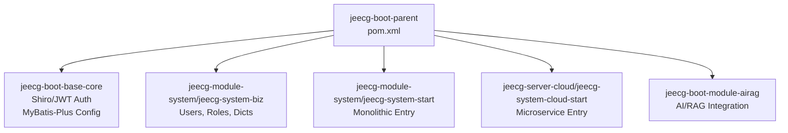

<!-- source: DeepWiki mcp.deepwiki.com · repo jeecgboot/JeecgBoot · page 1 JeecgBoot Overview · fetched 2026-10-29 -->

# JeecgBoot Overview

Relevant source files

The following files were used as context for generating this wiki page:

- [README-AI.md](README-AI.md)
- [README.en-US.md](README.en-US.md)
- [README.ja-JP.md](README.ja-JP.md)
- [README.md](README.md)
- [jeecg-boot/CLAUDE.md](jeecg-boot/CLAUDE.md)
- [jeecg-boot/README.md](jeecg-boot/README.md)
- [jeecg-boot/jeecg-boot-base-core/pom.xml](jeecg-boot/jeecg-boot-base-core/pom.xml)
- [jeecg-boot/jeecg-boot-base-core/src/main/java/org/jeecg/common/util/encryption/AesEncryptUtil.java](jeecg-boot/jeecg-boot-base-core/src/main/java/org/jeecg/common/util/encryption/AesEncryptUtil.java)
- [jeecg-boot/jeecg-boot-base-core/src/main/java/org/jeecg/config/shiro/ShiroConfig.java](jeecg-boot/jeecg-boot-base-core/src/main/java/org/jeecg/config/shiro/ShiroConfig.java)
- [jeecg-boot/jeecg-boot-module/jeecg-boot-module-airag/pom.xml](jeecg-boot/jeecg-boot-module/jeecg-boot-module-airag/pom.xml)
- [jeecg-boot/pom.xml](jeecg-boot/pom.xml)
- [jeecgboot-vue3/README.md](jeecgboot-vue3/README.md)

## Purpose and Scope

This document introduces JeecgBoot as an enterprise-level AI low-code development platform, explaining its core value proposition and position in the enterprise software ecosystem. It provides the conceptual foundation for understanding how JeecgBoot combines code generation, visual development, and AI capabilities into a unified platform.

For detailed technical information:
- Complete feature list: see [Key Features & Capabilities](#1.1)
- Technology stack details: see [Technology Stack](#1.2)
- System requirements: see [System Requirements & Environment Setup](#1.3)
- Quick start instructions: see [Quick Start Guide](#1.4)
- Architecture details: see [Architecture](#2)
- AI platform capabilities: see [AI Platform (AIGC)](#3)
- Low-code features: see [Low-Code Development Platform](#5)

## What is JeecgBoot?

JeecgBoot is an enterprise-grade AI-enhanced low-code development platform built on Spring Boot 4.1.0, Vue 3, and Spring Cloud Alibaba 2025.1.0.0. The platform provides three development approaches:

1. **Code Generation** - Maven-based code generator producing Vue3 + Spring Boot code [jeecg-boot/pom.xml:79]().
2. **OnlineCoding** - Zero-code visual configuration for forms, reports, and charts [README.md:143-145]().
3. **AI Platform** - LLM integration via `jeecg-boot-module-airag` module with RAG and workflow orchestration [jeecg-boot/jeecg-boot-module/jeecg-boot-module-airag/pom.xml:12]().

The architecture supports two deployment modes:
- **Monolithic**: `jeecg-system-start` (single JAR, port 8080) [CLAUDE.md:20-22]().
- **Microservices**: `jeecg-cloud-gateway` (port 9999) → `jeecg-system-cloud-start` (port 7001) [CLAUDE.md:67-68]().

**Current Version**: 3.9.3 (Released: July 7, 2026) [README.md:8-9]()
**License**: Apache License 2.0 [README.md:11]()
**Vendor**: Beijing Guoju Software (北京国炬软件) [README.md:12]()

Sources: [README.md:1-45](), [jeecg-boot/README.md:1-33](), [jeecg-boot/pom.xml:1-86](), [CLAUDE.md:1-65]()

## Core Value Proposition

JeecgBoot addresses the automation vs. flexibility trade-off through a four-tier development paradigm: "AI Generate → Online Configuration → Code Generation → Manual Merge" [README.md:27]().

**Four-Tier Development Flow**

**Development Approach by Complexity:**

| Feature Type | Code Path | Key Capability | Exit Point |
|-------------|-----------|----------------|------------|
| **Simple CRUD** | AI → OnlineCoding | `jeecg-onlform` Skill | Tier 2 (zero-code) |
| **Standard Business** | Code Generator | `jeecg-codegen` Skill | Tier 3 (generated code) |
| **Complex Logic** | Generator + Custom | `Manual MERGE` | Tier 4 (full control) |

**Implementation Details:**

- **Generated Code Format**: Standard Vue3 SFC + Spring Boot Java code (not proprietary DSL) [jeecg-boot/README.md:63]().
- **Merge Strategy**: AI and generators solve 80% of repetitive work, allowing developers to focus on custom business logic [README.md:27]().
- **AI Integration**: Supports one-sentence system generation, flow drawing, and form design [README.md:6]().
- **Security**: Granular permission control including button-level and data-level permissions [README.md:32]().

Sources: [README.md:6-48](), [jeecg-boot/README.md:35-68](), [README.en-US.md:10-31]()

## Platform Architecture Modes

JeecgBoot supports two deployment architectures using shared business logic modules:

**Architecture Mode Diagram**

**Module Comparison:**

| Component | Monolithic | Microservices | Shared |
|-----------|-----------|---------------|--------|
| **Entry Point** | `JeecgSystemApplication` | `JeecgCloudGatewayApplication` | N/A |
| **Business Logic** | `jeecg-system-biz` | `jeecg-system-biz` | ✓ Identical [CLAUDE.md:47-48]() |
| **Core Utilities** | `jeecg-boot-base-core` | `jeecg-boot-base-core` | ✓ Identical [CLAUDE.md:41-42]() |
| **Security** | `ShiroConfig` + `JwtFilter` | `ShiroConfig` + `JwtFilter` | ✓ Identical [jeecg-boot/jeecg-boot-base-core/src/main/java/org/jeecg/config/shiro/ShiroConfig.java:47]() |

**Switching Mechanism:**
The platform provides a simple mechanism to switch between monolithic and microservices modes [README.md:139](). This is achieved through the `jeecg-system-api` module which provides `local-api` for direct calls and `cloud-api` for Feign-based microservice calls [CLAUDE.md:44-46]().

Sources: [README.md:132-141](), [CLAUDE.md:37-70](), [jeecg-boot/jeecg-boot-base-core/src/main/java/org/jeecg/config/shiro/ShiroConfig.java:1-47]()

## Repository Organization

The platform consists of two primary repositories: `jeecg-boot` (backend) and `jeecgboot-vue3` (frontend).

**Backend Repository Structure** (`jeecg-boot/`)

**Key Directory Paths:**

| Module | Path | Purpose |
|--------|------|---------|
| **Parent POM** | `jeecg-boot/pom.xml` | Dependency management [jeecg-boot/pom.xml:1]() |
| **Core Framework** | `jeecg-boot/jeecg-boot-base-core/` | Common utilities, security, core config [CLAUDE.md:41]() |
| **System Biz** | `jeecg-boot/jeecg-module-system/jeecg-system-biz/` | Core business logic and entities [CLAUDE.md:47]() |
| **AI Module** | `jeecg-boot/jeecg-boot-module-airag/` | AI chat, RAG, and LiteFlow orchestration [jeecg-boot/jeecg-boot-module/jeecg-boot-module-airag/pom.xml:12]() |
| **Frontend Root** | `jeecgboot-vue3/` | Vue3 + Vite + TS project root [jeecgboot-vue3/README.md:1]() |

Sources: [jeecg-boot/pom.xml:1-92](), [CLAUDE.md:37-65](), [jeecgboot-vue3/README.md:1-18]()

## Technology Foundation

JeecgBoot is built on modern, production-grade technology stacks.

**Backend Core Technologies:**

| Component | Technology | Version | Purpose |
|-----------|---------|---------|---------|
| **Framework** | Spring Boot | 4.1.0 | Application core [jeecg-boot/pom.xml:26]() |
| **Microservices** | Spring Cloud Alibaba | 2025.1.0.0 | Cloud infrastructure [jeecg-boot/pom.xml:39]() |
| **ORM** | MyBatis-Plus | 3.5.16 | Data access [jeecg-boot/pom.xml:65]() |
| **Security** | Apache Shiro | 3.0.0 | Auth framework [jeecg-boot/pom.xml:76]() |
| **AI Flow** | LiteFlow | 2.15.0 | AI workflow orchestration [jeecg-boot/jeecg-boot-module/jeecg-boot-module-airag/pom.xml:35]() |
| **AI RAG** | LangChain4j | 1.17.2 | LLM & RAG integration [jeecg-boot/jeecg-boot-module/jeecg-boot-module-airag/pom.xml:37]() |

**Frontend Core Technologies:**

| Component | Technology | Version | Purpose |
|-----------|---------|---------|---------|
| **Framework** | Vue | 3.0 | Component framework [jeecgboot-vue3/README.md:14]() |
| **Build Tool** | Vite | 6.0 | Build system [jeecgboot-vue3/README.md:14]() |
| **UI Library** | Ant Design Vue | 4.0 | UI components [jeecgboot-vue3/README.md:14]() |
| **Language** | TypeScript | Latest | Type safety [jeecgboot-vue3/README.md:14]() |

**Infrastructure Support:**

| Category | Technology | Notes |
|----------|-----------|-------|
| **Databases** | MySQL, PostgreSQL, Oracle, SQL Server | Multi-DB support [jeecg-boot/pom.xml:49-52]() |
| **Domestic DB** | DM8 (达梦), Kingbase8 (人大金仓) | Chinese localization [jeecg-boot/pom.xml:55-56]() |
| **AI Models** | DeepSeek, ChatGPT, Ollama, Zhipu | Multi-LLM support [README.md:43]() |
| **Vector DB** | pgvector | Required for RAG knowledge base [README-AI.md:60]() |

Sources: [jeecg-boot/pom.xml:23-86](), [jeecgboot-vue3/README.md:13-18](), [README-AI.md:101-115]()

## Position in Enterprise Software Ecosystem

JeecgBoot bridges the gap between traditional enterprise development and AI-native applications.

**Competitive Positioning:**

| Platform Type | Example | JeecgBoot Advantage |
|---------------|---------|---------------------|
| **Pure AI Platforms** | Dify | Better business integration and low-code capabilities [README-AI.md:48-51]() |
| **Traditional Low-Code** | Commercial Platforms | No vendor lock-in; supports "Manual Merge" for complex logic [README.md:135]() |
| **Hand-coded Frameworks** | Standard Spring Boot | Reduces 70-80% of repetitive CRUD work [README.md:27]() |

**Target Use Cases:**
- **Enterprise Systems**: ERP, CRM, OA, and MIS [README.md:69]().
- **AI Applications**: Intelligent chat assistants, RAG knowledge bases [README-AI.md:6]().
- **SaaS Platforms**: Multi-tenant support and flexible deployment [README.md:69]().
- **Localization (信创)**: Full support for domestic OS, DB, and middleware [README.md:72-75]().

Sources: [README.md:67-75](), [README-AI.md:30-54](), [README.en-US.md:33-48]()

## Getting Started

### Prerequisites

| Component | Requirement |
|-----------|-------------|
| **JDK** | 17+ (Supports 21, 24, 25) [jeecg-boot/pom.xml:34]() |
| **Node.js** | 20+ [jeecgboot-vue3/README.md:37]() |
| **Package Manager** | pnpm 9+ [jeecgboot-vue3/README.md:36]() |
| **Database** | MySQL 5.7+ (Core), PostgreSQL (AI features) [README-AI.md:60]() |

### Quick Links

- **Online Demo**: [https://boot3.jeecg.com](https://boot3.jeecg.com) (admin/123456) [README.md:110]()
- **Documentation**: [https://help.jeecg.com](https://help.jeecg.com) [README.md:112]()
- **AI Manual**: [https://help.jeecg.com/aigc](https://help.jeecg.com/aigc) [README.md:112]()

For detailed setup instructions, see:
- [System Requirements & Environment Setup](#1.3)
- [Quick Start Guide](#1.4)
- [Architecture](#2) for system structure details
- [Deployment](#9) for production strategies

Sources: [README.md:95-115](), [jeecgboot-vue3/README.md:34-41]()

---

