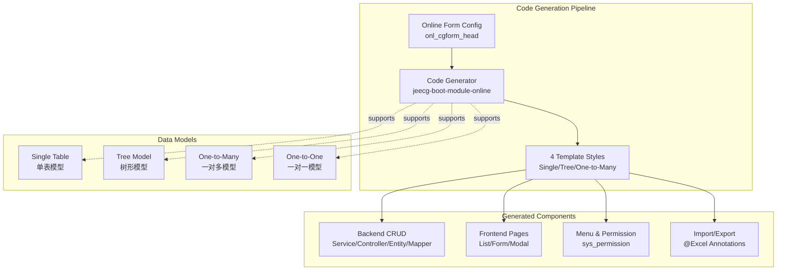
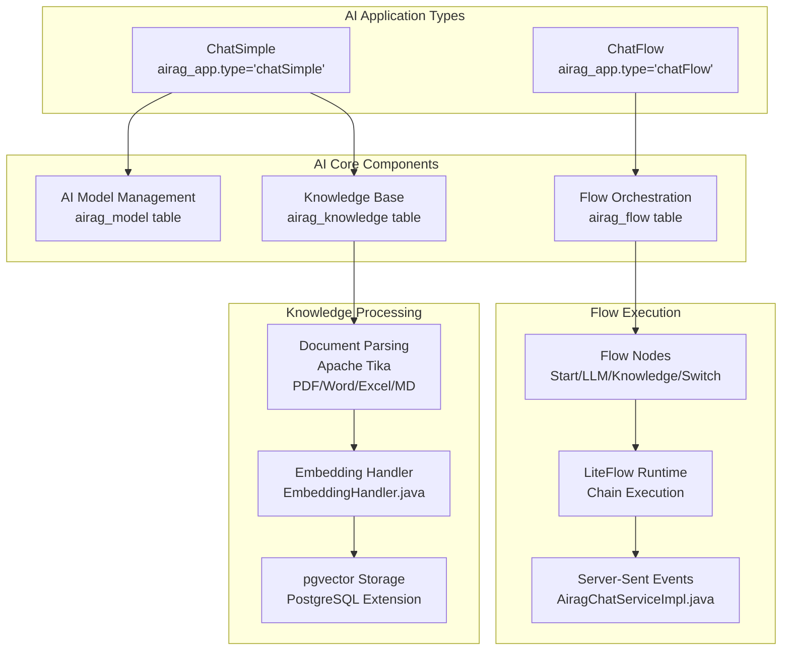
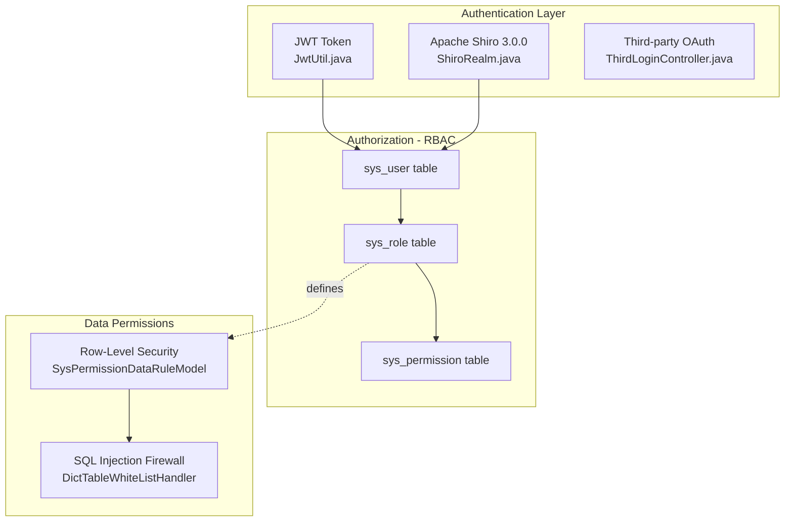

<!-- source: DeepWiki mcp.deepwiki.com · repo jeecgboot/JeecgBoot · page 1.1 Key Features & Capabilities · fetched 2026-10-29 -->

# Key Features & Capabilities

Relevant source files

The following files were used as context for generating this wiki page:

- [README-AI.md](README-AI.md)
- [README.en-US.md](README.en-US.md)
- [README.ja-JP.md](README.ja-JP.md)
- [README.md](README.md)
- [jeecg-boot/CLAUDE.md](jeecg-boot/CLAUDE.md)
- [jeecg-boot/README.md](jeecg-boot/README.md)
- [jeecg-boot/UPGRADE-3.9.3.md](jeecg-boot/UPGRADE-3.9.3.md)
- [jeecg-boot/db/Dockerfile](jeecg-boot/db/Dockerfile)
- [jeecg-boot/db/jeecgboot-mysql-5.7.sql](jeecg-boot/db/jeecgboot-mysql-5.7.sql)
- [jeecg-boot/db/tables_xxl_job.sql](jeecg-boot/db/tables_xxl_job.sql)
- [jeecg-boot/jeecg-module-system/jeecg-system-start/src/main/resources/flyway/sql/mysql/V3.9.0_0__all_upgrade.sql](jeecg-boot/jeecg-module-system/jeecg-system-start/src/main/resources/flyway/sql/mysql/V3.9.0_0__all_upgrade.sql)
- [jeecg-boot/jeecg-module-system/jeecg-system-start/src/main/resources/flyway/sql/mysql/V3.9.1_0__all_upgrade.sql](jeecg-boot/jeecg-module-system/jeecg-system-start/src/main/resources/flyway/sql/mysql/V3.9.1_0__all_upgrade.sql)
- [jeecg-boot/jeecg-server-cloud/jeecg-visual/jeecg-cloud-xxljob/doc/db/tables_xxl_job.sql](jeecg-boot/jeecg-server-cloud/jeecg-visual/jeecg-cloud-xxljob/doc/db/tables_xxl_job.sql)
- [jeecgboot-vue3/README.md](jeecgboot-vue3/README.md)

This document provides a comprehensive overview of JeecgBoot's core features and capabilities. It covers the platform's low-code development tools, AI integration, code generation, security mechanisms, and technical architecture features. For detailed information about specific subsystems:
- For technology stack details, see [Technology Stack](#1.2)
- For architecture patterns, see [System Architecture Overview](#2.1)
- For AI platform specifics, see [AI Platform (AIGC)](#3)
- For low-code tools, see [Low-Code Development Platform](#5)

---

## Feature Categories Overview

JeecgBoot provides five major categories of capabilities:

| Category | Core Capabilities | Primary Use Case |
|----------|------------------|------------------|
| **Low-Code Development** | Code generators, online form designers, visual configuration | Rapid CRUD application development without manual coding |
| **AI Integration** | LLM model management, RAG knowledge base, workflow orchestration | Building intelligent applications with conversational AI |
| **Enterprise Security** | RBAC, JWT/Shiro, data permissions, OAuth | Fine-grained access control and authentication |
| **Microservices Infrastructure** | Nacos, Gateway, Sentinel, distributed transactions | Scalable cloud-native deployment |
| **Multi-Platform Frontend** | Vue3, PWA, Electron, Uniapp | Cross-platform application deployment |

**Sources:** [README.md:19-51](), [jeecg-boot/README.md:15-34]()

---

## Low-Code Development Features

### Code Generator System

The code generator (`Online表单` and `代码生成器`) provides four template styles and supports multiple data models:

**Key Features:**
- **One-Click Generation**: Complete frontend and backend code generation with zero manual coding [README.md:140-141]().
- **Query Filter Auto-Generation**: `QueryGenerator` utility automatically builds SQL queries from page configurations [CLAUDE.md:99-100]().
- **Excel Integration**: Generated code includes `@Excel` annotations for import/export functionality via `AutoPoi` [CLAUDE.md:79]().
- **Custom Templates**: Template mechanism supports user-defined code generation patterns [README.md:141-142]().
- **23 Control Types**: Support for text, number, date, select, radio, checkbox, upload, popup, list, and more [README.md:143-144]().

**Sources:** [README.md:135-145](), [jeecg-boot/README.md:135-141](), [CLAUDE.md:85-102]()

### Online Form Designer (零代码开发)

The online form system enables zero-code CRUD development through visual configuration:

| Feature | Implementation | Configuration Path |
|---------|----------------|-------------------|
| Form Controls | 23 built-in types | `onl_cgform_field` table |
| Validation Rules | Auto-generated client/server-side | `ValidationRuleHandler` |
| Data Models | Single/Tree/One-to-Many/One-to-One | Online Form UI |
| Field Permissions | Hide/Disable by role | `sys_permission_data_rule` |
| Custom Enhancement | Inline code editor | Java/SQL/JS support |

**Key Classes:**
- Form configuration storage: `OnlCgformHead` entity [CLAUDE.md:140-141]().
- Field configuration: `OnlCgformField` entity [CLAUDE.md:140-141]().
- Enhanced development: Online code editor with syntax highlighting [README.md:145]().

**Sources:** [README.md:143-145](), [CLAUDE.md:138-143]()

---

## AI Platform Capabilities

### AI Application Architecture

JeecgBoot provides a complete AIGC platform comparable to Dify, with deeper business system integration [README-AI.md:30-40]():

**AI vs Low-Code Integration:**
- **AI Skills**: One-sentence system generation via `jeecg-codegen` skill [jeecg-boot/README.md:56-68]().
- **AI Flow as Business Engine**: AI workflows can orchestrate business logic using `JavaNode` and `HTTPNode` [README-AI.md:155-157]().
- **Unified Platform**: Low-code forms and AI capabilities share the same security and permission model [README-AI.md:41-54]().

**Sources:** [README-AI.md:1-115](), [jeecg-boot/README.md:35-68](), [UPGRADE-3.9.3.md:200-231]()

### Supported AI Models and Features

| Model Provider | Configuration | Features Supported |
|---------------|---------------|-------------------|
| DeepSeek | Default | Chat, streaming, high speed [README.md:146-147]() |
| ChatGPT | Supported | Chat, streaming, function calling [README.md:146-147]() |
| Ollama | Supported | Local deployment, custom models [README-AI.md:101-115]() |
| Qwen (千问) | Supported | Chat, streaming [README-AI.md:112]() |
| Zhipu AI (智普) | Supported | Chat, embeddings [README-AI.md:108]() |
| Claude | Supported | Chat, streaming [README-AI.md:109]() |

**Configuration Storage**: `airag_model` table holds provider details and API parameters [README-AI.md:133-141]().

**Sources:** [README.md:146-147](), [README-AI.md:101-115](), [UPGRADE-3.9.3.md:196-198]()

---

## Enterprise Security Features

### Multi-Layer Permission Architecture

**Permission Control Features:**

1. **RBAC (Role-Based Access Control)**: User-Role-Menu hierarchy with button-level control [README.md:141-142]().
2. **Data Permissions**: `SysPermissionDataRuleModel` dynamically injects SQL filters based on user/role context [README.md:141-142]().
3. **API Security**: JWT validation via `JwtUtil` and Shiro filters; SQL injection prevention via `DictTableWhiteListHandler` [CLAUDE.md:75](), [CLAUDE.md:132]().

**Sources:** [README.md:141-142](), [CLAUDE.md:75](), [CLAUDE.md:132]()

---

## Database & Data Layer Features

### Multi-Database Compatibility Matrix

JeecgBoot supports 8 major database systems with a single codebase [README.md:192-208]():

| Database | Support | Key Implementation |
|----------|---------|--------------------|
| MySQL | Native | Default schema in `jeecgboot-mysql-5.7.sql` |
| PostgreSQL | Native | Required for `pgvector` AI features |
| Oracle | Native | Database-specific profiles |
| SQL Server | Native | Database-specific profiles |
| Dameng (达梦) | Native | Xinchuang (信创) compatibility |
| Kingbase (人大金仓) | Native | Xinchuang (信创) compatibility |
| TiDB | Native | Distributed database support |

**Sources:** [README.md:72-75](), [jeecg-boot/README.md:177-189](), [CLAUDE.md:118-124]()

---

## Microservices Infrastructure

JeecgBoot supports a Spring Cloud Alibaba microservices architecture (activated via `-P SpringCloud`) [CLAUDE.md:31]():

- **Nacos 3.2.2**: Service registry and dynamic configuration center [UPGRADE-3.9.3.md:128-147]().
- **Gateway**: Spring Cloud Gateway for dynamic routing and rate limiting [CLAUDE.md:68]().
- **Sentinel 1.8.10**: Traffic control and circuit breaking [UPGRADE-3.9.3.md:191]().
- **XXL-JOB 3.4.2**: Distributed task scheduling [UPGRADE-3.9.3.md:75-126]().
- **Seata**: Distributed transactions for microservice coordination [CLAUDE.md:83]().

**Sources:** [UPGRADE-3.9.3.md:7-21](), [UPGRADE-3.9.3.md:75-181](), [CLAUDE.md:67-83]()

---

## Frontend & UI Features

JeecgBoot-Vue3 uses a modern stack for enterprise UI [jeecgboot-vue3/README.md:14-18]():

- **Vue 3.5 + Vite 6**: Fast build system and reactive UI components [jeecgboot-vue3/README.md:14]().
- **Ant Design Vue 4**: Enterprise-grade component library [jeecgboot-vue3/README.md:87]().
- **TypeScript 5.7**: Full type safety across the frontend [jeecgboot-vue3/README.md:88]().
- **JVXETable**: High-performance row-editable table for complex ERP layouts [README.md:147]().
- **PWA Support**: Service worker integration for offline capabilities [README.md:88]().

**Sources:** [README.md:133-147](), [jeecgboot-vue3/README.md:14-95]()

---

## Report & Visualization Tools

- **JimuReport**: Open-source enterprise Web report tool for complex reports via drag-and-drop [README.md:39-40]().
- **JimuBI**: Dashboard and large screen design tool focusing on digital twins and data visualization [README.md:41-42]().
- **ECharts**: Integrated for responsive data charts and maps [README.md:142]().

**Sources:** [README.md:39-42](), [README.md:142]()

---

