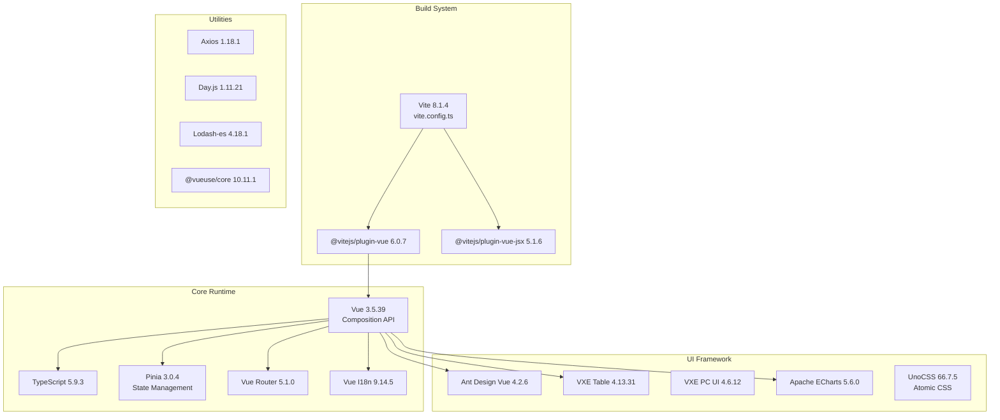
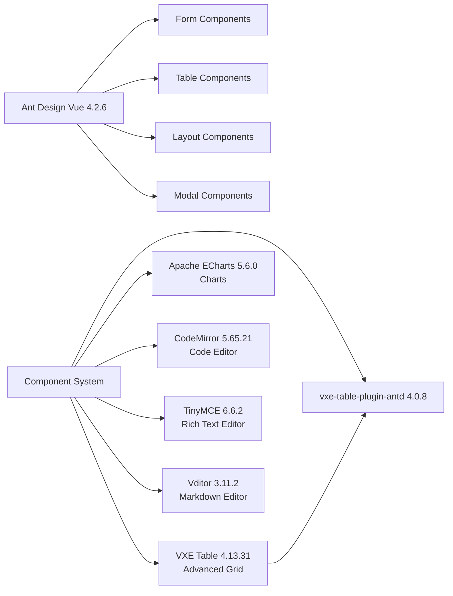
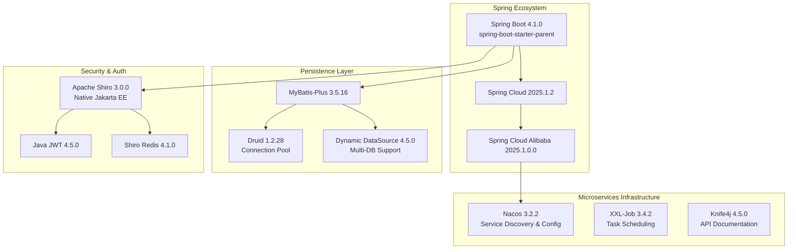
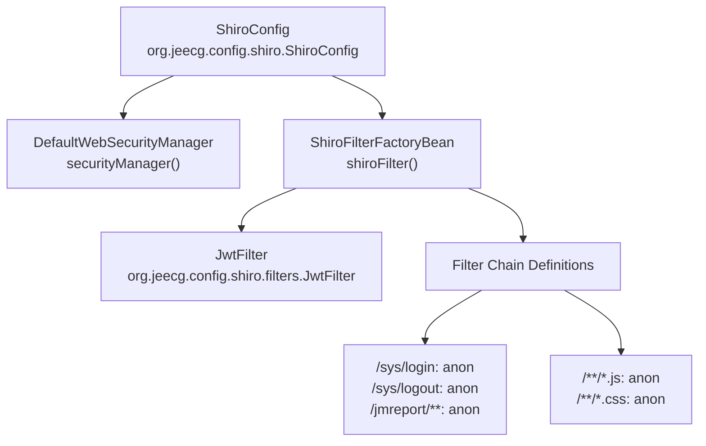
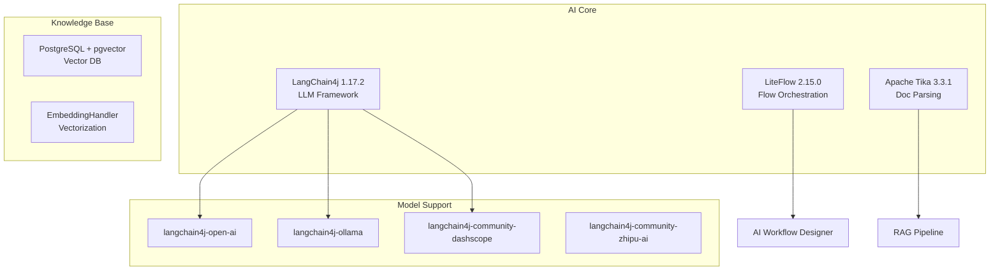
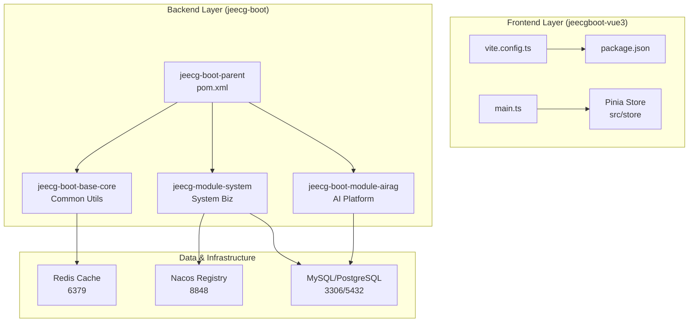

<!-- source: DeepWiki mcp.deepwiki.com · repo jeecgboot/JeecgBoot · page 1.2 Technology Stack · fetched 2026-10-29 -->

# Technology Stack

Relevant source files

The following files were used as context for generating this wiki page:

- [README-AI.md](README-AI.md)
- [README.en-US.md](README.en-US.md)
- [README.ja-JP.md](README.ja-JP.md)
- [README.md](README.md)
- [jeecg-boot/CLAUDE.md](jeecg-boot/CLAUDE.md)
- [jeecg-boot/README.md](jeecg-boot/README.md)
- [jeecg-boot/jeecg-boot-base-core/pom.xml](jeecg-boot/jeecg-boot-base-core/pom.xml)
- [jeecg-boot/jeecg-boot-base-core/src/main/java/org/jeecg/common/util/encryption/AesEncryptUtil.java](jeecg-boot/jeecg-boot-base-core/src/main/java/org/jeecg/common/util/encryption/AesEncryptUtil.java)
- [jeecg-boot/jeecg-boot-base-core/src/main/java/org/jeecg/config/shiro/ShiroConfig.java](jeecg-boot/jeecg-boot-base-core/src/main/java/org/jeecg/config/shiro/ShiroConfig.java)
- [jeecg-boot/jeecg-boot-module/jeecg-boot-module-airag/pom.xml](jeecg-boot/jeecg-boot-module/jeecg-boot-module-airag/pom.xml)
- [jeecg-boot/pom.xml](jeecg-boot/pom.xml)
- [jeecgboot-vue3/README.md](jeecgboot-vue3/README.md)
- [jeecgboot-vue3/VITE8-UPGRADE-LOG.md](jeecgboot-vue3/VITE8-UPGRADE-LOG.md)
- [jeecgboot-vue3/package.json](jeecgboot-vue3/package.json)
- [jeecgboot-vue3/pnpm-lock.yaml](jeecgboot-vue3/pnpm-lock.yaml)
- [jeecgboot-vue3/src/router/guard/paramMenuGuard.ts](jeecgboot-vue3/src/router/guard/paramMenuGuard.ts)
- [jeecgboot-vue3/src/router/guard/permissionGuard.ts](jeecgboot-vue3/src/router/guard/permissionGuard.ts)
- [jeecgboot-vue3/src/router/index.ts](jeecgboot-vue3/src/router/index.ts)
- [jeecgboot-vue3/src/store/modules/app.ts](jeecgboot-vue3/src/store/modules/app.ts)
- [jeecgboot-vue3/src/store/modules/defIndex.ts](jeecgboot-vue3/src/store/modules/defIndex.ts)
- [jeecgboot-vue3/src/store/modules/errorLog.ts](jeecgboot-vue3/src/store/modules/errorLog.ts)
- [jeecgboot-vue3/src/store/modules/locale.ts](jeecgboot-vue3/src/store/modules/locale.ts)
- [jeecgboot-vue3/src/store/modules/lock.ts](jeecgboot-vue3/src/store/modules/lock.ts)
- [jeecgboot-vue3/src/store/modules/multipleTab.ts](jeecgboot-vue3/src/store/modules/multipleTab.ts)

This page provides a comprehensive overview of the technologies, frameworks, and libraries used in JeecgBoot. It covers frontend, backend, infrastructure, and tooling components with their specific versions and integration points.

---

## Frontend Technology Stack

JeecgBoot's frontend is built with Vue 3 and modern JavaScript tooling, emphasizing type safety and developer experience.

### Core Framework

**Vue 3.5.39** serves as the foundation with Composition API support. The application uses **TypeScript 5.9.3** for static type checking across the entire frontend codebase.

**Sources:** [jeecgboot-vue3/package.json:25-180](), [jeecgboot-vue3/README.md:13-106]()

### Build & Development Tools

| Tool | Version | Purpose |
|------|---------|---------|
| **Vite** | 8.1.4 | Build tool and dev server |
| **pnpm** | 9+ (required) | Package manager |
| **Node.js** | 20+ (required) | JavaScript runtime ([jeecgboot-vue3/package.json:191]()) |
| **ESLint** | 8.57.1 | Code linting |
| **Prettier** | 3.9.5 | Code formatting |
| **TypeScript Compiler** | 5.9.3 | Type checking |

The build configuration is managed in `vite.config.ts`, which includes:
- **Code splitting** via manual chunks.
- **PWA support** via `vite-plugin-pwa` 1.3.0 ([jeecgboot-vue3/package.json:170]()).
- **Icon optimization** via `unplugin-icons` and `vite-plugin-svg-icons`.
- **Docker mode** build scripts ([jeecgboot-vue3/package.json:14-15]()).

**Sources:** [jeecgboot-vue3/package.json:9-180](), [jeecgboot-vue3/README.md:34-40]()

### UI Component Library

**Key Libraries:**
- **Ant Design Vue 4.2.6**: Primary component library.
- **VXE Table 4.13.31**: High-performance data grid for complex ERP layouts ([jeecgboot-vue3/package.json:82]()).
- **Apache ECharts 5.6.0**: Data visualization and charting ([jeecgboot-vue3/package.json:47]()).
- **UnoCSS 66.7.5**: Atomic CSS engine for utility-first styling ([jeecgboot-vue3/package.json:174]()).

**Sources:** [jeecgboot-vue3/package.json:25-91](), [README.md:132-147]()

### Module Integration

JeecgBoot uses dynamic package registration for modular features:

- **@jeecg/aiflow 3.9.2-beta**: AI Workflow orchestration module ([jeecgboot-vue3/package.json:26]()).
- **LogicFlow**: Core engine for visual flow design ([jeecgboot-vue3/package.json:27-29]()).

**Sources:** [jeecgboot-vue3/package.json:26-31]()

---

## Backend Technology Stack

JeecgBoot's backend is built on Spring Boot 4 (parent) with Spring Cloud Alibaba for microservices capabilities.

### Core Framework Versions

**Key Version Requirements:**
- **JDK**: 17 (Default), 21, 24, 25 ([jeecg-boot/pom.xml:33-34]())
- **Spring Boot**: 4.1.0 ([jeecg-boot/pom.xml:26]())
- **Maven**: Dependency management

**Sources:** [jeecg-boot/pom.xml:23-86](), [README.md:81-85]()

### Persistence & Data Access

| Component | Version | Purpose |
|-----------|---------|---------|
| **MyBatis-Plus** | 3.5.16 | ORM with code generation ([jeecg-boot/pom.xml:65]()) |
| **Druid** | 1.2.28 | Connection pooling ([jeecg-boot/pom.xml:67]()) |
| **Dynamic DataSource** | 4.5.0 | Multi-database support ([jeecg-boot/jeecg-boot-base-core/pom.xml:135]()) |
| **MiniDao** | 1.10.22 | Lightweight SQL execution ([jeecg-boot/pom.xml:61]()) |

**Database Drivers Included:**
- MySQL Connector: 8.0.27
- PostgreSQL: 42.2.25
- Oracle OJDBC6: 11.2.0.3
- SQL Server: 12.6.1.jre8
- Kingbase8: 9.0.0
- DM8: 8.1.3.140

**Sources:** [jeecg-boot/pom.xml:48-56](), [jeecg-boot/jeecg-boot-base-core/pom.xml:145-191]()

### Security Framework Configuration

The security layer uses Apache Shiro 3.0.0 with native Jakarta EE support:

**Key Configuration:**
- **Shiro Version**: 3.0.0 ([jeecg-boot/pom.xml:76]())
- **JWT Library**: com.auth0:java-jwt 4.5.0 ([jeecg-boot/pom.xml:78]())
- **Session Storage**: Redis via `shiro-redis` 4.1.0 ([jeecg-boot/pom.xml:77]())
- **Excluded Paths**: [jeecg-boot/jeecg-boot-base-core/src/main/java/org/jeecg/config/shiro/ShiroConfig.java:86-150]()

**Sources:** [jeecg-boot/jeecg-boot-base-core/src/main/java/org/jeecg/config/shiro/ShiroConfig.java:1-150](), [jeecg-boot/pom.xml:75-78]()

### AI & Machine Learning Stack

JeecgBoot integrates with LLM providers through the `jeecg-boot-module-airag` module.

**AI Components:**
- **LangChain4j 1.17.2**: Core AI orchestration ([jeecg-boot/jeecg-boot-module/jeecg-boot-module-airag/pom.xml:45]()).
- **LiteFlow 2.15.0**: Engine for AI workflow nodes ([jeecg-boot/jeecg-boot-module/jeecg-boot-module-airag/pom.xml:35]()).
- **Apache Tika 3.3.1**: Used for document parsing in RAG knowledge bases ([jeecg-boot/jeecg-boot-module/jeecg-boot-module-airag/pom.xml:36]()).
- **Models**: Supports DeepSeek (default), ChatGPT, Ollama, Zhipu, etc. ([README.md:146]()).

**Sources:** [jeecg-boot/jeecg-boot-module/jeecg-boot-module-airag/pom.xml:33-190](), [README-AI.md:101-115]()

---

## Infrastructure & Middleware

### Microservices Versions
- **Spring Cloud**: 2025.1.2 ([jeecg-boot/pom.xml:38]())
- **Spring Cloud Alibaba**: 2025.1.0.0 ([jeecg-boot/pom.xml:39]())
- **Nacos**: 3.2.2 ([jeecg-boot/pom.xml:40]())
- **XXL-Job**: 3.4.2 ([jeecg-boot/pom.xml:42]())

### Third-Party Service Integration
- **MinIO**: 9.0.3 ([jeecg-boot/pom.xml:80]())
- **Aliyun OSS**: 3.17.3 ([jeecg-boot/pom.xml:73]())
- **FastJSON**: 2.0.58 ([jeecg-boot/pom.xml:43]())
- **Hutool**: 5.8.25 ([jeecg-boot/pom.xml:53]())

**Sources:** [jeecg-boot/pom.xml:30-86](), [jeecg-boot/jeecg-boot-base-core/pom.xml:42-249]()

---

## Technology Integration Diagram

This diagram maps the high-level technology stack to specific code entities and configuration files.

**Sources:** [jeecg-boot/pom.xml:88-92](), [jeecgboot-vue3/package.json:1-25](), [README.md:87-90]()

---

