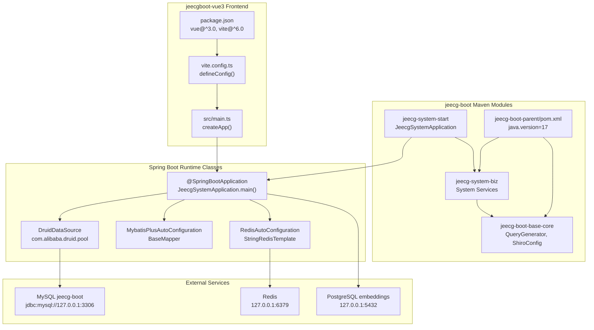
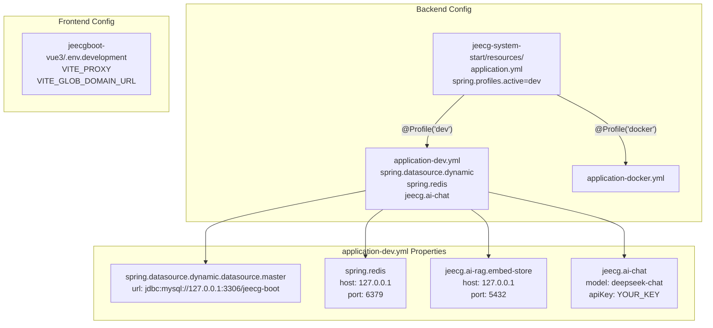

<!-- source: DeepWiki mcp.deepwiki.com · repo jeecgboot/JeecgBoot · page 1.3 System Requirements & Environment Setup · fetched 2026-10-29 -->

# System Requirements & Environment Setup

<details>
<summary>Relevant source files</summary>

The following files were used as context for generating this wiki page:

- [README-AI.md](README-AI.md)
- [README.en-US.md](README.en-US.md)
- [README.ja-JP.md](README.ja-JP.md)
- [README.md](README.md)
- [check_jeecgenv.py](check_jeecgenv.py)
- [jeecg-boot/CLAUDE.md](jeecg-boot/CLAUDE.md)
- [jeecg-boot/README.md](jeecg-boot/README.md)
- [jeecg-boot/jeecg-boot-base-core/src/main/java/org/jeecg/common/system/query/QueryGenerator.java](jeecg-boot/jeecg-boot-base-core/src/main/java/org/jeecg/common/system/query/QueryGenerator.java)
- [jeecg-boot/jeecg-boot-base-core/src/main/java/org/jeecg/common/system/util/SqlConcatUtil.java](jeecg-boot/jeecg-boot-base-core/src/main/java/org/jeecg/common/system/util/SqlConcatUtil.java)
- [jeecgboot-vue3/README.md](jeecgboot-vue3/README.md)

</details>


## Purpose and Scope

This document describes the system requirements and initial environment setup needed to run JeecgBoot (version 3.9.3) in both development and production environments. It covers the prerequisites for backend services, frontend applications, database systems, and optional AI platform components.

For detailed instructions on starting the application after setup, see Quick Start Guide [#1.4](). For database schema and configuration details, see Database & Data Layer [#4](). For AI-specific configuration including model management and vector databases, see AI Platform (AIGC) [#3]().

---

## System Requirements Overview

JeecgBoot version 3.9.3 supports two deployment modes: **monolithic** (single `jeecg-system-start` process) and **microservices** (distributed `jeecg-cloud-*` services). Base requirements are identical; microservices mode adds Nacos, Sentinel, and Gateway dependencies.

### Minimum Requirements Summary

| Component | Version | Required For | Configuration Location |
|-----------|---------|-------------|------------------------|
| JDK | 17 (default), 21, 24 | `jeecg-boot-parent` build | `pom.xml` `<java.version>17</java.version>` |
| Maven | 3.6+ | Backend build | Manages `jeecg-boot-parent` modules |
| Node.js | 20+ | `jeecgboot-vue3` build | Required by Vite 6 (`vite.config.ts`) |
| pnpm | 9+ | Frontend dependencies | `jeecgboot-vue3/package.json` |
| MySQL | 8.0+ (default) | `spring.datasource.dynamic` | `application-dev.yml` master datasource |
| Redis | Any stable | `spring.redis` | `application-dev.yml` cache/session |
| PostgreSQL + pgvector | 12+ (optional) | `jeecg.ai-rag.embed-store` | `application-dev.yml` AI embeddings |

**Sources:** [README.md:8-14](), [README.md:132-133](), [jeecgboot-vue3/README.md:36-40](), [jeecg-boot/CLAUDE.md:9](), [jeecg-boot/CLAUDE.md:119]()

---

## Environment Dependency Architecture



**Purpose:** Maps JDK, Maven, Node.js, and pnpm requirements to specific code entry points. Backend starts at `JeecgSystemApplication.main()` [jeecg-boot/jeecg-module-system/jeecg-system-start/src/main/java/org/jeecg/JeecgSystemApplication.java](). Frontend builds via `vite.config.ts` [jeecgboot-vue3/vite.config.ts](). Database connections configured through `DruidDataSource` pool [jeecg-boot/CLAUDE.md:76]().

**Sources:** [jeecg-boot/README.md:88-90](), [jeecgboot-vue3/README.md:14](), [jeecg-boot/CLAUDE.md:40-65]()

---

## Backend Requirements

### Java Development Kit (JDK)

**Required Version:** JDK 17 (default), JDK 21 or JDK 24 supported.

**Verification:**
```bash
java -version
# Expected: openjdk version "17.x.x" or "21.x.x" or "24.x.x"
```

**Maven Compiler Configuration:** The platform uses the `jakarta` namespace (not `javax`) throughout [jeecg-boot/CLAUDE.md:9](). The root POM [jeecg-boot/pom.xml]() specifies the Java version requirement.

**Sources:** [jeecg-boot/CLAUDE.md:9](), [check_jeecgenv.py:17-37]()

### Maven

**Required Version:** 3.6+ (3.8+ recommended).

**Verification:**
```bash
mvn -v
# Expected: Apache Maven 3.x.x, Java version: 17.x.x
```

**Module Hierarchy:** Maven manages dependencies through `jeecg-boot-parent` [jeecg-boot/CLAUDE.md:40]():

| Module Path | Artifact ID | Purpose |
|-------------|-------------|---------|
| `jeecg-boot-parent` | `jeecg-boot-parent` | Root POM, dependency versions |
| `jeecg-boot-base-core` | `jeecg-boot-base-core` | Core framework: Shiro/JWT auth, MyBatis-Plus config |
| `jeecg-module-system/jeecg-system-biz` | `jeecg-system-biz` | Business logic, entities, services |
| `jeecg-module-system/jeecg-system-start` | `jeecg-system-start` | Main entry point (port 8080) |
| `jeecg-server-cloud/jeecg-cloud-gateway` | `jeecg-cloud-gateway` | Microservices gateway (port 9999) |

**Sources:** [jeecg-boot/CLAUDE.md:40-68](), [check_jeecgenv.py:39-48]()

### Database Support Matrix

JeecgBoot supports 8 database types through its unified data access layer [README.md:138]().

| Database | Support Status | JDBC Driver | Notes |
|----------|---------------|-------------|-------|
| MySQL | ✅ Primary | `com.mysql.cj.jdbc.Driver` | Default (8.0+), scripts provided |
| Oracle 11g+ | ✅ Full | Oracle JDBC | Supported via profiles |
| SQL Server 2017+| ✅ Full | SQL Server JDBC | Supported via profiles |
| PostgreSQL | ✅ Full | PostgreSQL JDBC | Required for AI vector features |
| MariaDB | ✅ Full | MariaDB JDBC | MySQL-compatible |
| 达梦 (DM8) | ✅ Full | DM JDBC | 信创兼容 |
| 人大金仓 | ✅ Full | Kingbase JDBC | 信创兼容 |
| TiDB | ✅ Full | MySQL JDBC | Distributed database |

**Sources:** [README.md:72-75](), [jeecg-boot/CLAUDE.md:119]()

---

## Frontend Requirements

### Node.js

**Required Version:** Node.js 20+

This is a strict requirement due to Vite 6, which no longer supports EOL (End of Life) Node.js versions below 20 [jeecgboot-vue3/README.md:39]().

**Verification:**
```bash
node -v
# Expected output: v20.x.x or higher
```

**Sources:** [jeecgboot-vue3/README.md:37-39](), [check_jeecgenv.py:51-70]()

### pnpm Package Manager

**Required Version:** pnpm 9+

pnpm is the required package manager for the `jeecgboot-vue3` project [jeecgboot-vue3/README.md:36]().

**Installation:**
```bash
npm install -g pnpm
```

**Dependency Installation:**
```bash
cd jeecgboot-vue3
pnpm install
```

**Sources:** [jeecgboot-vue3/README.md:54](), [check_jeecgenv.py:72-93]()

---

## Configuration File Structure



**Sources:** [jeecgboot-vue3/README.md:57-62](), [jeecg-boot/CLAUDE.md:127-132](), [check_jeecgenv.py:100-159]()

---

## Required Services Configuration

### Redis Configuration

Redis is used for Shiro session management, token caching, and distributed locks [jeecg-boot/CLAUDE.md:75]().

**Property Structure:**
```yaml
spring:
  redis:
    database: 0
    host: 127.0.0.1
    port: 6379
    password: ''
```

**Sources:** [check_jeecgenv.py:165-171]()

### MySQL Configuration

MySQL stores the primary system schema. Initial scripts are located in `db/jeecgboot-mysql-5.7.sql` [jeecg-boot/CLAUDE.md:121]().

**Property Structure:**
```yaml
spring:
  datasource:
    dynamic:
      datasource:
        master:
          url: jdbc:mysql://127.0.0.1:3306/jeecg-boot?characterEncoding=UTF-8&useUnicode=true&useSSL=false&tinyInt1isBit=false&allowPublicKeyRetrieval=true&serverTimezone=Asia/Shanghai
          username: root
          password: root
          driver-class-name: com.mysql.cj.jdbc.Driver
```

**Sources:** [check_jeecgenv.py:115-120](), [jeecg-boot/CLAUDE.md:121]()

---

## Optional AI Platform Configuration

### AI Model API (DeepSeek/OpenAI)

JeecgBoot supports AI models like DeepSeek, ChatGPT, and Ollama [README.md:32]().

**File:** `application-dev.yml`
```yaml
jeecg:
  ai-chat:
    enabled: true
    model: deepseek-chat
    apiKey: YOUR_API_KEY
    apiHost: https://api.deepseek.com/v1
```

**Sources:** [README-AI.md:68-71](), [check_jeecgenv.py:151-157]()

### PostgreSQL + pgvector for RAG

Required for the Knowledge Base and RAG (Retrieval-Augmented Generation) features [README-AI.md:6]().

**File:** `application-dev.yml`
```yaml
jeecg:
  ai-rag:
    embed-store:
      host: 127.0.0.1
      port: 5432
      database: postgres
      user: postgres
      password: postgres
      table: embeddings
```

**Sources:** [README-AI.md:60](), [check_jeecgenv.py:130-138]()

---

## Environment Verification

### Automated Verification Script

A Python utility `check_jeecgenv.py` is provided to validate the local environment.

**Verification Tasks:**
1. **Java:** `check_java()` parses `java -version` for version 17+ [check_jeecgenv.py:17-37]().
2. **Maven:** `check_maven()` verifies `mvn -v` [check_jeecgenv.py:39-48]().
3. **Node.js:** `check_node()` validates Node.js 20+ [check_jeecgenv.py:51-70]().
4. **pnpm:** `check_pnpm()` validates pnpm 9+ [check_jeecgenv.py:72-93]().

**Sources:** [check_jeecgenv.py:1-216]()

---

## Next Steps

After completing environment setup:

1. **Quick Start:** Follow the Quick Start Guide [#1.4]() to run the platform.
2. **AI Configuration:** If using AI features, see Knowledge Base & RAG System [#3.3]().
3. **Microservices:** For Spring Cloud mode, refer to Nacos Configuration [#2.4.1]().

**Sources:** [README.md:100-104]()

---

