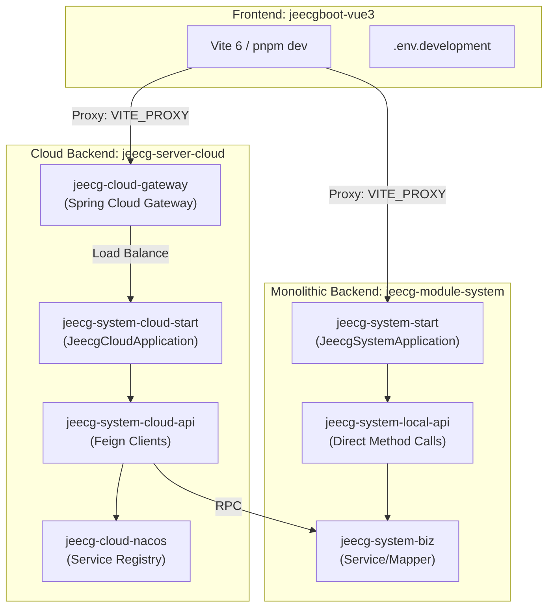
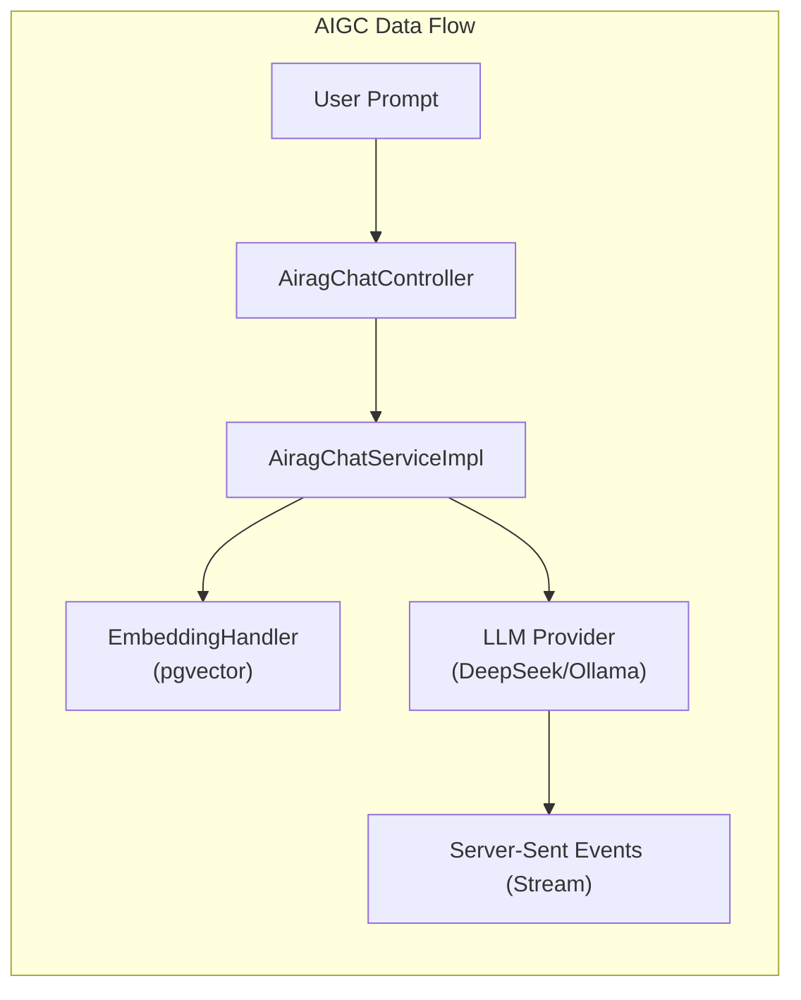

<!-- source: DeepWiki mcp.deepwiki.com · repo jeecgboot/JeecgBoot · page 1.4 Quick Start Guide · fetched 2026-10-29 -->

# Quick Start Guide

<details>
<summary>Relevant source files</summary>

The following files were used as context for generating this wiki page:

- [README-AI.md](README-AI.md)
- [README.en-US.md](README.en-US.md)
- [README.ja-JP.md](README.ja-JP.md)
- [README.md](README.md)
- [docker-compose-cloud.yml](docker-compose-cloud.yml)
- [docker-compose.yml](docker-compose.yml)
- [jeecg-boot/CLAUDE.md](jeecg-boot/CLAUDE.md)
- [jeecg-boot/README.md](jeecg-boot/README.md)
- [jeecg-boot/docker-compose.yml](jeecg-boot/docker-compose.yml)
- [jeecgboot-vue3/.env.docker](jeecgboot-vue3/.env.docker)
- [jeecgboot-vue3/.env.dockercloud](jeecgboot-vue3/.env.dockercloud)
- [jeecgboot-vue3/Dockerfile.cloud](jeecgboot-vue3/Dockerfile.cloud)
- [jeecgboot-vue3/README.md](jeecgboot-vue3/README.md)
- [start-docker-compose-cloud.bat](start-docker-compose-cloud.bat)
- [start-docker-compose-cloud.sh](start-docker-compose-cloud.sh)
- [start-docker-compose.bat](start-docker-compose.bat)
- [start-docker-compose.sh](start-docker-compose.sh)

</details>


## Purpose and Scope

This guide provides step-by-step instructions for quickly deploying JeecgBoot using Docker Compose and setting up a local development environment. It covers both **Single Instance (Monolithic)** and **Microservices** deployment modes, enabling developers to have a running system within minutes.

JeecgBoot supports a "half-intelligent" development mode where simple functions are handled via `OnlineCoding` (zero-code) and complex logic is handled via the code generator with manual merging [README.md:45-48]().

**Sources:** [README.md:95-105](), [jeecg-boot/README.md:93-102](), [docker-compose.yml:1-77](), [docker-compose-cloud.yml:1-155]()

---

## Development Environment Prerequisites

Before starting, ensure your host system has the following tools installed as per the technical requirements [README.md:100-104]():

| Tool | Version | Purpose |
|------------|----------------|---------|
| **JDK** | 17+ (Supports 21, 24) | Backend runtime [jeecg-boot/CLAUDE.md:9-9]() |
| **Node.js** | 20+ | Frontend build system [jeecgboot-vue3/README.md:37-39]() |
| **pnpm** | 9+ | Frontend package manager [jeecgboot-vue3/README.md:36-36]() |
| **Maven** | 3.8+ | Backend build tool [jeecg-boot/CLAUDE.md:13-35]() |
| **MySQL** | 8.0+ | Primary relational database [jeecg-boot/CLAUDE.md:119-119]() |
| **Redis** | 5.0+ | Caching and session management [jeecg-boot/CLAUDE.md:130-130]() |
| **Docker** | 20.10+ | Container orchestration [docker-compose.yml:1-1]() |

**Sources:** [jeecgboot-vue3/README.md:34-40](), [jeecg-boot/CLAUDE.md:7-12](), [README.md:132-151]()

---

## Deployment Mode Selection

JeecgBoot supports two primary architectural patterns that can be switched via Maven profiles and dependency management [jeecg-boot/CLAUDE.md:101-101]().

### Mode Comparison

| Aspect | Monolithic (Single) | Microservices (Cloud) |
|--------|----------------|---------------|
| **Primary Module** | `jeecg-system-start` [jeecg-boot/CLAUDE.md:48-48]() | `jeecg-system-cloud-start` [jeecg-boot/CLAUDE.md:68-68]() |
| **Gateway** | Direct access (Port 8080) | `jeecg-cloud-gateway` (Port 9999) [docker-compose-cloud.yml:91-91]() |
| **Registry** | None (Local API) | `jeecg-cloud-nacos` (Port 8848) [docker-compose-cloud.yml:50-50]() |
| **Maven Profile** | Default | `-P SpringCloud` [jeecg-boot/CLAUDE.md:31-31]() |
| **Implementation** | `jeecg-system-local-api` | `jeecg-system-cloud-api` (Feign) [jeecg-boot/CLAUDE.md:44-46]() |

### Data Flow Architecture (Code Entities)

The following diagram bridges the logical deployment to specific code modules and service entry points.



**Sources:** [jeecg-boot/CLAUDE.md:37-69](), [jeecgboot-vue3/README.md:57-64](), [docker-compose-cloud.yml:86-111]()

---

## Docker Quick Start (One-Click)

JeecgBoot provides scripts for automated compilation and container startup.

### Step 1: Automated Build & Start
On Windows, use the provided batch script to compile both frontend and backend and launch containers [start-docker-compose.bat:1-94]():

```bash
# This script checks tools, sets hosts, builds Java (mvn), builds Vue (pnpm), and runs docker-compose
./start-docker-compose.bat
```

### Step 2: Manual Launch (Single Mode)
If you have already built the JAR and Dist files:
```bash
docker-compose up -d
```
This starts `jeecg-boot-mysql`, `jeecg-boot-redis`, `jeecg-boot-pgvector` (for AI), `jeecg-boot-system`, and `jeecg-vue` [docker-compose.yml:2-59]().

### Step 3: Manual Launch (Microservices)
```bash
docker-compose -f docker-compose-cloud.yml up -d
```
This configuration includes a health check for the gateway, waiting for `jeecg-system` to register in Nacos before starting [docker-compose-cloud.yml:97-109]():
```bash
# Wait loop in Gateway container
until curl -s 'http://jeecg-boot-nacos:8848/nacos/v3/admin/ns/instance/list?serviceName=jeecg-system' | grep -q '"healthy":true'; do
  sleep 5;
done;
```

**Sources:** [start-docker-compose.bat:58-85](), [docker-compose.yml:1-77](), [docker-compose-cloud.yml:97-109]()

---

## Local Development Startup (Monolithic)

For active development, it is recommended to run the backend in your IDE and the frontend via Vite.

### 1. Backend Setup
1. **Initialize Database**: Import `db/jeecgboot-mysql-5.7.sql` [jeecg-boot/CLAUDE.md:121-121]().
2. **Configure application-dev.yml**: Located in `jeecg-module-system/jeecg-system-start/src/main/resources/` [jeecg-boot/CLAUDE.md:127-129]().
3. **Run Application**: Execute `org.jeecg.JeecgSystemApplication` in the `jeecg-system-start` module [jeecg-boot/CLAUDE.md:48-48]().

### 2. Frontend Setup
1. **Install Dependencies**:
   ```bash
   cd jeecgboot-vue3
   pnpm install
   ```
2. **Configure Proxy**: Edit `.env.development` to point to your backend [jeecgboot-vue3/README.md:57-62]():
   ```bash
   VITE_PROXY = [["/jeecgboot","http://localhost:8080/jeecg-boot"]]
   VITE_GLOB_DOMAIN_URL=http://localhost:8080/jeecg-boot
   ```
3. **Start Development Server**:
   ```bash
   pnpm dev
   ```

**Sources:** [jeecgboot-vue3/README.md:43-71](), [jeecg-boot/CLAUDE.md:20-22](), [jeecg-boot/CLAUDE.md:127-130]()

---

## AI Platform Integration (Quick Start)

JeecgBoot includes a built-in AI application platform (AIGC). To enable this during quick start:

1. **Vector Database**: Ensure the `jeecg-boot-pgvector` container is running [docker-compose.yml:61-72]().
2. **AI Config**: Configure your LLM provider (DeepSeek, OpenAI, Ollama) in the system settings [README-AI.md:68-71]().
3. **Access**: Navigate to the "AI Application Platform" menu to manage models, knowledge bases, and flows [README-AI.md:89-97]().



**Sources:** [README-AI.md:1-115](), [docker-compose.yml:61-72](), [README.md:117-131]()

---

## Access & Verification

### Default Credentials
- **Account**: `admin`
- **Password**: `123456`
- **Sources**: [README.md:98](), [jeecg-boot/README.md:96]()

### Service Endpoints

| Service | Monolithic URL | Microservices URL |
|---------|----------------|-------------------|
| **Frontend UI** | http://localhost:3100 | http://localhost:80 (Docker) |
| **Backend API** | http://localhost:8080/jeecg-boot | http://localhost:9999 (Gateway) |
| **API Docs** | http://localhost:8080/jeecg-boot/doc.html | http://localhost:9999/doc.html |
| **Nacos** | N/A | http://localhost:8848/nacos |

**Sources:** [jeecgboot-vue3/README.md:60-71](), [docker-compose-cloud.yml:50-153](), [jeecg-boot/CLAUDE.md:20-22]()

---

