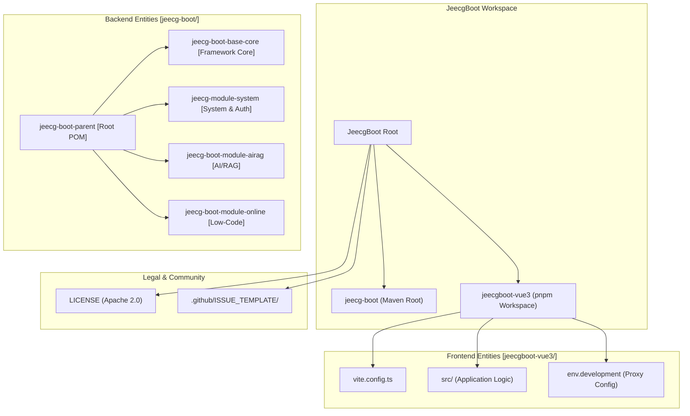
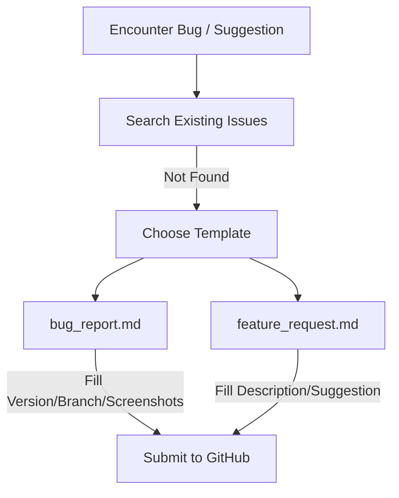

<!-- source: DeepWiki mcp.deepwiki.com · repo jeecgboot/JeecgBoot · page 10 Contributing & Community · fetched 2026-10-29 -->

# Contributing & Community

Relevant source files

The following files were used as context for generating this wiki page:

- [.github/ISSUE_TEMPLATE/bug_report.md](.github/ISSUE_TEMPLATE/bug_report.md)
- [.github/ISSUE_TEMPLATE/feature_request.md](.github/ISSUE_TEMPLATE/feature_request.md)
- [LICENSE](LICENSE)
- [README-AI.md](README-AI.md)
- [README.en-US.md](README.en-US.md)
- [README.ja-JP.md](README.ja-JP.md)
- [README.md](README.md)
- [jeecg-boot/CLAUDE.md](jeecg-boot/CLAUDE.md)
- [jeecg-boot/LICENSE](jeecg-boot/LICENSE)
- [jeecg-boot/README.md](jeecg-boot/README.md)
- [jeecgboot-vue3/LICENSE](jeecgboot-vue3/LICENSE)
- [jeecgboot-vue3/README.md](jeecgboot-vue3/README.md)

This page provides high-level guidelines for contributing to the JeecgBoot project, including development environment setup, issue reporting procedures, licensing information, and community engagement channels. JeecgBoot is an AI-powered low-code platform that thrives on community contributions to its backend, frontend, and AI capabilities.

## Overview of Contribution Areas

JeecgBoot welcomes contributions across multiple areas of the platform. The project is organized into several key repositories and modules:

| Contribution Area | Repository Component | Primary Technologies |
|------------------|---------------------|---------------------|
| Backend Core | `jeecg-boot/` | Spring Boot 3, MyBatis-Plus, Shiro [jeecg-boot/CLAUDE.md:41-43]() |
| Frontend UI | `jeecgboot-vue3/` | Vue 3, TypeScript, Vite 6, Ant Design Vue 4 [jeecgboot-vue3/README.md:14-14]() |
| AI Platform (AIGC) | `jeecg-boot-module-airag` | LiteFlow, LangChain4j, pgvector [jeecg-boot/CLAUDE.md:51-51]() |
| Low-Code Platform | `jeecg-boot-module-online` | Metadata-driven CRUD, Code Generator [jeecg-boot/CLAUDE.md:64-64]() |
| Microservices | `jeecg-server-cloud/` | Spring Cloud Alibaba (Nacos, Gateway) [jeecg-boot/CLAUDE.md:68-68]() |

## Project Structure for Contributors

The following diagram maps the logical system components to their physical code entities within the repository.

**Sources:** [jeecg-boot/CLAUDE.md:40-65](), [jeecgboot-vue3/README.md:57-62](), [LICENSE:1-213]()

## Key Developer Workflows

### 1. Development Environment Setup
JeecgBoot requires a specific stack including JDK 17+, Node 20+, and pnpm 9+. The project provides a validation script `check_jeecgenv.py` (referenced in child pages) to ensure your local environment meets enterprise requirements.
For details, see [Development Environment Setup](#10.1).

### 2. Issue Reporting & Feedback
We use GitHub Issues for bug tracking and feature suggestions. Standardized templates are provided to ensure high-quality reports that maintainers can act upon quickly.

**Issue Submission Flow:**

**Sources:** [.github/ISSUE_TEMPLATE/bug_report.md:1-29](), [.github/ISSUE_TEMPLATE/feature_request.md:1-28]()

For details, see [Issue Reporting & Bug Submission](#10.2).

## License & Governance

JeecgBoot follows a dual-license model:
*   **Backend (`jeecg-boot`)**: Licensed under **Apache License 2.0**. This allows commercial use and modification [LICENSE:1-213]().
*   **Frontend (`jeecgboot-vue3`)**: Licensed under the **MIT License** [jeecgboot-vue3/LICENSE:1-21]().

**Important Governance Rule:**
Both licenses contain a specific restriction: you may not use the software to develop products that compete directly with JeecgBoot [LICENSE:203-203](), [jeecgboot-vue3/LICENSE:23-23]().

For details, see [License & Legal](#10.3).

## Community Resources

*   **Official Website**: [http://www.jeecg.com](http://www.jeecg.com) [README.md:111-111]()
*   **Documentation**: [https://help.jeecg.com](https://help.jeecg.com) [README.md:112-112]()
*   **Issues & Feedback**: [GitHub Issues](https://github.com/jeecgboot/JeecgBoot/issues) [README.md:113-113]()
*   **QQ Groups**: 964611995, 716488839 [README.md:114-114]()

## Summary of Guidelines

1.  **Code Conventions**: Backend follows standard Maven/Spring patterns [jeecg-boot/CLAUDE.md:87-94](). Frontend uses Vue 3 Composition API with TypeScript [jeecgboot-vue3/README.md:14-14]().
2.  **Modification Logs**: All code changes must be wrapped in `update-begin` and `update-end` comments specifying the author, date, and reason [jeecg-boot/CLAUDE.md:103-109]().
3.  **Security**: Do not commit sensitive credentials; use environment variables or `application-dev.yml` [jeecg-boot/CLAUDE.md:127-130]().

---
**Sources:**
*   [README.md:1-151]()
*   [jeecg-boot/CLAUDE.md:1-143]()
*   [jeecgboot-vue3/README.md:1-106]()
*   [LICENSE:1-213]()
*   [.github/ISSUE_TEMPLATE/bug_report.md:1-29]()

---

