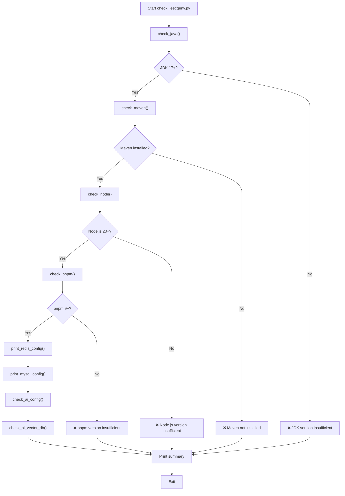
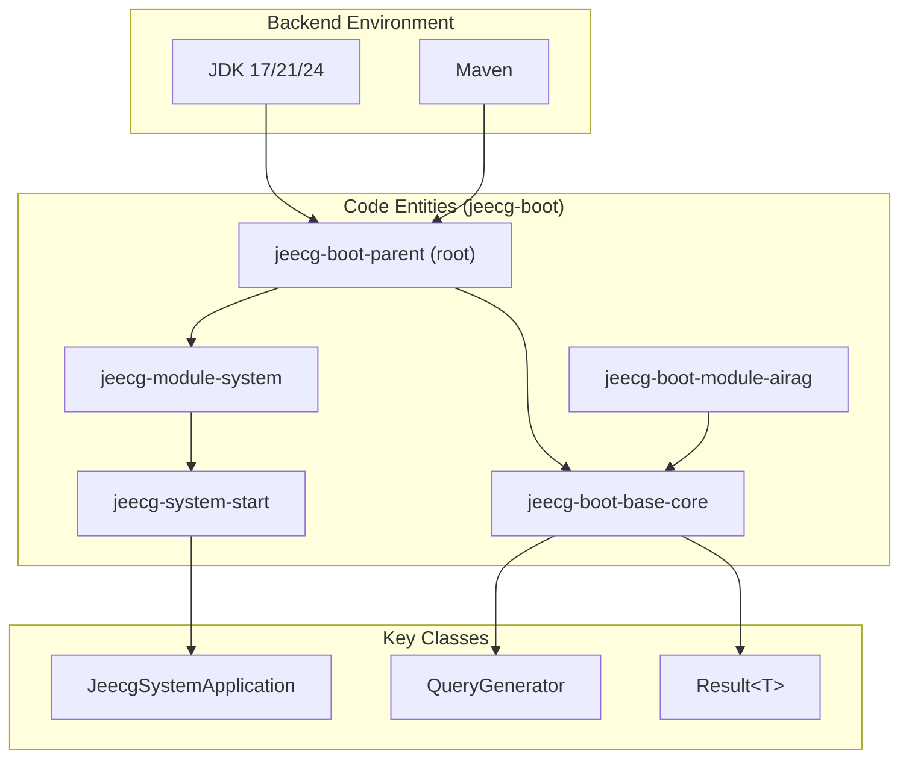
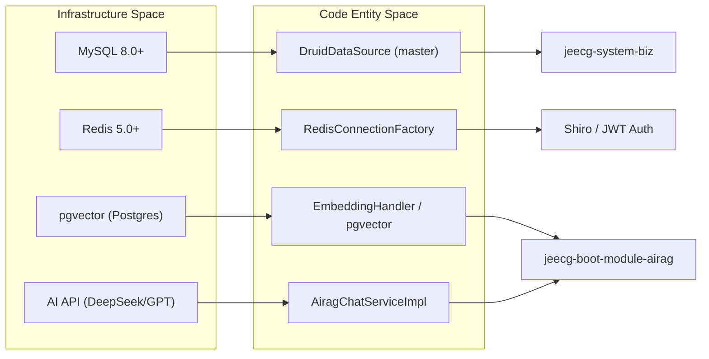

<!-- source: DeepWiki mcp.deepwiki.com · repo jeecgboot/JeecgBoot · page 10.1 Development Environment Setup · fetched 2026-10-29 -->

# Development Environment Setup

<details>
<summary>Relevant source files</summary>

The following files were used as context for generating this wiki page:

- [README-AI.md](README-AI.md)
- [README.en-US.md](README.en-US.md)
- [README.ja-JP.md](README.ja-JP.md)
- [README.md](README.md)
- [check_jeecgenv.py](check_jeecgenv.py)
- [jeecg-boot/CLAUDE.md](jeecg-boot/CLAUDE.md)
- [jeecg-boot/README.md](jeecg-boot/README.md)
- [jeecg-boot/jeecg-boot-base-core/src/main/java/org/jeecg/common/system/query/QueryGenerator.java](jeecg-boot/jeecg-boot-base-core/src/main/java/org/jeecg/common/system/query/QueryGenerator.java)
- [jeecg-boot/jeecg-boot-base-core/src/main/java/org/jeecg/common/system/util/SqlConcatUtil.java](jeecg-boot/jeecg-boot-base-core/src/main/java/org/jeecg/common/system/util/SqlConcatUtil.java)
- [jeecgboot-vue3/README.md](jeecgboot-vue3/README.md)

</details>


This document provides a detailed guide for setting up a local development environment for JeecgBoot. It covers the installation and configuration of all required tools, databases, and dependencies needed to run both the backend (Spring Boot 4) and frontend (Vue3) applications in development mode.

---

## Prerequisites Verification

JeecgBoot provides an automated environment checking script `check_jeecgenv.py` that validates all required dependencies before you begin development. This script checks for JDK version, Maven installation, Node.js version, pnpm package manager, and prompts you to verify database and AI configurations.

### Using the Environment Check Script

The script is located at the repository root and can be executed with Python 3:

```bash
python check_jeecgenv.py
```

The script performs the following validations:

| Component | Requirement | Validation Method |
|-----------|------------|-------------------|
| JDK | 17 or higher | Executes `java -version` and parses version [check_jeecgenv.py:17-37]() |
| Maven | Any version | Executes `mvn -v` [check_jeecgenv.py:39-48]() |
| Node.js | 20 or higher | Executes `node -v` and parses version [check_jeecgenv.py:50-70]() |
| pnpm | 9 or higher | Executes `pnpm -v` and parses version [check_jeecgenv.py:72-93]() |
| MySQL | 5.7+ or 8.0+ | Configuration verification prompt [check_jeecgenv.py:103-109]() |
| Redis | 5.0+ | Configuration verification prompt [check_jeecgenv.py:95-101]() |
| PostgreSQL + pgvector | Optional for AI | Configuration verification prompt [check_jeecgenv.py:123-140]() |

### Environment Check Flow


**Sources:** [check_jeecgenv.py:1-216]()

---

## Backend Environment Setup

The backend requires a Java development environment with Spring Boot 4 and Maven build tools.

### JDK Installation and Configuration

JeecgBoot 3.9.3 is built on **Spring Boot 4.1.0** and requires **Java 17** (also supports 21 and 24) [jeecg-boot/CLAUDE.md:9-9]().

#### Version Verification
The environment check script validates the JDK version using a regex pattern against the `java -version` output [check_jeecgenv.py:25-37]().

### Maven Installation and Configuration

Maven is used for backend dependency management. JeecgBoot utilizes a multi-module structure with `jeecg-boot-parent` as the root POM [jeecg-boot/CLAUDE.md:40-40]().

#### Build Commands
Common commands for the backend:
*   **Full Build:** `mvn clean package` [jeecg-boot/CLAUDE.md:15-15]()
*   **Run Standalone:** Execute `mvn spring-boot:run` within `jeecg-module-system/jeecg-system-start` [jeecg-boot/CLAUDE.md:21-22]()
*   **Microservices Build:** `mvn clean package -P SpringCloud` [jeecg-boot/CLAUDE.md:31-31]()

### Backend Module Structure Overview


**Sources:** [jeecg-boot/CLAUDE.md:40-65](), [jeecg-boot/jeecg-boot-base-core/src/main/java/org/jeecg/common/system/query/QueryGenerator.java:36-36]()

---

## Frontend Environment Setup

The frontend uses modern JavaScript tooling with Vue 3.5, TypeScript, and Vite 6 [jeecgboot-vue3/README.md:14-14]().

### Node.js and pnpm
*   **Node.js:** Requires version **20+** because Vite 5/6 does not support older EOL versions [jeecgboot-vue3/README.md:37-39]().
*   **pnpm:** Version **9+** is required for dependency installation [check_jeecgenv.py:73-73]().

### Frontend Quick Start
1.  Clone the repository: `git clone https://github.com/jeecgboot/JeecgBoot.git` [jeecgboot-vue3/README.md:46-46]()
2.  Install dependencies: `cd jeecgboot-vue3 && pnpm install` [jeecgboot-vue3/README.md:52-54]()
3.  Configure `.env.development` with the correct `VITE_PROXY` address [jeecgboot-vue3/README.md:57-62]()
4.  Run the dev server: `pnpm dev` [jeecgboot-vue3/README.md:70-70]()

---

## Database Configuration

### MySQL Database Setup
The default connection string is configured for MySQL 8.0+ using the `com.mysql.cj.jdbc.Driver` [check_jeecgenv.py:120-120]().

#### Configuration Path
Settings are primarily managed in `jeecg-boot/jeecg-module-system/jeecg-system-start/src/main/resources/application-dev.yml` [check_jeecgenv.py:108-108]().

### Redis Configuration
Redis is mandatory for session management and caching. The default configuration assumes a local instance on port `6379` [check_jeecgenv.py:168-169]().

### AI & Vector Database (Optional)
For AI RAG features, a **pgvector** enabled PostgreSQL database is required [check_jeecgenv.py:126-126]().

```yaml
jeecg.ai-rag:
    embed-store:
      host: 127.0.0.1
      port: 5432
      database: postgres
```
**Sources:** [check_jeecgenv.py:130-138]()

---

## AI Features Configuration

To enable AI chat capabilities (e.g., DeepSeek, ChatGPT), the following configuration must be updated in `application-dev.yml` [check_jeecgenv.py:146-146]():

```yaml
jeecg:
  ai-chat:
    enabled: true
    model: deepseek-chat
    apiKey: YOUR_API_KEY
    apiHost: https://api.deepseek.com/v1
```
**Sources:** [check_jeecgenv.py:151-155]()

---

## Environment Entity Relationship

This diagram maps system requirements to the code entities that consume them.


**Sources:** [jeecg-boot/CLAUDE.md:72-83](), [check_jeecgenv.py:130-157](), [README-AI.md:6-7]()

---

## Development Workflow Checklist

- [ ] Run `check_jeecgenv.py` to verify JDK 17, Node 20, and pnpm 9 [check_jeecgenv.py:173-192]().
- [ ] Initialize MySQL database using `db/jeecgboot-mysql-5.7.sql` or equivalent [jeecg-boot/CLAUDE.md:121-121]().
- [ ] Configure `application-dev.yml` for MySQL and Redis credentials [check_jeecgenv.py:113-171]().
- [ ] (Optional) Set up **pgvector** and AI API keys for AIGC features [check_jeecgenv.py:123-159]().
- [ ] Build backend: `mvn clean install -DskipTests` [jeecg-boot/CLAUDE.md:15-15]().
- [ ] Launch Backend: Run `JeecgSystemApplication` [jeecg-boot/CLAUDE.md:48-48]().
- [ ] Launch Frontend: `pnpm dev` in `jeecgboot-vue3` [jeecgboot-vue3/README.md:70-70]().

---

