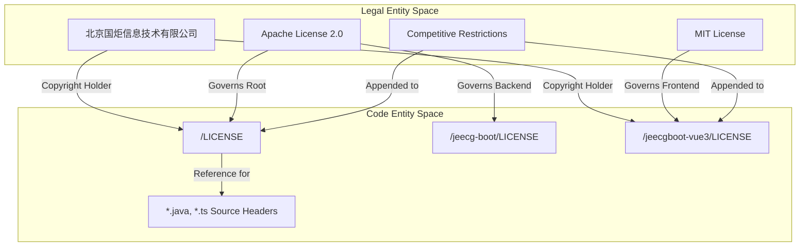

<!-- source: DeepWiki mcp.deepwiki.com · repo jeecgboot/JeecgBoot · page 10.3 License & Legal · fetched 2026-10-29 -->

# License & Legal

<details>
<summary>Relevant source files</summary>

The following files were used as context for generating this wiki page:

- [LICENSE](LICENSE)
- [jeecg-boot/LICENSE](jeecg-boot/LICENSE)
- [jeecgboot-vue3/LICENSE](jeecgboot-vue3/LICENSE)

</details>


This page details the licensing architecture of the JeecgBoot platform. The project utilizes a multi-license strategy depending on the specific module, combining the Apache License 2.0 for core backend services and the MIT License for the Vue3 frontend, both supplemented by specific usage restrictions regarding competitive software.

## Licensing Architecture

JeecgBoot's legal framework is divided by technical stack. The backend and root project follow the Apache 2.0 standard, while the modern frontend adopts the MIT license. Both licenses include a common restrictive clause provided by the copyright holder, **Beijing Guoju Information Technology Co., Ltd.**

### License Distribution by Module

| Module | License Type | Primary License File |
| :--- | :--- | :--- |
| **Root Project** | Apache 2.0 | [LICENSE:1-2]() |
| **Backend (Java)** | Apache 2.0 | [jeecg-boot/LICENSE:1-2]() |
| **Frontend (Vue3)** | MIT License | [jeecgboot-vue3/LICENSE:1-1]() |

### Code-to-Legal Mapping

The following diagram illustrates how legal entities and licenses map to specific code directories and files within the repository.



**Sources:** [LICENSE:1-3](), [jeecg-boot/LICENSE:1-3](), [jeecgboot-vue3/LICENSE:1-25]()

## Apache License 2.0 (Backend & Root)

The backend infrastructure, located in the `jeecg-boot` directory, is licensed under the Apache License, Version 2.0.

### Core Provisions
*   **Grant of Copyright License:** Each contributor grants a perpetual, worldwide, non-exclusive, no-charge, royalty-free, irrevocable copyright license to reproduce, prepare derivative works of, and distribute the work [LICENSE:66-71]().
*   **Grant of Patent License:** Includes a royalty-free patent license to make, use, or sell the work, which terminates automatically if the user institutes patent litigation against any contributor regarding the work [LICENSE:73-87]().
*   **Redistribution:** Users may redistribute the work provided they include a copy of the license, provide prominent notices of changes, and retain all copyright and patent notices [LICENSE:89-104]().

**Sources:** [LICENSE:1-128](), [jeecg-boot/LICENSE:1-128]()

## MIT License (Frontend Vue3)

The `jeecgboot-vue3` module is licensed under the MIT License, providing a more permissive framework for the frontend application layer.

### Permissions
*   **Usage:** Permission is granted to use, copy, modify, merge, publish, and distribute the software [jeecgboot-vue3/LICENSE:5-9]().
*   **Conditions:** The copyright notice and permission notice must be included in all copies or substantial portions of the software [jeecgboot-vue3/LICENSE:12-13]().

**Sources:** [jeecgboot-vue3/LICENSE:1-21]()

## Usage Restrictions & Competitive Clause

Both the Apache 2.0 and MIT license implementations in JeecgBoot include mandatory supplemental terms defined by the author.

### The Non-Compete Clause
A critical restriction is applied to all users of the software:
> "In any case, you must not make any such use of this software as to develop software which may be considered competitive with this software." [jeecgboot-vue3/LICENSE:23-23](), [LICENSE:203-203]()

### Summary of Supplemental Terms (Chinese & English)

| Term | Detail | Reference |
| :--- | :--- | :--- |
| **Commercial Use** | Permitted for developing business systems (ERP, CRM, etc.) | [jeecgboot-vue3/LICENSE:29-30]() |
| **No Limitations** | No specific functional limits on the open-source version | [jeecgboot-vue3/LICENSE:29-29]() |
| **Competition** | Prohibited from developing competing low-code platforms | [jeecgboot-vue3/LICENSE:31-31]() |
| **Authority** | Final interpretation belongs to http://www.jeecg.com | [jeecgboot-vue3/LICENSE:33-33]() |

**Sources:** [LICENSE:203-213](), [jeecgboot-vue3/LICENSE:23-33]()

## Legal Compliance Data Flow

This diagram describes how a developer must handle the software to remain compliant with the dual-licensing and non-compete requirements.

```mermaid
flowchart TD
    Start["Developer Downloads JeecgBoot"] --> Eval{"Developing Competing Product?"}
    Eval -- "Yes" --> Prohibited["VIOLATION: Stop Usage"]
    Eval -- "No" --> Intent{"Target Application"}
    
    Intent -- "Internal/Business System" --> CheckStack{"Stack Used"}
    
    CheckStack -- "Backend/Root" --> ApacheReqs["1. Include Apache LICENSE\n2. Keep Notice Files\n3. Mark Modifications"]
    CheckStack -- "Frontend (Vue3)" --> MITReqs["1. Include MIT LICENSE\n2. Keep Copyright Notice"]
    
    ApacheReqs --> Compliant["Legal Commercial Usage"]
    MITReqs --> Compliant
    
    subgraph "Notice Requirements"
        [LICENSE:94-95]
        [LICENSE:106-114]
        [jeecgboot-vue3/LICENSE:12-13]
    end
```

**Sources:** [LICENSE:92-121](), [jeecgboot-vue3/LICENSE:12-13](), [jeecgboot-vue3/LICENSE:31-31]()

## Corporate Information

The software is protected by national software copyright laws and international treaties.

*   **Company:** 北京国炬信息技术有限公司 (Beijing Guoju Information Technology Co., Ltd.)
*   **Address:** 中国·北京·朝阳区科荟前街1号院奥林佳泰大厦 (Aolin Jiatai Mansion, No. 1 Kehui Qianjie, Chaoyang District, Beijing, China)
*   **Contact:** jeecgos@163.com
*   **Official Site:** http://www.jeecg.com

**Sources:** [jeecgboot-vue3/LICENSE:25-33](), [LICENSE:205-213]()

---

