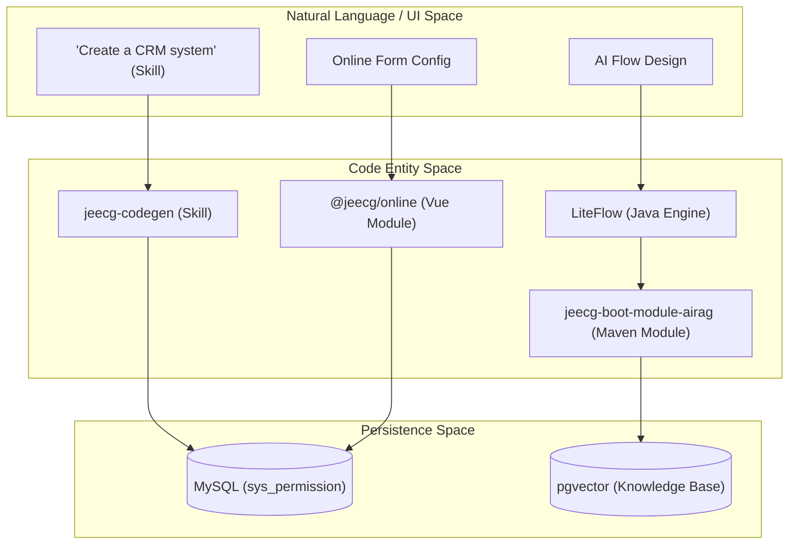
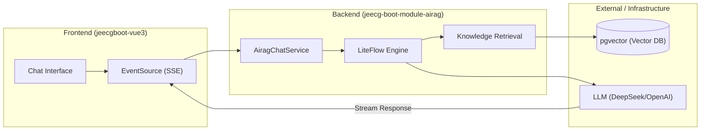

<!-- source: DeepWiki mcp.deepwiki.com · repo jeecgboot/JeecgBoot · page 11 Glossary · fetched 2026-10-29 -->

# Glossary

Relevant source files

The following files were used as context for generating this wiki page:

- [README-AI.md](README-AI.md)
- [README.en-US.md](README.en-US.md)
- [README.ja-JP.md](README.ja-JP.md)
- [README.md](README.md)
- [jeecg-boot/CLAUDE.md](jeecg-boot/CLAUDE.md)
- [jeecg-boot/README.md](jeecg-boot/README.md)
- [jeecg-boot/UPGRADE-3.9.3.md](jeecg-boot/UPGRADE-3.9.3.md)
- [jeecg-boot/db/Dockerfile](jeecg-boot/db/Dockerfile)
- [jeecg-boot/db/jeecgboot-mysql-5.7.sql](jeecg-boot/db/jeecgboot-mysql-5.7.sql)
- [jeecg-boot/db/tables_nacos.sql](jeecg-boot/db/tables_nacos.sql)
- [jeecg-boot/db/tables_xxl_job.sql](jeecg-boot/db/tables_xxl_job.sql)
- [jeecg-boot/jeecg-boot-base-core/pom.xml](jeecg-boot/jeecg-boot-base-core/pom.xml)
- [jeecg-boot/jeecg-boot-base-core/src/main/java/org/jeecg/common/util/encryption/AesEncryptUtil.java](jeecg-boot/jeecg-boot-base-core/src/main/java/org/jeecg/common/util/encryption/AesEncryptUtil.java)
- [jeecg-boot/jeecg-boot-base-core/src/main/java/org/jeecg/config/shiro/ShiroConfig.java](jeecg-boot/jeecg-boot-base-core/src/main/java/org/jeecg/config/shiro/ShiroConfig.java)
- [jeecg-boot/jeecg-boot-module/jeecg-boot-module-airag/pom.xml](jeecg-boot/jeecg-boot-module/jeecg-boot-module-airag/pom.xml)
- [jeecg-boot/jeecg-module-system/jeecg-system-start/src/main/resources/flyway/sql/mysql/V3.9.0_0__all_upgrade.sql](jeecg-boot/jeecg-module-system/jeecg-system-start/src/main/resources/flyway/sql/mysql/V3.9.0_0__all_upgrade.sql)
- [jeecg-boot/jeecg-module-system/jeecg-system-start/src/main/resources/flyway/sql/mysql/V3.9.1_0__all_upgrade.sql](jeecg-boot/jeecg-module-system/jeecg-system-start/src/main/resources/flyway/sql/mysql/V3.9.1_0__all_upgrade.sql)
- [jeecg-boot/jeecg-server-cloud/jeecg-cloud-gateway/src/main/resources/application.yml](jeecg-boot/jeecg-server-cloud/jeecg-cloud-gateway/src/main/resources/application.yml)
- [jeecg-boot/jeecg-server-cloud/jeecg-cloud-nacos/docs/DEFAULT_GROUP/jeecg-dev-satoken.yaml](jeecg-boot/jeecg-server-cloud/jeecg-cloud-nacos/docs/DEFAULT_GROUP/jeecg-dev-satoken.yaml)
- [jeecg-boot/jeecg-server-cloud/jeecg-cloud-nacos/docs/DEFAULT_GROUP/jeecg-dev.yaml](jeecg-boot/jeecg-server-cloud/jeecg-cloud-nacos/docs/DEFAULT_GROUP/jeecg-dev.yaml)
- [jeecg-boot/jeecg-server-cloud/jeecg-cloud-nacos/docs/DEFAULT_GROUP/jeecg-gateway-router.json](jeecg-boot/jeecg-server-cloud/jeecg-cloud-nacos/docs/DEFAULT_GROUP/jeecg-gateway-router.json)
- [jeecg-boot/jeecg-server-cloud/jeecg-cloud-nacos/docs/DEFAULT_GROUP/jeecg-gateway.yaml](jeecg-boot/jeecg-server-cloud/jeecg-cloud-nacos/docs/DEFAULT_GROUP/jeecg-gateway.yaml)
- [jeecg-boot/jeecg-server-cloud/jeecg-cloud-nacos/docs/DEFAULT_GROUP/jeecg.yaml](jeecg-boot/jeecg-server-cloud/jeecg-cloud-nacos/docs/DEFAULT_GROUP/jeecg.yaml)
- [jeecg-boot/jeecg-server-cloud/jeecg-cloud-nacos/docs/DEFAULT_GROUP/sharding.yaml](jeecg-boot/jeecg-server-cloud/jeecg-cloud-nacos/docs/DEFAULT_GROUP/sharding.yaml)
- [jeecg-boot/jeecg-server-cloud/jeecg-cloud-nacos/pom.xml](jeecg-boot/jeecg-server-cloud/jeecg-cloud-nacos/pom.xml)
- [jeecg-boot/jeecg-server-cloud/jeecg-cloud-nacos/src/main/java/com/alibaba/nacos/JeecgNacosApplication.java](jeecg-boot/jeecg-server-cloud/jeecg-cloud-nacos/src/main/java/com/alibaba/nacos/JeecgNacosApplication.java)
- [jeecg-boot/jeecg-server-cloud/jeecg-visual/jeecg-cloud-xxljob/doc/db/tables_xxl_job.sql](jeecg-boot/jeecg-server-cloud/jeecg-visual/jeecg-cloud-xxljob/doc/db/tables_xxl_job.sql)
- [jeecg-boot/pom.xml](jeecg-boot/pom.xml)
- [jeecgboot-vue3/README.md](jeecgboot-vue3/README.md)
- [jeecgboot-vue3/VITE8-UPGRADE-LOG.md](jeecgboot-vue3/VITE8-UPGRADE-LOG.md)
- [jeecgboot-vue3/package.json](jeecgboot-vue3/package.json)
- [jeecgboot-vue3/pnpm-lock.yaml](jeecgboot-vue3/pnpm-lock.yaml)
- [jeecgboot-vue3/src/router/guard/paramMenuGuard.ts](jeecgboot-vue3/src/router/guard/paramMenuGuard.ts)
- [jeecgboot-vue3/src/router/guard/permissionGuard.ts](jeecgboot-vue3/src/router/guard/permissionGuard.ts)
- [jeecgboot-vue3/src/router/index.ts](jeecgboot-vue3/src/router/index.ts)
- [jeecgboot-vue3/src/store/modules/app.ts](jeecgboot-vue3/src/store/modules/app.ts)
- [jeecgboot-vue3/src/store/modules/defIndex.ts](jeecgboot-vue3/src/store/modules/defIndex.ts)
- [jeecgboot-vue3/src/store/modules/errorLog.ts](jeecgboot-vue3/src/store/modules/errorLog.ts)
- [jeecgboot-vue3/src/store/modules/locale.ts](jeecgboot-vue3/src/store/modules/locale.ts)
- [jeecgboot-vue3/src/store/modules/lock.ts](jeecgboot-vue3/src/store/modules/lock.ts)
- [jeecgboot-vue3/src/store/modules/multipleTab.ts](jeecgboot-vue3/src/store/modules/multipleTab.ts)

This page provides definitions for codebase-specific terms, jargon, and domain concepts within the JeecgBoot ecosystem. It serves as a technical reference for onboarding engineers to bridge the gap between business terminology and the underlying implementation.

## Core Framework Concepts

### OnlineCoding (Zero-Code)
A "Zero-Code" development mode where users configure database tables, form fields, and validation rules through a web interface without writing Java or Vue code [README.md:24-27](). It uses dynamic metadata to render UI components and handle CRUD operations.
*   **Key Files**: Managed primarily through the `@jeecg/online` frontend module and backend logic in `jeecg-module-system`.
*   **Implementation**: Configurations are stored in system tables, and the engine dynamically generates SQL and UI schemas at runtime [README.md:143-145]().

### Low-Code (Code Generation)
A development mode that uses the `jeecg-codegen` engine to generate full-stack source code based on database schemas or AI prompts [README.md:27-28]().
*   **Templates**: Supports four major styles (Single Table, Tree, One-to-Many, One-to-One) [README.md:141-142]().
*   **Process**: "AI/Online Design → Code Generation → Manual Merge" [README.md:27-27]().

### Skills (Natural Language Programming)
A set of AI-driven capabilities integrated with tools like `Claude Code` to convert natural language descriptions into system entities (tables, flows, reports) [README.md:6-10]().
*   **jeecg-codegen Skill**: Generates Java/Vue source code and SQL from a sentence [jeecg-boot/README.md:63-63]().
*   **jeecg-bpmn Skill**: Converts process descriptions into Flowable BPMN 2.0 XML [jeecg-boot/README.md:67-67]().

---

## AI & AIGC Terms

### RAG (Retrieval-Augmented Generation)
The architecture used to provide LLMs with private knowledge. It involves document ingestion, text splitting, embedding generation, and vector search [README-AI.md:6-7]().
*   **Vector Database**: Uses `pgvector` for storing and searching high-dimensional embeddings [README-AI.md:60-60]().
*   **Embedding Support**: Handled via `langchain4j` integrations in the `jeecg-boot-module-airag` module [jeecg-boot/jeecg-boot-module/jeecg-boot-module-airag/pom.xml:150-160]().

### AI Flow (Workflow Orchestration)
A visual orchestration engine for AI tasks, distinct from traditional BPMN business flows. It uses `LiteFlow` as the execution engine [jeecg-boot/jeecg-boot-module/jeecg-boot-module-airag/pom.xml:35-35]().
*   **Nodes**: Includes LLM, Knowledge Base, HTTP, Java, and Script (Python/Groovy/Kotlin) nodes [README-AI.md:155-157]().
*   **Frontend**: Implemented using `@logicflow/core` [jeecgboot-vue3/package.json:23-25]().

### MCP (Model Context Protocol)
A protocol supported by the AI platform to integrate external tools and context into LLM conversations [README.md:43-44]().
*   **Implementation**: Integrated via `langchain4j-mcp` [jeecg-boot/jeecg-boot-module/jeecg-boot-module-airag/pom.xml:155-159]().

---

## Technical Infrastructure

### Multi-Mode Architecture
JeecgBoot supports switching between Monolithic (Single Instance) and Microservices (Spring Cloud) architectures using the same codebase [README.md:139-139]().
*   **Monolithic**: Standard Spring Boot application.
*   **Microservices**: Uses Nacos for discovery, Spring Cloud Gateway for routing, and Sentinel for flow control [README.md:139-139]().

### JVXETable
A high-performance, editable table component used for complex ERP-style data entry [README.md:147-147]().
*   **Frontend Library**: Based on `vxe-table` [jeecgboot-vue3/package.json:82-82]().

### JimuReport / JimuBI
Self-developed data visualization tools. `JimuReport` is for pixel-perfect web reports, and `JimuBI` is for large-screen dashboards [README.md:39-42]().
*   **Backend Starters**: `jimureport-spring-boot-starter` and `jimubi-spring-boot-starter` [jeecg-boot/pom.xml:59-60]().

---

## Conceptual Mapping Diagrams

### Diagram 1: Low-Code to Code Entity Mapping
This diagram shows how business-level "Low-Code" concepts translate into specific code entities and modules.

*Sources: [README.md:6-10](), [jeecg-boot/README.md:63-67](), [jeecg-boot/jeecg-boot-module/jeecg-boot-module-airag/pom.xml:35-35]().*

### Diagram 2: AI Request Data Flow
This diagram maps the journey of a user chat request through the AI-specific components of the system.

*Sources: [README-AI.md:6-7](), [jeecg-boot/jeecg-boot-module/jeecg-boot-module-airag/pom.xml:150-163](), [jeecgboot-vue3/package.json:55-55]().*

---

## Domain Vocabulary Table

| Term | Category | Definition | Code Pointer |
| :--- | :--- | :--- | :--- |
| **Shiro** | Security | The primary security framework for authentication and RBAC in the main branch. | [jeecg-boot/jeecg-boot-base-core/src/main/java/org/jeecg/config/shiro/ShiroConfig.java:1-100]() |
| **Nacos** | Infra | Service discovery and configuration center for microservices mode. | [jeecg-boot/db/tables_nacos.sql:1-50]() |
| **pgvector** | Database | PostgreSQL extension used for AI vector similarity searches. | [README-AI.md:60-60]() |
| **Flyway** | Database | Database version control tool for automated migrations. | [jeecg-boot/jeecg-module-system/jeecg-system-start/src/main/resources/flyway/sql/mysql/V3.9.1_0__all_upgrade.sql:1-10]() |
| **AesEncryptUtil** | Security | Utility for password and sensitive data encryption. | [jeecg-boot/jeecg-boot-base-core/src/main/java/org/jeecg/common/util/encryption/AesEncryptUtil.java:1-50]() |
| **Vben** | Frontend | The underlying Vue3 admin schema that JeecgBoot-Vue3 is built upon. | [jeecgboot-vue3/README.md:86-86]() |

*Sources: [README.md:139-139](), [README-AI.md:60-60](), [jeecgboot-vue3/README.md:86-86]().*