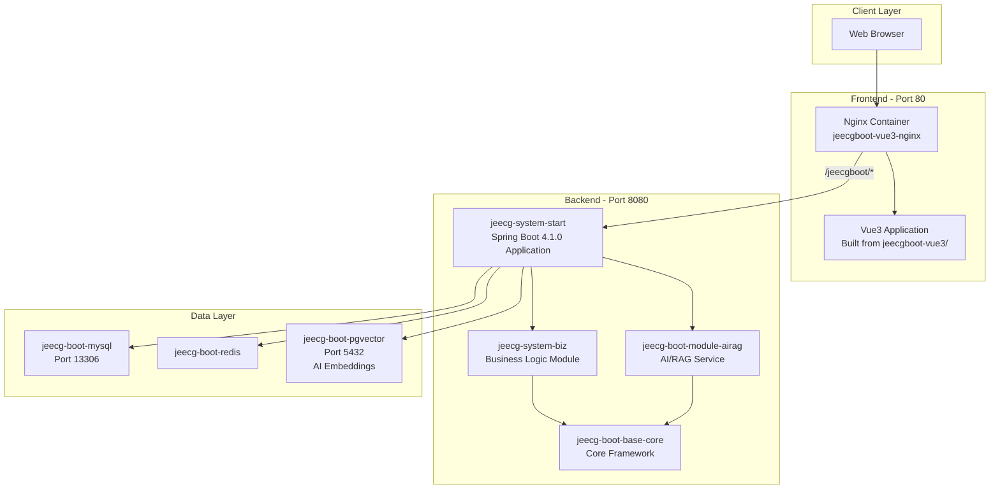
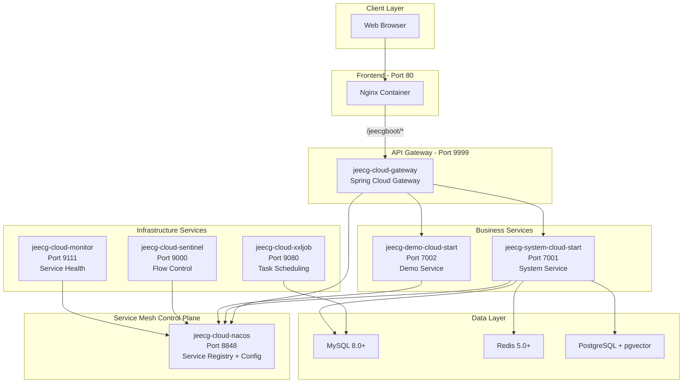
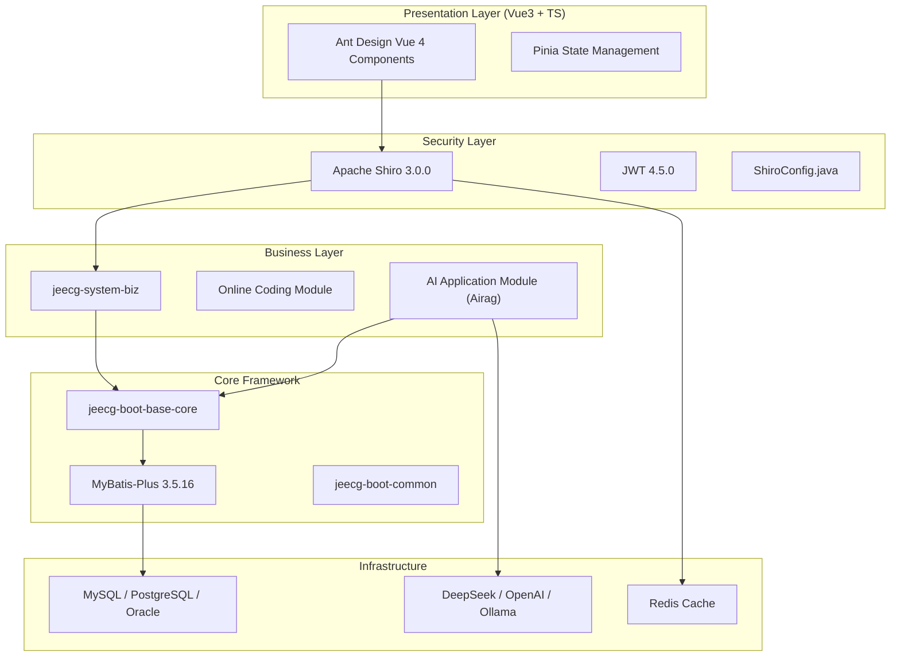

<!-- source: DeepWiki mcp.deepwiki.com · repo jeecgboot/JeecgBoot · page 2 Architecture · fetched 2026-10-29 -->

# Architecture

Relevant source files

The following files were used as context for generating this wiki page:

- [README-AI.md](README-AI.md)
- [README.en-US.md](README.en-US.md)
- [README.ja-JP.md](README.ja-JP.md)
- [README.md](README.md)
- [jeecg-boot/CLAUDE.md](jeecg-boot/CLAUDE.md)
- [jeecg-boot/README.md](jeecg-boot/README.md)
- [jeecg-boot/jeecg-boot-base-core/pom.xml](jeecg-boot/jeecg-boot-base-core/pom.xml)
- [jeecg-boot/jeecg-boot-base-core/src/main/java/org/jeecg/common/util/encryption/AesEncryptUtil.java](jeecg-boot/jeecg-boot-base-core/src/main/java/org/jeecg/common/util/encryption/AesEncryptUtil.java)
- [jeecg-boot/jeecg-boot-base-core/src/main/java/org/jeecg/config/shiro/ShiroConfig.java](jeecg-boot/jeecg-boot-base-core/src/main/java/org/jeecg/config/shiro/ShiroConfig.java)
- [jeecg-boot/jeecg-boot-module/jeecg-boot-module-airag/pom.xml](jeecg-boot/jeecg-boot-module/jeecg-boot-module-airag/pom.xml)
- [jeecg-boot/pom.xml](jeecg-boot/pom.xml)
- [jeecgboot-vue3/README.md](jeecgboot-vue3/README.md)

This document provides an overview of JeecgBoot's system architecture, explaining the platform's dual deployment modes (monolithic and microservices), layered component organization, and inter-component communication patterns. For detailed information on specific architectural aspects, see:
- Backend module organization and Maven structure: [Backend Module Structure](#2.2)
- Frontend project structure and build system: [Frontend Architecture](#2.3)
- Microservices components and coordination: [Microservices Architecture](#2.4)
- AI Application Platform and RAG: [AI Platform (AIGC)](#3)
- Desktop integration: [Electron Desktop Application](#2.5)

## Deployment Modes

JeecgBoot supports two distinct deployment architectures that share the same codebase but differ in their runtime configuration and infrastructure requirements. The choice is often determined by the Maven profile (e.g., `SpringCloud`) and the startup module used [CLAUDE.md:31-67]().

### Monolithic Mode

In monolithic mode, the entire backend application runs as a single Spring Boot process (`jeecg-system-start`) listening on port 8080. This mode is suitable for development, small-scale deployments, and rapid prototyping [CLAUDE.md:20-22]().

**Monolithic Deployment Architecture**

**Sources:** [CLAUDE.md:20-55](), [jeecg-boot/pom.xml:88-92](), [jeecg-boot/jeecg-boot-module/jeecg-boot-module-airag/pom.xml:60-64]()

The monolithic backend packages all business modules together. Configuration typically uses local profiles like `application-dev.yml` [CLAUDE.md:127-130]().

### Microservices Mode

In microservices mode, the backend is decomposed into multiple independently deployable services coordinated by Spring Cloud Alibaba components. This mode is activated via the `-P SpringCloud` Maven profile [CLAUDE.md:30-32]().

**Microservices Deployment Architecture**

**Sources:** [CLAUDE.md:67-69](), [jeecg-boot/README.md:134-139](), [jeecg-boot/pom.xml:37-40]()

### Deployment Mode Comparison

| Aspect | Monolithic Mode | Microservices Mode |
|--------|----------------|-------------------|
| **Entry Point** | Direct to backend (port 8080) | Through Gateway (port 9999) |
| **Service Discovery** | Not required | Nacos (port 8848) |
| **Configuration** | Local `application.yml` | Centralized in Nacos |
| **Backend Start Module** | `jeecg-system-start` | `jeecg-system-cloud-start` |
| **API Implementation** | `jeecg-system-local-api` | `jeecg-system-cloud-api` |
| **Tech Stack** | Spring Boot 4.1.0 | Spring Cloud 2025.1.0.0 |

**Sources:** [CLAUDE.md:9-69](), [jeecg-boot/pom.xml:37-40](), [jeecg-boot/README.md:134-139]()

## Technology Stack Summary

JeecgBoot v3.9.3 utilizes a modern stack centered on Spring Boot 4 and Vue 3 [README.md:8-14]().

### Backend Technology Stack

| Component | Technology | Version | Purpose |
|-----------|-----------|---------|---------|
| **Java SDK** | JDK | 17, 21, 24, 25 | Runtime environment [jeecg-boot/pom.xml:34]() |
| **Framework** | Spring Boot | 4.1.0 | Core container [jeecg-boot/pom.xml:26]() |
| **Microservices** | Spring Cloud Alibaba | 2025.1.0.0 | Service coordination [jeecg-boot/pom.xml:39]() |
| **ORM** | MyBatis-Plus | 3.5.16 | Persistence [jeecg-boot/pom.xml:65]() |
| **Security** | Apache Shiro | 3.0.0 | Auth [jeecg-boot/pom.xml:76]() |
| **Token** | JWT | 4.5.0 | Stateless sessions [jeecg-boot/pom.xml:78]() |
| **Database Pool** | Druid | 1.2.28 | Connection pooling [jeecg-boot/pom.xml:67]() |
| **AI/LLM** | LangChain4j | 1.17.2 | AI Integration [jeecg-boot/jeecg-boot-module/jeecg-boot-module-airag/pom.xml:45]() |

### Frontend Technology Stack

| Component | Technology | Version | Purpose |
|-----------|-----------|---------|---------|
| **Framework** | Vue | 3.0 | UI framework [jeecgboot-vue3/README.md:14]() |
| **Build Tool** | Vite | 6.x | Build & HMR [jeecgboot-vue3/README.md:14]() |
| **UI Library** | Ant Design Vue | 4.x | Components [jeecgboot-vue3/README.md:14]() |
| **Language** | TypeScript | Latest | Static typing [jeecgboot-vue3/README.md:14]() |
| **State** | Pinia | Latest | State management [jeecgboot-vue3/README.md:92]() |

## Layered Architecture

JeecgBoot follows a modular architecture that separates the core framework from business logic and AI capabilities.

**System Layer Interaction**

**Sources:** [jeecg-boot/pom.xml:88-92](), [jeecg-boot/jeecg-boot-base-core/src/main/java/org/jeecg/config/shiro/ShiroConfig.java:47-68](), [README-AI.md:6-27]()

### Core Components

1.  **jeecg-boot-base-core**: Contains the core framework logic, including Shiro security configuration [jeecg-boot/jeecg-boot-base-core/src/main/java/org/jeecg/config/shiro/ShiroConfig.java:47](), MyBatis-Plus settings, and common utilities.
2.  **jeecg-module-system**: The primary business module for user, role, and permission management [CLAUDE.md:43-48]().
3.  **jeecg-boot-module-airag**: The AI/RAG integration module, leveraging LangChain4j to connect with various LLMs [jeecg-boot/jeecg-boot-module/jeecg-boot-module-airag/pom.xml:150-163]().
4.  **Online Coding**: A metadata-driven low-code engine that allows runtime CRUD generation without redeployment [CLAUDE.md:138-143]().

## Security Architecture

The security system is a hybrid of Apache Shiro for authorization and JWT for stateless authentication [CLAUDE.md:75]().

-   **Authentication**: Managed via `ShiroConfig` which defines anonymous and protected paths [jeecg-boot/jeecg-boot-base-core/src/main/java/org/jeecg/config/shiro/ShiroConfig.java:67-150]().
-   **Encryption**: `AesEncryptUtil` provides AES/CBC/PKCS5Padding decryption for sensitive data like passwords, maintaining compatibility with legacy NoPadding implementations [jeecg-boot/jeecg-common/src/main/java/org/jeecg/common/util/encryption/AesEncryptUtil.java:15-64]().
-   **Token Storage**: JWT tokens are validated against a Redis-backed session store to allow for token revocation and session management [jeecg-boot/jeecg-boot-base-core/src/main/java/org/jeecg/config/shiro/ShiroConfig.java:49-57]().

For details, see [System Architecture Overview](#2.1).

## AI Platform Architecture (AIGC)

JeecgBoot integrates a full-stack AI development platform similar to Dify, built directly into the low-code ecosystem [README-AI.md:6-8]().

-   **Model Management**: Supports DeepSeek, OpenAI, Ollama, and domestic models like Zhipu and Qianfan [README-AI.md:101-115]().
-   **RAG (Retrieval-Augmented Generation)**: Uses PostgreSQL with `pgvector` for embedding storage and similarity search [README-AI.md:60-61]().
-   **Workflow Orchestration**: Uses `LiteFlow` for AI flow design, allowing developers to chain LLM nodes, knowledge nodes, and script nodes [jeecg-boot/jeecg-boot-module/jeecg-boot-module-airag/pom.xml:35, 75-94]().

For details, see [AI Platform (AIGC)](#3).

## Module Organization

The project is structured to facilitate the transition between monolithic and microservice architectures through the use of `api` modules [CLAUDE.md:101-102]().

| Module | Type | Description |
|--------|------|-------------|
| `jeecg-system-local-api` | Monolithic | Direct method calls between modules. |
| `jeecg-system-cloud-api` | Microservices | OpenFeign clients for remote service calls. |
| `jeecg-system-biz` | Shared | Core business logic used by both deployment modes. |

**Sources:** [CLAUDE.md:39-65](), [jeecg-boot/pom.xml:195-210]()

For details on the Maven structure, see [Backend Module Structure](#2.2).

---

