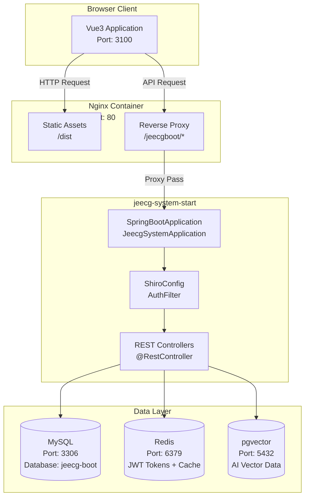
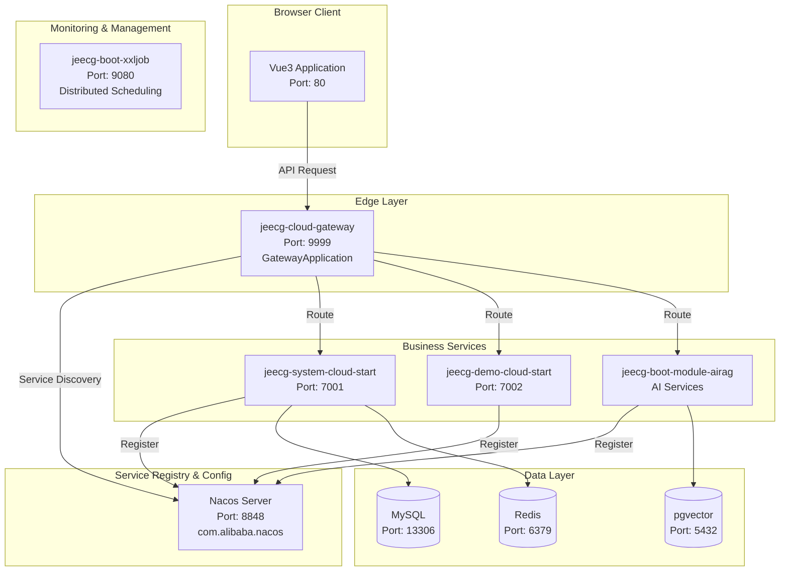
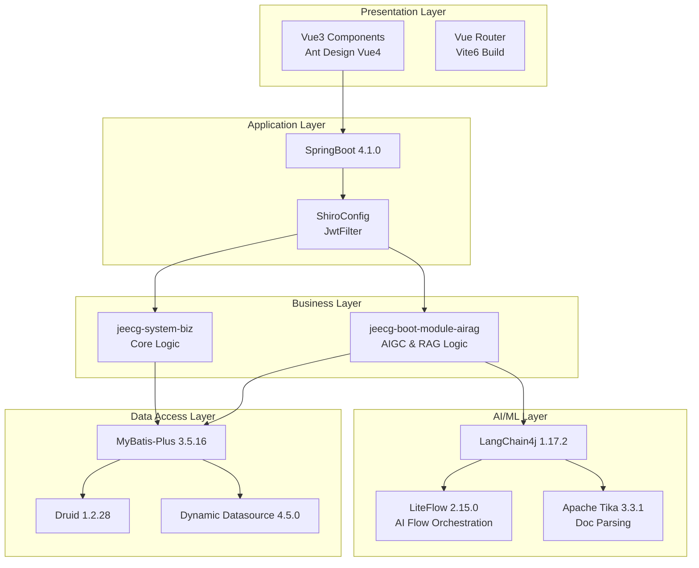
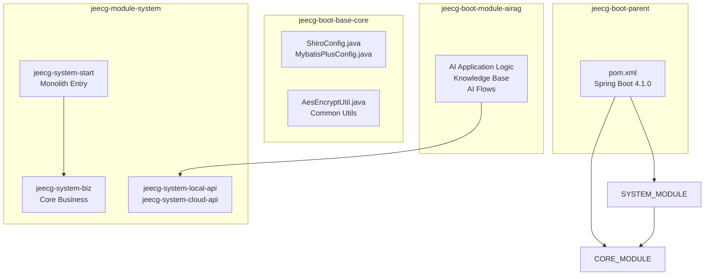
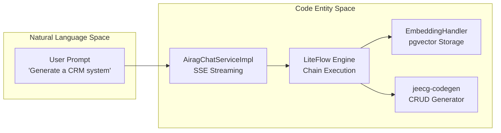

<!-- source: DeepWiki mcp.deepwiki.com · repo jeecgboot/JeecgBoot · page 2.1 System Architecture Overview · fetched 2026-10-29 -->

# System Architecture Overview

Relevant source files

The following files were used as context for generating this wiki page:

- [README-AI.md](README-AI.md)
- [README.en-US.md](README.en-US.md)
- [README.ja-JP.md](README.ja-JP.md)
- [README.md](README.md)
- [docker-compose-cloud.yml](docker-compose-cloud.yml)
- [docker-compose.yml](docker-compose.yml)
- [jeecg-boot/CLAUDE.md](jeecg-boot/CLAUDE.md)
- [jeecg-boot/README.md](jeecg-boot/README.md)
- [jeecg-boot/docker-compose.yml](jeecg-boot/docker-compose.yml)
- [jeecg-boot/jeecg-boot-base-core/pom.xml](jeecg-boot/jeecg-boot-base-core/pom.xml)
- [jeecg-boot/jeecg-boot-base-core/src/main/java/org/jeecg/common/util/encryption/AesEncryptUtil.java](jeecg-boot/jeecg-boot-base-core/src/main/java/org/jeecg/common/util/encryption/AesEncryptUtil.java)
- [jeecg-boot/jeecg-boot-base-core/src/main/java/org/jeecg/config/shiro/ShiroConfig.java](jeecg-boot/jeecg-boot-base-core/src/main/java/org/jeecg/config/shiro/ShiroConfig.java)
- [jeecg-boot/jeecg-boot-module/jeecg-boot-module-airag/pom.xml](jeecg-boot/jeecg-boot-module/jeecg-boot-module-airag/pom.xml)
- [jeecg-boot/pom.xml](jeecg-boot/pom.xml)
- [jeecgboot-vue3/.env.docker](jeecgboot-vue3/.env.docker)
- [jeecgboot-vue3/.env.dockercloud](jeecgboot-vue3/.env.dockercloud)
- [jeecgboot-vue3/Dockerfile.cloud](jeecgboot-vue3/Dockerfile.cloud)
- [jeecgboot-vue3/README.md](jeecgboot-vue3/README.md)

## Purpose and Scope

This document provides a comprehensive overview of the JeecgBoot platform's system architecture, including deployment topologies, layered design patterns, and module organization. It covers both monolithic and microservices deployment modes, the frontend and backend architectural patterns, and how the major components interact at a system level.

For details on specific backend modules and their internal organization, see [Backend Module Structure](#2.2). For frontend-specific architectural patterns, see [Frontend Architecture](#2.3). For microservices-specific components like Nacos and Gateway, see [Microservices Architecture](#2.4).

---

## Deployment Topologies

JeecgBoot supports two distinct deployment architectures that can be switched without code changes, providing flexibility based on project scale and complexity requirements.

### Monolithic Deployment Mode

**Monolithic Architecture Characteristics:**

The monolithic mode runs as a single Spring Boot application started by the `JeecgSystemApplication` class in the `jeecg-system-start` module. All business logic, including system management, online coding, code generation, and AI features, are packaged into one executable JAR file.

**Key Components:**
- **Entry Point**: `JeecgSystemApplication.java` - Spring Boot main class.
- **Web Configuration**: Configures CORS, interceptors, and resource handlers.
- **Security Filter**: `ShiroConfig.java` at [jeecg-boot/jeecg-boot-base-core/src/main/java/org/jeecg/config/shiro/ShiroConfig.java:47-68]() configures the `JwtFilter` for authentication.
- **AI Support**: Integrated via `jeecg-boot-pgvector` for RAG capabilities [docker-compose.yml:61-72]().

**Sources:** [README.md:87-91](), [jeecg-boot/README.md:86-90](), [docker-compose.yml:1-72]()

---

### Microservices Deployment Mode

**Microservices Architecture Characteristics:**

In microservices mode, the application is decomposed into independently deployable services coordinated by Spring Cloud Alibaba components.

**Key Components:**
- **Gateway**: `jeecg-boot-gateway` handles entry routing at port 9999 [docker-compose-cloud.yml:86-111]().
- **Service Registry**: Nacos at port 8848 for service discovery and configuration management [docker-compose-cloud.yml:45-57]().
- **AI Integration**: The `jeecg-boot-module-airag` module provides LLM and RAG capabilities using `pgvector` [jeecg-boot/jeecg-boot-module/jeecg-boot-module-airag/pom.xml:150-167]().
- **Task Scheduling**: XXL-Job Admin at port 9080 for distributed tasks [docker-compose-cloud.yml:35-43]().

**Sources:** [README.md:139-140](), [jeecg-boot/README.md:134-135](), [docker-compose-cloud.yml:1-171]()

---

## Layered Architecture

JeecgBoot follows a classic layered architecture pattern with clear separation of concerns across distinct layers, now enhanced with an AI/ML layer for AIGC capabilities.

### Layer Responsibilities

| Layer | Primary Technologies | Responsibilities |
|-------|-------------------------|------------------|
| **Presentation** | Vue3, TS, Vite6, Antd4 | UI rendering, state management, client-side routing. |
| **Application** | Spring Boot 4.1.0, Shiro | Auth, global exception handling, API security. |
| **Business** | MyBatis-Plus, Spring Services | Domain logic, OnlineCoding, code generation, AI app management. |
| **AI/ML** | LangChain4j, LiteFlow, Tika | LLM model management, RAG pipelines, AI workflow orchestration. |
| **Data Access** | Druid, Dynamic-Datasource | Multi-DB support (MySQL, PG, etc.), connection pooling. |

**Sources:** [jeecg-boot/pom.xml:23-86](), [jeecg-boot/jeecg-boot-module/jeecg-boot-module-airag/pom.xml:33-38](), [jeecgboot-vue3/package.json:1-50]()

---

## Backend Module Structure

The backend employs a Maven multi-module architecture. The same business logic in `-biz` modules can be deployed as a monolith or as microservices.

### Key Module Definitions

- **`jeecg-boot-parent`**: Manages versions for the entire project, including Spring Cloud Alibaba and Spring Boot [jeecg-boot/pom.xml:1-86]().
- **`jeecg-boot-base-core`**: Contains foundational configurations like `ShiroConfig` [jeecg-boot/jeecg-boot-base-core/src/main/java/org/jeecg/config/shiro/ShiroConfig.java:47-50]() and encryption utilities like `AesEncryptUtil` [jeecg-boot/jeecg-boot-base-core/src/main/java/org/jeecg/common/util/encryption/AesEncryptUtil.java:1-20]().
- **`jeecg-boot-module-airag`**: The AI application module, integrating `LangChain4j` and `LiteFlow` for natural language programming and RAG [jeecg-boot/jeecg-boot-module/jeecg-boot-module-airag/pom.xml:1-190]().
- **`jeecg-system-start`**: The entry point for the monolithic deployment [docker-compose.yml:35-48]().

**Sources:** [jeecg-boot/pom.xml:88-92](), [jeecg-boot/jeecg-boot-module/jeecg-boot-module-airag/pom.xml:1-13]()

---

## AI Platform Architecture (AIGC)

The AI architecture bridges low-code capabilities with Large Language Models (LLMs) and Retrieval-Augmented Generation (RAG).

**Architectural Highlights:**
- **Natural Language Programming**: Uses `AI Skills` to convert natural language into system entities (forms, flows, reports) [README.md:6-10]().
- **Model Compatibility**: Supports OpenAI, DeepSeek, Ollama, and others through the `ChatLanguageModel` interface [README-AI.md:101-115]().
- **RAG Pipeline**: Implemented using `pgvector` for vector storage [docker-compose.yml:61-72]() and `Apache Tika` for document parsing [jeecg-boot/jeecg-boot-module/jeecg-boot-module-airag/pom.xml:36-36]().

**Sources:** [README.md:24-28](), [README-AI.md:6-8](), [jeecg-boot/jeecg-boot-module/jeecg-boot-module-airag/pom.xml:150-188]()

---

