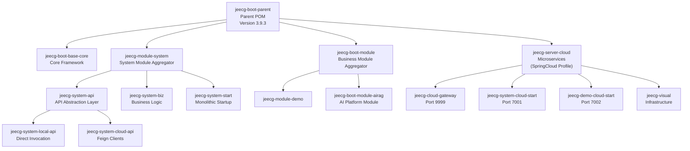
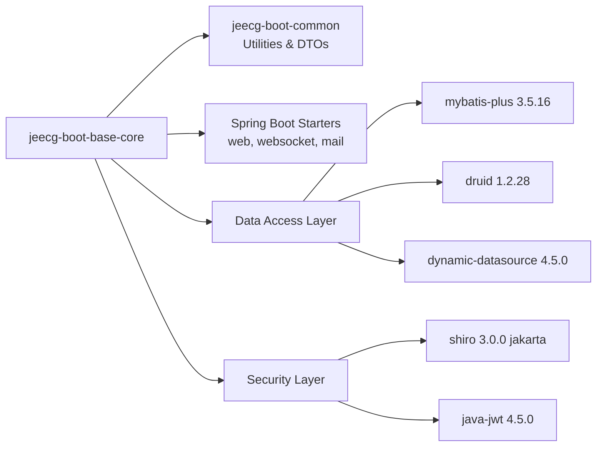
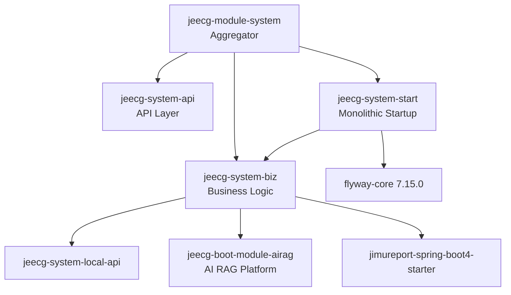

<!-- source: DeepWiki mcp.deepwiki.com · repo jeecgboot/JeecgBoot · page 2.2 Backend Module Structure · fetched 2026-10-29 -->

# Backend Module Structure

<details>
<summary>Relevant source files</summary>

The following files were used as context for generating this wiki page:

- [jeecg-boot/jeecg-boot-base-core/pom.xml](jeecg-boot/jeecg-boot-base-core/pom.xml)
- [jeecg-boot/jeecg-boot-base-core/src/main/java/org/jeecg/common/util/encryption/AesEncryptUtil.java](jeecg-boot/jeecg-boot-base-core/src/main/java/org/jeecg/common/util/encryption/AesEncryptUtil.java)
- [jeecg-boot/jeecg-boot-base-core/src/main/java/org/jeecg/config/shiro/ShiroConfig.java](jeecg-boot/jeecg-boot-base-core/src/main/java/org/jeecg/config/shiro/ShiroConfig.java)
- [jeecg-boot/jeecg-boot-module/jeecg-boot-module-airag/pom.xml](jeecg-boot/jeecg-boot-module/jeecg-boot-module-airag/pom.xml)
- [jeecg-boot/jeecg-module-system/jeecg-system-api/jeecg-system-cloud-api/pom.xml](jeecg-boot/jeecg-module-system/jeecg-system-api/jeecg-system-cloud-api/pom.xml)
- [jeecg-boot/jeecg-module-system/jeecg-system-api/pom.xml](jeecg-boot/jeecg-module-system/jeecg-system-api/pom.xml)
- [jeecg-boot/jeecg-module-system/jeecg-system-biz/pom.xml](jeecg-boot/jeecg-module-system/jeecg-system-biz/pom.xml)
- [jeecg-boot/jeecg-module-system/jeecg-system-biz/src/main/java/org/jeecg/config/jimureport/JimuDragExternalServiceImpl.java](jeecg-boot/jeecg-module-system/jeecg-system-biz/src/main/java/org/jeecg/config/jimureport/JimuDragExternalServiceImpl.java)
- [jeecg-boot/jeecg-module-system/jeecg-system-biz/src/main/java/org/jeecg/config/jimureport/JimuReportTokenService.java](jeecg-boot/jeecg-module-system/jeecg-system-biz/src/main/java/org/jeecg/config/jimureport/JimuReportTokenService.java)
- [jeecg-boot/jeecg-module-system/jeecg-system-start/pom.xml](jeecg-boot/jeecg-module-system/jeecg-system-start/pom.xml)
- [jeecg-boot/jeecg-module-system/jeecg-system-start/src/test/java/org/jeecg/modules/system/test/SysUserApiTest.java](jeecg-boot/jeecg-module-system/jeecg-system-start/src/test/java/org/jeecg/modules/system/test/SysUserApiTest.java)
- [jeecg-boot/jeecg-module-system/pom.xml](jeecg-boot/jeecg-module-system/pom.xml)
- [jeecg-boot/jeecg-server-cloud/jeecg-cloud-gateway/pom.xml](jeecg-boot/jeecg-server-cloud/jeecg-cloud-gateway/pom.xml)
- [jeecg-boot/jeecg-server-cloud/jeecg-demo-cloud-start/pom.xml](jeecg-boot/jeecg-server-cloud/jeecg-demo-cloud-start/pom.xml)
- [jeecg-boot/jeecg-server-cloud/jeecg-system-cloud-start/pom.xml](jeecg-boot/jeecg-server-cloud/jeecg-system-cloud-start/pom.xml)
- [jeecg-boot/jeecg-server-cloud/jeecg-visual/jeecg-cloud-test/jeecg-cloud-test-more/pom.xml](jeecg-boot/jeecg-server-cloud/jeecg-visual/jeecg-cloud-test/jeecg-cloud-test-more/pom.xml)
- [jeecg-boot/jeecg-server-cloud/jeecg-visual/jeecg-cloud-test/jeecg-cloud-test-rabbitmq/pom.xml](jeecg-boot/jeecg-server-cloud/jeecg-visual/jeecg-cloud-test/jeecg-cloud-test-rabbitmq/pom.xml)
- [jeecg-boot/jeecg-server-cloud/jeecg-visual/jeecg-cloud-test/jeecg-cloud-test-rocketmq/pom.xml](jeecg-boot/jeecg-server-cloud/jeecg-visual/jeecg-cloud-test/jeecg-cloud-test-rocketmq/pom.xml)
- [jeecg-boot/jeecg-server-cloud/jeecg-visual/jeecg-cloud-test/jeecg-cloud-test-seata/jeecg-cloud-test-seata-account/pom.xml](jeecg-boot/jeecg-server-cloud/jeecg-visual/jeecg-cloud-test/jeecg-cloud-test-seata/jeecg-cloud-test-seata-account/pom.xml)
- [jeecg-boot/pom.xml](jeecg-boot/pom.xml)

</details>


## Purpose and Scope

This page documents the Maven multi-module structure of the JeecgBoot backend, detailing how the codebase is organized into reusable components that support both monolithic and microservices deployment modes. It covers module hierarchy, dependency relationships, and the purpose of each major module.

For information about deployment architecture patterns, see [System Architecture Overview](#2.1) and [Microservices Architecture](#2.4). For specific core components and utilities, see [Core Framework & Base Components](#2.2.1). For frontend module organization, see [Frontend Architecture](#2.3).

---

## Maven Multi-Module Organization

JeecgBoot uses a Maven multi-module project structure with a parent POM managing dependencies and build configurations. The project supports two deployment modes through selective module composition:

- **Monolithic Mode**: Single executable JAR using `jeecg-system-start`.
- **Microservices Mode**: Distributed services using `jeecg-server-cloud` modules.

### Overall Module Hierarchy



Sources: [jeecg-boot/pom.xml:4-6](), [jeecg-boot/pom.xml:88-92](), [jeecg-boot/jeecg-boot-module/jeecg-boot-module-airag/pom.xml:12]()

---

## Parent Module: jeecg-boot-parent

The root `jeecg-boot-parent` serves as the parent POM for all modules, managing dependency versions, build configuration, and Maven profiles.

### Key Responsibilities

| Responsibility | Description | Location |
|---------------|-------------|----------|
| Spring Boot Parent | Inherits from `spring-boot-starter-parent` 4.1.0 | [jeecg-boot/pom.xml:23-28]() |
| Dependency Management | Centralized version control for 80+ dependencies | [jeecg-boot/pom.xml:176-230]() |
| Spring Cloud Versions | Spring Cloud 2025.1.2, Alibaba 2025.1.0.0 | [jeecg-boot/pom.xml:38-39]() |
| Build Configuration | Compiler and plugin management | [jeecg-boot/pom.xml:566-632]() |

### Core Technology Versions

```properties
jeecgboot.version=3.9.3
java.version=17
spring-cloud.version=2025.1.2
spring-cloud-alibaba.version=2025.1.0.0
mybatis-plus.version=3.5.16
druid.version=1.2.28
shiro.version=3.0.0
knife4j.version=4.5.0
```

Sources: [jeecg-boot/pom.xml:30-86]()

---

## Core Framework Module: jeecg-boot-base-core

The `jeecg-boot-base-core` module provides foundational infrastructure used by all business modules. It aggregates common utilities, security, data access, and integration components.

### Core Framework Dependencies



Sources: [jeecg-boot/jeecg-boot-base-core/pom.xml:42-232]()

### Data Access & Security

The module includes comprehensive database support and security configuration:
- **Multi-Database Support**: Includes drivers for MySQL, PostgreSQL, Oracle, SQL Server, Kingbase8, and Dameng [jeecg-boot/jeecg-boot-base-core/pom.xml:145-191]().
- **Shiro Security**: Uses Shiro 3.0.0 with Jakarta EE support [jeecg-boot/jeecg-boot-base-core/pom.xml:205-232]().
- **JWT Authentication**: Defined in `ShiroConfig` using `JwtFilter` for stateless token validation [jeecg-boot/jeecg-boot-base-core/src/main/java/org/jeecg/config/shiro/ShiroConfig.java:20-70]().

---

## System Module Organization: jeecg-module-system

The `jeecg-module-system` aggregates system-level functionality into API, business logic, and startup layers.

### System Module Structure



Sources: [jeecg-boot/jeecg-module-system/jeecg-system-biz/pom.xml:13-58](), [jeecg-boot/jeecg-module-system/jeecg-system-start/pom.xml:14-33]()

### Business Logic Layer: jeecg-system-biz

This module contains the core business services. Notably, it integrates the AI platform via `jeecg-boot-module-airag` [jeecg-boot/jeecg-module-system/jeecg-system-biz/pom.xml:54-58]().

- **AI Platform Integration**: The `jeecg-boot-module-airag` module provides RAG (Retrieval-Augmented Generation) capabilities, utilizing `langchain4j` and `liteflow` [jeecg-boot/jeecg-boot-module/jeecg-boot-module-airag/pom.xml:34-57]().
- **Reporting**: Integrates `JimuReport` and `JimuBI` for dashboard and report design [jeecg-boot/jeecg-module-system/jeecg-system-biz/pom.xml:33-52]().

### Startup Module: jeecg-system-start

The executable entry point for monolithic deployment. It includes `flyway-core` for automated database migrations [jeecg-boot/jeecg-module-system/jeecg-system-start/pom.xml:28-33](). The main class is `org.jeecg.JeecgSystemApplication` [jeecg-boot/jeecg-module-system/jeecg-system-start/pom.xml:65]().

---

## AI Platform Module: jeecg-boot-module-airag

A specialized business module for AI and RAG features.

| Component | Technology | Purpose |
|-----------|------------|---------|
| LLM Framework | `langchain4j` | Integration with OpenAI, Ollama, Gemini, ZhipuAI |
| Workflow Engine | `liteflow` | AI flow orchestration and chain execution |
| Document Parsing | `apache-tika` | Content extraction from various file types |
| Scripting | `Groovy`, `Python`, `Kotlin` | Dynamic node execution within AI flows |

Sources: [jeecg-boot/jeecg-boot-module/jeecg-boot-module-airag/pom.xml:34-190]()

---

## Security and Encryption Utilities

### Password Encryption
The `AesEncryptUtil` provides dual-mode decryption to support both new `PKCS5Padding` (compatible with modern frontend libraries) and legacy `NoPadding` modes [jeecg-boot/jeecg-boot-base-core/src/main/java/org/jeecg/common/util/encryption/AesEncryptUtil.java:42-64]().

### Shiro Configuration
`ShiroConfig` defines the security filter chain, including public endpoints (`anon`) for login, static resources, and third-party integrations like `jmreport` [jeecg-boot/jeecg-boot-base-core/src/main/java/org/jeecg/config/shiro/ShiroConfig.java:85-150]().

---

## Summary of Deployment Modules

| Module | Deployment Mode | Port | Role |
|--------|-----------------|------|------|
| `jeecg-system-start` | Monolithic | 8080 | Single JAR containing all system and business logic. |
| `jeecg-cloud-gateway` | Microservices | 9999 | Spring Cloud Gateway with Sentinel and Redis rate limiting. |
| `jeecg-system-cloud-start` | Microservices | 7001 | System business service in a distributed environment. |

Sources: [jeecg-boot/jeecg-server-cloud/jeecg-cloud-gateway/pom.xml:11-34](), [jeecg-boot/jeecg-server-cloud/jeecg-system-cloud-start/pom.xml:11-43]()

---

