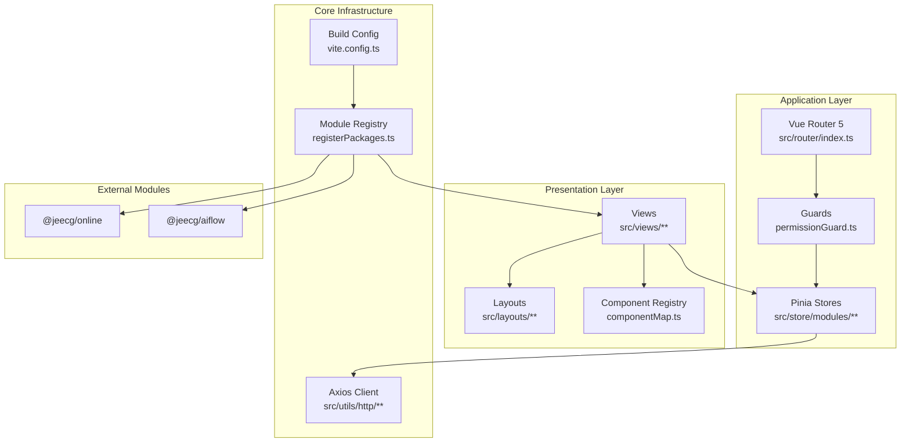

<!-- source: DeepWiki mcp.deepwiki.com · repo jeecgboot/JeecgBoot · page 2.3 Frontend Architecture · fetched 2026-10-29 -->

# Frontend Architecture

<details>
<summary>Relevant source files</summary>

The following files were used as context for generating this wiki page:

- [jeecgboot-vue3/VITE8-UPGRADE-LOG.md](jeecgboot-vue3/VITE8-UPGRADE-LOG.md)
- [jeecgboot-vue3/build/config/themeConfig.ts](jeecgboot-vue3/build/config/themeConfig.ts)
- [jeecgboot-vue3/build/vite/plugin/index.ts](jeecgboot-vue3/build/vite/plugin/index.ts)
- [jeecgboot-vue3/package.json](jeecgboot-vue3/package.json)
- [jeecgboot-vue3/pnpm-lock.yaml](jeecgboot-vue3/pnpm-lock.yaml)
- [jeecgboot-vue3/src/components/Form/index.ts](jeecgboot-vue3/src/components/Form/index.ts)
- [jeecgboot-vue3/src/components/Form/src/componentMap.ts](jeecgboot-vue3/src/components/Form/src/componentMap.ts)
- [jeecgboot-vue3/src/components/Form/src/hooks/useForm.ts](jeecgboot-vue3/src/components/Form/src/hooks/useForm.ts)
- [jeecgboot-vue3/src/components/Icon/src/Icon.vue](jeecgboot-vue3/src/components/Icon/src/Icon.vue)
- [jeecgboot-vue3/src/components/jeecg/JVxeTable/index.ts](jeecgboot-vue3/src/components/jeecg/JVxeTable/index.ts)
- [jeecgboot-vue3/src/components/jeecg/JVxeTable/useVxeTableRegister.ts](jeecgboot-vue3/src/components/jeecg/JVxeTable/useVxeTableRegister.ts)
- [jeecgboot-vue3/src/components/registerGlobComp.ts](jeecgboot-vue3/src/components/registerGlobComp.ts)
- [jeecgboot-vue3/src/router/guard/paramMenuGuard.ts](jeecgboot-vue3/src/router/guard/paramMenuGuard.ts)
- [jeecgboot-vue3/src/router/guard/permissionGuard.ts](jeecgboot-vue3/src/router/guard/permissionGuard.ts)
- [jeecgboot-vue3/src/router/helper/routeHelper.ts](jeecgboot-vue3/src/router/helper/routeHelper.ts)
- [jeecgboot-vue3/src/router/index.ts](jeecgboot-vue3/src/router/index.ts)
- [jeecgboot-vue3/src/settings/projectSetting.ts](jeecgboot-vue3/src/settings/projectSetting.ts)
- [jeecgboot-vue3/src/store/modules/app.ts](jeecgboot-vue3/src/store/modules/app.ts)
- [jeecgboot-vue3/src/store/modules/defIndex.ts](jeecgboot-vue3/src/store/modules/defIndex.ts)
- [jeecgboot-vue3/src/store/modules/errorLog.ts](jeecgboot-vue3/src/store/modules/errorLog.ts)
- [jeecgboot-vue3/src/store/modules/locale.ts](jeecgboot-vue3/src/store/modules/locale.ts)
- [jeecgboot-vue3/src/store/modules/lock.ts](jeecgboot-vue3/src/store/modules/lock.ts)
- [jeecgboot-vue3/src/store/modules/multipleTab.ts](jeecgboot-vue3/src/store/modules/multipleTab.ts)
- [jeecgboot-vue3/src/utils/dynamicPages.ts](jeecgboot-vue3/src/utils/dynamicPages.ts)
- [jeecgboot-vue3/src/utils/getConfigByMenuType.ts](jeecgboot-vue3/src/utils/getConfigByMenuType.ts)
- [jeecgboot-vue3/src/utils/monorepo/registerPackages.ts](jeecgboot-vue3/src/utils/monorepo/registerPackages.ts)
- [jeecgboot-vue3/src/views/super/online/cgform/auto/comp/superquery/SuperQuery.vue](jeecgboot-vue3/src/views/super/online/cgform/auto/comp/superquery/SuperQuery.vue)
- [jeecgboot-vue3/types/config.d.ts](jeecgboot-vue3/types/config.d.ts)
- [jeecgboot-vue3/vite.config.ts](jeecgboot-vue3/vite.config.ts)

</details>


## Purpose and Scope

This document describes the frontend architecture of JeecgBoot, covering the Vue3-based single-page application structure, build system configuration, module organization, and state management. For specific build configuration and PWA setup, see [Build System & PWA Configuration](#2.3.1). For component library details, see [Component Library & UI Framework](#2.3.2). For monorepo module integration, see [Module Integration & Monorepo](#2.3.3).

The JeecgBoot frontend is a modern enterprise framework built with **Vue 3.5**, **TypeScript 5.9**, and **Vite 6** (recently upgraded to **Vite 8** in specific branches), utilizing **Ant Design Vue 4** for UI and **Pinia 3** for state management.

---

## Technology Stack

The frontend utilizes a high-performance JavaScript ecosystem:

| Technology | Version | Purpose |
|------------|---------|---------|
| **Vue** | 3.5.39 | Core framework with Composition API [jeecgboot-vue3/package.json:73]() |
| **TypeScript** | 5.9.3 | Type-safe development [jeecgboot-vue3/package.json:159]() |
| **Vite** | 8.1.4 | Build tool and dev server [jeecgboot-vue3/package.json:161]() |
| **Ant Design Vue** | 4.2.6 | UI component library [jeecgboot-vue3/package.json:37]() |
| **Vue Router** | 5.1.0 | Routing with navigation guards [jeecgboot-vue3/package.json:79]() |
| **Pinia** | 3.0.4 | State management [jeecgboot-vue3/package.json:62]() |
| **VXE Table** | 4.13.31 | Advanced data grid [jeecgboot-vue3/package.json:82]() |

**Key Architectural Changes (Vite 8 Upgrade):**
The project has transitioned to the **Rolldown** bundler and **Oxc** minifier provided by Vite 8 [jeecgboot-vue3/VITE8-UPGRADE-LOG.md:42-46](). This includes a move to **Lightning CSS** for stricter CSS validation [jeecgboot-vue3/VITE8-UPGRADE-LOG.md:47]().

---

## Architecture Diagram

The following diagram bridges the natural language architecture to specific code entities within the `jeecgboot-vue3` directory.

### Frontend System Overview

**Sources:** [jeecgboot-vue3/src/router/index.ts:1-10](), [jeecgboot-vue3/src/store/modules/app.ts:31-39](), [jeecgboot-vue3/src/utils/monorepo/registerPackages.ts:17-28]()

---

## Project Structure

The frontend follows a strictly typed, modular structure designed for enterprise scale:

```
jeecgboot-vue3/
├── build/                      # Vite & Build scripts
│   ├── config/                # Theme and environment config
│   └── vite/                  # Vite plugins (PWA, Mock, etc.)
├── src/
│   ├── api/                   # API request definitions
│   ├── components/            # UI Components
│   │   └── Form/              # BasicForm & componentMap.ts
│   ├── hooks/                 # Composition API hooks
│   ├── layouts/               # Page layouts (Sidebar, Header)
│   ├── router/                # Vue Router 5 configuration
│   │   ├── guard/             # permissionGuard.ts
│   │   └── helper/            # routeHelper.ts
│   ├── settings/              # projectSetting.ts (Default Theme)
│   ├── store/                 # Pinia 3 modules (user, app, tab)
│   ├── utils/                 # Core utilities
│   │   └── monorepo/          # registerPackages.ts
│   └── views/                 # Page components
├── types/                     # TypeScript d.ts files
└── vite.config.ts            # Vite 8 / Rolldown configuration
```

**Sources:** [jeecgboot-vue3/vite.config.ts:50-88](), [jeecgboot-vue3/src/router/helper/routeHelper.ts:1-20]()

---

## Build System (Vite 8)

The build system leverages **Vite 8** for high-speed development and optimized production bundles.

### Build Configuration & Optimization
The configuration in `vite.config.ts` manages the transition from esbuild to **Rolldown** and **Oxc** [jeecgboot-vue3/vite.config.ts:110-112](). 

- **Manual Chunking**: Optimized via a function-based `manualChunks` to handle vendor splitting for `vue`, `vue-router`, and `emoji-mart-vue-fast` [jeecgboot-vue3/vite.config.ts:122-135]().
- **Dependency Optimization**: `optimizeDeps` now uses `rolldownOptions` to target `es2020` [jeecgboot-vue3/vite.config.ts:165-172]().
- **Path Aliases**: Uses `/@/` for `src` and `/#/` for `types` [jeecgboot-vue3/vite.config.ts:71-78]().

For details on PWA and specific plugin configurations, see [Build System & PWA Configuration](#2.3.1).

**Sources:** [jeecgboot-vue3/vite.config.ts:109-141](), [jeecgboot-vue3/VITE8-UPGRADE-LOG.md:42-53]()

---

## State Management & Routing

### Pinia 3 Store
The application uses Pinia 3 with the new `defineStore('id', { ... })` syntax [jeecgboot-vue3/VITE8-UPGRADE-LOG.md:81]().

- **`useAppStore`**: Manages global settings like `darkMode`, `projectConfig`, and `pageLoading` [jeecgboot-vue3/src/store/modules/app.ts:31-39]().
- **`useUserStore`**: Handles authentication tokens and user profile [jeecgboot-vue3/src/router/guard/permissionGuard.ts:33]().
- **`useMultipleTabStore`**: Manages the multi-tab navigation state and cache [jeecgboot-vue3/src/store/modules/multipleTab.ts:90-100]().

### Vue Router 5 & Navigation Guards
The routing system utilizes **Vue Router 5**, moving from `next()` callbacks to **Return Value** style navigation guards [jeecgboot-vue3/VITE8-UPGRADE-LOG.md:95-104]().

- **`permissionGuard.ts`**: Handles token validation, OAuth2 redirection, and dynamic route building via `permissionStore.buildRoutesAction()` [jeecgboot-vue3/src/router/guard/permissionGuard.ts:39-192]().
- **`routeHelper.ts`**: Transforms backend menu data into frontend route objects and handles dynamic component loading [jeecgboot-vue3/src/router/helper/routeHelper.ts:139-162]().

**Sources:** [jeecgboot-vue3/src/store/modules/app.ts:31-60](), [jeecgboot-vue3/src/router/guard/permissionGuard.ts:170-185](), [jeecgboot-vue3/VITE8-UPGRADE-LOG.md:75-76]()

---

## Component & Module Integration

### Dynamic Component Mapping
The `componentMap.ts` acts as a registry for all form components, using `createAsyncComponent` for lazy loading to reduce initial bundle size [jeecgboot-vue3/src/components/Form/src/componentMap.ts:11-86]().

### Monorepo & Package Registration
JeecgBoot supports a dynamic package system for integrating modules like `@jeecg/online` and `@jeecg/aiflow`.

- **`registerPackages.ts`**: Provides the `baseImport` mechanism to allow external packages to import core utilities and hooks from the main app [jeecgboot-vue3/src/utils/monorepo/registerPackages.ts:126-140]().
- **`loadPackageComponent`**: Facilitates on-demand loading of components from external packages when local routes are not found [jeecgboot-vue3/src/utils/monorepo/registerPackages.ts:101-113]().

For details on monorepo structure, see [Module Integration & Monorepo](#2.3.3).

**Sources:** [jeecgboot-vue3/src/components/Form/src/componentMap.ts:6-11](), [jeecgboot-vue3/src/utils/monorepo/registerPackages.ts:1-28]()

---

## Summary of Frontend Child Pages

- [Build System & PWA Configuration](#2.3.1) — Vite build configuration, plugin system, code splitting, and PWA implementation with service workers.
- [Component Library & UI Framework](#2.3.2) — Ant Design Vue4 components, VXE Table, Echarts integration, and custom component development.
- [Module Integration & Monorepo](#2.3.3) — Dynamic package registration system for @jeecg/online and @jeecg/aiflow modules with baseImport mechanism.

---

