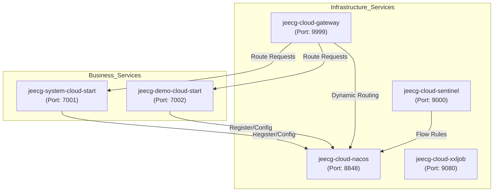
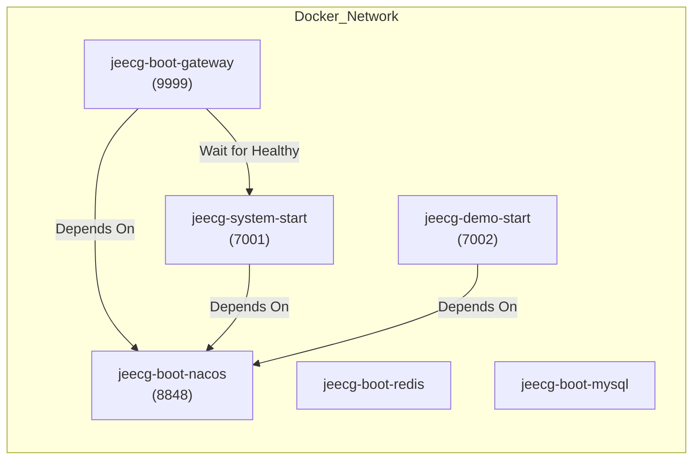

<!-- source: DeepWiki mcp.deepwiki.com · repo jeecgboot/JeecgBoot · page 2.4 Microservices Architecture · fetched 2026-10-29 -->

# Microservices Architecture

Relevant source files

The following files were used as context for generating this wiki page:

- [jeecg-boot/db/tables_nacos.sql](jeecg-boot/db/tables_nacos.sql)
- [jeecg-boot/jeecg-module-system/jeecg-system-api/jeecg-system-cloud-api/pom.xml](jeecg-boot/jeecg-module-system/jeecg-system-api/jeecg-system-cloud-api/pom.xml)
- [jeecg-boot/jeecg-module-system/jeecg-system-api/pom.xml](jeecg-boot/jeecg-module-system/jeecg-system-api/pom.xml)
- [jeecg-boot/jeecg-module-system/jeecg-system-start/Dockerfile](jeecg-boot/jeecg-module-system/jeecg-system-start/Dockerfile)
- [jeecg-boot/jeecg-module-system/pom.xml](jeecg-boot/jeecg-module-system/pom.xml)
- [jeecg-boot/jeecg-server-cloud/docker-compose.yml](jeecg-boot/jeecg-server-cloud/docker-compose.yml)
- [jeecg-boot/jeecg-server-cloud/jeecg-cloud-gateway/Dockerfile](jeecg-boot/jeecg-server-cloud/jeecg-cloud-gateway/Dockerfile)
- [jeecg-boot/jeecg-server-cloud/jeecg-cloud-gateway/pom.xml](jeecg-boot/jeecg-server-cloud/jeecg-cloud-gateway/pom.xml)
- [jeecg-boot/jeecg-server-cloud/jeecg-cloud-gateway/src/main/resources/application.yml](jeecg-boot/jeecg-server-cloud/jeecg-cloud-gateway/src/main/resources/application.yml)
- [jeecg-boot/jeecg-server-cloud/jeecg-cloud-nacos/Dockerfile](jeecg-boot/jeecg-server-cloud/jeecg-cloud-nacos/Dockerfile)
- [jeecg-boot/jeecg-server-cloud/jeecg-cloud-nacos/docs/DEFAULT_GROUP/jeecg-dev-satoken.yaml](jeecg-boot/jeecg-server-cloud/jeecg-cloud-nacos/docs/DEFAULT_GROUP/jeecg-dev-satoken.yaml)
- [jeecg-boot/jeecg-server-cloud/jeecg-cloud-nacos/docs/DEFAULT_GROUP/jeecg-dev.yaml](jeecg-boot/jeecg-server-cloud/jeecg-cloud-nacos/docs/DEFAULT_GROUP/jeecg-dev.yaml)
- [jeecg-boot/jeecg-server-cloud/jeecg-cloud-nacos/docs/DEFAULT_GROUP/jeecg-gateway-router.json](jeecg-boot/jeecg-server-cloud/jeecg-cloud-nacos/docs/DEFAULT_GROUP/jeecg-gateway-router.json)
- [jeecg-boot/jeecg-server-cloud/jeecg-cloud-nacos/docs/DEFAULT_GROUP/jeecg-gateway.yaml](jeecg-boot/jeecg-server-cloud/jeecg-cloud-nacos/docs/DEFAULT_GROUP/jeecg-gateway.yaml)
- [jeecg-boot/jeecg-server-cloud/jeecg-cloud-nacos/docs/DEFAULT_GROUP/jeecg.yaml](jeecg-boot/jeecg-server-cloud/jeecg-cloud-nacos/docs/DEFAULT_GROUP/jeecg.yaml)
- [jeecg-boot/jeecg-server-cloud/jeecg-cloud-nacos/docs/DEFAULT_GROUP/sharding.yaml](jeecg-boot/jeecg-server-cloud/jeecg-cloud-nacos/docs/DEFAULT_GROUP/sharding.yaml)
- [jeecg-boot/jeecg-server-cloud/jeecg-cloud-nacos/pom.xml](jeecg-boot/jeecg-server-cloud/jeecg-cloud-nacos/pom.xml)
- [jeecg-boot/jeecg-server-cloud/jeecg-cloud-nacos/src/main/java/com/alibaba/nacos/JeecgNacosApplication.java](jeecg-boot/jeecg-server-cloud/jeecg-cloud-nacos/src/main/java/com/alibaba/nacos/JeecgNacosApplication.java)
- [jeecg-boot/jeecg-server-cloud/jeecg-demo-cloud-start/Dockerfile](jeecg-boot/jeecg-server-cloud/jeecg-demo-cloud-start/Dockerfile)
- [jeecg-boot/jeecg-server-cloud/jeecg-demo-cloud-start/pom.xml](jeecg-boot/jeecg-server-cloud/jeecg-demo-cloud-start/pom.xml)
- [jeecg-boot/jeecg-server-cloud/jeecg-system-cloud-start/Dockerfile](jeecg-boot/jeecg-server-cloud/jeecg-system-cloud-start/Dockerfile)
- [jeecg-boot/jeecg-server-cloud/jeecg-system-cloud-start/pom.xml](jeecg-boot/jeecg-server-cloud/jeecg-system-cloud-start/pom.xml)
- [jeecg-boot/jeecg-server-cloud/jeecg-visual/jeecg-cloud-sentinel/Dockerfile](jeecg-boot/jeecg-server-cloud/jeecg-visual/jeecg-cloud-sentinel/Dockerfile)
- [jeecg-boot/jeecg-server-cloud/jeecg-visual/jeecg-cloud-sentinel/pom.xml](jeecg-boot/jeecg-server-cloud/jeecg-visual/jeecg-cloud-sentinel/pom.xml)
- [jeecg-boot/jeecg-server-cloud/jeecg-visual/jeecg-cloud-test/jeecg-cloud-test-rabbitmq/pom.xml](jeecg-boot/jeecg-server-cloud/jeecg-visual/jeecg-cloud-test/jeecg-cloud-test-rabbitmq/pom.xml)
- [jeecg-boot/jeecg-server-cloud/jeecg-visual/jeecg-cloud-test/jeecg-cloud-test-rocketmq/pom.xml](jeecg-boot/jeecg-server-cloud/jeecg-visual/jeecg-cloud-test/jeecg-cloud-test-rocketmq/pom.xml)
- [jeecg-boot/jeecg-server-cloud/jeecg-visual/jeecg-cloud-test/jeecg-cloud-test-seata/jeecg-cloud-test-seata-account/pom.xml](jeecg-boot/jeecg-server-cloud/jeecg-visual/jeecg-cloud-test/jeecg-cloud-test-seata/jeecg-cloud-test-seata-account/pom.xml)
- [jeecg-boot/jeecg-server-cloud/jeecg-visual/jeecg-cloud-xxljob/Dockerfile](jeecg-boot/jeecg-server-cloud/jeecg-visual/jeecg-cloud-xxljob/Dockerfile)

## Purpose and Scope

This document describes JeecgBoot's microservices architecture based on Spring Cloud Alibaba. It covers the distributed deployment mode where the application is split into multiple independent services that communicate via REST APIs and are orchestrated by infrastructure components including Nacos (service registry and configuration center), Spring Cloud Gateway (API gateway), Sentinel (flow control), and Spring Boot Admin (monitoring).

JeecgBoot provides flexible deployment options: the same codebase supports both monolithic deployment (single JAR) and microservices deployment (distributed services). This page focuses specifically on the microservices architecture. For details on specific components, see:
- [Service Discovery & Configuration (Nacos)](#2.4.1)
- [API Gateway & Routing](#2.4.2)
- [Monitoring & Resilience Services](#2.4.3)

Sources: [jeecg-boot/jeecg-server-cloud/docker-compose.yml:1-150](), [jeecg-boot/jeecg-server-cloud/jeecg-cloud-gateway/src/main/resources/application.yml:1-117]()

---

## Microservices Technology Stack

JeecgBoot's microservices implementation is built on the Spring Cloud Alibaba ecosystem. The technology stack includes:

| Component | Technology | Version | Purpose |
|-----------|-----------|---------|---------|
| Service Registry | Alibaba Nacos | 3.2.2 | Service discovery and configuration management [jeecg-boot/jeecg-server-cloud/jeecg-cloud-nacos/pom.xml:18-18]() |
| API Gateway | Spring Cloud Gateway | - | Routing, rate limiting, circuit breaking [jeecg-boot/jeecg-server-cloud/jeecg-cloud-gateway/pom.xml:26-29]() |
| Flow Control | Alibaba Sentinel | 1.8.10 | Rate limiting, circuit breaking [jeecg-boot/jeecg-server-cloud/jeecg-visual/jeecg-cloud-sentinel/pom.xml:21-26]() |
| Distributed Scheduling | XXL-Job | 3.9.3 | Distributed task scheduling [jeecg-boot/jeecg-server-cloud/jeecg-visual/jeecg-cloud-xxljob/Dockerfile:23-23]() |
| Configuration | Nacos Config | - | Dynamic configuration from Nacos [jeecg-boot/jeecg-server-cloud/jeecg-cloud-gateway/src/main/resources/application.yml:13-23]() |

Sources: [jeecg-boot/jeecg-server-cloud/jeecg-cloud-nacos/pom.xml:1-100](), [jeecg-boot/jeecg-server-cloud/jeecg-cloud-gateway/pom.xml:1-80](), [jeecg-boot/jeecg-server-cloud/jeecg-visual/jeecg-cloud-sentinel/pom.xml:1-66]()

---

## Microservices Module Structure

The codebase is organized into specialized modules for microservices deployment, separating business logic from infrastructure.

**Microservices Module Organization Diagram**

- **`jeecg-cloud-nacos`**: A customized Nacos server for service registration and configuration management [jeecg-boot/jeecg-server-cloud/jeecg-cloud-nacos/pom.xml:5-7]().
- **`jeecg-cloud-gateway`**: The unified entry point using Spring Cloud Gateway [jeecg-boot/jeecg-server-cloud/jeecg-cloud-gateway/pom.xml:11-11]().
- **`jeecg-system-cloud-start`**: The core system service containing user, role, and permission logic [jeecg-boot/jeecg-server-cloud/jeecg-system-cloud-start/Dockerfile:21-21]().
- **`jeecg-demo-cloud-start`**: A sample business service demonstrating microservice patterns [jeecg-boot/jeecg-server-cloud/jeecg-demo-cloud-start/Dockerfile:21-21]().
- **`jeecg-cloud-xxljob`**: Distributed task executor based on XXL-Job [jeecg-boot/jeecg-server-cloud/jeecg-visual/jeecg-cloud-xxljob/Dockerfile:17-21]().

Sources: [jeecg-boot/jeecg-server-cloud/docker-compose.yml:60-150](), [jeecg-boot/jeecg-server-cloud/jeecg-cloud-gateway/src/main/resources/application.yml:1-10]()

---

## Service Discovery and Configuration

JeecgBoot uses Nacos for both service discovery and configuration. Services register their instances with Nacos, and the Gateway dynamically discovers these instances to route traffic.

**Configuration Management**:
Nacos stores application configurations in YAML/JSON format. The system supports dynamic refresh, meaning changes in Nacos are propagated to services without restarts.
- **Config Table**: `config_info` stores the main configuration content [jeecg-boot/db/tables_nacos.sql:88-108]().
- **Default Group**: Services typically look for configurations in `DEFAULT_GROUP` [jeecg-boot/jeecg-server-cloud/jeecg-cloud-gateway/src/main/resources/application.yml:20-20]().

For details, see [Service Discovery & Configuration (Nacos)](#2.4.1).

Sources: [jeecg-boot/db/tables_nacos.sql:85-113](), [jeecg-boot/jeecg-server-cloud/jeecg-cloud-gateway/src/main/resources/application.yml:16-29]()

---

## API Gateway and Routing

The `jeecg-cloud-gateway` acts as the traffic controller. It provides:
- **Dynamic Routing**: Automatically routes to services based on Nacos registration [jeecg-boot/jeecg-server-cloud/jeecg-cloud-gateway/src/main/resources/application.yml:33-35]().
- **Security**: Integration with Sentinel for gateway-level flow control [jeecg-boot/jeecg-server-cloud/jeecg-cloud-gateway/pom.xml:37-40]().
- **CORS Support**: Global CORS configuration for cross-origin frontend requests [jeecg-boot/jeecg-server-cloud/jeecg-cloud-gateway/src/main/resources/application.yml:36-45]().

For details, see [API Gateway & Routing](#2.4.2).

Sources: [jeecg-boot/jeecg-server-cloud/jeecg-cloud-gateway/pom.xml:25-55](), [jeecg-boot/jeecg-server-cloud/jeecg-cloud-gateway/src/main/resources/application.yml:30-45]()

---

## Resilience and Monitoring

To ensure enterprise-grade stability, JeecgBoot integrates several resilience patterns:
- **Sentinel**: Provides flow control, circuit breaking, and system adaptive protection. Rules are persisted in Nacos [jeecg-boot/jeecg-server-cloud/jeecg-cloud-gateway/src/main/resources/application.yml:56-117]().
- **Distributed Scheduling**: XXL-Job handles complex background tasks across the cluster [jeecg-boot/jeecg-server-cloud/jeecg-visual/jeecg-cloud-xxljob/Dockerfile:1-25]().
- **Health Checks**: Actuator endpoints are exposed for monitoring service status [jeecg-boot/jeecg-server-cloud/jeecg-cloud-gateway/pom.xml:64-67]().

For details, see [Monitoring & Resilience Services](#2.4.3).

Sources: [jeecg-boot/jeecg-server-cloud/jeecg-cloud-gateway/src/main/resources/application.yml:47-117](), [jeecg-boot/jeecg-server-cloud/jeecg-visual/jeecg-cloud-sentinel/pom.xml:1-30]()

---

## Deployment Architecture

JeecgBoot provides a comprehensive `docker-compose.yml` for deploying the entire microservices stack.

**Docker Deployment Topology Diagram**

Key deployment features:
- **Service Dependency**: Gateway waits for `jeecg-system` to be registered as healthy in Nacos before starting to prevent empty routing tables [jeecg-boot/jeecg-server-cloud/docker-compose.yml:109-121]().
- **Environment Consistency**: Standardized Java 17/21 Anolis-based images are used across all services [jeecg-boot/jeecg-server-cloud/jeecg-cloud-gateway/Dockerfile:1-1](), [jeecg-boot/jeecg-server-cloud/jeecg-cloud-nacos/Dockerfile:1-1]().

Sources: [jeecg-boot/jeecg-server-cloud/docker-compose.yml:1-128](), [jeecg-boot/jeecg-server-cloud/jeecg-cloud-gateway/Dockerfile:1-25]()

---

