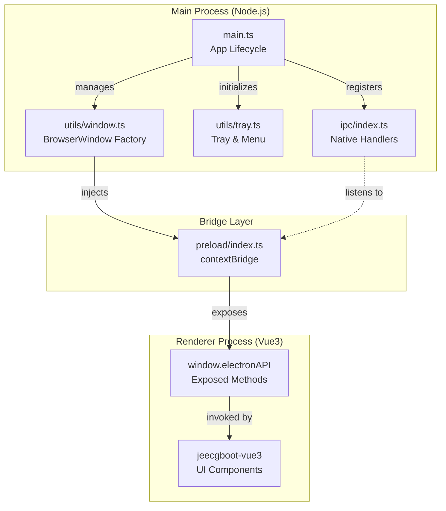
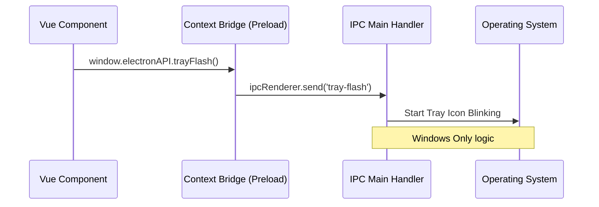

<!-- source: DeepWiki mcp.deepwiki.com · repo jeecgboot/JeecgBoot · page 2.5 Electron Desktop Application · fetched 2026-10-29 -->

# Electron Desktop Application

Relevant source files

The following files were used as context for generating this wiki page:

- [jeecgboot-vue3/VITE8-UPGRADE-LOG.md](jeecgboot-vue3/VITE8-UPGRADE-LOG.md)
- [jeecgboot-vue3/build/config/themeConfig.ts](jeecgboot-vue3/build/config/themeConfig.ts)
- [jeecgboot-vue3/package.json](jeecgboot-vue3/package.json)
- [jeecgboot-vue3/pnpm-lock.yaml](jeecgboot-vue3/pnpm-lock.yaml)
- [jeecgboot-vue3/src/router/guard/paramMenuGuard.ts](jeecgboot-vue3/src/router/guard/paramMenuGuard.ts)
- [jeecgboot-vue3/src/router/guard/permissionGuard.ts](jeecgboot-vue3/src/router/guard/permissionGuard.ts)
- [jeecgboot-vue3/src/router/index.ts](jeecgboot-vue3/src/router/index.ts)
- [jeecgboot-vue3/src/settings/projectSetting.ts](jeecgboot-vue3/src/settings/projectSetting.ts)
- [jeecgboot-vue3/src/store/modules/app.ts](jeecgboot-vue3/src/store/modules/app.ts)
- [jeecgboot-vue3/src/store/modules/defIndex.ts](jeecgboot-vue3/src/store/modules/defIndex.ts)
- [jeecgboot-vue3/src/store/modules/errorLog.ts](jeecgboot-vue3/src/store/modules/errorLog.ts)
- [jeecgboot-vue3/src/store/modules/locale.ts](jeecgboot-vue3/src/store/modules/locale.ts)
- [jeecgboot-vue3/src/store/modules/lock.ts](jeecgboot-vue3/src/store/modules/lock.ts)
- [jeecgboot-vue3/src/store/modules/multipleTab.ts](jeecgboot-vue3/src/store/modules/multipleTab.ts)
- [jeecgboot-vue3/src/utils/getConfigByMenuType.ts](jeecgboot-vue3/src/utils/getConfigByMenuType.ts)
- [jeecgboot-vue3/src/views/super/online/cgform/auto/comp/superquery/SuperQuery.vue](jeecgboot-vue3/src/views/super/online/cgform/auto/comp/superquery/SuperQuery.vue)
- [jeecgboot-vue3/types/config.d.ts](jeecgboot-vue3/types/config.d.ts)
- [jeecgboot-vue3/vite.config.ts](jeecgboot-vue3/vite.config.ts)

## Purpose and Scope

The JeecgBoot Electron desktop application serves as a native wrapper for the Vue3 frontend, enabling JeecgBoot to run as a cross-platform desktop application (Windows, macOS, and Linux). It leverages Electron to bridge the gap between web technologies and native operating system capabilities, providing advanced window management, system tray persistence, and native desktop notifications.

The application utilizes a secure multi-process architecture where the main process handles system-level operations and the renderer process executes the JeecgBoot Vue3 application logic.

---

## Architecture and Code Entity Mapping

The following diagram maps the logical desktop application components to their specific implementation files and classes within the codebase.

**Sources:** [jeecgboot-vue3/electron/main.ts:1-63](), [jeecgboot-vue3/electron/preload/index.ts:1-21](), [jeecgboot-vue3/electron/utils/window.ts:1-101]()

---

## Application Lifecycle & Window Management

The application lifecycle is managed in `electron/main.ts`, while window creation logic is encapsulated in `electron/utils/window.ts`.

### Main Process Entry
The `main()` function initializes the application. In production environments, it enforces a single-instance lock to prevent multiple copies of the application from running simultaneously [jeecgboot-vue3/electron/main.ts:24-38]().

### Window Creation Functions
The system provides specialized factory functions for different window types:

| Function | Purpose | Implementation Detail |
| :--- | :--- | :--- |
| `getBrowserWindowOptions()` | Configuration | Sets `nodeIntegration: false` and `contextIsolation: true` for security [jeecgboot-vue3/electron/utils/window.ts:9-22](). |
| `createMainWindow()` | Primary UI | Attaches the system tray and configures the window to hide instead of close [jeecgboot-vue3/electron/utils/window.ts:60-75](). |
| `createIndexWindow()` | Content UI | Loads the actual application URL or local file path [jeecgboot-vue3/electron/utils/window.ts:80-101](). |

### Security Configuration
To protect the system from malicious web content, the application explicitly disables Node.js integration in the renderer process and uses a preload script to expose only necessary APIs [jeecgboot-vue3/electron/utils/window.ts:13-17]().

**Sources:** [jeecgboot-vue3/electron/main.ts:1-63](), [jeecgboot-vue3/electron/utils/window.ts:9-101]()

---

## IPC Communication System

Inter-Process Communication (IPC) is the mechanism used by the Vue3 frontend to request native OS actions.

### API Exposure (Preload)
The `electron/preload/index.ts` file uses `contextBridge` to expose a safe API object named `electronAPI` to the global `window` object of the renderer [jeecgboot-vue3/electron/preload/index.ts:4-20]().

### Native Event Handlers
The main process handles these requests in `electron/ipc/index.ts`. Key handlers include:

*   **`open-in-browser`**: Uses the native shell to open links in the user's default web browser rather than inside the Electron window [jeecgboot-vue3/electron/ipc/index.ts:4-6]().
*   **`notify-flash`**: Triggers platform-specific attention-grabbing actions, such as taskbar flashing on Windows or dock bouncing on macOS [jeecgboot-vue3/electron/ipc/index.ts:8-27]().
*   **`notify-with-path`**: Displays a native desktop notification that, when clicked, restores the application window and focuses it [jeecgboot-vue3/electron/ipc/index.ts:29-43]().

**Sources:** [jeecgboot-vue3/electron/preload/index.ts:1-21](), [jeecgboot-vue3/electron/ipc/index.ts:1-44]()

---

## System Tray & Native Integration

The `electron/utils/tray.ts` file manages the persistent system tray icon and its associated context menu.

### Tray Menu Capabilities
The tray menu provides several utility functions, especially during development [jeecgboot-vue3/electron/utils/tray.ts:136-200]():
*   **Show/Hide Window**: Toggles the visibility of the main application window.
*   **DevTools Toggle**: Opens the Chromium developer tools for debugging.
*   **Blink Simulation**: Tests the notification "blink" effect.
*   **Exit**: Properly terminates the application process.

### Visual Alerts (Blinking)
For Windows users, the tray icon can "blink" by alternating between the application logo and an empty icon every 500ms [jeecgboot-vue3/electron/utils/tray.ts:46-68](). This is typically used to signal unread messages or background tasks requiring attention.

**Sources:** [jeecgboot-vue3/electron/utils/tray.ts:1-201](), [jeecgboot-vue3/electron/ipc/index.ts:8-27]()

---

## Build and Environment Integration

The Electron application is integrated into the Vite-based build pipeline.

### Build Scripts
The `package.json` includes specific scripts for Electron development and packaging:
*   `electron:dev`: Starts the Vite dev server with Electron environment variables enabled.
*   `electron:build-app`: Uses `electron-builder` to package the application into installers (EXE, DMG, AppImage).

### Environment Detection
The application uses the `VITE_GLOB_RUN_PLATFORM` environment variable. When set to `electron`, the frontend can adjust its behavior, such as using `127.0.0.1` instead of `localhost` to ensure compatibility with certain local services like WPS [jeecgboot-vue3/electron/utils/window.ts:88-97]().

### Dependencies
The project relies on specific versions of the Electron ecosystem to maintain stability:
*   `electron`: 35.1.4 [jeecgboot-vue3/electron.md:12]()
*   `vite-plugin-electron`: ^0.29.0 [jeecgboot-vue3/electron.md:14]()
*   `electron-builder`: ^26.0.12 [jeecgboot-vue3/electron.md:15]()

**Sources:** [jeecgboot-vue3/package.json:1-193](), [jeecgboot-vue3/electron.md:1-37](), [jeecgboot-vue3/electron/utils/window.ts:87-100]()

---

