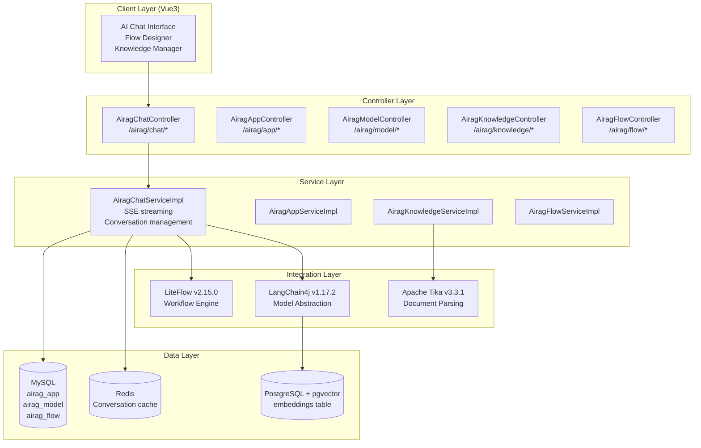

<!-- source: DeepWiki mcp.deepwiki.com · repo jeecgboot/JeecgBoot · page 3 AI Platform (AIGC) · fetched 2026-10-29 -->

# AI Platform (AIGC)

Relevant source files

The following files were used as context for generating this wiki page:

- [jeecg-boot/UPGRADE-3.9.3.md](jeecg-boot/UPGRADE-3.9.3.md)
- [jeecg-boot/db/Dockerfile](jeecg-boot/db/Dockerfile)
- [jeecg-boot/db/jeecgboot-mysql-5.7.sql](jeecg-boot/db/jeecgboot-mysql-5.7.sql)
- [jeecg-boot/db/tables_xxl_job.sql](jeecg-boot/db/tables_xxl_job.sql)
- [jeecg-boot/jeecg-boot-base-core/pom.xml](jeecg-boot/jeecg-boot-base-core/pom.xml)
- [jeecg-boot/jeecg-boot-base-core/src/main/java/org/jeecg/common/util/encryption/AesEncryptUtil.java](jeecg-boot/jeecg-boot-base-core/src/main/java/org/jeecg/common/util/encryption/AesEncryptUtil.java)
- [jeecg-boot/jeecg-boot-base-core/src/main/java/org/jeecg/config/shiro/ShiroConfig.java](jeecg-boot/jeecg-boot-base-core/src/main/java/org/jeecg/config/shiro/ShiroConfig.java)
- [jeecg-boot/jeecg-boot-module/jeecg-boot-module-airag/pom.xml](jeecg-boot/jeecg-boot-module/jeecg-boot-module-airag/pom.xml)
- [jeecg-boot/jeecg-module-system/jeecg-system-start/src/main/resources/flyway/sql/mysql/V3.9.0_0__all_upgrade.sql](jeecg-boot/jeecg-module-system/jeecg-system-start/src/main/resources/flyway/sql/mysql/V3.9.0_0__all_upgrade.sql)
- [jeecg-boot/jeecg-module-system/jeecg-system-start/src/main/resources/flyway/sql/mysql/V3.9.1_0__all_upgrade.sql](jeecg-boot/jeecg-module-system/jeecg-system-start/src/main/resources/flyway/sql/mysql/V3.9.1_0__all_upgrade.sql)
- [jeecg-boot/jeecg-server-cloud/jeecg-visual/jeecg-cloud-xxljob/doc/db/tables_xxl_job.sql](jeecg-boot/jeecg-server-cloud/jeecg-visual/jeecg-cloud-xxljob/doc/db/tables_xxl_job.sql)
- [jeecg-boot/pom.xml](jeecg-boot/pom.xml)

## Purpose and Scope

The AI Platform (AIGC) is JeecgBoot's complete artificial intelligence application development system, providing enterprise-level capabilities for building AI-powered applications. This module implements a full-stack AI platform comparable to Dify, combining LLM integration, knowledge base management, workflow orchestration, and conversational AI services.

This page documents the technical architecture, core components, and integration patterns of the AI platform within the JeecgBoot ecosystem.

**Core Capabilities:**
- Multi-provider LLM integration (ChatGPT, DeepSeek, Ollama, Qwen, Zhipu, Claude, etc.)
- RAG (Retrieval-Augmented Generation) pipeline with pgvector extension
- Visual AI workflow orchestration using LiteFlow engine
- Knowledge base management with document parsing (Apache Tika, MinerU)
- MCP (Model Context Protocol) and plugin system
- Real-time SSE streaming chat interface
- Multimedia AI features including TTS, video generation, and AI poster/painting

Sources: [jeecg-boot/jeecg-boot-module/jeecg-boot-module-airag/pom.xml:33-56](), [jeecg-boot/UPGRADE-3.9.3.md:200-231]()

---

## System Architecture Overview

The AI Platform is organized within the `jeecg-boot-module-airag` module, leveraging **LangChain4j** for LLM abstraction and **LiteFlow** for workflow orchestration.

### System Components Diagram

Sources: [jeecg-boot/jeecg-boot-module/jeecg-boot-module-airag/pom.xml:33-56](), [jeecg-boot/UPGRADE-3.9.3.md:182-198]()

---

## AI Application Types & Architecture

JeecgBoot supports two primary application types defined in the `airag_app` table:
1. **ChatSimple**: Direct chat with an LLM, supporting system prompts, knowledge base integration, and simple tools.
2. **ChatFlow**: Workflow-based applications where the conversation logic is defined by a LiteFlow chain.

The `airag_app` table stores configuration including `prologue`, `prompt`, `model_id`, and `flow_id`. For details, see [AI Application Types & Architecture](#3.1).

Sources: [jeecg-boot/db/jeecgboot-mysql-5.7.sql:41-43]()

---

## AI Model Management

The platform provides a unified interface for multiple AI providers through the `airag_model` configuration. It supports:
- **LLM Providers**: OpenAI, DeepSeek, Ollama, ZhipuAI, Dashscope (Qwen), etc.
- **Embedding Models**: Used for RAG to transform text into vectors.

Models are managed with parameters like `base_url`, `api_key`, and specific model names (e.g., `gpt-4.1`, `qwen3.5:0.8b`). For details, see [AI Model Management](#3.2).

Sources: [jeecg-boot/jeecg-boot-module/jeecg-boot-module-airag/pom.xml:150-190](), [jeecg-boot/db/tables_xxl_job.sql:81-83]()

---

## Knowledge Base & RAG System

The RAG (Retrieval-Augmented Generation) system allows applications to "consult" private documents.
- **Ingestion**: Documents are parsed via **Apache Tika** or **MinerU**.
- **Vectorization**: Text is split and converted to embeddings via LangChain4j.
- **Storage**: Vectors are stored in **PostgreSQL** using the `pgvector` extension, which supports high-dimensional similarity searches.

For details, see [Knowledge Base & RAG System](#3.3).

Sources: [jeecg-boot/jeecg-boot-module/jeecg-boot-module-airag/pom.xml:36-37](), [jeecg-boot/UPGRADE-3.9.3.md:200-231]()

---

## AI Flow Orchestration

Workflow orchestration is powered by **LiteFlow**, allowing users to design AI logic visually.
- **Node Types**: Includes LLM nodes, Knowledge nodes, Switch nodes, and Code nodes (supporting Groovy, Python, and JavaScript).
- **Chain Syntax**: Workflows are stored as LiteFlow EL (Expression Language) in the `airag_flow` table.

For details, see [AI Flow Orchestration](#3.4).

Sources: [jeecg-boot/jeecg-boot-module/jeecg-boot-module-airag/pom.xml:35-35](), [jeecg-boot/db/jeecgboot-mysql-5.7.sql:44-44]()

---

## AI Chat Service & Conversation Management

The `AiragChatServiceImpl` handles the core chat logic, supporting:
- **SSE (Server-Sent Events)**: Real-time streaming of AI responses to the frontend.
- **Conversation Persistence**: Storing message history and session metadata in Redis and MySQL.
- **Context Management**: Automatically managing message windows and token limits.

For details, see [AI Chat Service & Conversation Management](#3.5).

Sources: [jeecg-boot/jeecg-boot-base-core/pom.xml:59-63](), [jeecg-boot/jeecg-module-system/jeecg-system-start/src/main/resources/flyway/sql/mysql/V3.9.1_0__all_upgrade.sql:43-43]()

---

## Plugin & MCP System

The **Model Context Protocol (MCP)** and plugin system allow LLMs to interact with external tools and data.
- **airag_mcp Table**: Configures plugin types (SSE vs. STDIO) and tool definitions.
- **Tool Integration**: Allows the AI to call system APIs, query databases, or execute custom logic.

For details, see [Plugin & MCP System](#3.6).

Sources: [jeecg-boot/jeecg-module-system/jeecg-system-start/src/main/resources/flyway/sql/mysql/V3.9.0_0__all_upgrade.sql:27-47]()

---

## Multimedia AI Features

JeecgBoot extends beyond text with advanced multimedia capabilities:
- **AI Writer & Word Templates**: Generating structured documents based on templates.
- **Visual AI**: AI painting, poster generation, and "AI Cloth Change" features.
- **OCR & TTS**: Optical Character Recognition and Text-to-Speech synthesis.

For details, see [Multimedia AI Features](#3.7).

Sources: [jeecg-boot/db/jeecgboot-mysql-5.7.sql:27-48](), [jeecg-boot/jeecg-module-system/jeecg-system-start/src/main/resources/flyway/sql/mysql/V3.9.1_0__all_upgrade.sql:42-42]()

---

