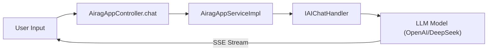
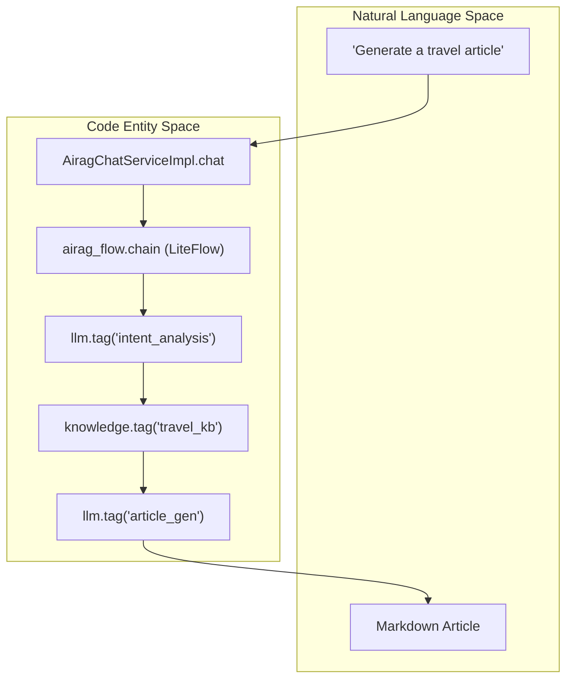
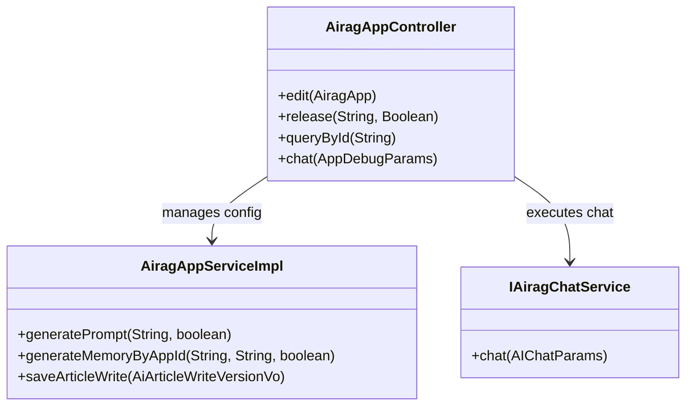

<!-- source: DeepWiki mcp.deepwiki.com · repo jeecgboot/JeecgBoot · page 3.1 AI Application Types & Architecture · fetched 2026-10-29 -->

# AI Application Types & Architecture

<details>
<summary>Relevant source files</summary>

The following files were used as context for generating this wiki page:

- [jeecg-boot/UPGRADE-3.9.3.md](jeecg-boot/UPGRADE-3.9.3.md)
- [jeecg-boot/db/Dockerfile](jeecg-boot/db/Dockerfile)
- [jeecg-boot/db/jeecgboot-mysql-5.7.sql](jeecg-boot/db/jeecgboot-mysql-5.7.sql)
- [jeecg-boot/db/tables_xxl_job.sql](jeecg-boot/db/tables_xxl_job.sql)
- [jeecg-boot/jeecg-boot-module/jeecg-boot-module-airag/src/main/java/org/jeecg/modules/airag/app/consts/AiAppConsts.java](jeecg-boot/jeecg-boot-module/jeecg-boot-module-airag/src/main/java/org/jeecg/modules/airag/app/consts/AiAppConsts.java)
- [jeecg-boot/jeecg-boot-module/jeecg-boot-module-airag/src/main/java/org/jeecg/modules/airag/app/consts/Prompts.java](jeecg-boot/jeecg-boot-module/jeecg-boot-module-airag/src/main/java/org/jeecg/modules/airag/app/consts/Prompts.java)
- [jeecg-boot/jeecg-boot-module/jeecg-boot-module-airag/src/main/java/org/jeecg/modules/airag/app/controller/AiragAppController.java](jeecg-boot/jeecg-boot-module/jeecg-boot-module-airag/src/main/java/org/jeecg/modules/airag/app/controller/AiragAppController.java)
- [jeecg-boot/jeecg-boot-module/jeecg-boot-module-airag/src/main/java/org/jeecg/modules/airag/app/service/IAiragAppService.java](jeecg-boot/jeecg-boot-module/jeecg-boot-module-airag/src/main/java/org/jeecg/modules/airag/app/service/IAiragAppService.java)
- [jeecg-boot/jeecg-boot-module/jeecg-boot-module-airag/src/main/java/org/jeecg/modules/airag/app/service/impl/AiragAppServiceImpl.java](jeecg-boot/jeecg-boot-module/jeecg-boot-module-airag/src/main/java/org/jeecg/modules/airag/app/service/impl/AiragAppServiceImpl.java)
- [jeecg-boot/jeecg-boot-module/jeecg-boot-module-airag/src/main/java/org/jeecg/modules/airag/app/vo/AiArticleWriteVersionVo.java](jeecg-boot/jeecg-boot-module/jeecg-boot-module-airag/src/main/java/org/jeecg/modules/airag/app/vo/AiArticleWriteVersionVo.java)
- [jeecg-boot/jeecg-module-system/jeecg-system-start/src/main/resources/flyway/sql/mysql/V3.9.0_0__all_upgrade.sql](jeecg-boot/jeecg-module-system/jeecg-system-start/src/main/resources/flyway/sql/mysql/V3.9.0_0__all_upgrade.sql)
- [jeecg-boot/jeecg-module-system/jeecg-system-start/src/main/resources/flyway/sql/mysql/V3.9.1_0__all_upgrade.sql](jeecg-boot/jeecg-module-system/jeecg-system-start/src/main/resources/flyway/sql/mysql/V3.9.1_0__all_upgrade.sql)
- [jeecg-boot/jeecg-module-system/jeecg-system-start/src/main/resources/flyway/sql/mysql/V3.9.1_1__add_aiapp_img_gen.sql](jeecg-boot/jeecg-module-system/jeecg-system-start/src/main/resources/flyway/sql/mysql/V3.9.1_1__add_aiapp_img_gen.sql)
- [jeecg-boot/jeecg-server-cloud/jeecg-visual/jeecg-cloud-xxljob/doc/db/tables_xxl_job.sql](jeecg-boot/jeecg-server-cloud/jeecg-visual/jeecg-cloud-xxljob/doc/db/tables_xxl_job.sql)

</details>


## Purpose and Scope

This document explains the two primary types of AI applications supported by the JeecgBoot AI platform: **Simple AI Applications** (`chatSimple`) and **Advanced Flow-Based Applications** (`chatFlow`). It details the `airag_app` table structure, architectural differences, prompt engineering capabilities, and the metadata-driven configuration model.

For information about AI model configuration and management, see [AI Model Management](#3.2). For detailed flow orchestration design, see [AI Flow Orchestration](#3.4).

Sources: [jeecg-boot/jeecg-boot-module/jeecg-boot-module-airag/src/main/java/org/jeecg/modules/airag/app/consts/AiAppConsts.java:31-40](), [jeecg-boot/jeecg-module-system/jeecg-system-start/src/main/resources/flyway/sql/mysql/V3.9.1_0__all_upgrade.sql:41-43]()

## AI Application Table Structure

All AI applications are defined in the `airag_app` table. This table acts as the central registry for both Simple and Flow-based applications, storing their configuration, behavior instructions (prompts), and associated resources.

### Core Schema: airag_app

| Column | Type | Description |
|--------|------|-------------|
| `id` | `varchar(36)` | Primary Key |
| `name` | `varchar(100)` | Application display name |
| `type` | `varchar(20)` | `chatSimple` or `chatFLow` [AiAppConsts.java:34-39]() |
| `model_id` | `varchar(36)` | Default LLM model reference |
| `knowledge_ids` | `text` | Comma-separated list of knowledge base IDs |
| `flow_id` | `varchar(36)` | Reference to `airag_flow` (required for `chatFLow`) |
| `prompt` | `text` | System instructions or role definition |
| `prologue` | `text` | Welcome message or initial prompt |
| `metadata` | `text` | JSON configuration for model parameters (temperature, etc.) |
| `plugins` | `text` | Configured tools or MCP plugins [V3.9.0_0__all_upgrade.sql:49-50]() |
| `status` | `varchar(20)` | `enable`, `disable`, or `release` [AiAppConsts.java:11-22]() |

Sources: [jeecg-boot/jeecg-module-system/jeecg-system-start/src/main/resources/flyway/sql/mysql/V3.9.1_0__all_upgrade.sql:41-43](), [jeecg-boot/jeecg-boot-module/jeecg-boot-module-airag/src/main/java/org/jeecg/modules/airag/app/consts/AiAppConsts.java:9-50]()

## ChatSimple: Simple AI Applications

### Architecture

Simple AI Applications provide a direct interaction path between the user and an LLM. The system constructs a context containing the system `prompt`, conversation history, and retrieved segments from the `knowledge_ids` (RAG).



**Architecture: ChatSimple Request Flow**

### Implementation Details
- **Prompt Generation**: The system includes a utility to generate high-quality structured prompts based on user requirements using the `GENERATE_LLM_PROMPT` role [Prompts.java:13-106]().
- **Variable Injection**: Supports dynamic variables (e.g., `{{name}}`) that are injected into the prompt at runtime [AiragAppServiceImpl.java:114-115]().
- **Memory Management**: Can automatically generate "memory usage guides" to instruct the LLM on when to call `add_memory` or `query_memory` tools [Prompts.java:141-159]().

Sources: [jeecg-boot/jeecg-boot-module/jeecg-boot-module-airag/src/main/java/org/jeecg/modules/airag/app/service/impl/AiragAppServiceImpl.java:71-91](), [jeecg-boot/jeecg-boot-module/jeecg-boot-module-airag/src/main/java/org/jeecg/modules/airag/app/consts/Prompts.java:13-159]()

## ChatFlow: Advanced Flow-Based Applications

### Architecture

`chatFLow` applications utilize a workflow engine (LiteFlow) to execute a sequence of nodes. Instead of a single LLM call, the `flow_id` points to a complex chain defined in the `airag_flow` table.



**Bridge: Natural Language to Code Entity Space (Flow Execution)**

### Key Characteristics
- **Visual Orchestration**: Built using a designer that generates a `chain` syntax (e.g., `THEN(start, llm, end)`) [V3.9.1_0__all_upgrade.sql:44]().
- **Multi-Model Support**: Different nodes in the same flow can use different LLM models.
- **Metadata Configuration**: The `metadata` field in `airag_app` stores flow-specific inputs (`flowInputs`), allowing the UI to render dynamic forms based on the workflow's requirements [AiAppConsts.java:42-45]().

Sources: [jeecg-boot/jeecg-module-system/jeecg-system-start/src/main/resources/flyway/sql/mysql/V3.9.1_0__all_upgrade.sql:44](), [jeecg-boot/jeecg-boot-module/jeecg-boot-module-airag/src/main/java/org/jeecg/modules/airag/app/consts/AiAppConsts.java:37-45]()

## Application Configuration & Metadata

### Metadata Schema
The `metadata` field in `airag_app` is a JSON string containing model parameters and UI hints.

```json
{
  "temperature": 0.7,
  "topP": 0.9,
  "presencePenalty": 0.1,
  "frequencyPenalty": 0.1,
  "maxTokens": 2000,
  "modelInfo": {
    "provider": "OPENAI",
    "modelName": "gpt-4"
  }
}
```

### Prompt Engineering Utilities
JeecgBoot provides a `Prompts` constant class to manage system-level instructions:
- **`GENERATE_LLM_PROMPT`**: A meta-prompt used to turn simple descriptions into structured role-playing prompts [Prompts.java:13-106]().
- **`GENERATE_VAR_PART`**: Instructions for the AI to handle user variables and call the `update_variable` tool [Prompts.java:124-136]().
- **`AI_WRITER_PROMPT`**: Standardized templates for specific AI features like article writing [Prompts.java:162-164]().

Sources: [jeecg-boot/jeecg-boot-module/jeecg-boot-module-airag/src/main/java/org/jeecg/modules/airag/app/consts/Prompts.java:13-164](), [jeecg-boot/jeecg-module-system/jeecg-system-start/src/main/resources/flyway/sql/mysql/V3.9.1_0__all_upgrade.sql:43]()

## Controller & Service Architecture

The management of AI applications is handled by `AiragAppController`, which extends the standard `JeecgController`.



**Code Entity Space: Application Management Classes**

### Key Functions
- **`edit`**: Handles application creation and updates with SaaS tenant isolation [AiragAppController.java:92-115]().
- **`release`**: Transitions an application to the `release` status, making it available for end-users [AiragAppController.java:122-137]().
- **`generatePrompt`**: Uses an LLM to automatically expand a short description into a full system prompt [AiragAppServiceImpl.java:71-91]().

Sources: [jeecg-boot/jeecg-boot-module/jeecg-boot-module-airag/src/main/java/org/jeecg/modules/airag/app/controller/AiragAppController.java:40-137](), [jeecg-boot/jeecg-boot-module/jeecg-boot-module-airag/src/main/java/org/jeecg/modules/airag/app/service/impl/AiragAppServiceImpl.java:58-91]()

---

