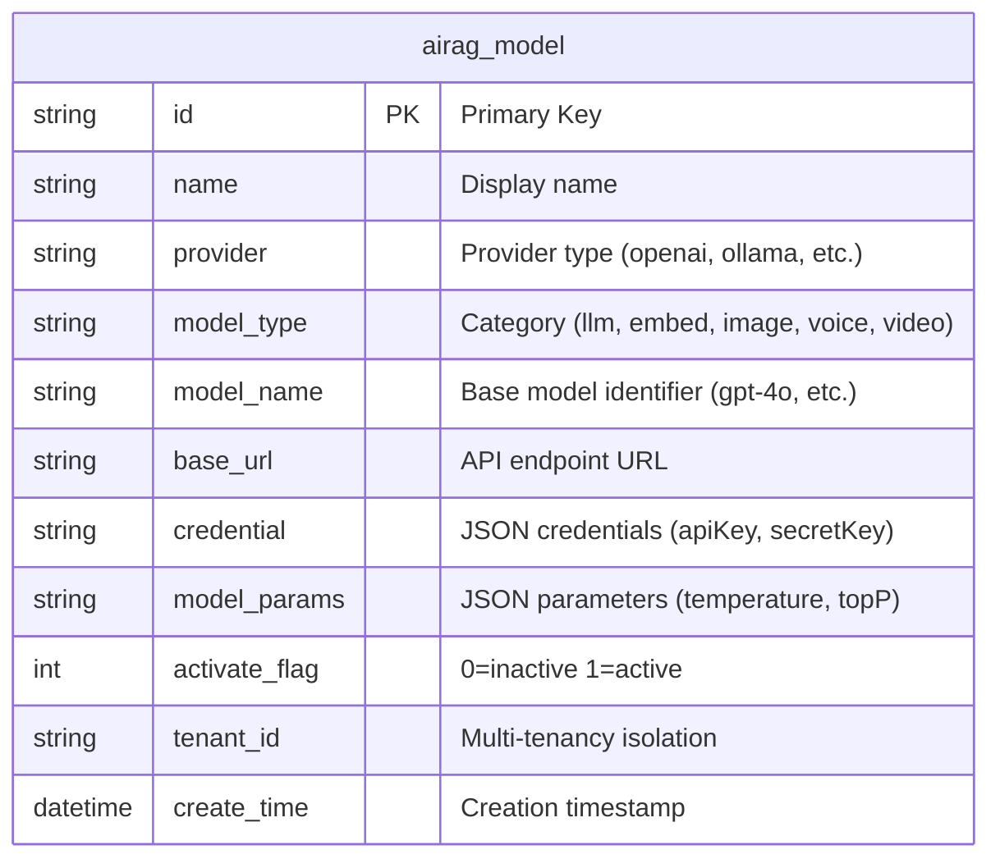
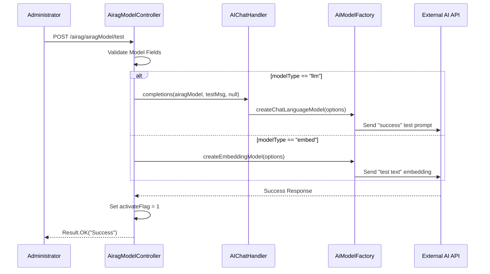

<!-- source: DeepWiki mcp.deepwiki.com · repo jeecgboot/JeecgBoot · page 3.2 AI Model Management · fetched 2026-10-29 -->

# AI Model Management

<details>
<summary>Relevant source files</summary>

The following files were used as context for generating this wiki page:

- [jeecg-boot/jeecg-boot-base-core/src/main/resources/config/default-spring-doc.properties](jeecg-boot/jeecg-boot-base-core/src/main/resources/config/default-spring-doc.properties)
- [jeecg-boot/jeecg-boot-module/jeecg-boot-module-airag/src/main/java/org/jeecg/modules/airag/app/controller/AiragChatController.java](jeecg-boot/jeecg-boot-module/jeecg-boot-module-airag/src/main/java/org/jeecg/modules/airag/app/controller/AiragChatController.java)
- [jeecg-boot/jeecg-boot-module/jeecg-boot-module-airag/src/main/java/org/jeecg/modules/airag/app/service/IAiragChatService.java](jeecg-boot/jeecg-boot-module/jeecg-boot-module-airag/src/main/java/org/jeecg/modules/airag/app/service/IAiragChatService.java)
- [jeecg-boot/jeecg-boot-module/jeecg-boot-module-airag/src/main/java/org/jeecg/modules/airag/llm/consts/LLMConsts.java](jeecg-boot/jeecg-boot-module/jeecg-boot-module-airag/src/main/java/org/jeecg/modules/airag/llm/consts/LLMConsts.java)
- [jeecg-boot/jeecg-boot-module/jeecg-boot-module-airag/src/main/java/org/jeecg/modules/airag/llm/controller/AiragModelController.java](jeecg-boot/jeecg-boot-module/jeecg-boot-module-airag/src/main/java/org/jeecg/modules/airag/llm/controller/AiragModelController.java)
- [jeecg-boot/jeecg-boot-module/jeecg-boot-module-airag/src/main/java/org/jeecg/modules/airag/llm/entity/AiragModel.java](jeecg-boot/jeecg-boot-module/jeecg-boot-module-airag/src/main/java/org/jeecg/modules/airag/llm/entity/AiragModel.java)
- [jeecg-boot/jeecg-boot-module/jeecg-boot-module-airag/src/main/java/org/jeecg/modules/airag/llm/handler/AIChatHandler.java](jeecg-boot/jeecg-boot-module/jeecg-boot-module-airag/src/main/java/org/jeecg/modules/airag/llm/handler/AIChatHandler.java)
- [jeecg-boot/jeecg-boot-module/jeecg-boot-module-airag/src/main/java/org/jeecg/modules/airag/llm/handler/JeecgToolsProvider.java](jeecg-boot/jeecg-boot-module/jeecg-boot-module-airag/src/main/java/org/jeecg/modules/airag/llm/handler/JeecgToolsProvider.java)
- [jeecg-boot/jeecg-module-system/jeecg-system-start/src/main/resources/application-dev.yml](jeecg-boot/jeecg-module-system/jeecg-system-start/src/main/resources/application-dev.yml)
- [jeecg-boot/jeecg-module-system/jeecg-system-start/src/main/resources/application-dm8.yml](jeecg-boot/jeecg-module-system/jeecg-system-start/src/main/resources/application-dm8.yml)
- [jeecg-boot/jeecg-module-system/jeecg-system-start/src/main/resources/application-docker.yml](jeecg-boot/jeecg-module-system/jeecg-system-start/src/main/resources/application-docker.yml)
- [jeecg-boot/jeecg-module-system/jeecg-system-start/src/main/resources/application-kingbase8.yml](jeecg-boot/jeecg-module-system/jeecg-system-start/src/main/resources/application-kingbase8.yml)
- [jeecg-boot/jeecg-module-system/jeecg-system-start/src/main/resources/application-oracle.yml](jeecg-boot/jeecg-module-system/jeecg-system-start/src/main/resources/application-oracle.yml)
- [jeecg-boot/jeecg-module-system/jeecg-system-start/src/main/resources/application-postgresql.yml](jeecg-boot/jeecg-module-system/jeecg-system-start/src/main/resources/application-postgresql.yml)
- [jeecg-boot/jeecg-module-system/jeecg-system-start/src/main/resources/application-prod.yml](jeecg-boot/jeecg-module-system/jeecg-system-start/src/main/resources/application-prod.yml)
- [jeecg-boot/jeecg-module-system/jeecg-system-start/src/main/resources/application-sqlserver.yml](jeecg-boot/jeecg-module-system/jeecg-system-start/src/main/resources/application-sqlserver.yml)
- [jeecg-boot/jeecg-module-system/jeecg-system-start/src/main/resources/application-test.yml](jeecg-boot/jeecg-module-system/jeecg-system-start/src/main/resources/application-test.yml)
- [jeecg-boot/jeecg-module-system/jeecg-system-start/src/main/resources/logback-spring.xml](jeecg-boot/jeecg-module-system/jeecg-system-start/src/main/resources/logback-spring.xml)
- [jeecgboot-vue3/src/views/super/airag/aimodel/components/model.json](jeecgboot-vue3/src/views/super/airag/aimodel/components/model.json)

</details>


## Purpose and Scope

This document describes the AI Model Management system in JeecgBoot, which provides centralized configuration and management of Large Language Models (LLMs), Embedding Models, and multimedia AI services (Image, Voice, Video). The system abstracts multiple AI provider APIs through a unified interface, enabling the platform to work with various providers such as OpenAI, DeepSeek, Ollama, and Alibaba Dashscope (QWEN) seamlessly.

For information about using models in chat applications, see **3.5 AI Chat Service & Conversation Management**. For knowledge base vector operations using embedding models, see **3.3 Knowledge Base & RAG System**.

## AI Model Entity Structure

The `AiragModel` entity represents a configured AI model in the system. Each model record stores connection parameters, credentials, and runtime configuration required to interact with a specific AI service.

### Database Schema



**Sources:** [jeecg-boot/jeecg-boot-module/jeecg-boot-module-airag/src/main/java/org/jeecg/modules/airag/llm/entity/AiragModel.java:1-132]()

### Key Fields

| Field | Type | Description |
|-------|------|-------------|
| `provider` | String | Provider identifier (openai, deepseek, ollama, zhipuai, qianfan, dashscope) |
| `modelType` | String | Model category: `llm`, `embed`, `image`, `voice`, or `video` |
| `modelName` | String | Specific model identifier (e.g., `deepseek-v3`, `text-embedding-v1`) |
| `baseUrl` | String | Custom API endpoint URL |
| `credential` | JSON String | API keys and secrets: `{"apiKey": "...", "secretKey": "..."}` |
| `modelParams` | JSON String | Runtime parameters: temperature, topP, maxTokens, etc. |
| `activateFlag` | Integer | Model activation status (0=not tested, 1=tested and working) |

**Sources:** [jeecg-boot/jeecg-boot-module/jeecg-boot-module-airag/src/main/java/org/jeecg/modules/airag/llm/entity/AiragModel.java:81-130]()

## Supported AI Providers and Configuration

The platform supports multiple providers through `AiModelFactory` and LangChain4j integration. Default configurations are managed via Spring Boot profiles.

### Provider Architecture

```mermaid
graph TB
    subgraph "Model Configuration Layer"
        "AiragModelEntity"["AiragModel Entity<br/>airag_model table"]
        "AppYmlConfig"["application.yml<br/>jeecg.ai-chat config"]
    end
    
    subgraph "Factory Layer"
        "AiModelFactory"["AiModelFactory<br/>createChatLanguageModel<br/>createEmbeddingModel"]
        "AiModelOptions"["AiModelOptions Builder<br/>provider modelName baseUrl<br/>apiKey secretKey"]
    end
    
    subgraph "Providers"
        "OPENAI"["langchain4j-open-ai<br/>OpenAI / DeepSeek"]
        "OLLAMA"["langchain4j-ollama<br/>Local Models"]
        "ZHIPU"["langchain4j-community-zhipu-ai<br/>Zhipu AI / GLM"]
        "DASHSCOPE"["langchain4j-community-dashscope<br/>Alibaba QWEN"]
    end
    
    "AiragModelEntity" --> "AiModelOptions"
    "AppYmlConfig" --> "AiModelOptions"
    "AiModelOptions" --> "AiModelFactory"
    
    "AiModelFactory" --> "OPENAI"
    "AiModelFactory" --> "OLLAMA"
    "AiModelFactory" --> "ZHIPU"
    "AiModelFactory" --> "DASHSCOPE"
```

**Sources:** [jeecg-boot/jeecg-boot-module/jeecg-boot-module-airag/src/main/java/org/jeecg/modules/airag/llm/controller/AiragModelController.java:11-12](), [jeecg-boot/jeecg-module-system/jeecg-system-start/src/main/resources/application-dev.yml:187-239]()

### Default System Configuration

JeecgBoot provides default model settings in `application-dev.yml` under the `jeecg.ai-chat` prefix.

| Configuration Key | Default Provider | Default Model |
|-------------------|------------------|---------------|
| `jeecg.ai-chat.model` | DeepSeek | `deepseek-v4-pro` |
| `jeecg.ai-chat.ai-model-draw` | QWEN | `wan2.2-t2i-flash` |
| `jeecg.ai-chat.ai-model-voice` | ZHIPU | `glm-tts` |
| `jeecg.ai-chat.ai-model-embed` | QWEN | `text-embedding-v1` |

**Sources:** [jeecg-module-system/jeecg-system-start/src/main/resources/application-dev.yml:188-239]()

## Model Lifecycle and Management

### Activation and Testing Flow

Before a model can be used, it must be activated via a connectivity test.



**Sources:** [jeecg-boot/jeecg-boot-module/jeecg-boot-module-airag/src/main/java/org/jeecg/modules/airag/llm/controller/AiragModelController.java:168-188]()

### Model Parameters Handling

The `AIChatHandler` merges database configuration with runtime parameters.

```java
public String completions(AiragModel airagModel, List<ChatMessage> messages, AIChatParams params) {
    params = mergeParams(airagModel, params);
    // ... inject thinking placeholders for DeepSeek models
    messages = injectThinkingPlaceholderIfNeeded(messages, airagModel.getModelName());
    return llmHandler.completions(messages, params);
}
```

**Key Parameters merged in `mergeParams`:**
- `temperature`: Controls randomness.
- `topP`: Nucleus sampling threshold.
- `maxTokens`: Maximum response length.
- `timeout`: Request timeout (default 60s).

**Sources:** [jeecg-boot/jeecg-boot-module/jeecg-boot-module-airag/src/main/java/org/jeecg/modules/airag/llm/handler/AIChatHandler.java:120-143](), [jeecg-boot/jeecg-module-system/jeecg-system-start/src/main/resources/application-dev.yml:193]()

## Multi-Provider Support Details

### Provider-Specific logic

1.  **DeepSeek Integration**: Special handling for "Thinking" tags (`<think>`). If `noThinking` is enabled, the handler strips thinking content from the response [AIChatHandler.java:137-141]().
2.  **Ollama**: Used for local model hosting. Configuration requires a `baseUrl` pointing to the Ollama server [application-dev.yml:245]().
3.  **Dashscope (QWEN)**: Primary provider for embedding (`text-embedding-v1`) and image generation (`wan2.2-t2i-flash`) [application-dev.yml:199,236]().
4.  **Zhipu AI**: Primary provider for Voice/TTS (`glm-tts`) and Video generation [application-dev.yml:215,226]().

## Security and Multi-Tenancy

Model management includes several security layers:

-   **SaaS Isolation**: In SaaS mode (`MybatisPlusSaasConfig.OPEN_SYSTEM_TENANT_CONTROL`), model deletion is restricted to the owner tenant [AiragModelController.java:117-124]().
-   **Permissions**: Operations like `add`, `edit`, and `delete` require specific Shiro permissions (e.g., `airag:model:add`) [AiragModelController.java:79,100,113]().
-   **SSRF Protection**: `AIChatHandler` utilizes `SsrfFileTypeFilter` when handling file-related AI tasks [AIChatHandler.java:16]().

**Sources:** [jeecg-boot/jeecg-boot-module/jeecg-boot-module-airag/src/main/java/org/jeecg/modules/airag/llm/controller/AiragModelController.java:79-124](), [jeecg-boot/jeecg-boot-module/jeecg-boot-module-airag/src/main/java/org/jeecg/modules/airag/llm/handler/AIChatHandler.java:16]()

## Implementation Classes

| Class | Role |
|-------|------|
| `AiragModelController` | REST API for model CRUD and testing. |
| `IAiragModelService` | Service interface for model database operations. |
| `AIChatHandler` | Core logic for LLM communication, parameter merging, and model selection. |
| `AiModelFactory` | External factory for creating LangChain4j model instances. |
| `EmbeddingHandler` | Manages embedding models and vector store connections. |

**Sources:** [jeecg-boot/jeecg-boot-module/jeecg-boot-module-airag/src/main/java/org/jeecg/modules/airag/llm/controller/AiragModelController.java:48-54](), [jeecg-boot/jeecg-boot-module/jeecg-boot-module-airag/src/main/java/org/jeecg/modules/airag/llm/handler/AIChatHandler.java:50-71]()

---

