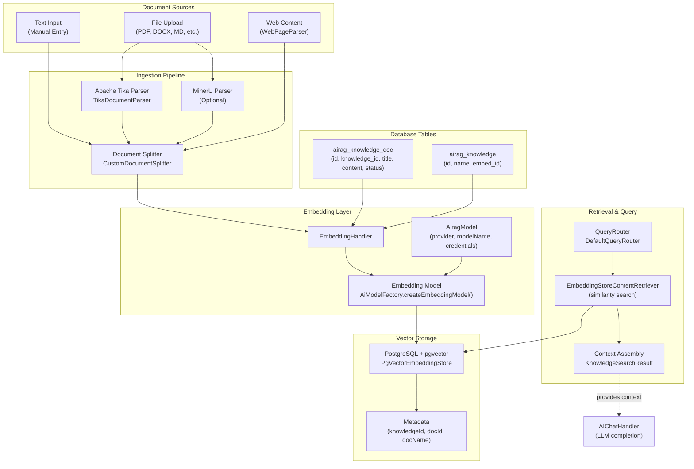
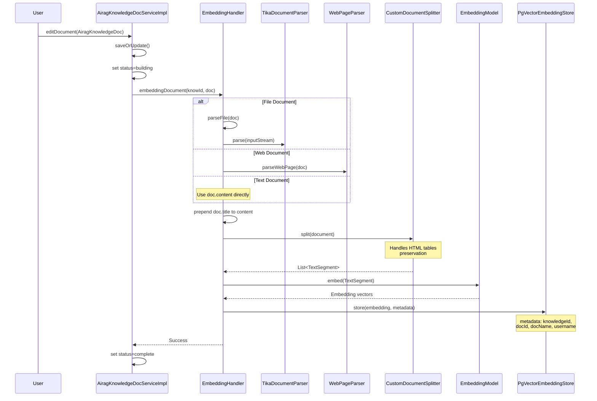

<!-- source: DeepWiki mcp.deepwiki.com · repo jeecgboot/JeecgBoot · page 3.3 Knowledge Base & RAG System · fetched 2026-10-29 -->

# Knowledge Base & RAG System

Relevant source files

The following files were used as context for generating this wiki page:

- [jeecg-boot/UPGRADE-3.9.3.md](jeecg-boot/UPGRADE-3.9.3.md)
- [jeecg-boot/db/Dockerfile](jeecg-boot/db/Dockerfile)
- [jeecg-boot/db/jeecgboot-mysql-5.7.sql](jeecg-boot/db/jeecgboot-mysql-5.7.sql)
- [jeecg-boot/db/tables_xxl_job.sql](jeecg-boot/db/tables_xxl_job.sql)
- [jeecg-boot/jeecg-boot-module/jeecg-boot-module-airag/src/main/java/org/jeecg/modules/airag/llm/handler/EmbeddingHandler.java](jeecg-boot/jeecg-boot-module/jeecg-boot-module-airag/src/main/java/org/jeecg/modules/airag/llm/handler/EmbeddingHandler.java)
- [jeecg-boot/jeecg-boot-module/jeecg-boot-module-airag/src/main/java/org/jeecg/modules/airag/llm/service/impl/AiragKnowledgeDocServiceImpl.java](jeecg-boot/jeecg-boot-module/jeecg-boot-module-airag/src/main/java/org/jeecg/modules/airag/llm/service/impl/AiragKnowledgeDocServiceImpl.java)
- [jeecg-boot/jeecg-module-system/jeecg-system-start/src/main/resources/flyway/sql/mysql/V3.9.0_0__all_upgrade.sql](jeecg-boot/jeecg-module-system/jeecg-system-start/src/main/resources/flyway/sql/mysql/V3.9.0_0__all_upgrade.sql)
- [jeecg-boot/jeecg-module-system/jeecg-system-start/src/main/resources/flyway/sql/mysql/V3.9.1_0__all_upgrade.sql](jeecg-boot/jeecg-module-system/jeecg-system-start/src/main/resources/flyway/sql/mysql/V3.9.1_0__all_upgrade.sql)
- [jeecg-boot/jeecg-server-cloud/jeecg-visual/jeecg-cloud-xxljob/doc/db/tables_xxl_job.sql](jeecg-boot/jeecg-server-cloud/jeecg-visual/jeecg-cloud-xxljob/doc/db/tables_xxl_job.sql)

## Purpose and Scope

This document describes JeecgBoot's Knowledge Base and Retrieval Augmented Generation (RAG) system, which enables AI applications to answer questions based on uploaded documents and custom knowledge bases. The system ingests various document formats (PDF, Word, Excel, Markdown, etc.), converts them to vector embeddings, stores them in a PostgreSQL pgvector database, and retrieves relevant context for LLM queries.

For information about AI application types and configuration, see [AI Application Types & Architecture](#3.1). For AI model configuration including embedding models, see [AI Model Management](#3.2). For AI workflow orchestration that uses knowledge bases, see [AI Flow Orchestration](#3.4).

## System Architecture

The RAG system consists of four major components: document ingestion, embedding generation, vector storage, and retrieval. Following the upgrade to **LangChain4j 1.17.2**, the system now supports advanced indexing like HNSW for improved search performance [jeecg-boot/UPGRADE-3.9.3.md:227-230]().

**Sources:**
- [jeecg-boot/jeecg-boot-module/jeecg-boot-module-airag/src/main/java/org/jeecg/modules/airag/llm/handler/EmbeddingHandler.java:1-558]()
- [jeecg-boot/jeecg-boot-module/jeecg-boot-module-airag/src/main/java/org/jeecg/modules/airag/llm/service/impl/AiragKnowledgeDocServiceImpl.java:1-350]()
- [jeecg-boot/UPGRADE-3.9.3.md:200-230]()

## Database Schema

The knowledge base system uses two primary tables to manage knowledge bases and their documents:

| Table | Purpose | Key Columns |
|-------|---------|-------------|
| `airag_knowledge` | Stores knowledge base definitions | `id`, `name`, `descr`, `embed_id` (embedding model reference), `status` [jeecg-boot/jeecg-module-system/jeecg-system-start/src/main/resources/flyway/sql/mysql/V3.9.1_0__all_upgrade.sql:38]() |
| `airag_knowledge_doc` | Stores documents within knowledge bases | `id`, `knowledge_id`, `title`, `content`, `type` (text/file/web), `status` [jeecg-boot/jeecg-boot-module/jeecg-boot-module-airag/src/main/java/org/jeecg/modules/airag/llm/service/impl/AiragKnowledgeDocServiceImpl.java:94-112]() |

The `embed_id` field in `airag_knowledge` references the `airag_model` table to specify which embedding model to use for vectorization.

Document status lifecycle [jeecg-boot/jeecg-boot-module/jeecg-boot-module-airag/src/main/java/org/jeecg/modules/airag/llm/service/impl/AiragKnowledgeDocServiceImpl.java:134-155]():
- **draft** (`KNOWLEDGE_DOC_STATUS_DRAFT`) - Initial state after upload/creation.
- **building** (`KNOWLEDGE_DOC_STATUS_BUILDING`) - Currently being vectorized.
- **complete** (`KNOWLEDGE_DOC_STATUS_COMPLETE`) - Successfully vectorized and queryable.
- **failed** (`KNOWLEDGE_DOC_STATUS_FAILED`) - Vectorization failed.

**Sources:**
- [jeecg-boot/jeecg-boot-module/jeecg-boot-module-airag/src/main/java/org/jeecg/modules/airag/llm/service/impl/AiragKnowledgeDocServiceImpl.java:94-217]()
- [jeecg-boot/jeecg-module-system/jeecg-system-start/src/main/resources/flyway/sql/mysql/V3.9.1_0__all_upgrade.sql:38]()

## Document Ingestion Pipeline

The document ingestion process converts various file formats into text segments suitable for embedding. It handles specialized cases like HTML tables to prevent truncation during splitting [jeecg-boot/jeecg-boot-module/jeecg-boot-module-airag/src/main/java/org/jeecg/modules/airag/llm/handler/EmbeddingHandler.java:152-157]().

**Sources:**
- [jeecg-boot/jeecg-boot-module/jeecg-boot-module-airag/src/main/java/org/jeecg/modules/airag/llm/handler/EmbeddingHandler.java:168-191]()
- [jeecg-boot/jeecg-boot-module/jeecg-boot-module-airag/src/main/java/org/jeecg/modules/airag/llm/service/impl/AiragKnowledgeDocServiceImpl.java:95-112]()

### Supported File Types

The system supports a wide range of formats via Apache Tika 3.3.1 [jeecg-boot/UPGRADE-3.9.3.md:198]():

| Format | Extensions | Constant/Source |
|--------|-----------|---------------|
| Documents | `.pdf`, `.docx`, `.doc`, `.pptx`, `.ppt` | `SUPPORT_DOC_TYPE` [jeecg-boot/jeecg-boot-module/jeecg-boot-module-airag/src/main/java/org/jeecg/modules/airag/llm/service/impl/AiragKnowledgeDocServiceImpl.java:74]() |
| Data | `.xlsx`, `.xls` | `SUPPORT_DOC_TYPE` [jeecg-boot/jeecg-boot-module/jeecg-boot-module-airag/src/main/java/org/jeecg/modules/airag/llm/service/impl/AiragKnowledgeDocServiceImpl.java:74]() |
| Text | `.txt`, `.md` | `SUPPORT_DOC_TYPE` [jeecg-boot/jeecg-boot-module/jeecg-boot-module-airag/src/main/java/org/jeecg/modules/airag/llm/service/impl/AiragKnowledgeDocServiceImpl.java:74]() |

### Text Splitting Strategy

The `EmbeddingHandler` defines standard constraints for text chunking:

| Parameter | Default Value | Purpose |
|-----------|--------------|---------|
| `DEFAULT_SEGMENT_SIZE` | 1000 | Maximum characters per chunk [jeecg-boot/jeecg-boot-module/jeecg-boot-module-airag/src/main/java/org/jeecg/modules/airag/llm/handler/EmbeddingHandler.java:103]() |
| `DEFAULT_OVERLAP_SIZE` | 50 | Overlap between chunks [jeecg-boot/jeecg-boot-module/jeecg-boot-module-airag/src/main/java/org/jeecg/modules/airag/llm/handler/EmbeddingHandler.java:108]() |

A specialized regex `PATTERN_HTML_TABLE` (`(?is)<table\b.*?</table>`) is used to ensure HTML tables are not split mid-content, preserving data integrity [jeecg-boot/jeecg-boot-module/jeecg-boot-module-airag/src/main/java/org/jeecg/modules/airag/llm/handler/EmbeddingHandler.java:156]().

## Embedding & Vector Storage

### pgvector Integration

With the upgrade to **LangChain4j 1.17.2**, the system utilizes the official `langchain4j-pgvector` implementation [jeecg-boot/UPGRADE-3.9.3.md:202-214]().

**Key Improvements:**
- Support for **HNSW** (Hierarchical Navigable Small World) indices for higher retrieval precision [jeecg-boot/UPGRADE-3.9.3.md:227]().
- Native support for vector dimensions exceeding 1000 (up to 2000) [jeecg-boot/UPGRADE-3.9.3.md:229]().
- Custom schema support via `schemaName()` [jeecg-boot/UPGRADE-3.9.3.md:228]().

### Metadata Storage

Metadata is stored alongside vectors to enable multi-tenant and multi-knowledge base filtering:

| Metadata Key | Variable Name | Source |
|--------------|---------------|--------|
| `knowledgeId` | `EMBED_STORE_METADATA_KNOWLEDGEID` | [jeecg-boot/jeecg-boot-module/jeecg-boot-module-airag/src/main/java/org/jeecg/modules/airag/llm/handler/EmbeddingHandler.java:118]() |
| `username` | `EMBED_STORE_METADATA_USER_NAME` | [jeecg-boot/jeecg-boot-module/jeecg-boot-module-airag/src/main/java/org/jeecg/modules/airag/llm/handler/EmbeddingHandler.java:123]() |
| `docId` | `EMBED_STORE_METADATA_DOCID` | [jeecg-boot/jeecg-boot-module/jeecg-boot-module-airag/src/main/java/org/jeecg/modules/airag/llm/handler/EmbeddingHandler.java:128]() |

## Retrieval Process

Retrieval uses the `EmbeddingStoreContentRetriever` to perform similarity searches.

1.  **Search Request**: Constructs an `EmbeddingSearchRequest` containing the query embedding and a metadata `Filter` [jeecg-boot/jeecg-boot-module/jeecg-boot-module-airag/src/main/java/org/jeecg/modules/airag/llm/handler/EmbeddingHandler.java:17-20]().
2.  **Filtering**: Filters are applied to ensure results only come from the specified `knowledgeId` [jeecg-boot/jeecg-boot-module/jeecg-boot-module-airag/src/main/java/org/jeecg/modules/airag/llm/handler/EmbeddingHandler.java:64]().
3.  **Result Mapping**: Matches are converted into `KnowledgeSearchResult` objects containing context strings and source metadata [jeecg-boot/jeecg-boot-module/jeecg-boot-module-airag/src/main/java/org/jeecg/modules/airag/common/vo/knowledge/KnowledgeSearchResult.java]().

For details, see [Knowledge Retrieval & Query](#3.3.2).

## Document Management

### Async Rebuild
Document vectorization is handled asynchronously via `buildDocExecutorService`, a fixed thread pool of size 10 [jeecg-boot/jeecg-boot-module/jeecg-boot-module-airag/src/main/java/org/jeecg/modules/airag/llm/service/impl/AiragKnowledgeDocServiceImpl.java:79-84]().

### Status Recovery
The system includes a recovery mechanism: if a document has been in the `building` state for more than 5 minutes, it is considered stalled and eligible for a rebuild [jeecg-boot/jeecg-boot-module/jeecg-boot-module-airag/src/main/java/org/jeecg/modules/airag/llm/service/impl/AiragKnowledgeDocServiceImpl.java:137-146]().

**Sources:**
- [jeecg-boot/jeecg-boot-module/jeecg-boot-module-airag/src/main/java/org/jeecg/modules/airag/llm/service/impl/AiragKnowledgeDocServiceImpl.java:126-175]()
- [jeecg-boot/jeecg-boot-module/jeecg-boot-module-airag/src/main/java/org/jeecg/modules/airag/llm/handler/EmbeddingHandler.java:76-143]()

---

