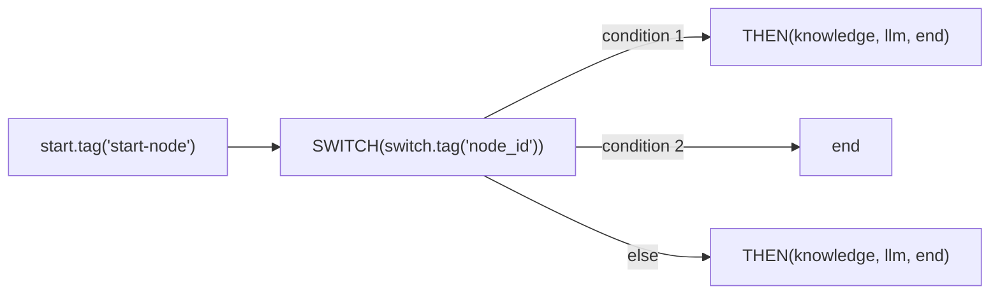
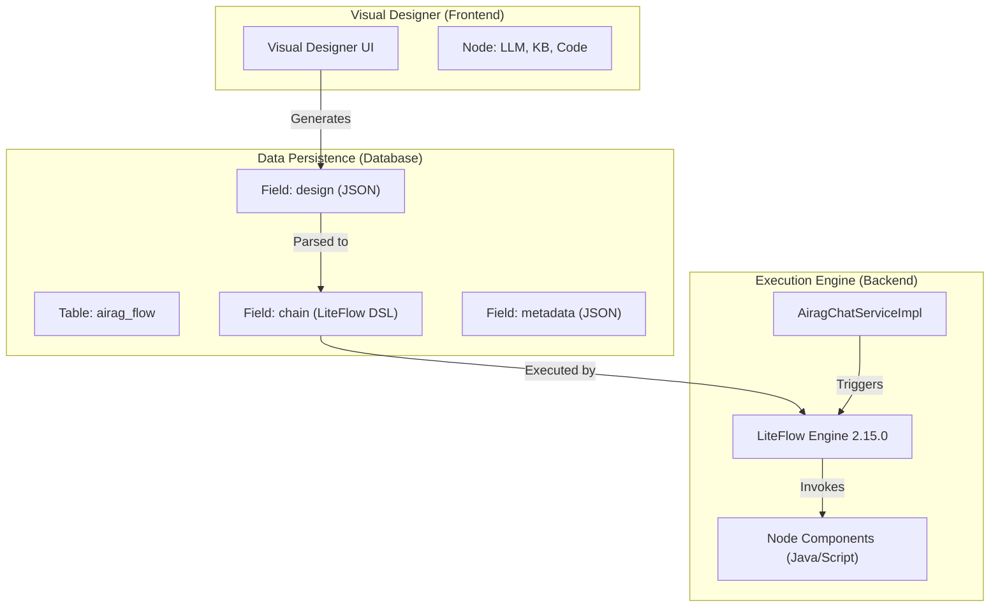
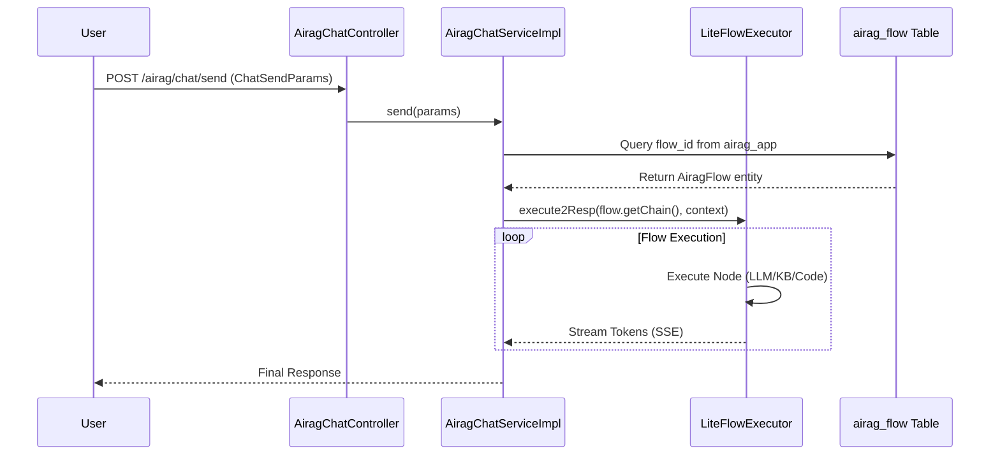
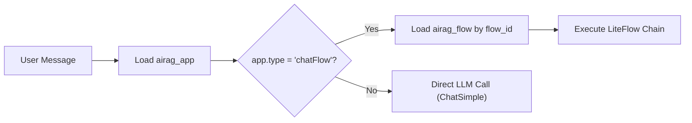

<!-- source: DeepWiki mcp.deepwiki.com · repo jeecgboot/JeecgBoot · page 3.4 AI Flow Orchestration · fetched 2026-10-29 -->

# AI Flow Orchestration

<details>
<summary>Relevant source files</summary>

The following files were used as context for generating this wiki page:

- [jeecg-boot/UPGRADE-3.9.3.md](jeecg-boot/UPGRADE-3.9.3.md)
- [jeecg-boot/db/Dockerfile](jeecg-boot/db/Dockerfile)
- [jeecg-boot/db/jeecgboot-mysql-5.7.sql](jeecg-boot/db/jeecgboot-mysql-5.7.sql)
- [jeecg-boot/db/tables_xxl_job.sql](jeecg-boot/db/tables_xxl_job.sql)
- [jeecg-boot/jeecg-boot-base-core/pom.xml](jeecg-boot/jeecg-boot-base-core/pom.xml)
- [jeecg-boot/jeecg-boot-base-core/src/main/java/org/jeecg/common/util/encryption/AesEncryptUtil.java](jeecg-boot/jeecg-boot-base-core/src/main/java/org/jeecg/common/util/encryption/AesEncryptUtil.java)
- [jeecg-boot/jeecg-boot-base-core/src/main/java/org/jeecg/config/shiro/ShiroConfig.java](jeecg-boot/jeecg-boot-base-core/src/main/java/org/jeecg/config/shiro/ShiroConfig.java)
- [jeecg-boot/jeecg-boot-module/jeecg-boot-module-airag/pom.xml](jeecg-boot/jeecg-boot-module/jeecg-boot-module-airag/pom.xml)
- [jeecg-boot/jeecg-module-system/jeecg-system-start/src/main/resources/flyway/sql/mysql/V3.9.0_0__all_upgrade.sql](jeecg-boot/jeecg-module-system/jeecg-system-start/src/main/resources/flyway/sql/mysql/V3.9.0_0__all_upgrade.sql)
- [jeecg-boot/jeecg-module-system/jeecg-system-start/src/main/resources/flyway/sql/mysql/V3.9.1_0__all_upgrade.sql](jeecg-boot/jeecg-module-system/jeecg-system-start/src/main/resources/flyway/sql/mysql/V3.9.1_0__all_upgrade.sql)
- [jeecg-boot/jeecg-server-cloud/jeecg-visual/jeecg-cloud-xxljob/doc/db/tables_xxl_job.sql](jeecg-boot/jeecg-server-cloud/jeecg-visual/jeecg-cloud-xxljob/doc/db/tables_xxl_job.sql)
- [jeecg-boot/pom.xml](jeecg-boot/pom.xml)

</details>


## Purpose and Scope

AI Flow Orchestration provides a visual, no-code workflow system for building complex AI applications by chaining together multiple processing nodes. It uses the **LiteFlow 2.15.0** engine to orchestrate sequential, conditional, and parallel logic flows. Flows enable developers to create sophisticated AI applications without writing code by connecting nodes such as LLM calls, knowledge base queries, conditional branches, code execution, and HTTP requests.

For information about individual node types and their configurations, see [Workflow Node Types](#3.4.1). For flow execution and event streaming details, see [Flow Execution & Event System](#3.4.2). For basic AI application types, see [AI Application Types & Architecture](#3.1).

**Sources:** [jeecg-boot/jeecg-boot-module/jeecg-boot-module-airag/pom.xml:35-35](), [jeecg-boot/db/jeecgboot-mysql-5.7.sql:63-95]()

---

## Flow Data Model

### airag_flow Table Structure

The `airag_flow` table stores flow definitions and metadata:

| Column | Type | Description |
|--------|------|-------------|
| `id` | varchar(36) | Primary key |
| `application_name` | varchar(50) | Application namespace (e.g., "jeecg") |
| `name` | varchar(50) | Flow name |
| `descr` | varchar(200) | Flow description |
| `chain` | text | **LiteFlow execution chain** (DSL syntax) |
| `design` | text | **Visual designer data** (JSON with nodes/edges) |
| `status` | varchar(20) | Flow status: `enable`, `disable`, `release` |
| `metadata` | text | **Input/output definitions** (JSON) |

**Sources:** [jeecg-boot/db/jeecgboot-mysql-5.7.sql:65-83]()

### Relationship with Applications

Flows are referenced by AI applications through the `airag_app.flow_id` field. Applications with `type='chatFlow'` use flows for conversation handling, while `type='chatSimple'` applications use direct LLM calls.

**Sources:** [jeecg-boot/db/jeecgboot-mysql-5.7.sql:24-51](), [jeecg-boot/jeecg-module-system/jeecg-system-start/src/main/resources/flyway/sql/mysql/V3.9.1_0__all_upgrade.sql:41-43]()

---

## LiteFlow Integration and Chain Syntax

### LiteFlow Dependency

JeecgBoot integrates **LiteFlow 2.15.0** via the `jeecg-aiflow-boot4` dependency. This module provides the core execution framework for the AI orchestration.

**Sources:** [jeecg-boot/jeecg-boot-module/jeecg-boot-module-airag/pom.xml:35-79]()

### Chain DSL Syntax

The `chain` field in `airag_flow` stores the flow execution logic using LiteFlow's EL (Expression Language) syntax.

```
THEN(node1, node2, node3)           // Sequential execution
SWITCH(condNode).to(n1, n2, n3)     // Conditional branching  
WHEN(node1, node2, node3)           // Parallel execution
```

#### Chain Execution Flow Diagram



**Sources:** [jeecg-boot/jeecg-module-system/jeecg-system-start/src/main/resources/flyway/sql/mysql/V3.9.1_0__all_upgrade.sql:44-44]()

---

## Flow Definition Structure

### System Architecture Mapping

This diagram bridges the visual designer concepts to the code entities and database fields.



**Sources:** [jeecg-boot/jeecg-boot-module/jeecg-boot-module-airag/pom.xml:35-79](), [jeecg-boot/db/jeecgboot-mysql-5.7.sql:65-83]()

### 1. Chain Field - Execution Logic

The `chain` field contains the executable LiteFlow EL expression.

**Example from DB Migration:**
```
THEN(
    start.tag('start-node'),
    llm.tag('node_id_1'),
    llm.tag('node_id_2'),
    end.tag('node_id_3')
).tag("start-node")
```

**Sources:** [jeecg-boot/jeecg-module-system/jeecg-system-start/src/main/resources/flyway/sql/mysql/V3.9.1_0__all_upgrade.sql:44-44]()

### 2. Design Field - Visual Representation

The `design` field stores the visual layout data as JSON, including node coordinates and properties.

```json
{
  "nodes": [
    {
      "id": "start-node",
      "type": "start",
      "x": 300,
      "y": 443,
      "properties": {
        "inputParams": [
          {"field": "content", "name": "用户问题", "type": "string"}
        ]
      }
    }
  ]
}
```

**Sources:** [jeecg-boot/jeecg-module-system/jeecg-system-start/src/main/resources/flyway/sql/mysql/V3.9.1_0__all_upgrade.sql:44-44]()

---

## Flow Execution Architecture

### Code Entity Execution Flow

This diagram shows how natural language requests move through code entities.



**Sources:** [jeecg-boot/jeecg-boot-module/jeecg-boot-module-airag/pom.xml:75-93](), [jeecg-boot/jeecg-module-system/jeecg-system-start/src/main/resources/flyway/sql/mysql/V3.9.1_0__all_upgrade.sql:41-44]()

---

## Script Engine Support

Flow orchestration supports multiple script languages for the `code` node type through LiteFlow script plugins. Note that several engines are marked as `provided` to manage deployment size.

| Language | Dependency | Version | Scope |
|----------|-----------|---------|-------|
| **Groovy** | `liteflow-script-groovy` | 2.15.0 | runtime |
| **Python** | `liteflow-script-python` | 2.15.0 | runtime |
| **Aviator** | `liteflow-script-aviator` | 2.15.0 | runtime |
| **GraalJS** | `liteflow-script-graaljs` | 2.15.0 | provided |
| **Kotlin** | `liteflow-script-kotlin` | 2.15.0 | runtime |

**Sources:** [jeecg-boot/jeecg-boot-module/jeecg-boot-module-airag/pom.xml:97-147]()

---

## Integration with AI Chat Service

### Chat-to-Flow Binding

AI applications with `type='chatFlow'` bind to flows through the `airag_app.flow_id` foreign key.



**Sources:** [jeecg-boot/jeecg-module-system/jeecg-system-start/src/main/resources/flyway/sql/mysql/V3.9.1_0__all_upgrade.sql:41-44]()

---

## Summary

AI Flow Orchestration in JeecgBoot provides a comprehensive visual workflow system that:

1.  **Abstracts Complexity**: Hides LiteFlow DSL complexity behind visual node-and-edge diagrams.
2.  **Enables Reusability**: Supports subflows and modular node composition.
3.  **Scales Vertically**: Single flows handle simple to complex AI application logic.
4.  **Supports Multiple Languages**: Code nodes execute JavaScript, Groovy, Python, Kotlin, and Aviator.
5.  **Integrates RAG**: Native knowledge base retrieval through dedicated nodes using **LangChain4j 1.17.2**.

For node-specific implementation details, see [Workflow Node Types](#3.4.1). For event streaming and callback patterns, see [Flow Execution & Event System](#3.4.2).

**Sources:** [jeecg-boot/jeecg-boot-module/jeecg-boot-module-airag/pom.xml:37-37](), [jeecg-boot/UPGRADE-3.9.3.md:200-214]()

---

