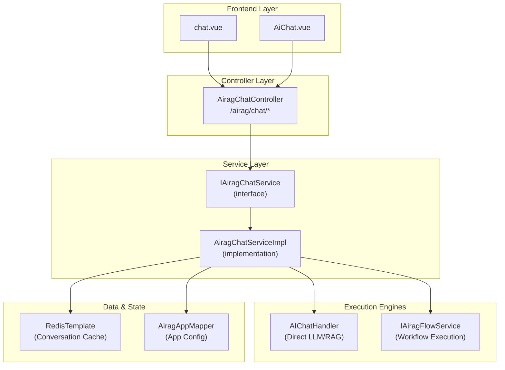
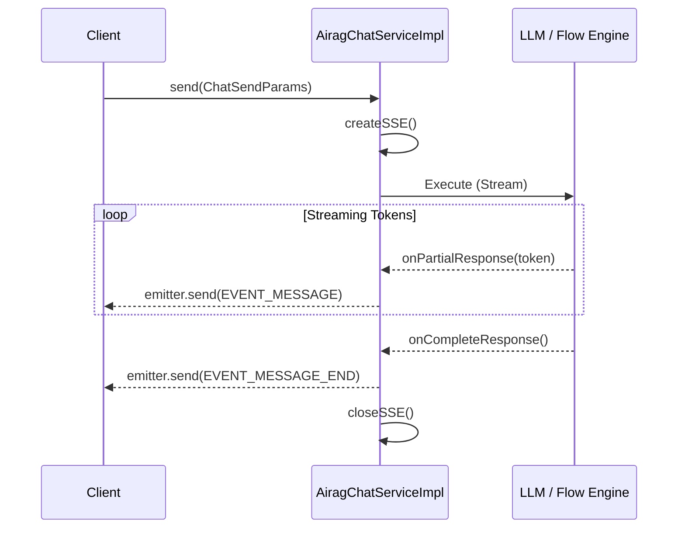

<!-- source: DeepWiki mcp.deepwiki.com · repo jeecgboot/JeecgBoot · page 3.5 AI Chat Service & Conversation Management · fetched 2026-10-29 -->

# AI Chat Service & Conversation Management

Relevant source files

The following files were used as context for generating this wiki page:

- [jeecg-boot/jeecg-boot-module/jeecg-boot-module-airag/src/main/java/org/jeecg/modules/airag/app/service/impl/AiragChatServiceImpl.java](jeecg-boot/jeecg-boot-module/jeecg-boot-module-airag/src/main/java/org/jeecg/modules/airag/app/service/impl/AiragChatServiceImpl.java)
- [jeecgboot-vue3/src/assets/images/ai/aiflow.png](jeecgboot-vue3/src/assets/images/ai/aiflow.png)
- [jeecgboot-vue3/src/views/super/airag/aiapp/AiApp.api.ts](jeecgboot-vue3/src/views/super/airag/aiapp/AiApp.api.ts)
- [jeecgboot-vue3/src/views/super/airag/aiapp/AiApp.data.ts](jeecgboot-vue3/src/views/super/airag/aiapp/AiApp.data.ts)
- [jeecgboot-vue3/src/views/super/airag/aiapp/AiAppList.vue](jeecgboot-vue3/src/views/super/airag/aiapp/AiAppList.vue)
- [jeecgboot-vue3/src/views/super/airag/aiapp/chat/AiChat.vue](jeecgboot-vue3/src/views/super/airag/aiapp/chat/AiChat.vue)
- [jeecgboot-vue3/src/views/super/airag/aiapp/chat/AiChatIcon.vue](jeecgboot-vue3/src/views/super/airag/aiapp/chat/AiChatIcon.vue)
- [jeecgboot-vue3/src/views/super/airag/aiapp/chat/chat.vue](jeecgboot-vue3/src/views/super/airag/aiapp/chat/chat.vue)
- [jeecgboot-vue3/src/views/super/airag/aiapp/chat/chatMessage.vue](jeecgboot-vue3/src/views/super/airag/aiapp/chat/chatMessage.vue)
- [jeecgboot-vue3/src/views/super/airag/aiapp/chat/chatText.vue](jeecgboot-vue3/src/views/super/airag/aiapp/chat/chatText.vue)
- [jeecgboot-vue3/src/views/super/airag/aiapp/chat/hooks/useChat.ts](jeecgboot-vue3/src/views/super/airag/aiapp/chat/hooks/useChat.ts)
- [jeecgboot-vue3/src/views/super/airag/aiapp/chat/hooks/useScroll.ts](jeecgboot-vue3/src/views/super/airag/aiapp/chat/hooks/useScroll.ts)
- [jeecgboot-vue3/src/views/super/airag/aiapp/chat/portal/LeftPortalSession.vue](jeecgboot-vue3/src/views/super/airag/aiapp/chat/portal/LeftPortalSession.vue)
- [jeecgboot-vue3/src/views/super/airag/aiknowledge/AiKnowledgeBase.data.ts](jeecgboot-vue3/src/views/super/airag/aiknowledge/AiKnowledgeBase.data.ts)
- [jeecgboot-vue3/src/views/super/airag/aiknowledge/AiKnowledgeBaseList.vue](jeecgboot-vue3/src/views/super/airag/aiknowledge/AiKnowledgeBaseList.vue)
- [jeecgboot-vue3/src/views/super/airag/aimodel/AiModelList.vue](jeecgboot-vue3/src/views/super/airag/aimodel/AiModelList.vue)
- [jeecgboot-vue3/src/views/super/airag/aimodel/components/AiModelModal.vue](jeecgboot-vue3/src/views/super/airag/aimodel/components/AiModelModal.vue)

## Purpose and Scope

This document describes the AI chat service and conversation management system within the JeecgBoot AI Platform. It covers the architecture of `AiragChatServiceImpl`, SSE streaming implementation, conversation caching strategies using Redis, and the management of message history for multi-turn interactions.

For information about AI model configuration, see [AI Model Management](#3.2). For details on knowledge base integration, see [Knowledge Base & RAG System](#3.3). For AI workflow orchestration, see [AI Flow Orchestration](#3.4).

---

## System Architecture

The AI chat service is centered around `AiragChatServiceImpl`, which implements `IAiragChatService`. It serves as the orchestration layer between frontend chat requests and backend AI execution engines (LLMs or Workflows).

### Chat Service Components

**Diagram: AI Chat Service Component Architecture**

Sources: [jeecg-boot/jeecg-boot-module/jeecg-boot-module-airag/src/main/java/org/jeecg/modules/airag/app/service/impl/AiragChatServiceImpl.java:90-134](), [jeecgboot-vue3/src/views/super/airag/aiapp/chat/chat.vue:1-55]()

---

## Conversation Management & Redis Caching

JeecgBoot uses Redis to maintain conversation state, allowing for multi-turn dialogue context and session persistence across page reloads.

### ChatConversation Data Model

The system uses `ChatConversation` as the primary container for a session's state.

| Field | Description |
|-------|-------------|
| `id` | Unique conversation identifier (UUID) |
| `title` | Display title, often derived from the first user message |
| `app` | The `AiragApp` entity defining the AI's behavior |
| `messages` | List of `MessageHistory` objects (user/AI/tool messages) |
| `flowInputs` | Custom parameters passed to workflows |

Sources: [jeecg-boot/jeecg-boot-module/jeecg-boot-module-airag/src/main/java/org/jeecg/modules/airag/app/service/impl/AiragChatServiceImpl.java:141-175](), [jeecg-boot/jeecg-boot-module/jeecg-boot-module-airag/src/main/java/org/jeecg/modules/airag/app/service/impl/AiragChatServiceImpl.java:530-545]()

### Redis Cache Strategy

Conversations are stored in Redis using keys structured by user and conversation ID.

1.  **Retrieval**: `getOrCreateChatConversation` attempts to fetch the conversation from Redis. If missing, it creates a new one based on the `AiragApp` configuration [jeecg-boot/jeecg-boot-module/jeecg-boot-module-airag/src/main/java/org/jeecg/modules/airag/app/service/impl/AiragChatServiceImpl.java:530-565]().
2.  **Persistence**: `saveChatConversation` serializes the object to Redis. Normal conversations persist, while "debug" conversations have a 3-hour TTL [jeecg-boot/jeecg-boot-module/jeecg-boot-module-airag/src/main/java/org/jeecg/modules/airag/app/service/impl/AiragChatServiceImpl.java:572-597]().
3.  **Title Auto-generation**: If a conversation has no title, the service takes a substring of the first user message [jeecg-boot/jeecg-boot-module/jeecg-boot-module-airag/src/main/java/org/jeecg/modules/airag/app/service/impl/AiragChatServiceImpl.java:158-161]().

Sources: [jeecg-boot/jeecg-boot-module/jeecg-boot-module-airag/src/main/java/org/jeecg/modules/airag/app/service/impl/AiragChatServiceImpl.java:530-597]()

---

## SSE Streaming Implementation

JeecgBoot utilizes Server-Sent Events (SSE) to provide real-time, low-latency streaming of AI responses.

### Server-Side: AiragChatServiceImpl

The backend uses `SseEmitter` to push events to the client.

**Diagram: SSE Streaming Flow**

- **Creation**: `createSSE` initializes the `SseEmitter` and registers it in `AiragLocalCache` to support reconnection and multi-tab synchronization [jeecg-boot/jeecg-boot-module/jeecg-boot-module-airag/src/main/java/org/jeecg/modules/airag/app/service/impl/AiragChatServiceImpl.java:432-443]().
- **Event Handling**: Events like `EVENT_MESSAGE` (streaming text), `EVENT_MESSAGE_END` (completion), and `EVENT_FLOW_ERROR` are pushed to the client [jeecg-boot/jeecg-boot-module/jeecg-boot-module-airag/src/main/java/org/jeecg/modules/airag/app/service/impl/AiragChatServiceImpl.java:445-484]().
- **Reconnection**: The `receiveByRequestId` method allows clients to resume a stream if the connection is interrupted, by replaying cached messages from `AiragLocalCache` [jeecg-boot/jeecg-boot-module/jeecg-boot-module-airag/src/main/java/org/jeecg/modules/airag/app/service/impl/AiragChatServiceImpl.java:356-423]().

Sources: [jeecg-boot/jeecg-boot-module/jeecg-boot-module-airag/src/main/java/org/jeecg/modules/airag/app/service/impl/AiragChatServiceImpl.java:356-484]()

---

## Frontend Chat Interface

The frontend is implemented using Vue 3 and provides a rich conversational UI with support for Markdown, images, and tool execution displays.

### UI Components

- **`chat.vue`**: The main chat window container, managing the message list (`chatData`), scroll behavior, and user input [jeecgboot-vue3/src/views/super/airag/aiapp/chat/chat.vue:27-55]().
- **`chatMessage.vue`**: Renders individual message bubbles, distinguishing between user and AI roles [jeecgboot-vue3/src/views/super/airag/aiapp/chat/chat.vue:31-51]().
- **`chatText.vue`**: Handles Markdown rendering using `markdown-it` and provides specialized rendering for "JeecgTags" (custom UI components embedded in AI responses) [jeecgboot-vue3/src/views/super/airag/aiapp/chat/chatText.vue:84-119]().
- **`LeftPortalSession.vue`**: Manages the conversation sidebar, allowing users to switch between apps and view historical dialogues [jeecgboot-vue3/src/views/super/airag/aiapp/chat/portal/LeftPortalSession.vue:16-75]().

### Workflow Input Management

For `chatFLow` applications, the UI dynamically renders configuration modals if the workflow requires custom metadata inputs. The `AiChat.vue` component checks for `flowInputs` in the app metadata and provides a `ConversationSettingsModal` for user configuration [jeecgboot-vue3/src/views/super/airag/aiapp/chat/AiChat.vue:130-168]().

Sources: [jeecgboot-vue3/src/views/super/airag/aiapp/chat/chat.vue:1-60](), [jeecgboot-vue3/src/views/super/airag/aiapp/chat/chatText.vue:1-40](), [jeecgboot-vue3/src/views/super/airag/aiapp/chat/AiChat.vue:130-168]()

---

## Message History & Context Collation

To enable multi-turn memory, the service must collate historical messages before sending them to the LLM.

### Context Building Logic

The `collateMessage` method is responsible for transforming `MessageHistory` into LangChain4j `ChatMessage` objects [jeecg-boot/jeecg-boot-module/jeecg-boot-module-airag/src/main/java/org/jeecg/modules/airag/app/service/impl/AiragChatServiceImpl.java:608-668]():

1.  **Filtering**: Messages are filtered by `topicId` to ensure the AI only sees context relevant to the current sub-thread [jeecg-boot/jeecg-boot-module/jeecg-boot-module-airag/src/main/java/org/jeecg/modules/airag/app/service/impl/AiragChatServiceImpl.java:613-617]().
2.  **Role Mapping**:
    - `USER`: Converted to `UserMessage`. Includes text and `ImageContent` if images were uploaded [jeecg-boot/jeecg-boot-module/jeecg-boot-module-airag/src/main/java/org/jeecg/modules/airag/app/service/impl/AiragChatServiceImpl.java:620-634]().
    - `AI`: Converted to `AiMessage`. Includes any historical `ToolExecutionRequest` objects to maintain tool-calling state [jeecg-boot/jeecg-boot-module/jeecg-boot-module-airag/src/main/java/org/jeecg/modules/airag/app/service/impl/AiragChatServiceImpl.java:636-653]().
    - `TOOL`: Converted to `ToolExecutionResultMessage` containing the output of external tool calls [jeecg-boot/jeecg-boot-module/jeecg-boot-module-airag/src/main/java/org/jeecg/modules/airag/app/service/impl/AiragChatServiceImpl.java:655-659]().
3.  **Multimodal Support**: If the `ChatSendParams` contains image URLs, they are downloaded or processed as base64 to be included in the `UserMessage` [jeecg-boot/jeecg-boot-module/jeecg-boot-module-airag/src/main/java/org/jeecg/modules/airag/app/service/impl/AiragChatServiceImpl.java:943-987]().

Sources: [jeecg-boot/jeecg-boot-module/jeecg-boot-module-airag/src/main/java/org/jeecg/modules/airag/app/service/impl/AiragChatServiceImpl.java:608-668](), [jeecg-boot/jeecg-boot-module/jeecg-boot-module-airag/src/main/java/org/jeecg/modules/airag/app/service/impl/AiragChatServiceImpl.java:943-987]()

---

