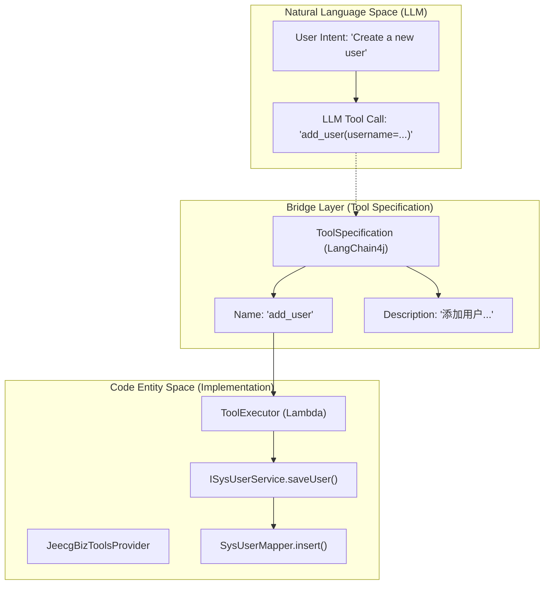
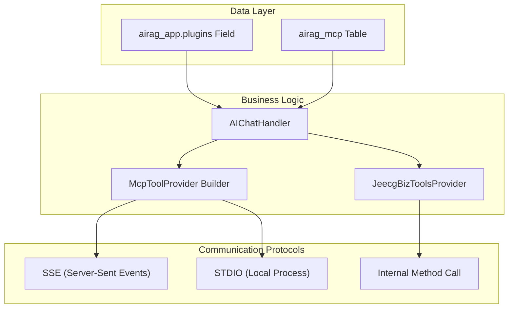
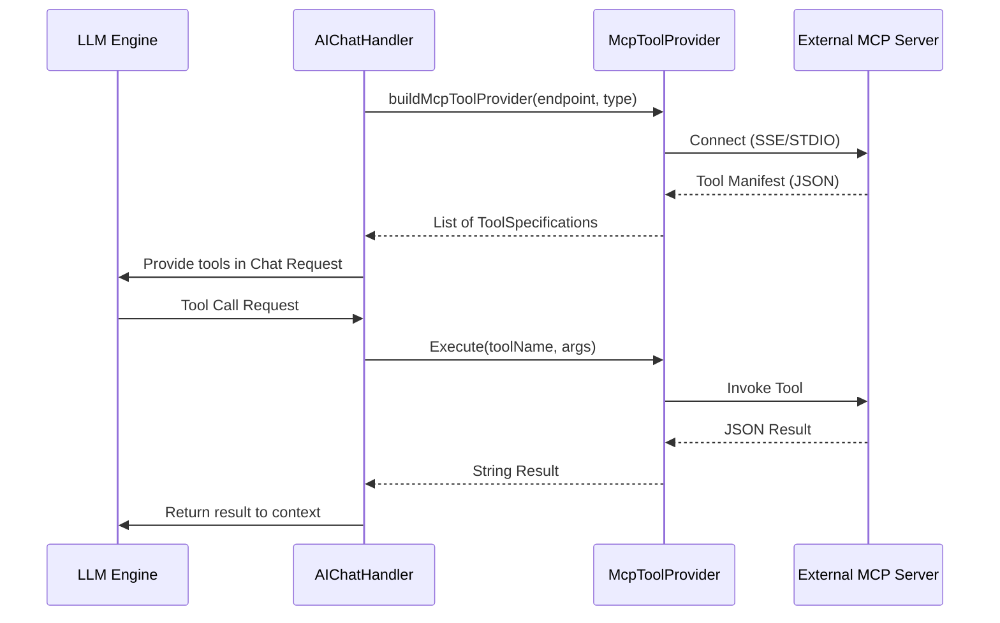

<!-- source: DeepWiki mcp.deepwiki.com · repo jeecgboot/JeecgBoot · page 3.6 Plugin & MCP System · fetched 2026-10-29 -->

# Plugin & MCP System

Relevant source files

The following files were used as context for generating this wiki page:

- [jeecg-boot/UPGRADE-3.9.3.md](jeecg-boot/UPGRADE-3.9.3.md)
- [jeecg-boot/db/Dockerfile](jeecg-boot/db/Dockerfile)
- [jeecg-boot/db/jeecgboot-mysql-5.7.sql](jeecg-boot/db/jeecgboot-mysql-5.7.sql)
- [jeecg-boot/db/tables_xxl_job.sql](jeecg-boot/db/tables_xxl_job.sql)
- [jeecg-boot/jeecg-module-system/jeecg-system-biz/src/main/java/org/jeecg/modules/airag/JeecgBizToolsProvider.java](jeecg-boot/jeecg-module-system/jeecg-system-biz/src/main/java/org/jeecg/modules/airag/JeecgBizToolsProvider.java)
- [jeecg-boot/jeecg-module-system/jeecg-system-start/src/main/resources/flyway/sql/mysql/V3.9.0_0__all_upgrade.sql](jeecg-boot/jeecg-module-system/jeecg-system-start/src/main/resources/flyway/sql/mysql/V3.9.0_0__all_upgrade.sql)
- [jeecg-boot/jeecg-module-system/jeecg-system-start/src/main/resources/flyway/sql/mysql/V3.9.0_1__mcp_demo.sql](jeecg-boot/jeecg-module-system/jeecg-system-start/src/main/resources/flyway/sql/mysql/V3.9.0_1__mcp_demo.sql)
- [jeecg-boot/jeecg-module-system/jeecg-system-start/src/main/resources/flyway/sql/mysql/V3.9.1_0__all_upgrade.sql](jeecg-boot/jeecg-module-system/jeecg-system-start/src/main/resources/flyway/sql/mysql/V3.9.1_0__all_upgrade.sql)
- [jeecg-boot/jeecg-server-cloud/jeecg-visual/jeecg-cloud-xxljob/doc/db/tables_xxl_job.sql](jeecg-boot/jeecg-server-cloud/jeecg-visual/jeecg-cloud-xxljob/doc/db/tables_xxl_job.sql)

## Purpose and Scope

The Plugin & MCP System provides extensible tool capabilities for AI applications in JeecgBoot. It enables AI models to interact with external systems, execute custom functions, and access real-time data through two distinct mechanisms:

- **Plugins**: Custom tool implementations that execute within the application context, often calling local Spring services.
- **MCP (Model Context Protocol)**: External tool services that communicate via standardized SSE (Server-Sent Events) or STDIO protocols, allowing integration with the broader AI ecosystem.

This system allows AI applications to augment their capabilities beyond pure language model responses. For information about the AI workflow orchestration system, see [AI Flow Orchestration](#3.4).

Sources: [jeecg-boot/jeecg-module-system/jeecg-system-biz/src/main/java/org/jeecg/modules/airag/JeecgBizToolsProvider.java:30-37](), [jeecg-boot/jeecg-module-system/jeecg-system-start/src/main/resources/flyway/sql/mysql/V3.9.0_0__all_upgrade.sql:27-47]()

## System Architecture

The Plugin & MCP system bridges the gap between the LLM's natural language space and the system's code entity space by mapping tool specifications to executable logic.

### Natural Language to Code Entity Mapping

Sources: [jeecg-boot/jeecg-module-system/jeecg-system-biz/src/main/java/org/jeecg/modules/airag/JeecgBizToolsProvider.java:54-99](), [jeecg-boot/jeecg-module-system/jeecg-system-biz/src/main/java/org/jeecg/modules/airag/JeecgBizToolsProvider.java:149-170]()

### System Components Diagram

Sources: [jeecg-boot/jeecg-module-system/jeecg-system-start/src/main/resources/flyway/sql/mysql/V3.9.0_0__all_upgrade.sql:27-50](), [jeecg-boot/jeecg-module-system/jeecg-system-biz/src/main/java/org/jeecg/modules/airag/JeecgBizToolsProvider.java:54-65]()

## Database Schema

The `airag_mcp` table stores all tool configurations. It uses the `category` field to differentiate between local plugins and remote MCP servers.

### Table Structure: airag_mcp

| Field | Type | Description |
|-------|------|-------------|
| `id` | varchar(36) | Primary key |
| `name` | varchar(50) | Tool set name (e.g., "Amap MCP", "Shop Plugin") |
| `category` | varchar(20) | `plugin` (Internal) or `mcp` (External) |
| `type` | varchar(255) | `sse` or `stdio` (only for MCP) |
| `endpoint` | text | URL for SSE or shell command for STDIO |
| `headers` | text | HTTP headers (SSE) or Env variables (STDIO) |
| `tools` | text | JSON definition of tool names and parameters |
| `status` | varchar(20) | `enable` or `disable` |

Sources: [jeecg-boot/jeecg-module-system/jeecg-system-start/src/main/resources/flyway/sql/mysql/V3.9.0_0__all_upgrade.sql:28-47](), [jeecg-boot/jeecg-module-system/jeecg-system-start/src/main/resources/flyway/sql/mysql/V3.9.0_0__all_upgrade.sql:59-60]()

## Plugin System (Internal Tools)

Plugins are Java-based tools that run within the JeecgBoot JVM. They are typically used to expose existing business services to the AI.

### JeecgBizToolsProvider Implementation
The `JeecgBizToolsProvider` class serves as a central registry for business tools. It implements `JeecgToolsProvider` and uses `ToolSpecification` to define interfaces for the LLM.

Key tools implemented include:
- `query_user_by_name`: Searches for system users.
- `add_user`: Creates a new system user with validation. [jeecg-boot/jeecg-module-system/jeecg-system-biz/src/main/java/org/jeecg/modules/airag/JeecgBizToolsProvider.java:149-169]()
- `query_all_roles`: Retrieves available system roles. [jeecg-boot/jeecg-module-system/jeecg-system-biz/src/main/java/org/jeecg/modules/airag/JeecgBizToolsProvider.java:82-85]()
- `grant_user_roles`: Assigns roles to users. [jeecg-boot/jeecg-module-system/jeecg-system-biz/src/main/java/org/jeecg/modules/airag/JeecgBizToolsProvider.java:90-93]()

### Security & Context
Because AI chat endpoints often bypass standard Shiro filters via `@IgnoreAuth`, the system manually extracts the JWT from the request header to perform permission checks before registering tools. [jeecg-boot/jeecg-module-system/jeecg-system-biz/src/main/java/org/jeecg/modules/airag/JeecgBizToolsProvider.java:108-141]()

Sources: [jeecg-boot/jeecg-module-system/jeecg-system-biz/src/main/java/org/jeecg/modules/airag/JeecgBizToolsProvider.java:54-99]()

## MCP System (Model Context Protocol)

MCP is an open standard that allows JeecgBoot to connect to third-party tool servers.

### Communication Types
1. **SSE (Server-Sent Events)**:
   - Used for remote web-based tool servers.
   - Example: Amap (高德) MCP for maps, traffic, and weather. [jeecg-boot/jeecg-module-system/jeecg-system-start/src/main/resources/flyway/sql/mysql/V3.9.0_1__mcp_demo.sql:3]()
   - Configuration requires an `endpoint` URL and optional `headers`.

2. **STDIO**:
   - Used for local command-line tools.
   - The system spawns a child process and communicates via standard input/output.
   - `endpoint` contains the execution command (e.g., `npx`, `python`).

### Tool Integration Flow

Sources: [jeecg-boot/jeecg-module-system/jeecg-system-start/src/main/resources/flyway/sql/mysql/V3.9.0_0__all_upgrade.sql:33-36](), [jeecg-boot/jeecg-module-system/jeecg-system-start/src/main/resources/flyway/sql/mysql/V3.9.0_1__mcp_demo.sql:3]()

## Integration with AI Applications

AI applications (defined in `airag_app`) link to these tools through the `plugins` column, which stores a list of `airag_mcp` IDs. [jeecg-boot/jeecg-module-system/jeecg-system-start/src/main/resources/flyway/sql/mysql/V3.9.0_0__all_upgrade.sql:49-50]()

### Example Tool: Amap (高德) MCP
Integrated via SSE, providing capabilities such as:
- `maps_weather`: Query weather by city.
- `maps_direction_driving`: Driving route planning.
- `maps_ip_location`: IP-based positioning.

Sources: [jeecg-boot/jeecg-module-system/jeecg-system-start/src/main/resources/flyway/sql/mysql/V3.9.0_1__mcp_demo.sql:3]()

### Example Tool: Shop Plugin (API Demo)
Integrated as a local `plugin` category, providing:
- `list_products`: Query product list from `/demo/shop/products`.
- `create_order`: Create purchase orders via `/demo/shop/purchase`.

Sources: [jeecg-boot/jeecg-module-system/jeecg-system-start/src/main/resources/flyway/sql/mysql/V3.9.0_1__mcp_demo.sql:4]()

## Implementation Details

### Key Classes
- `JeecgBizToolsProvider`: Core logic for defining internal system tools. [jeecg-boot/jeecg-module-system/jeecg-system-biz/src/main/java/org/jeecg/modules/airag/JeecgBizToolsProvider.java:37]()
- `AIChatHandler`: Orchestrates the loading of both Plugins and MCP providers during a chat session.
- `McpToolProvider`: (LangChain4j component) Handles the protocol-level communication with MCP servers.

### Data Flow for Tool Invocation
1. **Discovery**: When a chat starts, `AIChatHandler` reads the `plugins` field from `airag_app`.
2. **Binding**: For each ID, it fetches the `airag_mcp` record.
3. **Execution**:
    - If `category=plugin`, it uses `JeecgBizToolsProvider` to get the `ToolExecutor`.
    - If `category=mcp`, it initializes an `McpToolProvider` for the specified `endpoint`.
4. **Context**: `ToolExecutor` instances are provided with the current `HttpServletRequest` to maintain user session and tenant context. [jeecg-boot/jeecg-module-system/jeecg-system-biz/src/main/java/org/jeecg/modules/airag/JeecgBizToolsProvider.java:110-115]()

Sources: [jeecg-boot/jeecg-module-system/jeecg-system-biz/src/main/java/org/jeecg/modules/airag/JeecgBizToolsProvider.java:54-99](), [jeecg-boot/jeecg-module-system/jeecg-system-start/src/main/resources/flyway/sql/mysql/V3.9.0_0__all_upgrade.sql:59-63]()

---

