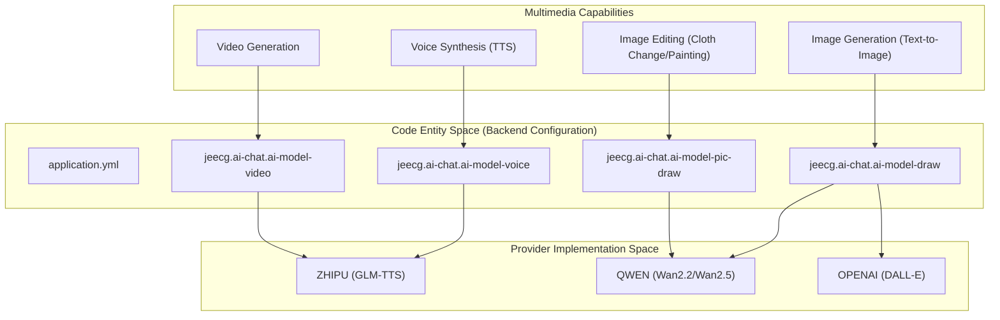
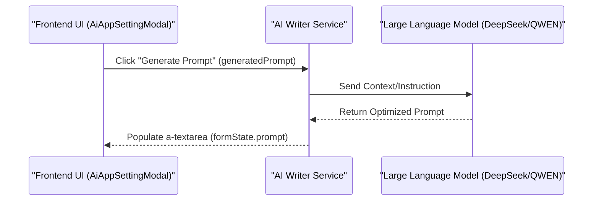

<!-- source: DeepWiki mcp.deepwiki.com · repo jeecgboot/JeecgBoot · page 3.7 Multimedia AI Features · fetched 2026-10-29 -->

# Multimedia AI Features

Relevant source files

The following files were used as context for generating this wiki page:

- [jeecg-boot/jeecg-boot-base-core/src/main/resources/config/default-spring-doc.properties](jeecg-boot/jeecg-boot-base-core/src/main/resources/config/default-spring-doc.properties)
- [jeecg-boot/jeecg-module-system/jeecg-system-start/src/main/resources/application-dev.yml](jeecg-boot/jeecg-module-system/jeecg-system-start/src/main/resources/application-dev.yml)
- [jeecg-boot/jeecg-module-system/jeecg-system-start/src/main/resources/application-dm8.yml](jeecg-boot/jeecg-module-system/jeecg-system-start/src/main/resources/application-dm8.yml)
- [jeecg-boot/jeecg-module-system/jeecg-system-start/src/main/resources/application-docker.yml](jeecg-boot/jeecg-module-system/jeecg-system-start/src/main/resources/application-docker.yml)
- [jeecg-boot/jeecg-module-system/jeecg-system-start/src/main/resources/application-kingbase8.yml](jeecg-boot/jeecg-module-system/jeecg-system-start/src/main/resources/application-kingbase8.yml)
- [jeecg-boot/jeecg-module-system/jeecg-system-start/src/main/resources/application-oracle.yml](jeecg-boot/jeecg-module-system/jeecg-system-start/src/main/resources/application-oracle.yml)
- [jeecg-boot/jeecg-module-system/jeecg-system-start/src/main/resources/application-postgresql.yml](jeecg-boot/jeecg-module-system/jeecg-system-start/src/main/resources/application-postgresql.yml)
- [jeecg-boot/jeecg-module-system/jeecg-system-start/src/main/resources/application-prod.yml](jeecg-boot/jeecg-module-system/jeecg-system-start/src/main/resources/application-prod.yml)
- [jeecg-boot/jeecg-module-system/jeecg-system-start/src/main/resources/application-sqlserver.yml](jeecg-boot/jeecg-module-system/jeecg-system-start/src/main/resources/application-sqlserver.yml)
- [jeecg-boot/jeecg-module-system/jeecg-system-start/src/main/resources/application-test.yml](jeecg-boot/jeecg-module-system/jeecg-system-start/src/main/resources/application-test.yml)
- [jeecg-boot/jeecg-module-system/jeecg-system-start/src/main/resources/logback-spring.xml](jeecg-boot/jeecg-module-system/jeecg-system-start/src/main/resources/logback-spring.xml)
- [jeecgboot-vue3/src/views/super/airag/aiapp/components/AiAppGeneratedPromptModal.vue](jeecgboot-vue3/src/views/super/airag/aiapp/components/AiAppGeneratedPromptModal.vue)
- [jeecgboot-vue3/src/views/super/airag/aiapp/components/AiAppSettingModal.vue](jeecgboot-vue3/src/views/super/airag/aiapp/components/AiAppSettingModal.vue)

The Multimedia AI Features in JeecgBoot provide a comprehensive suite of generative and analytical capabilities for non-text assets. These features leverage specialized AI models for voice synthesis, image generation, video creation, and visual data extraction (OCR), integrated directly into the low-code ecosystem.

## Multimedia AI Architecture

JeecgBoot utilizes a provider-based architecture to integrate various AI multimedia services. Configuration is managed via Spring Boot profiles, allowing developers to switch between providers like OpenAI, ZhipuAI (BigModel), and Alibaba DashScope (Qwen) for different multimedia tasks.

### Multimedia Flow to Code Entity Mapping

The following diagram bridges the functional multimedia requirements to the underlying configuration and execution entities within the JeecgBoot codebase.

**Multimedia Entity Mapping**

Sources: `[jeecg-boot/jeecg-module-system/jeecg-system-start/src/main/resources/application-dev.yml:187-233]()`

---

## Core Multimedia Capabilities

### 1. Voice Synthesis (TTS)
The platform supports Text-to-Speech (TTS) capabilities primarily through ZhipuAI's `glm-tts` model. 

*   **Key Parameters**:
    *   `voice`: Supports multiple personas such as `tongtong`, `chuichui`, `xiaochen`, `jam`, `kazi`, `douji`, and `luodo` `[jeecg-boot/jeecg-module-system/jeecg-system-start/src/main/resources/application-dev.yml:220-221]()`.
    *   `speed`: Adjustable playback speed (default `1.0`) `[jeecg-boot/jeecg-module-system/jeecg-system-start/src/main/resources/application-dev.yml:222]()`.
    *   `volume`: Adjustable output volume `[jeecg-boot/jeecg-module-system/jeecg-system-start/src/main/resources/application-dev.yml:223]()`.
*   **External Dependencies**: Can integrate with `edge-tts` via local paths defined in configuration `[jeecg-boot/jeecg-module-system/jeecg-system-start/src/main/resources/application-dev.yml:232]()`.

### 2. AI Image Generation & Painting
JeecgBoot distinguishes between "Text-to-Image" (AI Painting/Poster) and "Image-to-Image" (AI Cloth Change/Editing).

| Feature | Provider | Models | Configuration Key |
| :--- | :--- | :--- | :--- |
| **AI Painting** | QWEN / OPENAI | `wan2.2-t2i-flash` | `jeecg.ai-chat.ai-model-draw` |
| **AI Cloth Change** | QWEN | `wan2.5-i2i-preview`, `wanx2.1-imageedit` | `jeecg.ai-chat.ai-model-pic-draw` |

Sources: `[jeecg-boot/jeecg-module-system/jeecg-system-start/src/main/resources/application-dev.yml:197-212]()`

### 3. Video Generation
Video generation is configured to use ZhipuAI by default. The system requires `ffmpeg` for post-processing and media handling.
*   **Path Configuration**: `jeecg.ai-chat.ai-model-video.ffmpeg-path` `[jeecg-boot/jeecg-module-system/jeecg-system-start/src/main/resources/application-dev.yml:231]()`.

---

## AI Writer and Prompt Engineering
The AI Writer feature is integrated into the frontend application settings, allowing users to generate content or refine prompts using the `AiAppGeneratedPromptModal.vue` `[jeecgboot-vue3/src/views/super/airag/aiapp/components/AiAppSettingModal.vue:88-92]()`.

**Prompt Generation Data Flow**

Sources: `[jeecgboot-vue3/src/views/super/airag/aiapp/components/AiAppSettingModal.vue:75-99]()`

---

## Technical Configuration Details

Multimedia features are activated and configured through the `jeecg.ai-chat` namespace in the application properties.

### Provider Configuration Table
The following table illustrates the required properties for multimedia enablement across different environments (Dev, Prod, Docker).

| Property | Default Value (Dev) | Purpose |
| :--- | :--- | :--- |
| `ai-model-draw.provider` | `QWEN` | Provider for text-to-image `[application-dev.yml:199]()` |
| `ai-model-pic-draw.model`| `wan2.5-i2i-preview` | Model for image-to-image `[application-dev.yml:209]()` |
| `ai-model-voice.voice` | `tongtong` | Default TTS voice persona `[application-dev.yml:221]()` |
| `ai-model-video.apiHost` | `https://api.deepseek.com/v1` | Endpoint for video generation `[application-dev.yml:229]()` |

### Infrastructure Requirements
*   **FFmpeg**: Required for video processing and format conversion `[jeecg-boot/jeecg-module-system/jeecg-system-start/src/main/resources/application-dev.yml:231]()`.
*   **Edge-TTS**: Optional python-based TTS engine for offline or edge synthesis `[jeecg-boot/jeecg-module-system/jeecg-system-start/src/main/resources/application-dev.yml:232]()`.
*   **File Storage**: Generated multimedia assets are stored according to `jeecg.path.upload`, which defaults to `/opt/upFiles` in Linux environments `[jeecg-boot/jeecg-module-system/jeecg-system-start/src/main/resources/application-dm8.yml:246]()`.

Sources: `[jeecg-boot/jeecg-module-system/jeecg-system-start/src/main/resources/application-dev.yml:187-240]()`, `[jeecg-boot/jeecg-module-system/jeecg-system-start/src/main/resources/application-dm8.yml:244-246]()`

---

