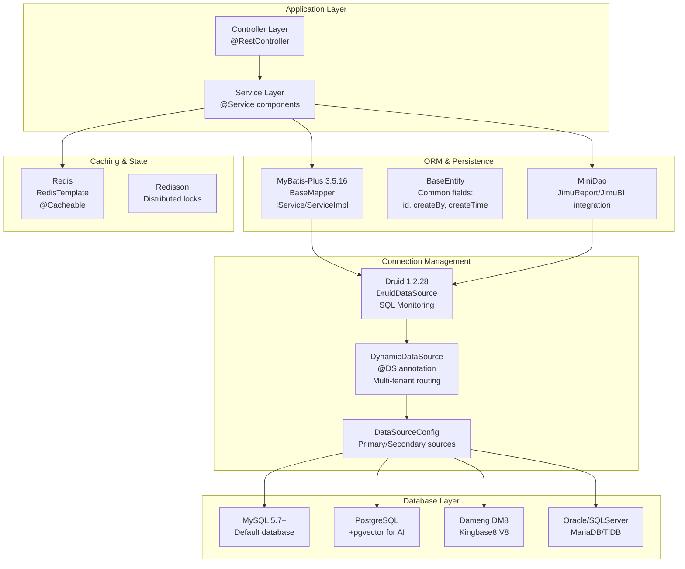

<!-- source: DeepWiki mcp.deepwiki.com · repo jeecgboot/JeecgBoot · page 4 Database & Data Layer · fetched 2026-10-29 -->

# Database & Data Layer

<details>
<summary>Relevant source files</summary>

The following files were used as context for generating this wiki page:

- [jeecg-boot/UPGRADE-3.9.3.md](jeecg-boot/UPGRADE-3.9.3.md)
- [jeecg-boot/db/Dockerfile](jeecg-boot/db/Dockerfile)
- [jeecg-boot/db/jeecgboot-mysql-5.7.sql](jeecg-boot/db/jeecgboot-mysql-5.7.sql)
- [jeecg-boot/db/tables_xxl_job.sql](jeecg-boot/db/tables_xxl_job.sql)
- [jeecg-boot/jeecg-boot-base-core/src/main/resources/config/default-spring-doc.properties](jeecg-boot/jeecg-boot-base-core/src/main/resources/config/default-spring-doc.properties)
- [jeecg-boot/jeecg-module-system/jeecg-system-start/src/main/resources/application-dev.yml](jeecg-boot/jeecg-module-system/jeecg-system-start/src/main/resources/application-dev.yml)
- [jeecg-boot/jeecg-module-system/jeecg-system-start/src/main/resources/application-dm8.yml](jeecg-boot/jeecg-module-system/jeecg-system-start/src/main/resources/application-dm8.yml)
- [jeecg-boot/jeecg-module-system/jeecg-system-start/src/main/resources/application-docker.yml](jeecg-boot/jeecg-module-system/jeecg-system-start/src/main/resources/application-docker.yml)
- [jeecg-boot/jeecg-module-system/jeecg-system-start/src/main/resources/application-kingbase8.yml](jeecg-boot/jeecg-module-system/jeecg-system-start/src/main/resources/application-kingbase8.yml)
- [jeecg-boot/jeecg-module-system/jeecg-system-start/src/main/resources/application-oracle.yml](jeecg-boot/jeecg-module-system/jeecg-system-start/src/main/resources/application-oracle.yml)
- [jeecg-boot/jeecg-module-system/jeecg-system-start/src/main/resources/application-postgresql.yml](jeecg-boot/jeecg-module-system/jeecg-system-start/src/main/resources/application-postgresql.yml)
- [jeecg-boot/jeecg-module-system/jeecg-system-start/src/main/resources/application-prod.yml](jeecg-boot/jeecg-module-system/jeecg-system-start/src/main/resources/application-prod.yml)
- [jeecg-boot/jeecg-module-system/jeecg-system-start/src/main/resources/application-sqlserver.yml](jeecg-boot/jeecg-module-system/jeecg-system-start/src/main/resources/application-sqlserver.yml)
- [jeecg-boot/jeecg-module-system/jeecg-system-start/src/main/resources/application-test.yml](jeecg-boot/jeecg-module-system/jeecg-system-start/src/main/resources/application-test.yml)
- [jeecg-boot/jeecg-module-system/jeecg-system-start/src/main/resources/flyway/sql/mysql/V3.9.0_0__all_upgrade.sql](jeecg-boot/jeecg-module-system/jeecg-system-start/src/main/resources/flyway/sql/mysql/V3.9.0_0__all_upgrade.sql)
- [jeecg-boot/jeecg-module-system/jeecg-system-start/src/main/resources/flyway/sql/mysql/V3.9.1_0__all_upgrade.sql](jeecg-boot/jeecg-module-system/jeecg-system-start/src/main/resources/flyway/sql/mysql/V3.9.1_0__all_upgrade.sql)
- [jeecg-boot/jeecg-module-system/jeecg-system-start/src/main/resources/logback-spring.xml](jeecg-boot/jeecg-module-system/jeecg-system-start/src/main/resources/logback-spring.xml)
- [jeecg-boot/jeecg-server-cloud/jeecg-visual/jeecg-cloud-xxljob/doc/db/tables_xxl_job.sql](jeecg-boot/jeecg-server-cloud/jeecg-visual/jeecg-cloud-xxljob/doc/db/tables_xxl_job.sql)

</details>


This document describes JeecgBoot's database architecture, data access patterns, and persistence layer implementation. It covers database connectivity, ORM configuration, multi-database support, caching strategies, and advanced features like sharding and distributed transactions.

For information about specific database tables and schema definitions, see [Core Database Schema](#4.1). For AI-related vector database usage, see [AI Platform (AIGC)](#3). For data migration and versioning, see [Database Migration with Flyway](#7.7).

---

## Data Layer Architecture Overview

JeecgBoot's data layer is built on a flexible, multi-database architecture that supports both monolithic and microservices deployments. The persistence layer uses **MyBatis-Plus** as the primary ORM framework, with **Druid** for connection pooling and dynamic datasource switching capabilities provided by `dynamic-datasource-spring-boot-starter`.

### Core Data Layer Architecture



**Sources:** [jeecg-boot/jeecg-module-system/jeecg-system-start/src/main/resources/application-dev.yml:110-153](), [jeecg-boot/UPGRADE-3.9.3.md:182-198]()

---

## MyBatis-Plus ORM Framework

JeecgBoot uses **MyBatis-Plus 3.5.16** as its primary ORM framework, providing CRUD operations, pagination, and advanced query capabilities.

### MyBatis-Plus Components

| Component | Purpose | Configuration Path |
|-----------|---------|--------------------|
| **Mapper Locations** | XML mapping file paths | `mybatis-plus.mapper-locations` |
| **Id Type** | Primary key strategy | `mybatis-plus.global-config.db-config.id-type: ASSIGN_ID` |
| **Naming Strategy** | Table/Column mapping | `mybatis-plus.global-config.db-config.table-underline: true` |
| **SQL Logging** | Execution debugging | `mybatis-plus.configuration.log-impl` |

### Primary Key Strategy
JeecgBoot defaults to `ASSIGN_ID` (Snowflake ID) for primary keys [jeecg-boot/jeecg-module-system/jeecg-system-start/src/main/resources/application-dev.yml:173](). This ensures global uniqueness across distributed systems and sharded databases.

**Sources:** [jeecg-boot/jeecg-module-system/jeecg-system-start/src/main/resources/application-dev.yml:166-180](), [jeecg-boot/UPGRADE-3.9.3.md:186]()

---

## Druid Connection Pool

JeecgBoot uses **Alibaba Druid 1.2.28** as the database connection pool, providing connection management, SQL monitoring, and performance statistics.

### Druid Configuration Structure

```yaml
spring:
  datasource:
    druid:
      stat-view-servlet:
        enabled: true
        loginUsername: admin
        loginPassword: ??
      web-stat-filter:
        enabled: true
    dynamic:
      druid:
        initial-size: 5
        min-idle: 5
        maxActive: 1000
        maxWait: 60000
        filters: stat,slf4j
        stat:
          merge-sql: false
          slow-sql-millis: 5000
```

The Druid monitoring console is typically accessible at the `/druid/` endpoint, providing real-time insights into SQL execution and connection health.

**Sources:** [jeecg-boot/jeecg-module-system/jeecg-system-start/src/main/resources/application-dev.yml:110-147](), [jeecg-boot/UPGRADE-3.9.3.md:187]()

---

## Multi-Database Support

JeecgBoot supports 8 major database types with a unified codebase. Support is managed through Spring profiles and dedicated configuration files.

### Supported Databases & Profiles

| Database | Driver Class | Configuration File |
|----------|--------------|--------------------|
| **MySQL** | `com.mysql.cj.jdbc.Driver` | `application-dev.yml` |
| **PostgreSQL** | `org.postgresql.Driver` | `application-postgresql.yml` |
| **Oracle** | `oracle.jdbc.OracleDriver` | `application-oracle.yml` |
| **SQL Server** | `com.microsoft.sqlserver.jdbc.SQLServerDriver` | `application-sqlserver.yml` |
| **Dameng (DM8)** | `dm.jdbc.driver.DmDriver` | `application-dm8.yml` |
| **Kingbase8** | `com.kingbase8.Driver` | `application-kingbase8.yml` |

### Database Dialect Handling
Different databases are handled via Hibernate dialects and MyBatis-Plus auto-detection. For example, Dameng uses `org.hibernate.dialect.DmDialect` [jeecg-boot/jeecg-module-system/jeecg-system-start/src/main/resources/application-dm8.yml:77](), while Kingbase8 uses `org.hibernate.dialect.PostgreSQLDialect` [jeecg-boot/jeecg-module-system/jeecg-system-start/src/main/resources/application-kingbase8.yml:80]().

**Sources:** [jeecg-boot/jeecg-module-system/jeecg-system-start/src/main/resources/application-dm8.yml:128-132](), [jeecg-boot/jeecg-module-system/jeecg-system-start/src/main/resources/application-kingbase8.yml:145-149]()

---

## PostgreSQL + pgvector for AI

For AI-powered features (RAG, Knowledge Base), JeecgBoot utilizes **PostgreSQL** with the `pgvector` extension to store and query high-dimensional embeddings.

### Vector Store Configuration

```yaml
jeecg:
  ai-rag:
    embed-store:
      host: 127.0.0.1
      port: 5432
      database: vector_db
      user: postgres
      table: embeddings
```

The system uses **LangChain4j 1.17.2** to interact with pgvector, supporting HNSW indexes for high-performance vector retrieval [jeecg-boot/UPGRADE-3.9.3.md:200-230]().

**Sources:** [jeecg-boot/jeecg-module-system/jeecg-system-start/src/main/resources/application-dev.yml:241-250](), [jeecg-boot/UPGRADE-3.9.3.md:225-231]()

---

## Child Pages

For detailed technical implementation of specific data layer components, refer to the following child pages:

- [Core Database Schema](#4.1) — Detailed view of system, user, and AI-related tables.
- [Multi-Database Support](#4.2) — Configuration guides for the 8 supported database types.
- [Data Sharding with ShardingSphere](#4.3) — Horizontal scaling and read-write splitting implementation.
- [Distributed Transactions with Seata](#4.4) — Transaction coordination across microservices.
- [Nacos Configuration Database](#4.5) — Schema and management for the Nacos service discovery and config store.

---

## Database Migration with Flyway

JeecgBoot uses **Flyway** for version-controlled database migrations. Migration scripts are organized by database type.

- **MySQL Scripts:** `classpath:flyway/sql/mysql` [jeecg-boot/jeecg-module-system/jeecg-system-start/src/main/resources/application-dev.yml:27]()
- **Upgrade Logs:** Major schema changes are documented in upgrade files like `V3.9.1_0__all_upgrade.sql`.

Flyway is typically disabled by default in development (`enabled: false`) to prevent accidental schema changes during rapid prototyping [jeecg-boot/jeecg-module-system/jeecg-system-start/src/main/resources/application-dev.yml:25]().

**Sources:** [jeecg-boot/jeecg-module-system/jeecg-system-start/src/main/resources/application-dev.yml:23-29](), [jeecg-boot/UPGRADE-3.9.3.md:1-20]()

---

