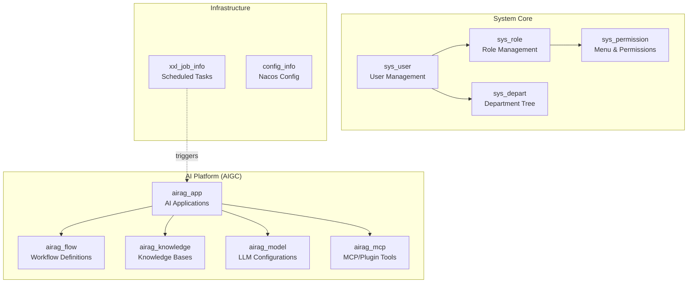
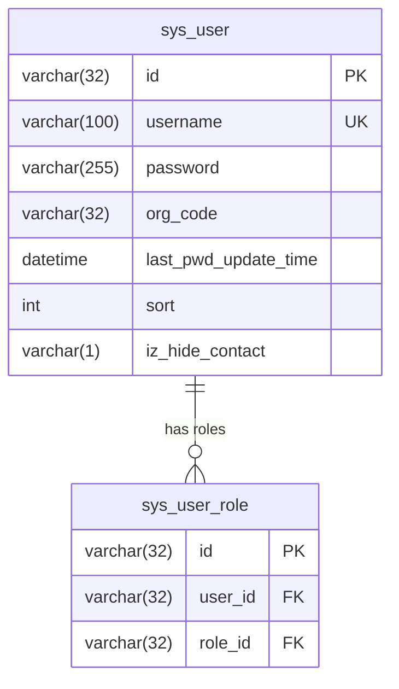
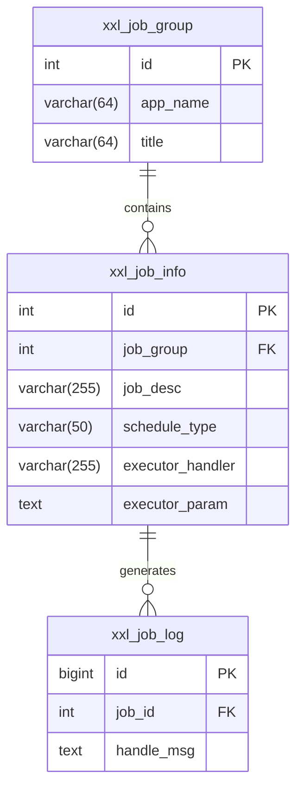

<!-- source: DeepWiki mcp.deepwiki.com · repo jeecgboot/JeecgBoot · page 4.1 Core Database Schema · fetched 2026-10-29 -->

# Core Database Schema

<details>
<summary>Relevant source files</summary>

The following files were used as context for generating this wiki page:

- [jeecg-boot/UPGRADE-3.9.3.md](jeecg-boot/UPGRADE-3.9.3.md)
- [jeecg-boot/db/Dockerfile](jeecg-boot/db/Dockerfile)
- [jeecg-boot/db/jeecgboot-mysql-5.7.sql](jeecg-boot/db/jeecgboot-mysql-5.7.sql)
- [jeecg-boot/db/tables_xxl_job.sql](jeecg-boot/db/tables_xxl_job.sql)
- [jeecg-boot/jeecg-module-system/jeecg-system-start/src/main/resources/flyway/sql/mysql/V3.9.0_0__all_upgrade.sql](jeecg-boot/jeecg-module-system/jeecg-system-start/src/main/resources/flyway/sql/mysql/V3.9.0_0__all_upgrade.sql)
- [jeecg-boot/jeecg-module-system/jeecg-system-start/src/main/resources/flyway/sql/mysql/V3.9.1_0__all_upgrade.sql](jeecg-boot/jeecg-module-system/jeecg-system-start/src/main/resources/flyway/sql/mysql/V3.9.1_0__all_upgrade.sql)
- [jeecg-boot/jeecg-server-cloud/jeecg-visual/jeecg-cloud-xxljob/doc/db/tables_xxl_job.sql](jeecg-boot/jeecg-server-cloud/jeecg-visual/jeecg-cloud-xxljob/doc/db/tables_xxl_job.sql)

</details>


## Purpose and Scope

This document describes the core database schema used by JeecgBoot, including all primary tables that support system management, AI platform functionality, and low-code development features. The schema is designed to work with multiple database types including MySQL, Oracle, PostgreSQL, SQL Server, and domestic databases like Dameng and Kingbase8.

For information about multi-database support and configuration, see [Multi-Database Support](#4.2). For database migration and versioning, see [Database Migration with Flyway](#7.7). For data sharding strategies, see [Data Sharding with ShardingSphere](#4.3).

**Sources:** [jeecg-boot/db/jeecgboot-mysql-5.7.sql:1-22](), [jeecg-boot/UPGRADE-3.9.3.md:182-199]()

---

## Schema Overview

The JeecgBoot database schema is organized into several functional domains:

| Domain | Table Prefix | Purpose | Key Tables |
|--------|--------------|---------|------------|
| System Management | `sys_` | User authentication, RBAC, departments | `sys_user`, `sys_role`, `sys_permission`, `sys_depart` |
| AI Platform (AIGC) | `airag_` | AI applications, workflows, knowledge bases | `airag_app`, `airag_flow`, `airag_knowledge`, `airag_model`, `airag_mcp` |
| Online Forms | `onl_` | Low-code form configuration | `onl_cgform_head`, `onl_drag_page` |
| Multimedia AI | `aigc_` | AI-generated content and templates | `aigc_word_template` |
| Distributed Jobs | `xxl_job_` | Task scheduling and execution logs | `xxl_job_info`, `xxl_job_log` |



**Sources:** [jeecg-boot/db/jeecgboot-mysql-5.7.sql:1-100](), [jeecg-boot/db/tables_xxl_job.sql:46-75]()

---

## System Management Tables

### User and Authentication

#### sys_user

The `sys_user` table is the core user management table. Recent updates include enhanced password security tracking and organizational sorting.



**Key Fields:**
- `last_pwd_update_time`: Tracks password changes to support the `UserUpadtePwdJob` which alerts users after 5 months without a change [jeecg-boot/jeecg-module-system/jeecg-system-start/src/main/resources/flyway/sql/mysql/V3.9.0_0__all_upgrade.sql:3-10]().
- `sort`: Defines display order in user lists [jeecg-boot/jeecg-module-system/jeecg-system-start/src/main/resources/flyway/sql/mysql/V3.9.0_0__all_upgrade.sql:21-24]().
- `iz_hide_contact`: Privacy flag (0=visible, 1=hidden) [jeecg-boot/jeecg-module-system/jeecg-system-start/src/main/resources/flyway/sql/mysql/V3.9.0_0__all_upgrade.sql:22]().

**Sources:** [jeecg-boot/jeecg-module-system/jeecg-system-start/src/main/resources/flyway/sql/mysql/V3.9.0_0__all_upgrade.sql:1-25]()

---

## AI Platform Tables (AIGC)

### airag_app

Central table for AI application definitions. It integrates models, knowledge bases, and LiteFlow-based orchestrations.

**Key Fields:**
- `type`: Supports `chatSimple` and `chatFlow` [jeecg-boot/jeecg-module-system/jeecg-system-start/src/main/resources/flyway/sql/mysql/V3.9.1_0__all_upgrade.sql:41-43]().
- `plugins`: Stores integrated tool configurations for the application [jeecg-boot/jeecg-module-system/jeecg-system-start/src/main/resources/flyway/sql/mysql/V3.9.0_0__all_upgrade.sql:49-50]().

### airag_mcp

Configuration for the Model Context Protocol (MCP) and tool plugins.

```sql
CREATE TABLE `airag_mcp` (
  `id` varchar(36) NOT NULL,
  `category` varchar(20) DEFAULT 'mcp' COMMENT '类型（plugin=插件，mcp=MCP）',
  `type` varchar(255) DEFAULT NULL COMMENT 'mcp类型（sse：sse类型；stdio：标准类型）',
  `endpoint` text COMMENT '服务端点（SSE类型为URL，stdio类型为命令）',
  `tools` text COMMENT '工具列表',
  PRIMARY KEY (`id`)
) ENGINE=InnoDB DEFAULT CHARSET=utf8mb4;
```

**Sources:** [jeecg-boot/jeecg-module-system/jeecg-system-start/src/main/resources/flyway/sql/mysql/V3.9.0_0__all_upgrade.sql:28-47](), [jeecg-boot/jeecg-module-system/jeecg-system-start/src/main/resources/flyway/sql/mysql/V3.9.0_0__all_upgrade.sql:59-63]()

### airag_flow

Stores workflow logic using LiteFlow DSL.

**Key Fields:**
- `chain`: LiteFlow execution logic (e.g., `THEN(start.tag('node-1'), llm.tag('node-2'), end.tag('node-3'))`) [jeecg-boot/jeecg-module-system/jeecg-system-start/src/main/resources/flyway/sql/mysql/V3.9.1_0__all_upgrade.sql:44-45]().
- `design`: JSON representation of the visual graph used by the frontend designer [jeecg-boot/jeecg-module-system/jeecg-system-start/src/main/resources/flyway/sql/mysql/V3.9.1_0__all_upgrade.sql:46]().

---

## Multimedia and Reporting

### aigc_word_template

Manages templates for AI-driven document generation (e.g., "Red-headed" official documents).

```sql
CREATE TABLE `aigc_word_template` (
  `id` varchar(36) NOT NULL,
  `name` varchar(32) DEFAULT NULL COMMENT '模版名称',
  `header` text COMMENT '页眉',
  `footer` text COMMENT '页脚',
  `main` text COMMENT '主体内容',
  `paper_direction` varchar(32) DEFAULT NULL COMMENT '纸张方向',
  PRIMARY KEY (`id`)
) ENGINE=InnoDB DEFAULT CHARSET=utf8;
```

**Sources:** [jeecg-boot/db/jeecgboot-mysql-5.7.sql:29-48]()

### jimu_report_sheet

Supports multi-sheet capabilities in the JimuReport low-code reporting engine.

**Sources:** [jeecg-boot/jeecg-module-system/jeecg-system-start/src/main/resources/flyway/sql/mysql/V3.9.1_0__all_upgrade.sql:19-30]()

---

## Distributed Task Scheduling (XXL-JOB)

JeecgBoot utilizes a dedicated `xxl_job` database for managing distributed tasks.



**Key Handlers:**
- `ollamaJobHandler`: Executes local AI model tasks [jeecg-boot/db/tables_xxl_job.sql:81]().
- `difyWorkflowJobHandler`: Integrates with Dify workflows [jeecg-boot/db/tables_xxl_job.sql:82]().
- `demoJob`: Standard system health check or demo task [jeecg-boot/db/tables_xxl_job.sql:84]().

**Sources:** [jeecg-boot/db/tables_xxl_job.sql:24-104]()

---

## Infrastructure Initialization

The system initializes these schemas during deployment via Docker or Flyway.

| File | Purpose |
|------|---------|
| `jeecgboot-mysql-5.7.sql` | Primary application schema [jeecg-boot/db/Dockerfile:11]() |
| `tables_nacos.sql` | Nacos configuration and service discovery [jeecg-boot/db/Dockerfile:9]() |
| `tables_xxl_job.sql` | Distributed task management [jeecg-boot/db/Dockerfile:13]() |

**Sources:** [jeecg-boot/db/Dockerfile:1-13]()

---

