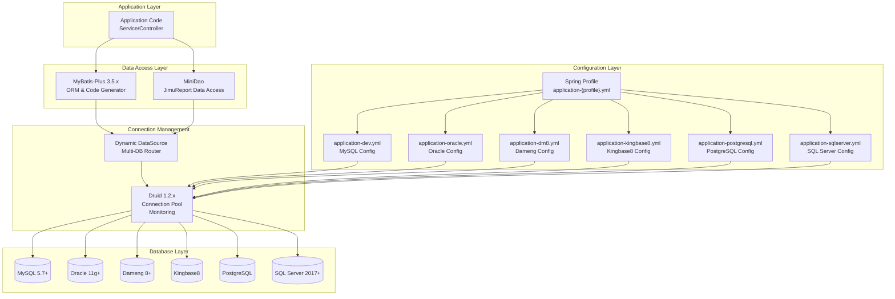
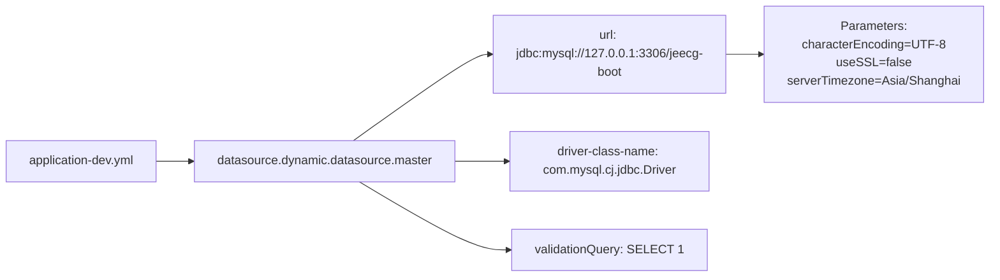
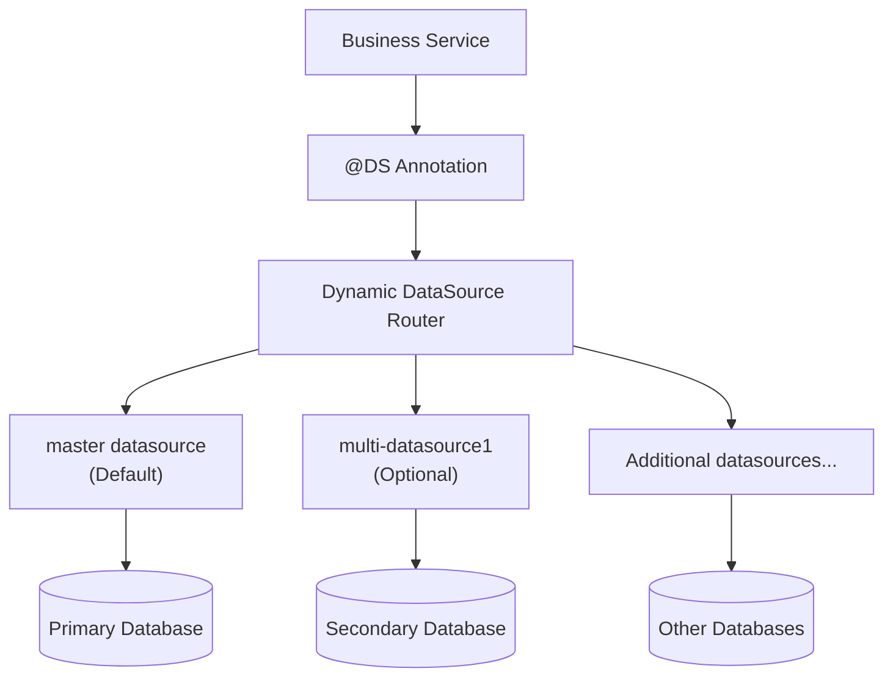
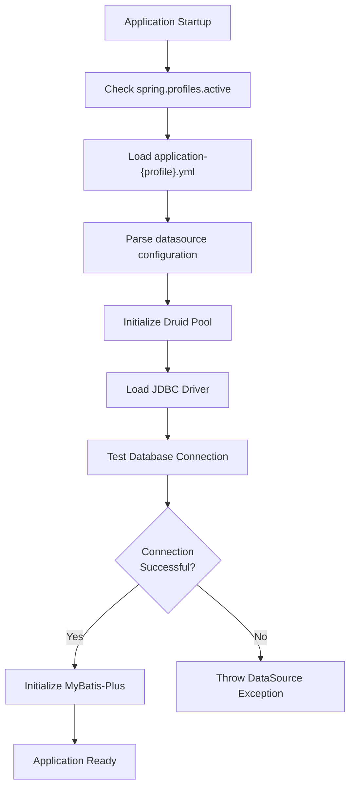

<!-- source: DeepWiki mcp.deepwiki.com · repo jeecgboot/JeecgBoot · page 4.2 Multi-Database Support · fetched 2026-10-29 -->

# Multi-Database Support

<details>
<summary>Relevant source files</summary>

The following files were used as context for generating this wiki page:

- [jeecg-boot/jeecg-boot-base-core/src/main/resources/config/default-spring-doc.properties](jeecg-boot/jeecg-boot-base-core/src/main/resources/config/default-spring-doc.properties)
- [jeecg-boot/jeecg-module-system/jeecg-system-start/src/main/resources/application-dev.yml](jeecg-boot/jeecg-module-system/jeecg-system-start/src/main/resources/application-dev.yml)
- [jeecg-boot/jeecg-module-system/jeecg-system-start/src/main/resources/application-dm8.yml](jeecg-boot/jeecg-module-system/jeecg-system-start/src/main/resources/application-dm8.yml)
- [jeecg-boot/jeecg-module-system/jeecg-system-start/src/main/resources/application-docker.yml](jeecg-boot/jeecg-module-system/jeecg-system-start/src/main/resources/application-docker.yml)
- [jeecg-boot/jeecg-module-system/jeecg-system-start/src/main/resources/application-kingbase8.yml](jeecg-boot/jeecg-module-system/jeecg-system-start/src/main/resources/application-kingbase8.yml)
- [jeecg-boot/jeecg-module-system/jeecg-system-start/src/main/resources/application-oracle.yml](jeecg-boot/jeecg-module-system/jeecg-system-start/src/main/resources/application-oracle.yml)
- [jeecg-boot/jeecg-module-system/jeecg-system-start/src/main/resources/application-postgresql.yml](jeecg-boot/jeecg-module-system/jeecg-system-start/src/main/resources/application-postgresql.yml)
- [jeecg-boot/jeecg-module-system/jeecg-system-start/src/main/resources/application-prod.yml](jeecg-boot/jeecg-module-system/jeecg-system-start/src/main/resources/application-prod.yml)
- [jeecg-boot/jeecg-module-system/jeecg-system-start/src/main/resources/application-sqlserver.yml](jeecg-boot/jeecg-module-system/jeecg-system-start/src/main/resources/application-sqlserver.yml)
- [jeecg-boot/jeecg-module-system/jeecg-system-start/src/main/resources/application-test.yml](jeecg-boot/jeecg-module-system/jeecg-system-start/src/main/resources/application-test.yml)
- [jeecg-boot/jeecg-module-system/jeecg-system-start/src/main/resources/logback-spring.xml](jeecg-boot/jeecg-module-system/jeecg-system-start/src/main/resources/logback-spring.xml)

</details>


## Purpose and Scope

This document explains JeecgBoot's multi-database compatibility layer, which allows a single codebase to run on 8 different database types without modification. It covers database configuration, the dynamic datasource framework, connection pooling with Druid, and how to switch between database vendors at deployment time using Spring profiles.

For information about the core database schema design, see [Core Database Schema](#4.1). For sharding and distributed database features, see [Data Sharding with ShardingSphere](#4.3).

## Overview

JeecgBoot supports 8 major database types through a combination of MyBatis-Plus dialect handling, Druid connection pooling, and Spring Boot profile-based configuration. The system provides profile-specific YAML files for each database type, enabling zero-code database switching.

### Supported Databases

| Database | Version | Support Status | Driver Class | Profile Name |
|----------|---------|----------------|--------------|--------------|
| MySQL | 5.7+ | ✓ Default | `com.mysql.cj.jdbc.Driver` | `dev`, `test`, `prod`, `docker` |
| Oracle | 11g+ | ✓ | `oracle.jdbc.OracleDriver` | `oracle` |
| SQL Server | 2017+ | ✓ | `com.microsoft.sqlserver.jdbc.SQLServerDriver` | `sqlserver` |
| PostgreSQL | 9.6+ | ✓ | `org.postgresql.Driver` | `postgresql` |
| MariaDB | 10.3+ | ✓ | `com.mysql.cj.jdbc.Driver` | Same as MySQL |
| Dameng (达梦) | 8+ | ✓ | `dm.jdbc.driver.DmDriver` | `dm8` |
| Kingbase8 (人大金仓) | 8+ | ✓ | `com.kingbase8.Driver` | `kingbase8` |
| TiDB | 5.0+ | ✓ | `com.mysql.cj.jdbc.Driver` | Same as MySQL |

Sources: [jeecg-boot/jeecg-module-system/jeecg-system-start/src/main/resources/application-dev.yml:153-153](), [jeecg-boot/jeecg-module-system/jeecg-system-start/src/main/resources/application-oracle.yml:140-140](), [jeecg-boot/jeecg-module-system/jeecg-system-start/src/main/resources/application-sqlserver.yml:138-138](), [jeecg-boot/jeecg-module-system/jeecg-system-start/src/main/resources/application-postgresql.yml:153-153](), [jeecg-boot/jeecg-module-system/jeecg-system-start/src/main/resources/application-dm8.yml:132-132](), [jeecg-boot/jeecg-module-system/jeecg-system-start/src/main/resources/application-kingbase8.yml:149-149]()

## Database Configuration Architecture



**Database Configuration Architecture Diagram**

Sources: [jeecg-boot/jeecg-module-system/jeecg-system-start/src/main/resources/application-dev.yml:119-153](), [jeecg-boot/jeecg-module-system/jeecg-system-start/src/main/resources/application-dm8.yml:116-132]()

## Configuration Structure

All database configurations follow a consistent Spring Boot datasource pattern using the dynamic-datasource framework:

```yaml
spring:
  datasource:
    dynamic:
      druid:
        # Global Druid connection pool settings
        initial-size: 5
        min-idle: 5
        maxActive: 1000
        maxWait: 60000
        validationQuery: SELECT 1
        filters: stat,slf4j
      datasource:
        master:
          url: jdbc:mysql://127.0.0.1:3306/jeecg-boot?characterEncoding=UTF-8...
          username: root
          password: root
          driver-class-name: com.mysql.cj.jdbc.Driver
```

### Configuration Files Mapping

| Profile | File Path | Database |
|---------|-----------|----------|
| `dev` | `application-dev.yml` | MySQL (default development) |
| `test` | `application-test.yml` | MySQL (test environment) |
| `prod` | `application-prod.yml` | MySQL (production) |
| `docker` | `application-docker.yml` | MySQL (containerized) |
| `oracle` | `application-oracle.yml` | Oracle 11g+ |
| `sqlserver` | `application-sqlserver.yml` | SQL Server 2017+ |
| `postgresql` | `application-postgresql.yml` | PostgreSQL |
| `dm8` | `application-dm8.yml` | Dameng 8+ |
| `kingbase8` | `application-kingbase8.yml` | Kingbase8 |

Sources: [jeecg-boot/jeecg-module-system/jeecg-system-start/src/main/resources/application-dev.yml:149-153](), [jeecg-boot/jeecg-module-system/jeecg-system-start/src/main/resources/application-dm8.yml:128-132]()

## Database-Specific Configuration

### MySQL Configuration



**MySQL Configuration Structure**

MySQL is the default database and includes specific JDBC parameters for timezone handling and character encoding.

Sources: [jeecg-boot/jeecg-module-system/jeecg-system-start/src/main/resources/application-dev.yml:150-153]()

### Oracle Configuration

Key differences for Oracle:
- **Driver**: `oracle.jdbc.OracleDriver`
- **URL Pattern**: `jdbc:oracle:thin:@127.0.0.1:1521:helowin`
- **Validation Query**: `SELECT 1 FROM DUAL` (Oracle-specific syntax)
- **Filters**: Includes `wall` filter for SQL firewall protection [jeecg-boot/jeecg-module-system/jeecg-system-start/src/main/resources/application-oracle.yml:134-134]()

```yaml
datasource:
  master:
    url: jdbc:oracle:thin:@127.0.0.1:1521:helowin
    username: jeecgboot
    password: ???
    driver-class-name: oracle.jdbc.OracleDriver
```

Sources: [jeecg-boot/jeecg-module-system/jeecg-system-start/src/main/resources/application-oracle.yml:137-140]()

### SQL Server Configuration

Key differences for SQL Server:
- **Driver**: `com.microsoft.sqlserver.jdbc.SQLServerDriver`
- **URL Pattern**: `jdbc:sqlserver://127.0.0.1:1433;SelectMethod=cursor;DatabaseName=jeecgboot`
- **Connection Method**: Uses cursor-based selection

```yaml
datasource:
  master:
    driver-class-name: com.microsoft.sqlserver.jdbc.SQLServerDriver
    url: jdbc:sqlserver://127.0.0.1:1433;SelectMethod=cursor;DatabaseName=jeecgboot
    username: jeecgboot
    password: ??
```

Sources: [jeecg-boot/jeecg-module-system/jeecg-system-start/src/main/resources/application-sqlserver.yml:138-141]()

### PostgreSQL Configuration

Key differences for PostgreSQL:
- **Driver**: `org.postgresql.Driver`
- **URL Parameter**: `stringtype=unspecified` for type handling
- **Hibernate Dialect**: `org.hibernate.dialect.PostgreSQLDialect` [jeecg-boot/jeecg-module-system/jeecg-system-start/src/main/resources/application-postgresql.yml:76-76]()

```yaml
spring:
  jpa:
    database-platform: org.hibernate.dialect.PostgreSQLDialect
    properties:
      hibernate:
        temp:
          use_jdbc_metadata_defaults: false
  datasource:
    dynamic:
      datasource:
        master:
          url: jdbc:postgresql://127.0.0.1:5432/postgres?stringtype=unspecified
          username: admin
          password: ????
          driver-class-name: org.postgresql.Driver
```

Sources: [jeecg-boot/jeecg-module-system/jeecg-system-start/src/main/resources/application-postgresql.yml:76-153]()

### Dameng (达梦) Configuration

Dameng is a Chinese domestic database with Oracle compatibility mode:
- **Driver**: `dm.jdbc.driver.DmDriver`
- **URL Pattern**: `jdbc:dm://127.0.0.1:30236?schema=SYSDBA&compatibleMode=oracle`
- **Compatibility Mode**: Oracle compatibility for SQL syntax [jeecg-boot/jeecg-module-system/jeecg-system-start/src/main/resources/application-dm8.yml:129-129]()
- **Hibernate Dialect**: `org.hibernate.dialect.DmDialect` [jeecg-boot/jeecg-module-system/jeecg-system-start/src/main/resources/application-dm8.yml:77-77]()

```yaml
spring:
  jpa:
    properties:
      hibernate:
        dialect: org.hibernate.dialect.DmDialect
  datasource:
    dynamic:
      datasource:
        master:
          url: jdbc:dm://127.0.0.1:30236?schema=SYSDBA&compatibleMode=oracle&zeroDateTimeBehavior=convertToNull
          username: SYSDBA
          password: SYSDBA
          driverClassName: dm.jdbc.driver.DmDriver
```

Sources: [jeecg-boot/jeecg-module-system/jeecg-system-start/src/main/resources/application-dm8.yml:77-132]()

### Kingbase8 (人大金仓) Configuration

Kingbase8 is another Chinese domestic database with PostgreSQL compatibility:
- **Driver**: `com.kingbase8.Driver`
- **URL Pattern**: `jdbc:kingbase8://127.0.0.1:4321/test`
- **Hibernate Dialect**: `org.hibernate.dialect.PostgreSQLDialect` [jeecg-boot/jeecg-module-system/jeecg-system-start/src/main/resources/application-kingbase8.yml:80-80]()
- **Validation Query**: `SELECT 1` [jeecg-boot/jeecg-module-system/jeecg-system-start/src/main/resources/application-kingbase8.yml:131-131]()

```yaml
spring:
  jpa:
    properties:
      hibernate:
        dialect: org.hibernate.dialect.PostgreSQLDialect
  datasource:
    dynamic:
      datasource:
        master:
          url: jdbc:kingbase8://127.0.0.1:4321/test
          username: system
          password: system
          driver-class-name: com.kingbase8.Driver
```

Sources: [jeecg-boot/jeecg-module-system/jeecg-system-start/src/main/resources/application-kingbase8.yml:80-149]()

## Dynamic DataSource Framework

The `spring.datasource.dynamic` configuration enables multiple datasources in a single application. Each datasource can be named and switched programmatically using the `@DS` annotation.



**Dynamic DataSource Routing**

### Multi-DataSource Configuration Example

```yaml
spring:
  datasource:
    dynamic:
      datasource:
        master:
          url: jdbc:mysql://127.0.0.1:3306/jeecg-boot
          username: root
          password: root
          driver-class-name: com.mysql.cj.jdbc.Driver
        # Additional datasource example (commented in configs)
        multi-datasource1:
          url: jdbc:mysql://localhost:3306/jeecg-boot2
          username: root
          password: root
          driver-class-name: com.mysql.cj.jdbc.Driver
```

The `master` datasource is the default. Additional datasources can be defined with custom names and accessed using the `@DS("datasource-name")` annotation in service classes.

Sources: [jeecg-boot/jeecg-module-system/jeecg-system-start/src/main/resources/application-prod.yml:143-153]()

## Druid Connection Pool

All database configurations use Alibaba Druid as the connection pool with monitoring capabilities.

### Druid Global Configuration

```yaml
spring:
  datasource:
    druid:
      stat-view-servlet:
        enabled: true
        loginUsername: admin
        loginPassword: 123456
      web-stat-filter:
        enabled: true
    dynamic:
      druid:
        initial-size: 5
        min-idle: 5
        maxActive: 1000
        maxWait: 60000
        timeBetweenEvictionRunsMillis: 60000
        minEvictableIdleTimeMillis: 300000
        validationQuery: SELECT 1
        testWhileIdle: true
        testOnBorrow: false
        testOnReturn: false
        poolPreparedStatements: true
        maxPoolPreparedStatementPerConnectionSize: 20
        filters: stat,slf4j
```

### Key Druid Parameters

| Parameter | Value | Purpose |
|-----------|-------|---------|
| `initial-size` | 5 | Initial number of connections [jeecg-boot/jeecg-module-system/jeecg-system-start/src/main/resources/application-dev.yml:123-123]() |
| `min-idle` | 5 | Minimum idle connections [jeecg-boot/jeecg-module-system/jeecg-system-start/src/main/resources/application-dev.yml:124-124]() |
| `maxActive` | 1000 | Maximum active connections [jeecg-boot/jeecg-module-system/jeecg-system-start/src/main/resources/application-dev.yml:125-125]() |
| `maxWait` | 60000ms | Max wait time for connection [jeecg-boot/jeecg-module-system/jeecg-system-start/src/main/resources/application-dev.yml:127-127]() |
| `validationQuery` | `SELECT 1` | Query to validate connections [jeecg-boot/jeecg-module-system/jeecg-system-start/src/main/resources/application-dev.yml:132-132]() |
| `filters` | `stat,slf4j` | Monitoring and logging filters [jeecg-boot/jeecg-module-system/jeecg-system-start/src/main/resources/application-dev.yml:140-140]() |

Sources: [jeecg-boot/jeecg-module-system/jeecg-system-start/src/main/resources/application-dev.yml:111-147]()

## MyBatis-Plus Integration

MyBatis-Plus handles database dialect differences automatically through its configuration:

```yaml
mybatis-plus:
  mapper-locations: classpath*:org/jeecg/**/xml/*Mapper.xml
  global-config:
    banner: false
    db-config:
      id-type: ASSIGN_ID
      table-underline: true
  configuration:
    call-setters-on-nulls: true
```

### Key MyBatis-Plus Features

- **ID Type**: `ASSIGN_ID` - Uses distributed ID generation (Snowflake algorithm) [jeecg-boot/jeecg-module-system/jeecg-system-start/src/main/resources/application-dev.yml:173-173]()
- **Table Naming**: `table-underline: true` - Automatic underscore naming convention [jeecg-boot/jeecg-module-system/jeecg-system-start/src/main/resources/application-dev.yml:175-175]()
- **Null Handling**: `call-setters-on-nulls: true` - Shows null fields in Map results [jeecg-boot/jeecg-module-system/jeecg-system-start/src/main/resources/application-dev.yml:180-180]()
- **Mapper Scanning**: Scans `org/jeecg/**/xml/*Mapper.xml` for SQL mappings [jeecg-boot/jeecg-module-system/jeecg-system-start/src/main/resources/application-dev.yml:167-167]()

Sources: [jeecg-boot/jeecg-module-system/jeecg-system-start/src/main/resources/application-dev.yml:166-180]()

## Switching Between Databases

### Method 1: Spring Profile Activation

Activate a specific database profile when starting the application:

**Docker:**
```yaml
environment:
  - SPRING_PROFILES_ACTIVE=docker
```

### Method 2: application.yml Configuration

Set the active profile in the main `application.yml` or through Nacos.

### Database Profile Selection Flow



**Database Switching Process**

Sources: [jeecg-boot/jeecg-module-system/jeecg-system-start/src/main/resources/application-dev.yml:149-153](), [jeecg-boot/jeecg-module-system/jeecg-system-start/src/main/resources/application-oracle.yml:136-140]()

## Database Migration Considerations

### Flyway Integration

JeecgBoot includes Flyway for database schema versioning. Each database type may require different migration scripts:

```yaml
spring:
  flyway:
    enabled: false
    locations: classpath:flyway/sql/mysql
    clean-disabled: true  # MUST be true in production
```

**Important**: 
- MySQL scripts are provided by default at `classpath:flyway/sql/mysql` [jeecg-boot/jeecg-module-system/jeecg-system-start/src/main/resources/application-dev.yml:27-27]()
- Flyway is disabled by default in most profiles (`enabled: false`) to prevent accidental changes [jeecg-boot/jeecg-module-system/jeecg-system-start/src/main/resources/application-dev.yml:25-25]()

Sources: [jeecg-boot/jeecg-module-system/jeecg-system-start/src/main/resources/application-dev.yml:23-29]()

## Production Recommendations

### Connection Pool Sizing

For production environments, adjust Druid settings based on load:

```yaml
spring:
  datasource:
    dynamic:
      druid:
        initial-size: 5
        min-idle: 5
        maxActive: 1000
        maxWait: 60000
```

### Monitoring and Performance

Enable Druid SQL monitoring in production:

```yaml
spring:
  datasource:
    druid:
      stat-view-servlet:
        enabled: true
      web-stat-filter:
        enabled: true
      filters: stat,slf4j
      stat:
        merge-sql: true
        slow-sql-millis: 5000
```

Sources: [jeecg-boot/jeecg-module-system/jeecg-system-start/src/main/resources/application-prod.yml:113-140]()

## Summary

JeecgBoot's multi-database support provides:

1. **Zero-code database switching** via Spring profiles.
2. **8 database types supported** including domestic Chinese databases (Dameng, Kingbase8).
3. **Unified configuration pattern** using dynamic-datasource.
4. **Production-ready connection pooling** with Druid monitoring.
5. **Automatic dialect handling** by MyBatis-Plus.
6. **Multiple datasource capability** for complex integrations.

Sources: [jeecg-boot/jeecg-module-system/jeecg-system-start/src/main/resources/application-dev.yml](), [jeecg-boot/jeecg-module-system/jeecg-system-start/src/main/resources/application-dm8.yml](), [jeecg-boot/jeecg-module-system/jeecg-system-start/src/main/resources/application-kingbase8.yml]()

---

