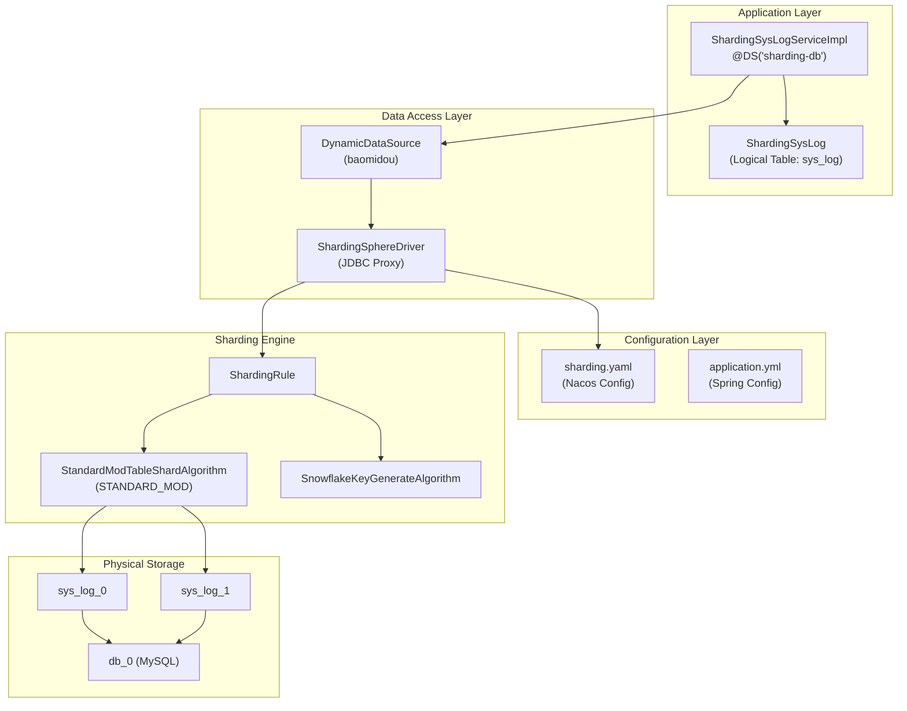
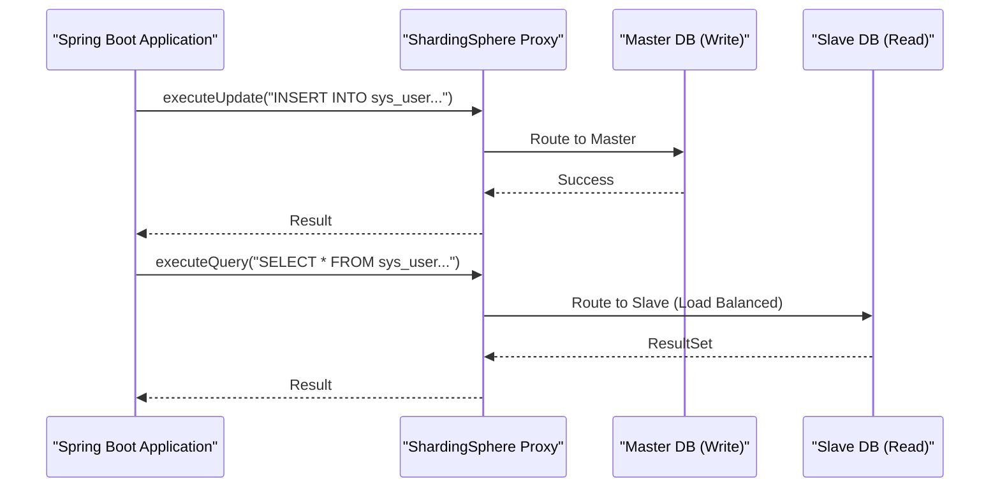

<!-- source: DeepWiki mcp.deepwiki.com · repo jeecgboot/JeecgBoot · page 4.3 Data Sharding with ShardingSphere · fetched 2026-10-29 -->

# Data Sharding with ShardingSphere

<details>
<summary>Relevant source files</summary>

The following files were used as context for generating this wiki page:

- [jeecg-boot/db/tables_nacos.sql](jeecg-boot/db/tables_nacos.sql)
- [jeecg-boot/jeecg-server-cloud/jeecg-cloud-gateway/src/main/resources/application.yml](jeecg-boot/jeecg-server-cloud/jeecg-cloud-gateway/src/main/resources/application.yml)
- [jeecg-boot/jeecg-server-cloud/jeecg-cloud-nacos/docs/DEFAULT_GROUP/jeecg-dev-satoken.yaml](jeecg-boot/jeecg-server-cloud/jeecg-cloud-nacos/docs/DEFAULT_GROUP/jeecg-dev-satoken.yaml)
- [jeecg-boot/jeecg-server-cloud/jeecg-cloud-nacos/docs/DEFAULT_GROUP/jeecg-dev.yaml](jeecg-boot/jeecg-server-cloud/jeecg-cloud-nacos/docs/DEFAULT_GROUP/jeecg-dev.yaml)
- [jeecg-boot/jeecg-server-cloud/jeecg-cloud-nacos/docs/DEFAULT_GROUP/jeecg-gateway-router.json](jeecg-boot/jeecg-server-cloud/jeecg-cloud-nacos/docs/DEFAULT_GROUP/jeecg-gateway-router.json)
- [jeecg-boot/jeecg-server-cloud/jeecg-cloud-nacos/docs/DEFAULT_GROUP/jeecg-gateway.yaml](jeecg-boot/jeecg-server-cloud/jeecg-cloud-nacos/docs/DEFAULT_GROUP/jeecg-gateway.yaml)
- [jeecg-boot/jeecg-server-cloud/jeecg-cloud-nacos/docs/DEFAULT_GROUP/jeecg.yaml](jeecg-boot/jeecg-server-cloud/jeecg-cloud-nacos/docs/DEFAULT_GROUP/jeecg.yaml)
- [jeecg-boot/jeecg-server-cloud/jeecg-cloud-nacos/docs/DEFAULT_GROUP/sharding.yaml](jeecg-boot/jeecg-server-cloud/jeecg-cloud-nacos/docs/DEFAULT_GROUP/sharding.yaml)
- [jeecg-boot/jeecg-server-cloud/jeecg-cloud-nacos/pom.xml](jeecg-boot/jeecg-server-cloud/jeecg-cloud-nacos/pom.xml)
- [jeecg-boot/jeecg-server-cloud/jeecg-cloud-nacos/src/main/java/com/alibaba/nacos/JeecgNacosApplication.java](jeecg-boot/jeecg-server-cloud/jeecg-cloud-nacos/src/main/java/com/alibaba/nacos/JeecgNacosApplication.java)

</details>


## Purpose and Scope

This document explains JeecgBoot's integration with Apache ShardingSphere for horizontal data sharding (分库分表). ShardingSphere enables the platform to distribute data across multiple databases and tables, improving scalability and performance for high-volume scenarios. This section covers configuration within Nacos, table sharding algorithms, snowflake key generation, and read-write splitting implementation.

For general multi-database support without sharding, see [Multi-Database Support](#4.2). For distributed transaction coordination across sharded databases, see [Distributed Transactions with Seata](#4.4).

---

## Integration Architecture

ShardingSphere integrates with JeecgBoot's dynamic datasource framework. It acts as a JDBC driver proxy that intercepts SQL statements, analyzes sharding keys, and routes queries to the appropriate physical database and table based on rules defined in Nacos or local configuration files.

### Code-to-System Mapping

The following diagram bridges the natural language concepts of sharding to the specific code entities used in JeecgBoot.



**Sources:** [jeecg-boot/jeecg-server-cloud/jeecg-cloud-nacos/docs/DEFAULT_GROUP/sharding.yaml:1-37](), [jeecg-boot/jeecg-server-cloud/jeecg-cloud-nacos/docs/DEFAULT_GROUP/jeecg-dev.yaml:37-39]()

---

## Configuration in Nacos

In microservices mode, ShardingSphere configuration is managed centrally via Nacos. The `sharding.yaml` file defines the data sources, sharding rules, and key generators.

### Nacos Datasource Configuration
The primary application configuration (e.g., `jeecg-dev.yaml`) references the ShardingSphere driver.

```yaml
spring:
  datasource:
    dynamic:
      datasource:
        sharding-db:
          driver-class-name: org.apache.shardingsphere.driver.ShardingSphereDriver
          url: jdbc:shardingsphere:nacos:sharding.yaml?serverAddr=${spring.cloud.nacos.config.server-addr}&namespace=${spring.cloud.nacos.config.namespace}&group=${spring.cloud.nacos.config.group}
```

**Sources:** [jeecg-boot/jeecg-server-cloud/jeecg-cloud-nacos/docs/DEFAULT_GROUP/jeecg-dev.yaml:37-39]()

### sharding.yaml Structure
The `sharding.yaml` file defines the physical resources and logic:

| Section | Description | Key Code Reference |
|---------|-------------|--------------------|
| `dataSources` | Physical database connections (e.g., `db_0`) | [sharding.yaml:3-9]() |
| `rules` | Sharding logic for specific tables | [sharding.yaml:11-34]() |
| `actualDataNodes` | Physical table mapping (e.g., `db_0.sys_log$->{0..1}`) | [sharding.yaml:15-15]() |
| `shardingAlgorithms` | Algorithm types and properties | [sharding.yaml:30-34]() |
| `keyGenerators` | Distributed ID generation strategy | [sharding.yaml:25-29]() |

---

## Sharding Algorithms & Key Generation

### Table Sharding Algorithm
JeecgBoot utilizes the `INLINE` algorithm for simple modulo-based sharding. As seen in the Nacos configuration, the `sys_log` table is sharded based on the `log_type` column.

```yaml
shardingAlgorithms:
  user_inline:
    type: INLINE
    props:
      algorithm-expression: sys_log$->{log_type % 2}
```

This expression ensures that:
- Records with `log_type % 2 == 0` are routed to `sys_log_0`.
- Records with `log_type % 2 == 1` are routed to `sys_log_1`.

**Sources:** [jeecg-boot/jeecg-server-cloud/jeecg-cloud-nacos/docs/DEFAULT_GROUP/sharding.yaml:31-34]()

### Snowflake Key Generation
To ensure unique IDs across distributed shards, ShardingSphere's `SNOWFLAKE` generator is configured. This avoids ID collisions that would occur with standard database auto-incrementing.

```yaml
keyGenerators:
  snowflake:
    type: SNOWFLAKE
    props:
      worker-id: 123
```

The generator is assigned to the `id` column of the `sys_log` table.

**Sources:** [jeecg-boot/jeecg-server-cloud/jeecg-cloud-nacos/docs/DEFAULT_GROUP/sharding.yaml:22-29]()

---

## Read-Write Splitting

While the provided `sharding.yaml` focuses on horizontal sharding, ShardingSphere in JeecgBoot also supports read-write splitting. This is typically implemented by defining a `master` datasource for writes and one or more `slave` datasources for reads.

### Data Flow for Read-Write Splitting



**Sources:** [jeecg-boot/jeecg-server-cloud/jeecg-cloud-nacos/docs/DEFAULT_GROUP/sharding.yaml:11-12]() (Note: Rules section supports `READWRITE_SPLITTING` type in standard ShardingSphere configurations).

---

## Implementation Details

### Service Layer Integration
To use the sharded database, the service implementation must be annotated with `@DS("sharding-db")`. This instructs the `dynamic-datasource` interceptor to select the ShardingSphere proxy datasource.

### Nacos Management
The `tables_nacos.sql` file initializes the Nacos database which stores these configurations. The `config_info` table holds the actual YAML content.

| Table | Purpose |
|-------|---------|
| `config_info` | Stores the `sharding.yaml` content |
| `his_config_info` | Stores configuration history for rollbacks |
| `tenant_info` | Manages isolation between different environments |

**Sources:** [jeecg-boot/db/tables_nacos.sql:88-108](), [jeecg-boot/jeecg-server-cloud/jeecg-cloud-nacos/src/main/java/com/alibaba/nacos/JeecgNacosApplication.java:23-57]()

### Deployment Considerations
When deploying with ShardingSphere:
1. Ensure the `nacos` database is initialized using `tables_nacos.sql`.
2. Verify that the `sharding.yaml` is uploaded to the correct Nacos Namespace and Group (`DEFAULT_GROUP`).
3. Set `sql-show: true` in the `props` section of `sharding.yaml` during development to debug routing logic in the console.

**Sources:** [jeecg-boot/jeecg-server-cloud/jeecg-cloud-nacos/docs/DEFAULT_GROUP/sharding.yaml:36-37]()

---

