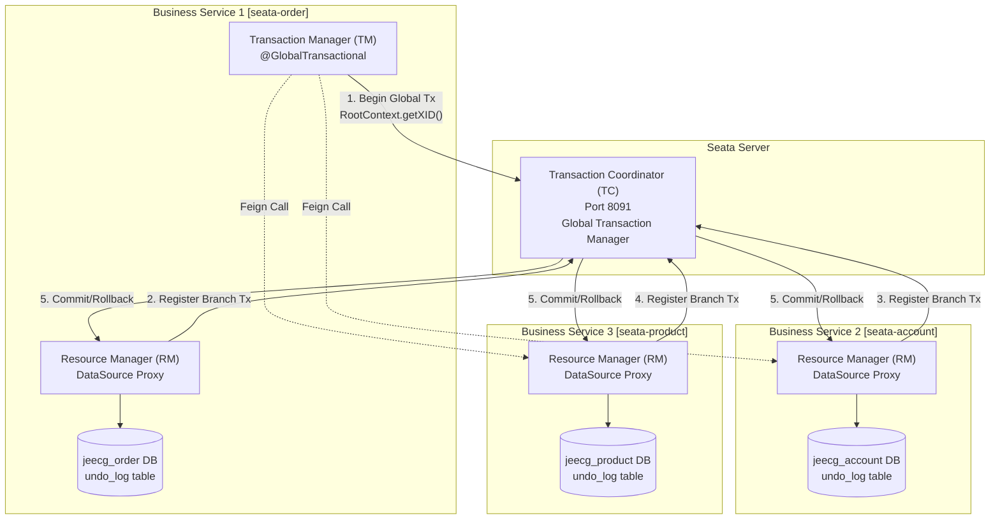
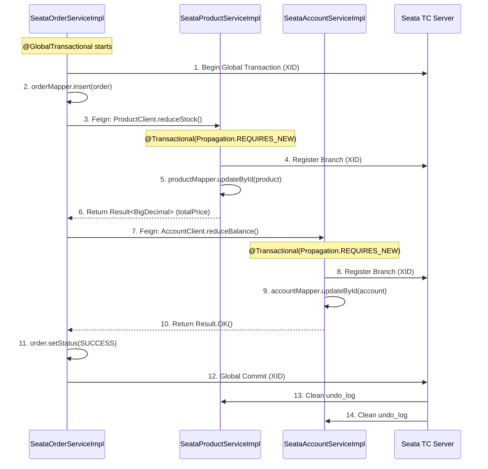

<!-- source: DeepWiki mcp.deepwiki.com · repo jeecgboot/JeecgBoot · page 4.4 Distributed Transactions with Seata · fetched 2026-10-29 -->

# Distributed Transactions with Seata

<details>
<summary>Relevant source files</summary>

The following files were used as context for generating this wiki page:

- [jeecg-boot/jeecg-server-cloud/jeecg-visual/jeecg-cloud-test/jeecg-cloud-test-seata/jeecg-cloud-test-seata-account/src/main/java/org/jeecg/modules/test/seata/account/controller/SeataAccountController.java](jeecg-boot/jeecg-server-cloud/jeecg-visual/jeecg-cloud-test/jeecg-cloud-test-seata/jeecg-cloud-test-seata-account/src/main/java/org/jeecg/modules/test/seata/account/controller/SeataAccountController.java)
- [jeecg-boot/jeecg-server-cloud/jeecg-visual/jeecg-cloud-test/jeecg-cloud-test-seata/jeecg-cloud-test-seata-account/src/main/java/org/jeecg/modules/test/seata/account/service/SeataAccountService.java](jeecg-boot/jeecg-server-cloud/jeecg-visual/jeecg-cloud-test/jeecg-cloud-test-seata/jeecg-cloud-test-seata-account/src/main/java/org/jeecg/modules/test/seata/account/service/SeataAccountService.java)
- [jeecg-boot/jeecg-server-cloud/jeecg-visual/jeecg-cloud-test/jeecg-cloud-test-seata/jeecg-cloud-test-seata-account/src/main/java/org/jeecg/modules/test/seata/account/service/impl/SeataAccountServiceImpl.java](jeecg-boot/jeecg-server-cloud/jeecg-visual/jeecg-cloud-test/jeecg-cloud-test-seata/jeecg-cloud-test-seata-account/src/main/java/org/jeecg/modules/test/seata/account/service/impl/SeataAccountServiceImpl.java)
- [jeecg-boot/jeecg-server-cloud/jeecg-visual/jeecg-cloud-test/jeecg-cloud-test-seata/jeecg-cloud-test-seata-account/src/main/resources/application.yml](jeecg-boot/jeecg-server-cloud/jeecg-visual/jeecg-cloud-test/jeecg-cloud-test-seata/jeecg-cloud-test-seata-account/src/main/resources/application.yml)
- [jeecg-boot/jeecg-server-cloud/jeecg-visual/jeecg-cloud-test/jeecg-cloud-test-seata/jeecg-cloud-test-seata-order/src/main/java/org/jeecg/modules/test/seata/order/feign/AccountClient.java](jeecg-boot/jeecg-server-cloud/jeecg-visual/jeecg-cloud-test/jeecg-cloud-test-seata/jeecg-cloud-test-seata-order/src/main/java/org/jeecg/modules/test/seata/order/feign/AccountClient.java)
- [jeecg-boot/jeecg-server-cloud/jeecg-visual/jeecg-cloud-test/jeecg-cloud-test-seata/jeecg-cloud-test-seata-order/src/main/java/org/jeecg/modules/test/seata/order/feign/ProductClient.java](jeecg-boot/jeecg-server-cloud/jeecg-visual/jeecg-cloud-test/jeecg-cloud-test-seata/jeecg-cloud-test-seata-order/src/main/java/org/jeecg/modules/test/seata/order/feign/ProductClient.java)
- [jeecg-boot/jeecg-server-cloud/jeecg-visual/jeecg-cloud-test/jeecg-cloud-test-seata/jeecg-cloud-test-seata-order/src/main/java/org/jeecg/modules/test/seata/order/service/impl/SeataOrderServiceImpl.java](jeecg-boot/jeecg-server-cloud/jeecg-visual/jeecg-cloud-test/jeecg-cloud-test-seata/jeecg-cloud-test-seata-order/src/main/java/org/jeecg/modules/test/seata/order/service/impl/SeataOrderServiceImpl.java)
- [jeecg-boot/jeecg-server-cloud/jeecg-visual/jeecg-cloud-test/jeecg-cloud-test-seata/jeecg-cloud-test-seata-order/src/main/resources/application.yml](jeecg-boot/jeecg-server-cloud/jeecg-visual/jeecg-cloud-test/jeecg-cloud-test-seata/jeecg-cloud-test-seata-order/src/main/resources/application.yml)
- [jeecg-boot/jeecg-server-cloud/jeecg-visual/jeecg-cloud-test/jeecg-cloud-test-seata/jeecg-cloud-test-seata-product/src/main/java/org/jeecg/modules/test/seata/product/controller/SeataProductController.java](jeecg-boot/jeecg-server-cloud/jeecg-visual/jeecg-cloud-test/jeecg-cloud-test-seata/jeecg-cloud-test-seata-product/src/main/java/org/jeecg/modules/test/seata/product/controller/SeataProductController.java)
- [jeecg-boot/jeecg-server-cloud/jeecg-visual/jeecg-cloud-test/jeecg-cloud-test-seata/jeecg-cloud-test-seata-product/src/main/java/org/jeecg/modules/test/seata/product/service/SeataProductService.java](jeecg-boot/jeecg-server-cloud/jeecg-visual/jeecg-cloud-test/jeecg-cloud-test-seata/jeecg-cloud-test-seata-product/src/main/java/org/jeecg/modules/test/seata/product/service/SeataProductService.java)
- [jeecg-boot/jeecg-server-cloud/jeecg-visual/jeecg-cloud-test/jeecg-cloud-test-seata/jeecg-cloud-test-seata-product/src/main/java/org/jeecg/modules/test/seata/product/service/impl/SeataProductServiceImpl.java](jeecg-boot/jeecg-server-cloud/jeecg-visual/jeecg-cloud-test/jeecg-cloud-test-seata/jeecg-cloud-test-seata-product/src/main/java/org/jeecg/modules/test/seata/product/service/impl/SeataProductServiceImpl.java)
- [jeecg-boot/jeecg-server-cloud/jeecg-visual/jeecg-cloud-test/jeecg-cloud-test-seata/jeecg-cloud-test-seata-product/src/main/resources/application.yml](jeecg-boot/jeecg-server-cloud/jeecg-visual/jeecg-cloud-test/jeecg-cloud-test-seata/jeecg-cloud-test-seata-product/src/main/resources/application.yml)
- [jeecg-boot/jeecg-server-cloud/jeecg-visual/jeecg-cloud-test/jeecg-cloud-test-seata/pom.xml](jeecg-boot/jeecg-server-cloud/jeecg-visual/jeecg-cloud-test/jeecg-cloud-test-seata/pom.xml)

</details>


## Purpose and Scope

This document explains the integration of Seata for managing distributed transactions across microservices in the JeecgBoot platform. Seata (Simple Extensible Autonomous Transaction Architecture) provides distributed transaction capabilities using the AT (Automatic Transaction) mode, ensuring data consistency when business operations span multiple microservices and databases.

This page covers Seata TC configuration, microservice transaction coordination, and implementation details for the account, order, and product example services located in the `jeecg-cloud-test-seata` module.

**Note:** Seata is only relevant in microservices mode. The monolithic deployment mode uses local transactions managed by Spring's `@Transactional` annotation.

---

## Seata Architecture Overview

Seata implements distributed transactions through three core components that work together to coordinate transactions across multiple services and databases.

### Component Roles



**Sources:** [jeecg-boot/jeecg-server-cloud/jeecg-visual/jeecg-cloud-test/jeecg-cloud-test-seata/jeecg-cloud-test-seata-order/src/main/java/org/jeecg/modules/test/seata/order/service/impl/SeataOrderServiceImpl.java:45-47](), [jeecg-boot/jeecg-server-cloud/jeecg-visual/jeecg-cloud-test/jeecg-cloud-test-seata/jeecg-cloud-test-seata-account/src/main/java/org/jeecg/modules/test/seata/account/service/impl/SeataAccountServiceImpl.java:39-40]()

| Component | Role | Location | Responsibilities |
|-----------|------|----------|------------------|
| **TC** (Transaction Coordinator) | Server | Standalone Seata Server (port 8091) | Manages global transaction state, coordinates commit/rollback decisions |
| **TM** (Transaction Manager) | Client | `SeataOrderServiceImpl` | Begins and ends global transaction using `@GlobalTransactional` [jeecg-boot/jeecg-server-cloud/jeecg-visual/jeecg-cloud-test/jeecg-cloud-test-seata/jeecg-cloud-test-seata-order/src/main/java/org/jeecg/modules/test/seata/order/service/impl/SeataOrderServiceImpl.java:45]() |
| **RM** (Resource Manager) | Client | Every service with database operations | Registers branch transactions, executes local transactions, handles commit/rollback |

---

## Example Service Implementation

JeecgBoot provides a suite of test services to demonstrate distributed transactions: `seata-order`, `seata-account`, and `seata-product`. These services are defined in the `jeecg-cloud-test-seata` parent POM [jeecg-boot/jeecg-server-cloud/jeecg-visual/jeecg-cloud-test/jeecg-cloud-test-seata/pom.xml:13-17]().

### 1. Order Service (TM Entry Point)
The `SeataOrderServiceImpl` acts as the Transaction Manager. It uses `@GlobalTransactional` to initiate the global transaction context [jeecg-boot/jeecg-server-cloud/jeecg-visual/jeecg-cloud-test/jeecg-cloud-test-seata/jeecg-cloud-test-seata-order/src/main/java/org/jeecg/modules/test/seata/order/service/impl/SeataOrderServiceImpl.java:45]().

**Transaction Flow in `placeOrder`:**
1.  Logs the Global Transaction ID (XID) via `RootContext.getXID()` [jeecg-boot/jeecg-server-cloud/jeecg-visual/jeecg-cloud-test/jeecg-cloud-test-seata/jeecg-cloud-test-seata-order/src/main/java/org/jeecg/modules/test/seata/order/service/impl/SeataOrderServiceImpl.java:47]().
2.  Creates an initial order record in the `order` database [jeecg-boot/jeecg-server-cloud/jeecg-visual/jeecg-cloud-test/jeecg-cloud-test-seata/jeecg-cloud-test-seata-order/src/main/java/org/jeecg/modules/test/seata/order/service/impl/SeataOrderServiceImpl.java:62]().
3.  Calls `ProductClient.reduceStock` via Feign to deduct inventory and retrieve the total price [jeecg-boot/jeecg-server-cloud/jeecg-visual/jeecg-cloud-test/jeecg-cloud-test-seata/jeecg-cloud-test-seata-order/src/main/java/org/jeecg/modules/test/seata/order/service/impl/SeataOrderServiceImpl.java:65]().
4.  Calls `AccountClient.reduceBalance` via Feign to deduct the calculated amount from the user's balance [jeecg-boot/jeecg-server-cloud/jeecg-visual/jeecg-cloud-test/jeecg-cloud-test-seata/jeecg-cloud-test-seata-order/src/main/java/org/jeecg/modules/test/seata/order/service/impl/SeataOrderServiceImpl.java:73]().
5.  If any Feign call returns a failure `Result`, a `JeecgBootBizTipException` is thrown to trigger the global rollback [jeecg-boot/jeecg-server-cloud/jeecg-visual/jeecg-cloud-test/jeecg-cloud-test-seata/jeecg-cloud-test-seata-order/src/main/java/org/jeecg/modules/test/seata/order/service/impl/SeataOrderServiceImpl.java:69-78]().

### 2. Product Service (RM)
`SeataProductServiceImpl` manages inventory. It uses `@DS("product")` for multi-datasource routing and `@Transactional` with `Propagation.REQUIRES_NEW` to ensure the local branch transaction is handled correctly within the global context [jeecg-boot/jeecg-server-cloud/jeecg-visual/jeecg-cloud-test/jeecg-cloud-test-seata/jeecg-cloud-test-seata-product/src/main/java/org/jeecg/modules/test/seata/product/service/impl/SeataProductServiceImpl.java:36-37]().

### 3. Account Service (RM)
`SeataAccountServiceImpl` handles user balances. Similar to the product service, it uses `@DS("account")` and `Propagation.REQUIRES_NEW` [jeecg-boot/jeecg-server-cloud/jeecg-visual/jeecg-cloud-test/jeecg-cloud-test-seata/jeecg-cloud-test-seata-account/src/main/java/org/jeecg/modules/test/seata/account/service/impl/SeataAccountServiceImpl.java:35-37]().

---

## Seata Client Configuration

Each participating microservice must be configured to connect to the Seata TC and enable data source proxying.

### Configuration Properties

The following configuration is standardized across the example services:

| Property | Value | Description |
|----------|-------|-------------|
| `seata.enable-auto-data-source-proxy` | `true` | Automatically wraps the DataSource to intercept SQL for AT mode [jeecg-boot/jeecg-server-cloud/jeecg-visual/jeecg-cloud-test/jeecg-cloud-test-seata/jeecg-cloud-test-seata-order/src/main/resources/application.yml:33]() |
| `seata.service.grouplist.default` | `127.0.0.1:8091` | The address of the Seata TC server [jeecg-boot/jeecg-server-cloud/jeecg-visual/jeecg-cloud-test/jeecg-cloud-test-seata/jeecg-cloud-test-seata-order/src/main/resources/application.yml:36]() |
| `seata.tx-service-group` | `springboot-seata-group` | The transaction service group ID [jeecg-boot/jeecg-server-cloud/jeecg-visual/jeecg-cloud-test/jeecg-cloud-test-seata/jeecg-cloud-test-seata-order/src/main/resources/application.yml:40]() |

**Sources:** [jeecg-boot/jeecg-server-cloud/jeecg-visual/jeecg-cloud-test/jeecg-cloud-test-seata/jeecg-cloud-test-seata-account/src/main/resources/application.yml:32-40](), [jeecg-boot/jeecg-server-cloud/jeecg-visual/jeecg-cloud-test/jeecg-cloud-test-seata/jeecg-cloud-test-seata-product/src/main/resources/application.yml:32-40]()

---

## Transaction Coordination Flow

The diagram below maps the natural language business process of "Placing an Order" to the specific code entities and Seata lifecycle events.



**Sources:** [jeecg-boot/jeecg-server-cloud/jeecg-visual/jeecg-cloud-test/jeecg-cloud-test-seata/jeecg-cloud-test-seata-order/src/main/java/org/jeecg/modules/test/seata/order/service/impl/SeataOrderServiceImpl.java:46-86](), [jeecg-boot/jeecg-server-cloud/jeecg-visual/jeecg-cloud-test/jeecg-cloud-test-seata/jeecg-cloud-test-seata-product/src/main/java/org/jeecg/modules/test/seata/product/service/impl/SeataProductServiceImpl.java:37-56](), [jeecg-boot/jeecg-server-cloud/jeecg-visual/jeecg-cloud-test/jeecg-cloud-test-seata/jeecg-cloud-test-seata-account/src/main/java/org/jeecg/modules/test/seata/account/service/impl/SeataAccountServiceImpl.java:37-54]()

---

## Technical Implementation Details

### Data Source Routing
JeecgBoot uses the `dynamic-datasource` library. In the Seata test modules, specific datasources are targeted using the `@DS` annotation:
- `@DS("order")` in `SeataOrderServiceImpl` [jeecg-boot/jeecg-server-cloud/jeecg-visual/jeecg-cloud-test/jeecg-cloud-test-seata/jeecg-cloud-test-seata-order/src/main/java/org/jeecg/modules/test/seata/order/service/impl/SeataOrderServiceImpl.java:42]()
- `@DS("product")` in `SeataProductServiceImpl` [jeecg-boot/jeecg-server-cloud/jeecg-visual/jeecg-cloud-test/jeecg-cloud-test-seata/jeecg-cloud-test-seata-product/src/main/java/org/jeecg/modules/test/seata/product/service/impl/SeataProductServiceImpl.java:36]()
- `@DS("account")` in `SeataAccountServiceImpl` [jeecg-boot/jeecg-server-cloud/jeecg-visual/jeecg-cloud-test/jeecg-cloud-test-seata/jeecg-cloud-test-seata-account/src/main/java/org/jeecg/modules/test/seata/account/service/impl/SeataAccountServiceImpl.java:35]()

### Exception Handling and Rollback
The global transaction rollback is triggered by throwing a runtime exception in the TM. `SeataOrderServiceImpl` explicitly checks the `Result` from Feign clients:
```java
if (!productRes.isSuccess()) {
    throw new JeecgBootBizTipException(message);
}
```
**Sources:** [jeecg-boot/jeecg-server-cloud/jeecg-visual/jeecg-cloud-test/jeecg-cloud-test-seata/jeecg-cloud-test-seata-order/src/main/java/org/jeecg/modules/test/seata/order/service/impl/SeataOrderServiceImpl.java:66-69]()

### Database Schema Requirements
Each database (`jeecg_order`, `jeecg_account`, `jeecg_product`) must contain the `undo_log` table required for Seata AT mode. The schema locations are defined in the `application.yml` for each service:
- `classpath:sql/schema-order.sql` [jeecg-boot/jeecg-server-cloud/jeecg-visual/jeecg-cloud-test/jeecg-cloud-test-seata/jeecg-cloud-test-seata-order/src/main/resources/application.yml:31]()
- `classpath:sql/schema-account.sql` [jeecg-boot/jeecg-server-cloud/jeecg-visual/jeecg-cloud-test/jeecg-cloud-test-seata/jeecg-cloud-test-seata-account/src/main/resources/application.yml:31]()
- `classpath:sql/schema-product.sql` [jeecg-boot/jeecg-server-cloud/jeecg-visual/jeecg-cloud-test/jeecg-cloud-test-seata/jeecg-cloud-test-seata-product/src/main/resources/application.yml:31]()

### Maven Dependencies
Distributed transaction support is enabled by including the `jeecg-boot-starter-seata` dependency in the microservice's `pom.xml`.
**Sources:** [jeecg-boot/jeecg-server-cloud/jeecg-visual/jeecg-cloud-test/jeecg-cloud-test-seata/pom.xml:24-27]()

---

