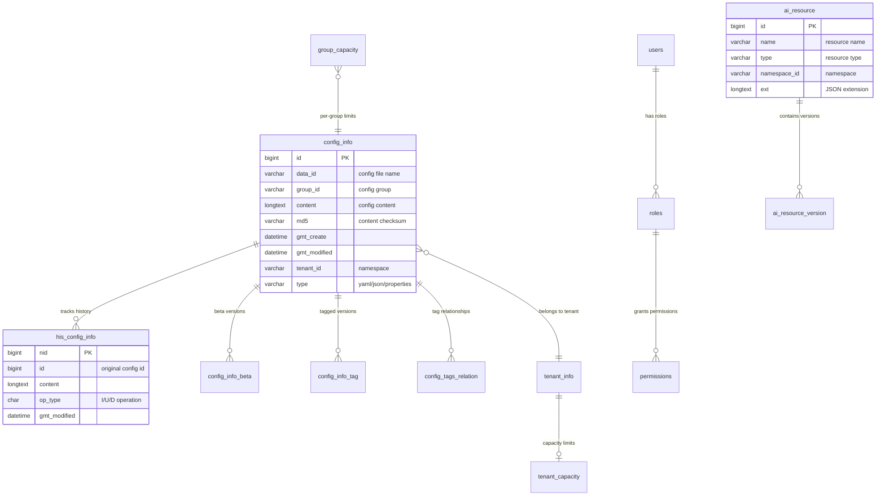
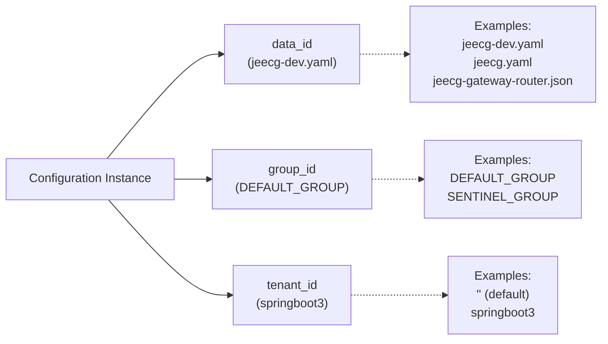
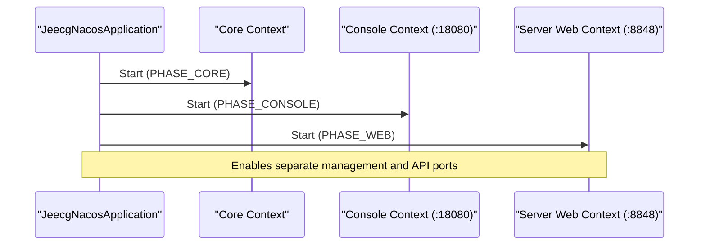

<!-- source: DeepWiki mcp.deepwiki.com · repo jeecgboot/JeecgBoot · page 4.5 Nacos Configuration Database · fetched 2026-10-29 -->

# Nacos Configuration Database

<details>
<summary>Relevant source files</summary>

The following files were used as context for generating this wiki page:

- [jeecg-boot/db/tables_nacos.sql](jeecg-boot/db/tables_nacos.sql)
- [jeecg-boot/jeecg-server-cloud/jeecg-cloud-gateway/src/main/resources/application.yml](jeecg-boot/jeecg-server-cloud/jeecg-cloud-gateway/src/main/resources/application.yml)
- [jeecg-boot/jeecg-server-cloud/jeecg-cloud-nacos/docs/DEFAULT_GROUP/jeecg-dev-satoken.yaml](jeecg-boot/jeecg-server-cloud/jeecg-cloud-nacos/docs/DEFAULT_GROUP/jeecg-dev-satoken.yaml)
- [jeecg-boot/jeecg-server-cloud/jeecg-cloud-nacos/docs/DEFAULT_GROUP/jeecg-dev.yaml](jeecg-boot/jeecg-server-cloud/jeecg-cloud-nacos/docs/DEFAULT_GROUP/jeecg-dev.yaml)
- [jeecg-boot/jeecg-server-cloud/jeecg-cloud-nacos/docs/DEFAULT_GROUP/jeecg-gateway-router.json](jeecg-boot/jeecg-server-cloud/jeecg-cloud-nacos/docs/DEFAULT_GROUP/jeecg-gateway-router.json)
- [jeecg-boot/jeecg-server-cloud/jeecg-cloud-nacos/docs/DEFAULT_GROUP/jeecg-gateway.yaml](jeecg-boot/jeecg-server-cloud/jeecg-cloud-nacos/docs/DEFAULT_GROUP/jeecg-gateway.yaml)
- [jeecg-boot/jeecg-server-cloud/jeecg-cloud-nacos/docs/DEFAULT_GROUP/jeecg.yaml](jeecg-boot/jeecg-server-cloud/jeecg-cloud-nacos/docs/DEFAULT_GROUP/jeecg.yaml)
- [jeecg-boot/jeecg-server-cloud/jeecg-cloud-nacos/docs/DEFAULT_GROUP/sharding.yaml](jeecg-boot/jeecg-server-cloud/jeecg-cloud-nacos/docs/DEFAULT_GROUP/sharding.yaml)
- [jeecg-boot/jeecg-server-cloud/jeecg-cloud-nacos/pom.xml](jeecg-boot/jeecg-server-cloud/jeecg-cloud-nacos/pom.xml)
- [jeecg-boot/jeecg-server-cloud/jeecg-cloud-nacos/src/main/java/com/alibaba/nacos/JeecgNacosApplication.java](jeecg-boot/jeecg-server-cloud/jeecg-cloud-nacos/src/main/java/com/alibaba/nacos/JeecgNacosApplication.java)

</details>


This document describes the database schema and data model used by Nacos to store configuration data, service metadata, and access control information in JeecgBoot's microservices deployment. For information about how services connect to and use Nacos for service discovery, see [Service Discovery & Configuration (Nacos)](#2.4.1). For general microservices architecture concepts, see [Microservices Architecture](#2.4).

## Purpose and Scope

The Nacos configuration database is a dedicated MySQL database that serves as the persistent storage layer for Nacos Server in microservices mode. It stores:

- Application configuration files (YAML, JSON, properties)
- Historical configuration versions and audit trails
- Tenant and namespace isolation metadata
- User authentication credentials and role-based access control
- Configuration group and capacity management
- AI Resource metadata and versioning (Nacos 3.x specific extensions)

This database is only used in microservices deployments. Monolithic deployments do not require Nacos.

**Sources:** [jeecg-boot/db/tables_nacos.sql:1-357](), [jeecg-boot/jeecg-server-cloud/jeecg-cloud-nacos/src/main/java/com/alibaba/nacos/JeecgNacosApplication.java:21-59]()

## Database Schema Overview

The Nacos database consists of 15 tables organized into functional categories: configuration management, multi-tenancy, access control, capacity management, and AI resource management.



**Sources:** [jeecg-boot/db/tables_nacos.sql:24-357]()

## Core Configuration Tables

### config_info Table

The `config_info` table is the primary storage for all configuration data. Each row represents a unique configuration file identified by the combination of `data_id`, `group_id`, and `tenant_id`.

| Column | Type | Purpose |
|--------|------|---------|
| `id` | bigint(20) | Auto-increment primary key |
| `data_id` | varchar(255) | Configuration file identifier (e.g., "jeecg-dev.yaml") |
| `group_id` | varchar(128) | Configuration group (e.g., "DEFAULT_GROUP") |
| `content` | longtext | Full configuration content in YAML/JSON/properties format |
| `md5` | varchar(32) | MD5 checksum for change detection |
| `tenant_id` | varchar(128) | Namespace/tenant identifier for isolation |
| `type` | varchar(64) | Content type: "yaml", "json", "properties", etc. |
| `encrypted_data_key` | varchar(1024) | Key for encrypted configurations |

**Unique Index:** `uk_configinfo_datagrouptenant(data_id, group_id, tenant_id)` ensures no duplicate configurations per tenant.

**Sources:** [jeecg-boot/db/tables_nacos.sql:85-108]()

### his_config_info Table

The `his_config_info` table maintains a complete audit trail of all configuration changes. Every insert, update, or delete operation on `config_info` creates a historical record.

| Column | Type | Purpose |
|--------|------|---------|
| `nid` | bigint(20) | Auto-increment primary key for history records |
| `id` | bigint(20) | Original config_info.id |
| `op_type` | char(10) | Operation type: "I" (insert), "U" (update), "D" (delete) |
| `src_user` | text | User who made the change |
| `src_ip` | varchar(50) | Source IP address |

**Sources:** [jeecg-boot/db/tables_nacos.sql:255-275]()

## AI Resource Management

Nacos 3.x in JeecgBoot includes specialized tables for managing AI-related metadata, such as model definitions or prompt templates, integrated into the Nacos namespace system.

### ai_resource Table

Stores high-level metadata for AI resources.

| Column | Type | Purpose |
|--------|------|---------|
| `id` | bigint(20) | PK |
| `name` | varchar(256) | Resource name |
| `type` | varchar(32) | Resource type |
| `namespace_id` | varchar(128) | Nacos namespace isolation |
| `scope` | varchar(16) | Visibility: PUBLIC/PRIVATE |

**Sources:** [jeecg-boot/db/tables_nacos.sql:26-49]()

### ai_resource_version Table

Manages the specific versions and storage locations for AI resources.

| Column | Type | Purpose |
|--------|------|---------|
| `version` | varchar(64) | Version identifier |
| `storage` | longtext | Storage information (JSON) |
| `status` | varchar(32) | Version status |

**Sources:** [jeecg-boot/db/tables_nacos.sql:58-78]()

## Configuration Data Model

### Configuration Identification

Each configuration in Nacos is uniquely identified by a coordinate system:



**Sources:** [jeecg-boot/db/tables_nacos.sql:107](), [jeecg-boot/jeecg-server-cloud/jeecg-cloud-gateway/src/main/resources/application.yml:65]()

### JeecgBoot Configuration Files

The Nacos database stores several configuration files used by JeecgBoot microservices:

| data_id | group_id | Purpose |
|---------|----------|---------|
| `jeecg-dev.yaml` | DEFAULT_GROUP | Main development settings: datasource, Redis, RabbitMQ [jeecg-boot/jeecg-server-cloud/jeecg-cloud-nacos/docs/DEFAULT_GROUP/jeecg-dev.yaml:1-168]() |
| `jeecg.yaml` | DEFAULT_GROUP | Shared settings: server configuration, MyBatis Plus, LiteFlow [jeecg-boot/jeecg-server-cloud/jeecg-cloud-nacos/docs/DEFAULT_GROUP/jeecg.yaml:1-119]() |
| `jeecg-gateway.yaml` | DEFAULT_GROUP | Gateway specific settings [jeecg-boot/jeecg-server-cloud/jeecg-cloud-nacos/docs/DEFAULT_GROUP/jeecg-gateway.yaml:1-15]() |
| `jeecg-gateway-router.json` | DEFAULT_GROUP | Gateway routing rules [jeecg-boot/jeecg-server-cloud/jeecg-cloud-nacos/docs/DEFAULT_GROUP/jeecg-gateway-router.json:1-55]() |
| `sharding.yaml` | DEFAULT_GROUP | ShardingSphere JDBC configuration [jeecg-boot/jeecg-server-cloud/jeecg-cloud-nacos/docs/DEFAULT_GROUP/sharding.yaml:1-37]() |
| `jeecg-gateway-flow-rules` | SENTINEL_GROUP | Sentinel flow control rules [jeecg-boot/jeecg-server-cloud/jeecg-cloud-gateway/src/main/resources/application.yml:63-65]() |

## Multi-Tenancy and Namespace Isolation

### tenant_info Table

The `tenant_info` table stores namespace metadata used to isolate environments (e.g., dev, test, prod).

| Column | Type | Purpose |
|--------|------|---------|
| `tenant_id` | varchar(128) | Unique namespace identifier |
| `tenant_name` | varchar(128) | Human-readable name |
| `tenant_desc` | varchar(256) | Description |

**Sources:** [jeecg-boot/db/tables_nacos.sql:380-398]()

## Access Control and Security

### User Authentication

The `users` table stores authentication credentials. Nacos 3.x uses bcrypt password hashing.

```sql
CREATE TABLE `users` (
  `username` varchar(50) NOT NULL,
  `password` varchar(500) NOT NULL,
  `enabled` tinyint(1) NOT NULL,
  PRIMARY KEY (`username`)
);
```

**Sources:** [jeecg-boot/db/tables_nacos.sql:403-408]()

### Role-Based Access Control

The `roles` table assigns roles to users, while `permissions` defines the resource access.

```sql
INSERT INTO `roles` VALUES ('nacos', 'ROLE_ADMIN');
```

**Sources:** [jeecg-boot/db/tables_nacos.sql:410-415, 417-423]()

## Capacity Management

Nacos enforces quotas to prevent resource exhaustion via `group_capacity` and `tenant_capacity`.

| Table | Purpose |
|-------|---------|
| `group_capacity` | Limits configs per group, max size, and history count [jeecg-boot/db/tables_nacos.sql:232-246]() |
| `tenant_capacity` | Limits configs per tenant/namespace [jeecg-boot/db/tables_nacos.sql:357-371]() |

## Integration with JeecgBoot Microservices

### Nacos 3.x Application Startup

The `JeecgNacosApplication` uses a three-phase startup sequence to ensure the console and server contexts are properly initialized.



**Sources:** [jeecg-boot/jeecg-server-cloud/jeecg-cloud-nacos/src/main/java/com/alibaba/nacos/JeecgNacosApplication.java:31-48]()

### Gateway Configuration Loading

The `jeecg-cloud-gateway` module imports its configuration from Nacos using the `${spring.application.name}.yaml` pattern.

```yaml
spring:
  config:
    import:
      - optional:nacos:${spring.application.name}.yaml
  cloud:
    nacos:
      config:
        server-addr: @config.server-addr@
        namespace: @config.namespace@
```

**Sources:** [jeecg-boot/jeecg-server-cloud/jeecg-cloud-gateway/src/main/resources/application.yml:13-21]()

### ShardingSphere Nacos Integration

JeecgBoot supports loading sharding rules dynamically from Nacos via a specific JDBC URL format.

```yaml
# Example from jeecg-dev.yaml
sharding-db:
  driver-class-name: org.apache.shardingsphere.driver.ShardingSphereDriver
  url: jdbc:shardingsphere:nacos:sharding.yaml?serverAddr=${spring.cloud.nacos.config.server-addr}...
```

**Sources:** [jeecg-boot/jeecg-server-cloud/jeecg-cloud-nacos/docs/DEFAULT_GROUP/jeecg-dev.yaml:37-39]()

---

