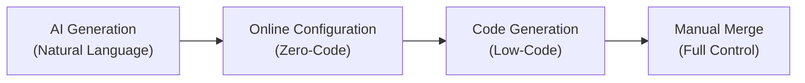
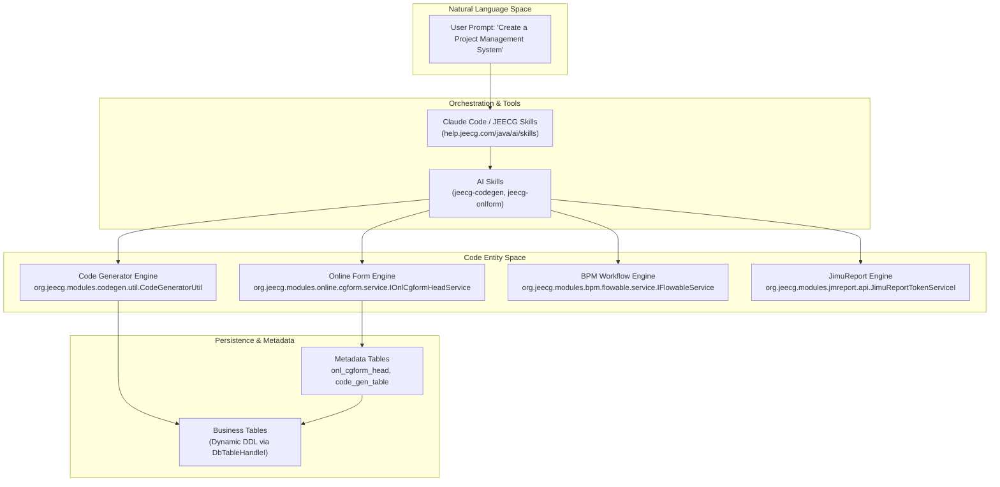

<!-- source: DeepWiki mcp.deepwiki.com · repo jeecgboot/JeecgBoot · page 5 Low-Code Development Platform · fetched 2026-10-29 -->

# Low-Code Development Platform

Relevant source files

The following files were used as context for generating this wiki page:

- [README-AI.md](README-AI.md)
- [README.en-US.md](README.en-US.md)
- [README.ja-JP.md](README.ja-JP.md)
- [README.md](README.md)
- [jeecg-boot/CLAUDE.md](jeecg-boot/CLAUDE.md)
- [jeecg-boot/README.md](jeecg-boot/README.md)
- [jeecg-boot/jeecg-module-system/jeecg-system-biz/src/main/resources/jeecg/code-template-online/default/one/java/${bussiPackage}/${entityPackage}/vue3/${entityName}List.vuei](jeecg-boot/jeecg-module-system/jeecg-system-biz/src/main/resources/jeecg/code-template-online/default/one/java/${bussiPackage}/${entityPackage}/vue3/${entityName}List.vuei)
- [jeecg-boot/jeecg-module-system/jeecg-system-biz/src/main/resources/jeecg/code-template-online/default/one/java/${bussiPackage}/${entityPackage}/vue3Native/${entityName}List.vuei](jeecg-boot/jeecg-module-system/jeecg-system-biz/src/main/resources/jeecg/code-template-online/default/one/java/${bussiPackage}/${entityPackage}/vue3Native/${entityName}List.vuei)
- [jeecg-boot/jeecg-module-system/jeecg-system-biz/src/main/resources/jeecg/code-template-online/default/tree/java/${bussiPackage}/${entityPackage}/vue3/${entityName}List.vuei](jeecg-boot/jeecg-module-system/jeecg-system-biz/src/main/resources/jeecg/code-template-online/default/tree/java/${bussiPackage}/${entityPackage}/vue3/${entityName}List.vuei)
- [jeecg-boot/jeecg-module-system/jeecg-system-biz/src/main/resources/jeecg/code-template-online/default/tree/java/${bussiPackage}/${entityPackage}/vue3Native/${entityName}List.vuei](jeecg-boot/jeecg-module-system/jeecg-system-biz/src/main/resources/jeecg/code-template-online/default/tree/java/${bussiPackage}/${entityPackage}/vue3Native/${entityName}List.vuei)
- [jeecg-boot/jeecg-module-system/jeecg-system-biz/src/main/resources/jeecg/code-template-online/erp/onetomany/java/${bussiPackage}/${entityPackage}/vue3/${entityName}List.vuei](jeecg-boot/jeecg-module-system/jeecg-system-biz/src/main/resources/jeecg/code-template-online/erp/onetomany/java/${bussiPackage}/${entityPackage}/vue3/${entityName}List.vuei)
- [jeecg-boot/jeecg-module-system/jeecg-system-biz/src/main/resources/jeecg/code-template-online/erp/onetomany/java/${bussiPackage}/${entityPackage}/vue3Native/${entityName}List.vuei](jeecg-boot/jeecg-module-system/jeecg-system-biz/src/main/resources/jeecg/code-template-online/erp/onetomany/java/${bussiPackage}/${entityPackage}/vue3Native/${entityName}List.vuei)
- [jeecg-boot/jeecg-module-system/jeecg-system-biz/src/main/resources/jeecg/code-template-online/inner-table/onetomany/java/${bussiPackage}/${entityPackage}/vue3/${entityName}List.vuei](jeecg-boot/jeecg-module-system/jeecg-system-biz/src/main/resources/jeecg/code-template-online/inner-table/onetomany/java/${bussiPackage}/${entityPackage}/vue3/${entityName}List.vuei)
- [jeecg-boot/jeecg-module-system/jeecg-system-biz/src/main/resources/jeecg/code-template-online/jvxe/onetomany/java/${bussiPackage}/${entityPackage}/vue3/${entityName}List.vuei](jeecg-boot/jeecg-module-system/jeecg-system-biz/src/main/resources/jeecg/code-template-online/jvxe/onetomany/java/${bussiPackage}/${entityPackage}/vue3/${entityName}List.vuei)
- [jeecg-boot/jeecg-module-system/jeecg-system-biz/src/main/resources/jeecg/code-template-online/jvxe/onetomany/java/${bussiPackage}/${entityPackage}/vue3Native/${entityName}List.vuei](jeecg-boot/jeecg-module-system/jeecg-system-biz/src/main/resources/jeecg/code-template-online/jvxe/onetomany/java/${bussiPackage}/${entityPackage}/vue3Native/${entityName}List.vuei)
- [jeecg-boot/jeecg-module-system/jeecg-system-biz/src/main/resources/jeecg/code-template-online/tab/onetomany/java/${bussiPackage}/${entityPackage}/vue3/${entityName}List.vuei](jeecg-boot/jeecg-module-system/jeecg-system-biz/src/main/resources/jeecg/code-template-online/tab/onetomany/java/${bussiPackage}/${entityPackage}/vue3/${entityName}List.vuei)
- [jeecgboot-vue3/README.md](jeecgboot-vue3/README.md)

This page provides a high-level overview of JeecgBoot's low-code and zero-code development capabilities. JeecgBoot implements a "Low-Code + Zero-Code" dual-mode drive, allowing developers to use low-code tools for complex logic while business users can build simple applications without programming.

## Development Philosophy

JeecgBoot follows a unique **four-stage development paradigm** designed to solve 80% of repetitive work in Java projects while maintaining 100% flexibility for complex requirements.

| Mode | Capability | Target User | Code Involvement |
| :--- | :--- | :--- | :--- |
| **Zero-Code** | Online Form, Report, and Dashboard configuration | Business Analyst | None |
| **Low-Code** | Code generation based on database metadata | Developer | Manual Merge |
| **AI-Assisted** | Natural language to system generation | All Users | None (Generative) |

**Sources:** [README.md:24-27](), [README.md:45-45](), [README.en-US.md:38-43]()

---

## Core Components

The platform consists of several integrated designers and engines that map Natural Language requirements to Code Entities.

### System Mapping: Natural Language to Code Entity Space

**Sources:** [README.md:53-58](), [jeecg-boot/README.md:56-67](), [README.en-US.md:24-30]()

---

## Sub-Topic Overviews

### 5.1 Code Generator
The `jeecg-codegen` skill and the built-in generator provide one-click CRUD generation. It supports four template styles (Single Table, Tree, One-to-Many, One-to-One) and generates complete SpringBoot backend and Vue3 frontend code.
For details, see [Code Generator](#5.1).

**Sources:** [README.md:140-141](), [jeecg-boot/README.md:63-63]()

### 5.2 OnlineCoding (Zero-Code Development)
The OnlineCoding platform allows for rapid building of business systems without writing code. By configuring metadata in the `onl_cgform_head` and `onl_cgform_field` tables, the system dynamically renders UI and handles database DDL.
For details, see [OnlineCoding (Zero-Code Development)](#5.2).

**Sources:** [README.md:143-145](), [jeecg-boot/README.md:64-64]()

### 5.3 AI-Assisted Development
JeecgBoot integrates LLMs (DeepSeek, ChatGPT, Ollama) to enable natural language programming. Users can generate entire systems, draw BPMN flows, and design reports through a single sentence.
For details, see [AI-Assisted Development](#5.3).

**Sources:** [README.md:6-10](), [README-AI.md:64-73](), [jeecg-boot/README.md:29-33]()

### 5.4 Form Designer & Validation
A visual "所见即所得" (What You See Is What You Get) designer supporting 23 types of controls. It handles automatic validation rules and dynamic field configurations stored as JSON metadata.
For details, see [Form Designer & Validation](#5.4).

**Sources:** [README.md:143-143](), [jeecg-boot/README.md:66-66]()

### 5.5 Report & Dashboard Designer
Integrates `JimuReport` for complex enterprise web reports and `JimuBI` for interactive dashboards and "Large Screens" (Big Screens). It supports drag-and-drop design with multiple data source connections.
For details, see [Report & Dashboard Designer](#5.5).

**Sources:** [README.md:39-42](), [README.md:142-142](), [jeecg-boot/README.md:25-25]()

### 5.6 BPM Workflow & Process Designer
Utilizes the Flowable BPM engine to implement business approvals. It features a loose coupling design between processes and forms, allowing developers to extend business logic via task interfaces.
For details, see [BPM Workflow & Process Designer](#5.6).

**Sources:** [README.md:47-48](), [jeecg-boot/README.md:33-33](), [jeecg-boot/README.md:67-67]()

---

## Technical Mapping: Platform to Implementation

| Platform Capability | Backend Implementation | Frontend Component |
| :--- | :--- | :--- |
| **Online Forms** | `org.jeecg.modules.online.cgform` | `OnlineForm.vue` |
| **Code Generation** | `org.jeecg.modules.codegen` | `CodeGenList.vue` |
| **BPM Workflow** | `org.jeecg.modules.bpm` | `ProcessDesigner.vue` |
| **AI Skills** | `org.jeecg.modules.airag` | `AiChat.vue` |
| **Reporting** | `org.jeecg.modules.jmreport` | `JimuReport` (External) |

**Sources:** [jeecg-boot/CLAUDE.md:56-65](), [jeecg-boot/README.md:86-89]()

---

