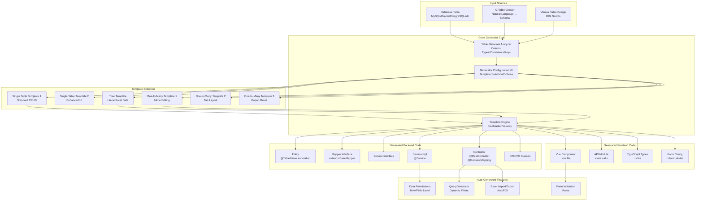
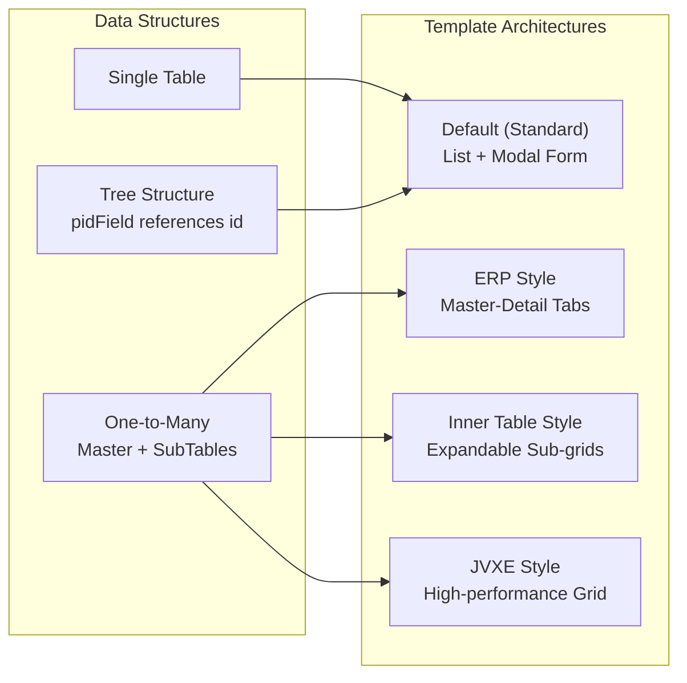
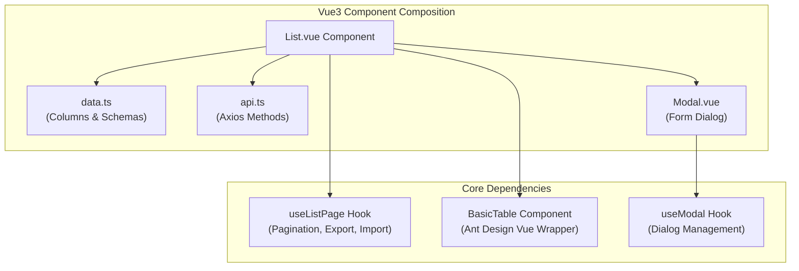

<!-- source: DeepWiki mcp.deepwiki.com · repo jeecgboot/JeecgBoot · page 5.1 Code Generator · fetched 2026-10-29 -->

# Code Generator

Relevant source files

The following files were used as context for generating this wiki page:

- [jeecg-boot/jeecg-module-system/jeecg-system-biz/src/main/resources/jeecg/code-template-online/common/form/native/vue3NativeImport.ftl](jeecg-boot/jeecg-module-system/jeecg-system-biz/src/main/resources/jeecg/code-template-online/common/form/native/vue3NativeImport.ftl)
- [jeecg-boot/jeecg-module-system/jeecg-system-biz/src/main/resources/jeecg/code-template-online/common/form/native/vue3NativeSearch.ftl](jeecg-boot/jeecg-module-system/jeecg-system-biz/src/main/resources/jeecg/code-template-online/common/form/native/vue3NativeSearch.ftl)
- [jeecg-boot/jeecg-module-system/jeecg-system-biz/src/main/resources/jeecg/code-template-online/common/utils.ftl](jeecg-boot/jeecg-module-system/jeecg-system-biz/src/main/resources/jeecg/code-template-online/common/utils.ftl)
- [jeecg-boot/jeecg-module-system/jeecg-system-biz/src/main/resources/jeecg/code-template-online/default/one/java/${bussiPackage}/${entityPackage}/vue3/${entityName}List.vuei](jeecg-boot/jeecg-module-system/jeecg-system-biz/src/main/resources/jeecg/code-template-online/default/one/java/${bussiPackage}/${entityPackage}/vue3/${entityName}List.vuei)
- [jeecg-boot/jeecg-module-system/jeecg-system-biz/src/main/resources/jeecg/code-template-online/default/one/java/${bussiPackage}/${entityPackage}/vue3/${entityName}__data.tsi](jeecg-boot/jeecg-module-system/jeecg-system-biz/src/main/resources/jeecg/code-template-online/default/one/java/${bussiPackage}/${entityPackage}/vue3/${entityName}__data.tsi)
- [jeecg-boot/jeecg-module-system/jeecg-system-biz/src/main/resources/jeecg/code-template-online/default/one/java/${bussiPackage}/${entityPackage}/vue3/components/${entityName}Modal.vuei](jeecg-boot/jeecg-module-system/jeecg-system-biz/src/main/resources/jeecg/code-template-online/default/one/java/${bussiPackage}/${entityPackage}/vue3/components/${entityName}Modal.vuei)
- [jeecg-boot/jeecg-module-system/jeecg-system-biz/src/main/resources/jeecg/code-template-online/default/one/java/${bussiPackage}/${entityPackage}/vue3Native/${entityName}List.vuei](jeecg-boot/jeecg-module-system/jeecg-system-biz/src/main/resources/jeecg/code-template-online/default/one/java/${bussiPackage}/${entityPackage}/vue3Native/${entityName}List.vuei)
- [jeecg-boot/jeecg-module-system/jeecg-system-biz/src/main/resources/jeecg/code-template-online/default/tree/java/${bussiPackage}/${entityPackage}/vue3/${entityName}List.vuei](jeecg-boot/jeecg-module-system/jeecg-system-biz/src/main/resources/jeecg/code-template-online/default/tree/java/${bussiPackage}/${entityPackage}/vue3/${entityName}List.vuei)
- [jeecg-boot/jeecg-module-system/jeecg-system-biz/src/main/resources/jeecg/code-template-online/default/tree/java/${bussiPackage}/${entityPackage}/vue3/${entityName}__data.tsi](jeecg-boot/jeecg-module-system/jeecg-system-biz/src/main/resources/jeecg/code-template-online/default/tree/java/${bussiPackage}/${entityPackage}/vue3/${entityName}__data.tsi)
- [jeecg-boot/jeecg-module-system/jeecg-system-biz/src/main/resources/jeecg/code-template-online/default/tree/java/${bussiPackage}/${entityPackage}/vue3/components/${entityName}Modal.vuei](jeecg-boot/jeecg-module-system/jeecg-system-biz/src/main/resources/jeecg/code-template-online/default/tree/java/${bussiPackage}/${entityPackage}/vue3/components/${entityName}Modal.vuei)
- [jeecg-boot/jeecg-module-system/jeecg-system-biz/src/main/resources/jeecg/code-template-online/default/tree/java/${bussiPackage}/${entityPackage}/vue3Native/${entityName}List.vuei](jeecg-boot/jeecg-module-system/jeecg-system-biz/src/main/resources/jeecg/code-template-online/default/tree/java/${bussiPackage}/${entityPackage}/vue3Native/${entityName}List.vuei)
- [jeecg-boot/jeecg-module-system/jeecg-system-biz/src/main/resources/jeecg/code-template-online/erp/onetomany/java/${bussiPackage}/${entityPackage}/vue3/${entityName}List.vuei](jeecg-boot/jeecg-module-system/jeecg-system-biz/src/main/resources/jeecg/code-template-online/erp/onetomany/java/${bussiPackage}/${entityPackage}/vue3/${entityName}List.vuei)
- [jeecg-boot/jeecg-module-system/jeecg-system-biz/src/main/resources/jeecg/code-template-online/erp/onetomany/java/${bussiPackage}/${entityPackage}/vue3/${entityName}__data.tsi](jeecg-boot/jeecg-module-system/jeecg-system-biz/src/main/resources/jeecg/code-template-online/erp/onetomany/java/${bussiPackage}/${entityPackage}/vue3/${entityName}__data.tsi)
- [jeecg-boot/jeecg-module-system/jeecg-system-biz/src/main/resources/jeecg/code-template-online/erp/onetomany/java/${bussiPackage}/${entityPackage}/vue3/components/${entityName}Modal.vuei](jeecg-boot/jeecg-module-system/jeecg-system-biz/src/main/resources/jeecg/code-template-online/erp/onetomany/java/${bussiPackage}/${entityPackage}/vue3/components/${entityName}Modal.vuei)
- [jeecg-boot/jeecg-module-system/jeecg-system-biz/src/main/resources/jeecg/code-template-online/erp/onetomany/java/${bussiPackage}/${entityPackage}/vue3Native/${entityName}List.vuei](jeecg-boot/jeecg-module-system/jeecg-system-biz/src/main/resources/jeecg/code-template-online/erp/onetomany/java/${bussiPackage}/${entityPackage}/vue3Native/${entityName}List.vuei)
- [jeecg-boot/jeecg-module-system/jeecg-system-biz/src/main/resources/jeecg/code-template-online/inner-table/onetomany/java/${bussiPackage}/${entityPackage}/vue3/${entityName}List.vuei](jeecg-boot/jeecg-module-system/jeecg-system-biz/src/main/resources/jeecg/code-template-online/inner-table/onetomany/java/${bussiPackage}/${entityPackage}/vue3/${entityName}List.vuei)
- [jeecg-boot/jeecg-module-system/jeecg-system-biz/src/main/resources/jeecg/code-template-online/inner-table/onetomany/java/${bussiPackage}/${entityPackage}/vue3/${entityName}__data.tsi](jeecg-boot/jeecg-module-system/jeecg-system-biz/src/main/resources/jeecg/code-template-online/inner-table/onetomany/java/${bussiPackage}/${entityPackage}/vue3/${entityName}__data.tsi)
- [jeecg-boot/jeecg-module-system/jeecg-system-biz/src/main/resources/jeecg/code-template-online/inner-table/onetomany/java/${bussiPackage}/${entityPackage}/vue3/components/${entityName}Modal.vuei](jeecg-boot/jeecg-module-system/jeecg-system-biz/src/main/resources/jeecg/code-template-online/inner-table/onetomany/java/${bussiPackage}/${entityPackage}/vue3/components/${entityName}Modal.vuei)
- [jeecg-boot/jeecg-module-system/jeecg-system-biz/src/main/resources/jeecg/code-template-online/jvxe/onetomany/java/${bussiPackage}/${entityPackage}/vue3/${entityName}List.vuei](jeecg-boot/jeecg-module-system/jeecg-system-biz/src/main/resources/jeecg/code-template-online/jvxe/onetomany/java/${bussiPackage}/${entityPackage}/vue3/${entityName}List.vuei)
- [jeecg-boot/jeecg-module-system/jeecg-system-biz/src/main/resources/jeecg/code-template-online/jvxe/onetomany/java/${bussiPackage}/${entityPackage}/vue3/${entityName}__data.tsi](jeecg-boot/jeecg-module-system/jeecg-system-biz/src/main/resources/jeecg/code-template-online/jvxe/onetomany/java/${bussiPackage}/${entityPackage}/vue3/${entityName}__data.tsi)
- [jeecg-boot/jeecg-module-system/jeecg-system-biz/src/main/resources/jeecg/code-template-online/jvxe/onetomany/java/${bussiPackage}/${entityPackage}/vue3/components/${entityName}Modal.vuei](jeecg-boot/jeecg-module-system/jeecg-system-biz/src/main/resources/jeecg/code-template-online/jvxe/onetomany/java/${bussiPackage}/${entityPackage}/vue3/components/${entityName}Modal.vuei)
- [jeecg-boot/jeecg-module-system/jeecg-system-biz/src/main/resources/jeecg/code-template-online/jvxe/onetomany/java/${bussiPackage}/${entityPackage}/vue3Native/${entityName}List.vuei](jeecg-boot/jeecg-module-system/jeecg-system-biz/src/main/resources/jeecg/code-template-online/jvxe/onetomany/java/${bussiPackage}/${entityPackage}/vue3Native/${entityName}List.vuei)
- [jeecg-boot/jeecg-module-system/jeecg-system-biz/src/main/resources/jeecg/code-template-online/tab/onetomany/java/${bussiPackage}/${entityPackage}/vue3/${entityName}List.vuei](jeecg-boot/jeecg-module-system/jeecg-system-biz/src/main/resources/jeecg/code-template-online/tab/onetomany/java/${bussiPackage}/${entityPackage}/vue3/${entityName}List.vuei)
- [jeecg-boot/jeecg-module-system/jeecg-system-biz/src/main/resources/jeecg/code-template-online/tab/onetomany/java/${bussiPackage}/${entityPackage}/vue3/${entityName}__data.tsi](jeecg-boot/jeecg-module-system/jeecg-system-biz/src/main/resources/jeecg/code-template-online/tab/onetomany/java/${bussiPackage}/${entityPackage}/vue3/${entityName}__data.tsi)
- [jeecg-boot/jeecg-module-system/jeecg-system-biz/src/main/resources/jeecg/code-template-online/tab/onetomany/java/${bussiPackage}/${entityPackage}/vue3/components/${entityName}Modal.vuei](jeecg-boot/jeecg-module-system/jeecg-system-biz/src/main/resources/jeecg/code-template-online/tab/onetomany/java/${bussiPackage}/${entityPackage}/vue3/components/${entityName}Modal.vuei)

## Purpose and Scope

The Code Generator is JeecgBoot's core low-code development tool that automatically generates complete, production-ready front-end and back-end code from database table definitions. Unlike OnlineCoding (see [5.2]()) which provides zero-code runtime configuration, the Code Generator produces actual source code files that can be customized, version-controlled, and merged with hand-written logic.

The generator supports four primary data models: single table, tree structure, one-to-many relationships, and one-to-one relationships. It creates complete CRUD functionality including query filters, Excel import/export, form validation, and data permissions, reducing repetitive development work by approximately 70-80%.

For AI-assisted table creation and schema generation, see [5.3](). For form validation configuration, see [5.4]().

---

## Code Generation Workflow

The following diagram illustrates the end-to-end process from database table to deployable code artifacts:

**Workflow Stages:**

1. **Table Source Selection**: Database tables can originate from existing databases, AI-generated schemas, or manual DDL scripts.
2. **Metadata Analysis**: The generator analyzes table structure including columns, data types, primary keys, foreign keys, and constraints.
3. **Template Configuration**: Developer selects data model type and template style through the configuration UI.
4. **Code Generation**: Template engine processes templates with table metadata to produce code files.
5. **Feature Integration**: Generated code includes `QueryGenerator`, `AutoPOI`, validation rules, and permission controls.

Sources: [jeecg-boot/jeecg-module-system/jeecg-system-biz/src/main/resources/jeecg/code-template-online/common/utils.ftl:1-10](), [jeecg-boot/jeecg-module-system/jeecg-system-biz/src/main/resources/jeecg/code-template-online/default/one/java/${bussiPackage}/${entityPackage}/vue3/${entityName}List.vuei:1-100]()

---

## Template Types and Data Models

JeecgBoot provides **4 template categories** supporting different data model patterns. These templates are implemented as FreeMarker (`.ftl`) or `.vuei` files that ingest metadata variables like `tableVo` and `columns`.

### Template Overview Matrix

| Template Category | Data Model | Primary Use Case | Implementation File Examples |
|------------------|------------|------------------|------------------------------|
| **Single Table** | 1 table | Basic CRUD operations | `default/one/java/.../vue3/${entityName}List.vuei` |
| **Tree Structure** | 1 table with parent-child | Hierarchical data | `default/tree/java/.../vue3Native/${entityName}List.vuei` |
| **One-to-Many** | Main + detail tables | Master-detail relationships | `erp/onetomany/java/.../vue3/${entityName}List.vuei` |
| **Inner Table** | Nested detail table | Sub-grid display | `inner-table/onetomany/java/.../vue3/${entityName}List.vuei` |

### Template Logic Components

Templates use conditional logic to handle various field types and features:
*   **BPM Status**: Checked via `po.fieldDbName=='bpm_status'` to enable workflow integration [jeecg-boot/jeecg-module-system/jeecg-system-biz/src/main/resources/jeecg/code-template-online/inner-table/onetomany/java/${bussiPackage}/${entityPackage}/vue3/${entityName}List.vuei:15-17]().
*   **Query Modes**: Handles `group` (range) or `single` queries [jeecg-boot/jeecg-module-system/jeecg-system-biz/src/main/resources/jeecg/code-template-online/inner-table/onetomany/java/${bussiPackage}/${entityPackage}/vue3/${entityName}List.vuei:170-175]().
*   **Component Mapping**: Maps database `classType` (e.g., `pca`, `file`, `umeditor`) to specific UI components [jeecg-boot/jeecg-module-system/jeecg-system-biz/src/main/resources/jeecg/code-template-online/inner-table/onetomany/java/${bussiPackage}/${entityPackage}/vue3/${entityName}List.vuei:79-95]().

Sources: [jeecg-boot/jeecg-module-system/jeecg-system-biz/src/main/resources/jeecg/code-template-online/inner-table/onetomany/java/${bussiPackage}/${entityPackage}/vue3/${entityName}List.vuei:1-40](), [jeecg-boot/jeecg-module-system/jeecg-system-biz/src/main/resources/jeecg/code-template-online/default/one/java/${bussiPackage}/${entityPackage}/vue3Native/${entityName}List.vuei:4-30]()

---

## Generated Code Structure

The Code Generator produces a complete code package with consistent structure across backend and frontend layers.

### Frontend Component Logic

The generated Vue3 components utilize the `useListPage` hook and `BasicTable` for standardized list management:

**Key Frontend Files:**
1.  **List View**: Implements the main grid, search form, and action buttons [jeecg-boot/jeecg-module-system/jeecg-system-biz/src/main/resources/jeecg/code-template-online/inner-table/onetomany/java/${bussiPackage}/${entityPackage}/vue3/${entityName}List.vuei:3-106]().
2.  **Data Definition**: Exports `columns` and `searchFormSchema` [jeecg-boot/jeecg-module-system/jeecg-system-biz/src/main/resources/jeecg/code-template-online/inner-table/onetomany/java/${bussiPackage}/${entityPackage}/vue3/${entityName}__data.tsi:9-80]().
3.  **API Service**: Defines methods for `list`, `save`, `edit`, and `delete` [jeecg-boot/jeecg-module-system/jeecg-system-biz/src/main/resources/jeecg/code-template-online/inner-table/onetomany/java/${bussiPackage}/${entityPackage}/vue3/${entityName}List.vuei:119]().

Sources: [jeecg-boot/jeecg-module-system/jeecg-system-biz/src/main/resources/jeecg/code-template-online/inner-table/onetomany/java/${bussiPackage}/${entityPackage}/vue3/${entityName}List.vuei:108-150](), [jeecg-boot/jeecg-module-system/jeecg-system-biz/src/main/resources/jeecg/code-template-online/inner-table/onetomany/java/${bussiPackage}/${entityPackage}/vue3/${entityName}__data.tsi:1-80]()

---

## Query Filter Generation

The generator automatically builds a `searchFormSchema` that maps frontend input fields to backend `QueryGenerator` logic.

### Dynamic Query Mapping

| Component Type | Schema Component | Match Mode |
|----------------|------------------|------------|
| `sel_search` | `JSearchSelect` | Single/Like |
| `date` | `DatePicker` | Range (Group) |
| `pca` | `JAreaLinkage` | Exact |
| `list_multi` | `JSelectMultiple` | In |

For range queries (e.g., numbers or dates), the template generates `fieldMapToNumber` or `fieldMapToTime` configurations to split a single UI range picker into `_begin` and `_end` parameters [jeecg-boot/jeecg-module-system/jeecg-system-biz/src/main/resources/jeecg/code-template-online/inner-table/onetomany/java/${bussiPackage}/${entityPackage}/vue3/${entityName}List.vuei:167-185]().

Sources: [jeecg-boot/jeecg-module-system/jeecg-system-biz/src/main/resources/jeecg/code-template-online/inner-table/onetomany/java/${bussiPackage}/${entityPackage}/vue3/${entityName}__data.tsi:80-160](), [jeecg-boot/jeecg-module-system/jeecg-system-biz/src/main/resources/jeecg/code-template-online/inner-table/onetomany/java/${bussiPackage}/${entityPackage}/vue3/${entityName}List.vuei:156-175]()

---

## Excel Import/Export

Code generation includes one-click Excel integration using the `AutoPOI` framework.

*   **Export**: The `onExportXls` method is wired to the backend export endpoint [jeecg-boot/jeecg-module-system/jeecg-system-biz/src/main/resources/jeecg/code-template-online/inner-table/onetomany/java/${bussiPackage}/${entityPackage}/vue3/${entityName}List.vuei:45]().
*   **Import**: Uses the `j-upload-button` component which triggers `onImportXls` [jeecg-boot/jeecg-module-system/jeecg-system-biz/src/main/resources/jeecg/code-template-online/inner-table/onetomany/java/${bussiPackage}/${entityPackage}/vue3/${entityName}List.vuei:46]().

The template logic also includes `vue3NativeImport.ftl` for native-style import UI [jeecg-boot/jeecg-module-system/jeecg-system-biz/src/main/resources/jeecg/code-template-online/common/form/native/vue3NativeImport.ftl:1-10]().

Sources: [jeecg-boot/jeecg-module-system/jeecg-system-biz/src/main/resources/jeecg/code-template-online/inner-table/onetomany/java/${bussiPackage}/${entityPackage}/vue3/${entityName}List.vuei:43-50](), [jeecg-boot/jeecg-module-system/jeecg-system-biz/src/main/resources/jeecg/code-template-online/common/form/native/vue3NativeImport.ftl:1-5]()

---

## Advanced UI Features

### 1. One-to-Many Relationships
Templates like `inner-table` generate nested UI structures where sub-tables are rendered inside expanded rows [jeecg-boot/jeecg-module-system/jeecg-system-biz/src/main/resources/jeecg/code-template-online/inner-table/onetomany/java/${bussiPackage}/${entityPackage}/vue3/${entityName}List.vuei:31-41](). It iterates through `subTables` to create `a-tab-pane` elements [jeecg-boot/jeecg-module-system/jeecg-system-biz/src/main/resources/jeecg/code-template-online/inner-table/onetomany/java/${bussiPackage}/${entityPackage}/vue3/${entityName}List.vuei:34-38]().

### 2. Super Query
The `super-query` component is automatically included in the table title area, allowing users to build complex boolean query logic at runtime [jeecg-boot/jeecg-module-system/jeecg-system-biz/src/main/resources/jeecg/code-template-online/inner-table/onetomany/java/${bussiPackage}/${entityPackage}/vue3/${entityName}List.vuei:69]().

### 3. Action Buttons
Custom buttons configured in the Online form are dynamically rendered using the `buttonList` logic [jeecg-boot/jeecg-module-system/jeecg-system-biz/src/main/resources/jeecg/code-template-online/inner-table/onetomany/java/${bussiPackage}/${entityPackage}/vue3/${entityName}List.vuei:47-53]().

Sources: [jeecg-boot/jeecg-module-system/jeecg-system-biz/src/main/resources/jeecg/code-template-online/inner-table/onetomany/java/${bussiPackage}/${entityPackage}/vue3/${entityName}List.vuei:9-55](), [jeecg-boot/jeecg-module-system/jeecg-system-biz/src/main/resources/jeecg/code-template-online/inner-table/onetomany/java/${bussiPackage}/${entityPackage}/vue3/${entityName}List.vuei:30-41]()

---

