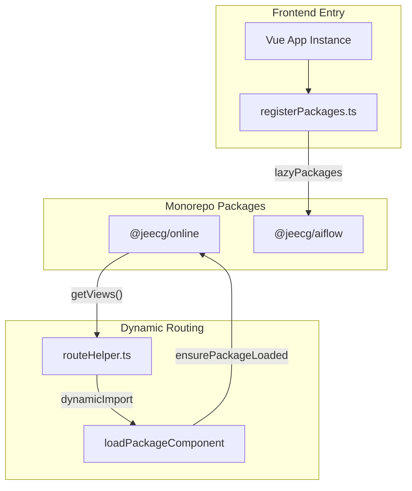
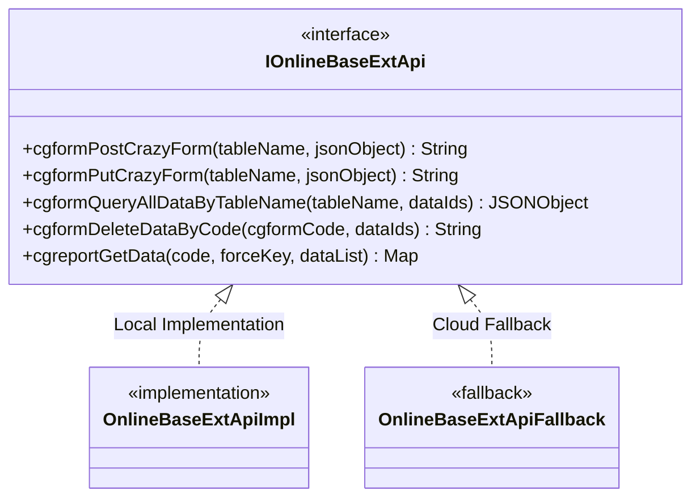

<!-- source: DeepWiki mcp.deepwiki.com · repo jeecgboot/JeecgBoot · page 5.2 OnlineCoding (Zero-Code Development) · fetched 2026-10-29 -->

# OnlineCoding (Zero-Code Development)

Relevant source files

The following files were used as context for generating this wiki page:

- [jeecg-boot/jeecg-module-system/jeecg-system-api/jeecg-system-cloud-api/src/main/java/org/jeecg/common/online/api/IOnlineBaseExtApi.java](jeecg-boot/jeecg-module-system/jeecg-system-api/jeecg-system-cloud-api/src/main/java/org/jeecg/common/online/api/IOnlineBaseExtApi.java)
- [jeecg-boot/jeecg-module-system/jeecg-system-api/jeecg-system-cloud-api/src/main/java/org/jeecg/common/online/api/factory/OnlineBaseExtApiFallbackFactory.java](jeecg-boot/jeecg-module-system/jeecg-system-api/jeecg-system-cloud-api/src/main/java/org/jeecg/common/online/api/factory/OnlineBaseExtApiFallbackFactory.java)
- [jeecg-boot/jeecg-module-system/jeecg-system-api/jeecg-system-cloud-api/src/main/java/org/jeecg/common/online/api/fallback/OnlineBaseExtApiFallback.java](jeecg-boot/jeecg-module-system/jeecg-system-api/jeecg-system-cloud-api/src/main/java/org/jeecg/common/online/api/fallback/OnlineBaseExtApiFallback.java)
- [jeecg-boot/jeecg-module-system/jeecg-system-api/jeecg-system-local-api/src/main/java/org/jeecg/common/online/api/IOnlineBaseExtApi.java](jeecg-boot/jeecg-module-system/jeecg-system-api/jeecg-system-local-api/src/main/java/org/jeecg/common/online/api/IOnlineBaseExtApi.java)
- [jeecgboot-vue3/build/vite/plugin/index.ts](jeecgboot-vue3/build/vite/plugin/index.ts)
- [jeecgboot-vue3/src/components/Form/index.ts](jeecgboot-vue3/src/components/Form/index.ts)
- [jeecgboot-vue3/src/components/Form/src/componentMap.ts](jeecgboot-vue3/src/components/Form/src/componentMap.ts)
- [jeecgboot-vue3/src/components/Form/src/hooks/useForm.ts](jeecgboot-vue3/src/components/Form/src/hooks/useForm.ts)
- [jeecgboot-vue3/src/components/Icon/src/Icon.vue](jeecgboot-vue3/src/components/Icon/src/Icon.vue)
- [jeecgboot-vue3/src/components/jeecg/JVxeTable/index.ts](jeecgboot-vue3/src/components/jeecg/JVxeTable/index.ts)
- [jeecgboot-vue3/src/components/jeecg/JVxeTable/useVxeTableRegister.ts](jeecgboot-vue3/src/components/jeecg/JVxeTable/useVxeTableRegister.ts)
- [jeecgboot-vue3/src/components/registerGlobComp.ts](jeecgboot-vue3/src/components/registerGlobComp.ts)
- [jeecgboot-vue3/src/router/helper/routeHelper.ts](jeecgboot-vue3/src/router/helper/routeHelper.ts)
- [jeecgboot-vue3/src/utils/dynamicPages.ts](jeecgboot-vue3/src/utils/dynamicPages.ts)
- [jeecgboot-vue3/src/utils/monorepo/registerPackages.ts](jeecgboot-vue3/src/utils/monorepo/registerPackages.ts)

## Purpose and Scope

This document describes the OnlineCoding module of JeecgBoot, which enables zero-code development for CRUD (Create, Read, Update, Delete) functions through online form configuration. OnlineCoding allows business users and developers to rapidly build functional data management interfaces without writing any code, using a visual configuration approach.

For information about generating complete application code with templates, see [Code Generator](#5.1). For AI-powered table and field creation, see [AI-Assisted Development](#5.3). For the underlying form design mechanism, see [Form Designer & Validation](#5.4).

**Sources:** [README.md:34-34](), [README.md:118-118](), [README.md:267-268]()

---

## Overview

OnlineCoding is JeecgBoot's flagship zero-code development capability. It requires no code writing or compilation—users configure forms, map database fields, and immediately have a working application with full CRUD operations, search capabilities, and data permissions.

**Key Characteristics:**

| Feature | Description |
|---------|-------------|
| **Zero Code** | No programming, SQL, or script writing required |
| **Immediate Deployment** | Changes take effect instantly without compilation or deployment |
| **Database Mapping** | Direct mapping to existing database tables or creation of new tables |
| **23 Control Types** | Rich set of form controls for different data types and use cases |
| **Multi-Model Support** | Single table, tree structure, one-to-many, and one-to-one relationships |

**Sources:** [README.md:22-26](), [README.md:34-34](), [README.md:118-119]()

---

## Technical Architecture & Implementation

The OnlineCoding system is implemented through a combination of a backend CGForm engine and a dynamic frontend rendering system.

### Dynamic Module Loading

In the Vue3 frontend, OnlineCoding components are registered as part of a monorepo structure. The `registerPackages` function manages the lazy loading of modules like `@jeecg/online` to optimize initial bundle size.

**Diagram: Frontend Package Registration and Dynamic Loading**

**Sources:** [jeecgboot-vue3/src/utils/monorepo/registerPackages.ts:1-28](), [jeecgboot-vue3/src/router/helper/routeHelper.ts:130-136]()

### Component Mapping and Rendering

OnlineCoding forms utilize a sophisticated `componentMap` to translate metadata field types into actual Vue components.

| Component Type | Source File |
| :--- | :--- |
| `JDictSelectTag` | [jeecgboot-vue3/src/components/Form/src/componentMap.ts:58-58]() |
| `JSearchSelect` | [jeecgboot-vue3/src/components/Form/src/componentMap.ts:85-85]() |
| `JUpload` | [jeecgboot-vue3/src/components/Form/src/componentMap.ts:84-84]() |
| `JEditor` | [jeecgboot-vue3/src/components/Form/src/componentMap.ts:63-63]() |
| `JVxeTable` | [jeecgboot-vue3/src/components/jeecg/JVxeTable/index.ts:4-17]() |

The `useForm` hook provides the operational methods for these dynamically generated forms, such as `validate`, `setFieldsValue`, and `getFieldsValue`.

**Sources:** [jeecgboot-vue3/src/components/Form/src/componentMap.ts:11-90](), [jeecgboot-vue3/src/components/Form/src/hooks/useForm.ts:49-145]()

---

## Backend Integration (Feign API)

The OnlineCoding module exposes several key APIs for external interaction and internal engine operations. In microservice mode, these are accessed via Feign clients.

**Diagram: Online API Structure**

The `IOnlineBaseExtApi` interface defines the core operations for "Crazy Forms" (dynamic forms) and report data retrieval.

**Sources:** [jeecg-boot/jeecg-module-system/jeecg-system-api/jeecg-system-cloud-api/src/main/java/org/jeecg/common/online/api/IOnlineBaseExtApi.java:25-89](), [jeecg-boot/jeecg-module-system/jeecg-system-api/jeecg-system-local-api/src/main/java/org/jeecg/common/online/api/IOnlineBaseExtApi.java:14-72]()

---

## Online Table Engine (CGForm)

### Data Models Supported

| Model Type | Description |
|------------|-------------|
| **Single Table** | Simple one-table CRUD operations. |
| **Tree Structure** | Hierarchical data with parent/child relationships. |
| **One-to-Many** | Master-detail relationship (e.g., Order and Items). |

### Table and Field Metadata

OnlineCoding stores configuration in `online_cgform_*` tables. The engine uses this metadata to:
1.  **Generate Physical Tables**: Execute `CREATE` or `ALTER` SQL statements.
2.  **Dynamic Querying**: The `QueryGenerator` utility translates form inputs into SQL `WHERE` clauses based on configured query modes (e.g., `LIKE`, `GE`, `LE`).

**Sources:** [README.md:115-116](), [README.md:133-133]()

---

## Comparison: OnlineCoding vs Code Generator

| Feature | OnlineCoding | Code Generator |
|---------|--------------|----------------|
| **Implementation** | Metadata-driven (Runtime) | Java/Vue Code Generation |
| **Deployment** | Instant | Requires Compilation |
| **Customization** | Via JS/Java Enhancements | Full Source Code Access |
| **Primary Use Case** | Standard CRUD, rapid prototyping | Complex business logic |

**Sources:** [README.md:25-25](), [README.md:34-34](), [README.md:115-117]()

---

## Enhancement and Customization

OnlineCoding provides two main hooks for extending zero-code functionality:

1.  **JavaScript Enhancement**: Client-side logic for form interactions (stored in `online_cgform_enhance_js`).
2.  **Java Enhancement**: Server-side business logic executed during the CRUD lifecycle (stored in `online_cgform_enhance_java`).

**Sources:** [README.md:120-120]()

---

