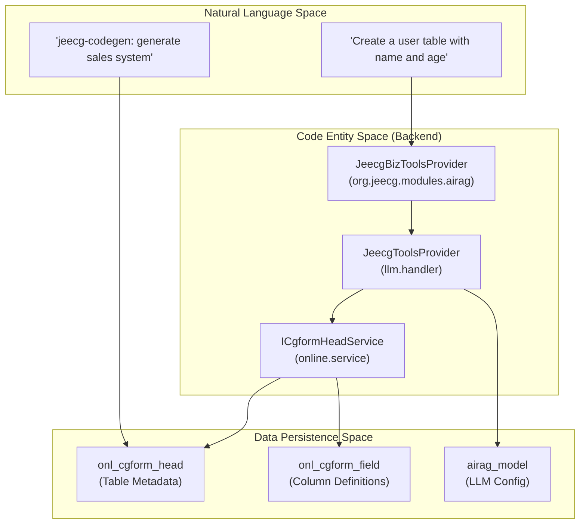
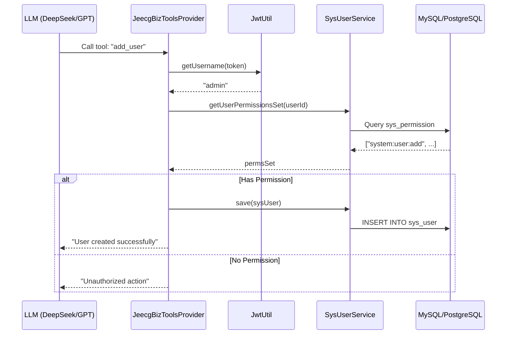

<!-- source: DeepWiki mcp.deepwiki.com · repo jeecgboot/JeecgBoot · page 5.3 AI-Assisted Development · fetched 2026-10-29 -->

# AI-Assisted Development

Relevant source files

The following files were used as context for generating this wiki page:

- [README-AI.md](README-AI.md)
- [README.en-US.md](README.en-US.md)
- [README.ja-JP.md](README.ja-JP.md)
- [README.md](README.md)
- [jeecg-boot/CLAUDE.md](jeecg-boot/CLAUDE.md)
- [jeecg-boot/README.md](jeecg-boot/README.md)
- [jeecg-boot/jeecg-module-system/jeecg-system-biz/src/main/java/org/jeecg/modules/airag/JeecgBizToolsProvider.java](jeecg-boot/jeecg-module-system/jeecg-system-biz/src/main/java/org/jeecg/modules/airag/JeecgBizToolsProvider.java)
- [jeecgboot-vue3/README.md](jeecgboot-vue3/README.md)

## Purpose and Scope

This document details the AI-powered development assistance features integrated into the JeecgBoot low-code platform. These features leverage Large Language Models (LLMs) to accelerate development tasks including:

- **AI Table Creation**: Natural language descriptions converted to database schemas and Online forms.
- **AI Form Field Suggestions**: Intelligent control type and validation rule recommendations.
- **AI Report Generation**: One-sentence generation of reports and big-screen dashboards.
- **Natural Language Programming (AI Skills)**: A comprehensive suite of capabilities (integrated with Claude Code) to generate full-stack CRUD code, BPMN flows, and complex forms from a single sentence.

The AI assistance layer integrates with the Code Generator ([5.1]()), OnlineCoding system ([5.2]()), and Form Designer ([5.4]()). The platform supports multiple LLM providers including DeepSeek (default), ChatGPT, Ollama for local deployment, and Chinese models (千问, 智谱).

**Sources:** [README.md:6-8](), [README.md:24-27](), [README.md:53-58](), [README-AI.md:1-8](), [jeecg-boot/README.md:27-30]()

---

## AI-Assisted Development Workflow

The AI assistance features integrate at multiple points in the low-code development lifecycle, transforming natural language descriptions into functional components.

### Natural Language to Code Entity Space Mapping

The following diagram bridges natural language inputs to the internal code entities and tables used by JeecgBoot.

**AI Entity Mapping**: Shows how user input is routed through the `JeecgBizToolsProvider` and `JeecgToolsProvider` to the Online coding services and metadata tables.

**Sources:** [jeecg-boot/jeecg-module-system/jeecg-system-biz/src/main/java/org/jeecg/modules/airag/JeecgBizToolsProvider.java:37-54](), [README.md:37-38](), [jeecg-boot/README.md:61-68]()

---

## AI Skills (Natural Language Programming)

JeecgBoot v2.0 introduces "AI Skills," a natural language programming capability that covers the entire low-code scenario.

### AI Skills Catalog

| Skill | Description | Requirement |
|-------|-------------|-------------|
| `jeecg-codegen` | Generates full CRUD code (Java + Vue3 + SQL + Menus) from a sentence. | No code required |
| `jeecg-onlform` | Creates Online Forms, syncs DB, and generates menu SQL automatically. | No code required |
| `jeecg-onlreport`| Creates Online Reports by writing SQL, parsing fields, and configuring UI. | No code required |
| `jeecg-desform` | Draws visual forms in the Designer based on requirements. | No code required |
| `jeecg-bpmn`    | Converts approval descriptions to Flowable BPMN 2.0 XML via API. | No code required |

**Sources:** [README.md:53-65](), [jeecg-boot/README.md:56-68](), [README.en-US.md:24-30]()

---

## AI Table Creation and Business Tools

The AI engine provides specific "Tools" (via the LangChain4j framework) that allow the LLM to interact with the system's business logic, such as creating users or querying roles.

### JeecgBizToolsProvider Implementation

The `JeecgBizToolsProvider` class defines the interface between the LLM and the system's internal services. It uses JWT-based authentication to ensure the AI only accesses tools the current user is authorized to use.

| Tool Name | Implementation Method | Required Permission |
|-----------|----------------------|---------------------|
| `add_user` | `addUserTool(perms)` | `system:user:add` |
| `query_user_by_name` | `queryUserTool(perms)` | `system:user:listAll` |
| `query_all_roles` | `queryAllRolesTool(perms)` | `system:role:list` |
| `grant_user_roles` | `grantUserRolesTool(perms)` | `system:user:addUserRole` |

**Sources:** [jeecg-boot/jeecg-module-system/jeecg-system-biz/src/main/java/org/jeecg/modules/airag/JeecgBizToolsProvider.java:54-99](), [jeecg-boot/jeecg-module-system/jeecg-system-biz/src/main/java/org/jeecg/modules/airag/JeecgBizToolsProvider.java:108-141]()

### Tool Execution Flow

**Tool Authorization Flow**: Detail of how `JeecgBizToolsProvider` validates permissions before executing AI-requested business actions.

**Sources:** [jeecg-boot/jeecg-module-system/jeecg-system-biz/src/main/java/org/jeecg/modules/airag/JeecgBizToolsProvider.java:108-141](), [jeecg-boot/jeecg-module-system/jeecg-system-biz/src/main/java/org/jeecg/modules/airag/JeecgBizToolsProvider.java:174-180]()

---

## AI Form Field and Report Suggestions

The platform integrates AI into the visual designers to suggest metadata and configurations.

### Field Suggestion Logic
In the Form Designer, the AI analyzes field names to suggest:
- **Control Types**: Mapping "avatar" to `j-upload` or "birthday" to `j-date`.
- **Validation Rules**: Automatically suggesting regex for "phone" or "email" fields.
- **Data Dictionaries**: Linking fields like "sex" or "status" to existing system dictionaries.

### Report Generation (JimuReport)
JimuReport and JimuBI leverage AI to:
- **SQL Writing**: Convert "Show sales by region for 2024" into a valid SQL query.
- **Field Parsing**: Automatically map SQL result columns to report fields.
- **Visualization**: Suggest the best chart type (e.g., Pie chart for proportions, Line chart for trends).

**Sources:** [README.md:39-42](), [README-AI.md:25-26](), [jeecg-boot/README.md:25-27]()

---

## MCP (Model Context Protocol) and Plugin System

To extend AI capabilities beyond built-in features, JeecgBoot implements an MCP-compatible plugin system. This allows the AI to connect to external data sources or execute complex scripts.

### Plugin Architecture

| Component | Table / Entity | Role |
|-----------|----------------|------|
| **Plugin Registry** | `airag_mcp` | Stores plugin metadata, endpoints, and tool definitions. |
| **Communication** | `type` (sse/stdio) | Defines how the system talks to the external tool. |
| **App Integration** | `airag_app.plugins` | A JSON field in the AI App table that links specific plugins to a chat assistant. |

**Sources:** [README-AI.md:43-46](), [README-AI.md:91-97](), [jeecg-boot/README.md:27]()

---

## Configuration and Multi-Model Support

AI assistance is model-agnostic, supporting a wide range of LLMs.

### Model Configuration (airag_model)
The system manages models via the `airag_model` table, supporting:
- **Public Models**: OpenAI, DeepSeek (Default), Claude, Zhipu (智谱), Qwen (千问).
- **Local Models**: Integration with **Ollama** for running models like Llama3 or DeepSeek-R1 on-premises.

### Deployment Requirements
For RAG and Knowledge Base features (which power some development suggestions), **PostgreSQL with pgvector** is the recommended infrastructure choice.

**Sources:** [README.md:146](), [README-AI.md:71](), [README-AI.md:101-114](), [README-AI.md:60]()

---

