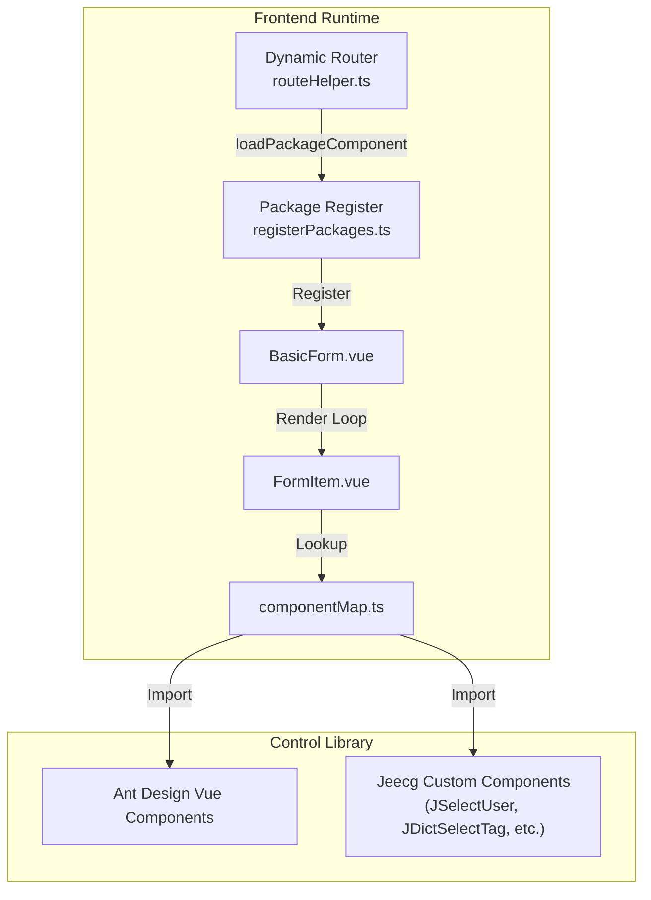
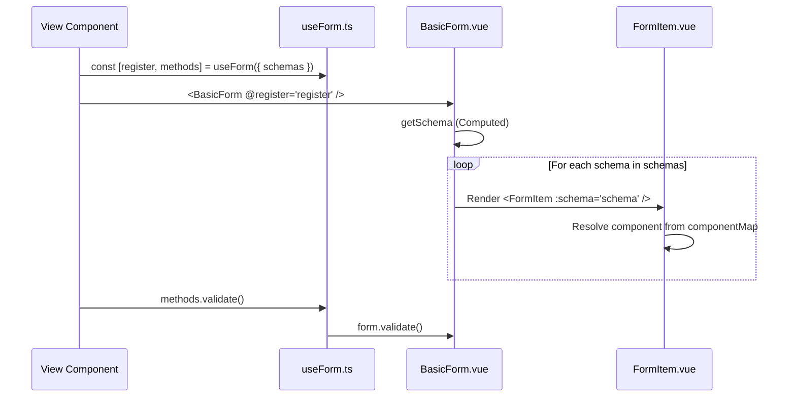

<!-- source: DeepWiki mcp.deepwiki.com · repo jeecgboot/JeecgBoot · page 5.4 Form Designer & Validation · fetched 2026-10-29 -->

# Form Designer & Validation

Relevant source files

The following files were used as context for generating this wiki page:

- [jeecgboot-vue3/build/vite/plugin/index.ts](jeecgboot-vue3/build/vite/plugin/index.ts)
- [jeecgboot-vue3/src/components/Form/index.ts](jeecgboot-vue3/src/components/Form/index.ts)
- [jeecgboot-vue3/src/components/Form/src/BasicForm.vue](jeecgboot-vue3/src/components/Form/src/BasicForm.vue)
- [jeecgboot-vue3/src/components/Form/src/componentMap.ts](jeecgboot-vue3/src/components/Form/src/componentMap.ts)
- [jeecgboot-vue3/src/components/Form/src/hooks/useForm.ts](jeecgboot-vue3/src/components/Form/src/hooks/useForm.ts)
- [jeecgboot-vue3/src/components/Icon/src/Icon.vue](jeecgboot-vue3/src/components/Icon/src/Icon.vue)
- [jeecgboot-vue3/src/components/Table/src/components/editable/EditableCell.vue](jeecgboot-vue3/src/components/Table/src/components/editable/EditableCell.vue)
- [jeecgboot-vue3/src/components/Table/src/components/editable/index.ts](jeecgboot-vue3/src/components/Table/src/components/editable/index.ts)
- [jeecgboot-vue3/src/components/Table/src/components/settings/ColumnSetting.vue](jeecgboot-vue3/src/components/Table/src/components/settings/ColumnSetting.vue)
- [jeecgboot-vue3/src/components/Table/src/hooks/useColumnsCache.ts](jeecgboot-vue3/src/components/Table/src/hooks/useColumnsCache.ts)
- [jeecgboot-vue3/src/components/jeecg/JVxeTable/index.ts](jeecgboot-vue3/src/components/jeecg/JVxeTable/index.ts)
- [jeecgboot-vue3/src/components/jeecg/JVxeTable/useVxeTableRegister.ts](jeecgboot-vue3/src/components/jeecg/JVxeTable/useVxeTableRegister.ts)
- [jeecgboot-vue3/src/components/registerGlobComp.ts](jeecgboot-vue3/src/components/registerGlobComp.ts)
- [jeecgboot-vue3/src/router/helper/routeHelper.ts](jeecgboot-vue3/src/router/helper/routeHelper.ts)
- [jeecgboot-vue3/src/utils/dynamicPages.ts](jeecgboot-vue3/src/utils/dynamicPages.ts)
- [jeecgboot-vue3/src/utils/monorepo/registerPackages.ts](jeecgboot-vue3/src/utils/monorepo/registerPackages.ts)

The Form Designer is a visual tool for creating data entry forms without manual coding. It supports 23 control types, multiple data models (single table, tree, one-to-many), and automatic validation rule generation. Forms designed in this system can be rendered at runtime via dynamic components or used to generate production-ready code.

---

## System Architecture

The Form Designer operates within the low-code ecosystem, utilizing a metadata-driven approach where form configurations are stored in the database and interpreted by the frontend rendering engine.

### Component Interaction Diagram

This diagram shows how the frontend components interact with the dynamic routing and package registration systems to render forms.

**Form Component Resolution Flow**

Sources: [jeecgboot-vue3/src/router/helper/routeHelper.ts:131-136](), [jeecgboot-vue3/src/utils/monorepo/registerPackages.ts:101-113](), [jeecgboot-vue3/src/components/Form/src/componentMap.ts:11-86]()

---

## Control Types & Registration

The system supports a wide array of controls, ranging from standard Ant Design inputs to specialized Jeecg business components.

### Component Mapping
Components are registered in a central map which the `BasicForm` uses to resolve strings to Vue components.

| Category | Component Key | Code Entity |
| :--- | :--- | :--- |
| **Standard** | `Input`, `Select`, `Checkbox` | `ant-design-vue/es/*` |
| **Date/Time** | `DatePicker`, `TimePicker` | `ant-design-vue/es/date-picker` |
| **Selection** | `JSelectUser`, `JSelectDept` | [jeecgboot-vue3/src/components/Form/src/componentMap.ts:55-59]() |
| **Advanced** | `JEditor`, `JCodeEditor` | [jeecgboot-vue3/src/components/Form/src/componentMap.ts:63-67]() |
| **Specialized**| `JPopup`, `JDictSelectTag` | [jeecgboot-vue3/src/components/Form/src/componentMap.ts:58-71]() |

Sources: [jeecgboot-vue3/src/components/Form/src/componentMap.ts:13-86]()

---

## Form Models & Rendering

### BasicForm Implementation
`BasicForm.vue` is the primary entry point for form rendering. It accepts a `schemas` array (FormSchema) and iterates through them to produce `FormItem` instances.

**Form Lifecycle and Data Flow**

Sources: [jeecgboot-vue3/src/components/Form/src/BasicForm.vue:5-24](), [jeecgboot-vue3/src/components/Form/src/hooks/useForm.ts:123-140]()

### Editable Tables (JVxeTable)
For one-to-many relationships, Jeecg uses `JVxeTable` or `EditableCell` for high-performance grid editing.

- **Cell Rendering**: Managed by `renderEditCell` which wraps components in an `EditableCell` [jeecgboot-vue3/src/components/Table/src/components/editable/index.ts:14-59]().
- **Dynamic Registration**: `useVxeTableRegister` ensures the VxeTable library is loaded globally when needed [jeecgboot-vue3/src/components/jeecg/JVxeTable/useVxeTableRegister.ts:2-12]().

---

## Validation System

The validation system integrates Ant Design Vue's form validation with Jeecg's dynamic rules.

### Validation Logic Flow
1. **Schema Definition**: Rules are defined in the `FormSchema` object.
2. **Frontend Trigger**: Triggered via `methods.validate()` in `useForm` [jeecgboot-vue3/src/components/Form/src/hooks/useForm.ts:123]().
3. **Data Transformation**: The `validate` function automatically handles array-to-string conversion for components like `JSelectUser` (joining with commas) [jeecgboot-vue3/src/components/Form/src/hooks/useForm.ts:126-134]().
4. **Editable Table Validation**: In grid editing, `onValid` callbacks are stored in the record and executed as a batch using `Promise.all` [jeecgboot-vue3/src/components/Table/src/components/editable/index.ts:16-25]().

### Component-Specific Validation
Specialized validators like `JCronValidator` provide domain-specific logic (e.g., for Cron expressions) and are imported directly into business modules to reduce initial bundle size [jeecgboot-vue3/src/components/Form/index.ts:40-42]().

---

## Dynamic Field Configuration

The system allows runtime modification of form behavior through several hooks:

- **useForm**: Provides methods like `updateSchema`, `appendSchemaByField`, and `removeSchemaByFiled` to modify the form structure after initialization [jeecgboot-vue3/src/components/Form/src/hooks/useForm.ts:59-82]().
- **Component Props**: `editComponentProps` can be a function that receives the current record, allowing for dynamic props (e.g., disabling a field based on another field's value) [jeecgboot-vue3/src/components/Table/src/components/editable/EditableCell.vue:114-118]().
- **Column Settings**: The `ColumnSetting.vue` component allows users to dynamically toggle field visibility and fixed positions in table-based forms [jeecgboot-vue3/src/components/Table/src/components/settings/ColumnSetting.vue:36-79]().

Sources: [jeecgboot-vue3/src/components/Form/src/hooks/useForm.ts:49-145](), [jeecgboot-vue3/src/components/Table/src/components/editable/EditableCell.vue:99-145]()

---

