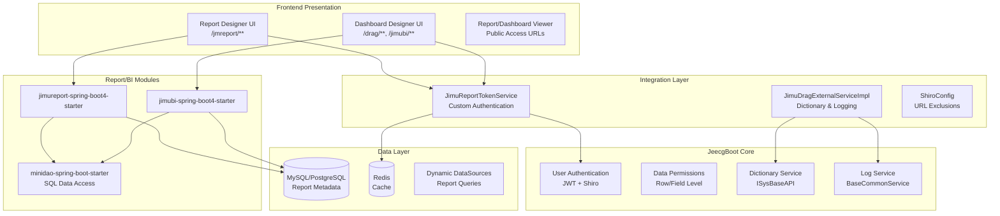
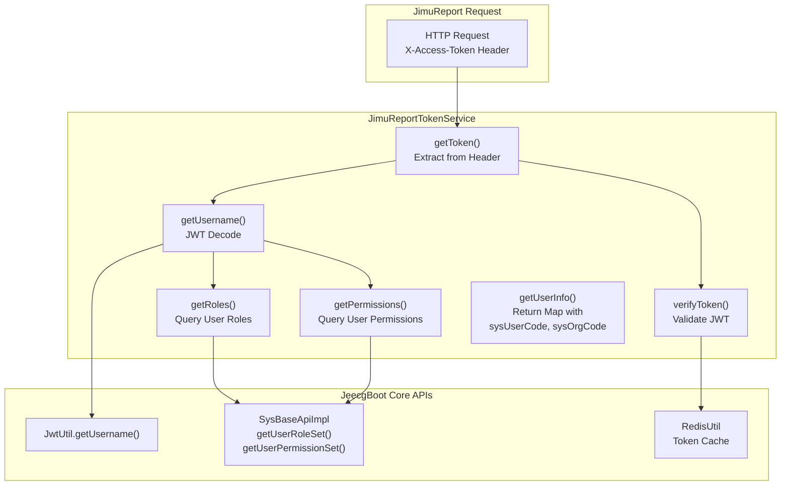
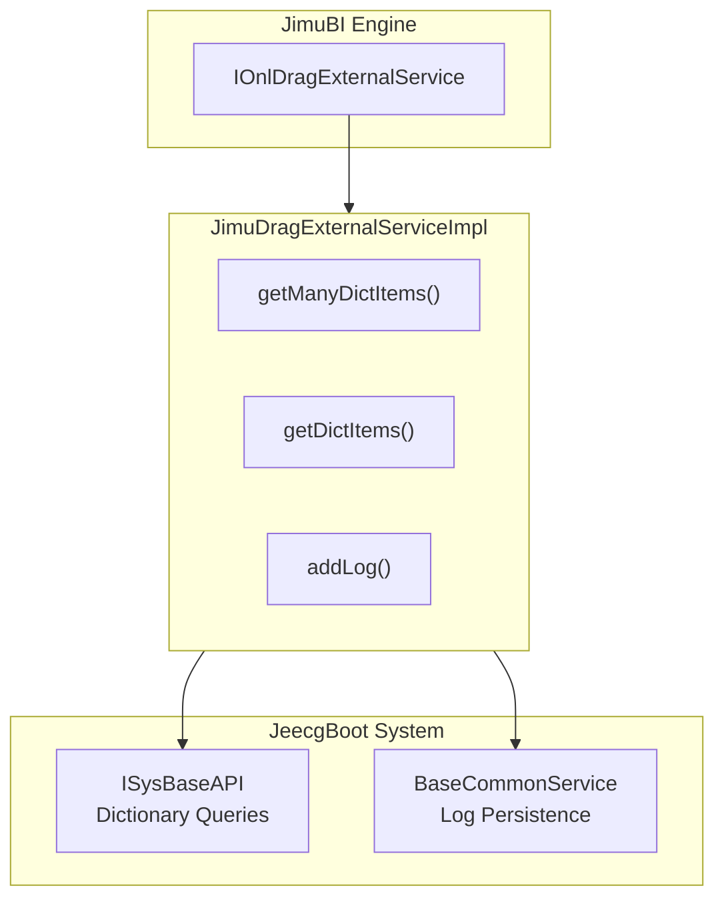
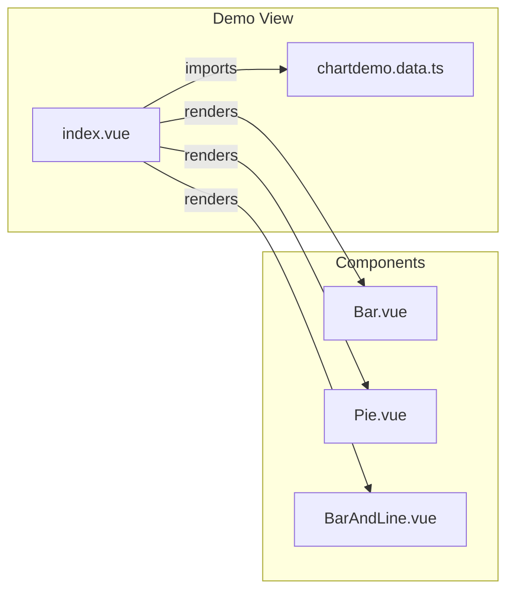

<!-- source: DeepWiki mcp.deepwiki.com · repo jeecgboot/JeecgBoot · page 5.5 Report & Dashboard Designer · fetched 2026-10-29 -->

# Report & Dashboard Designer

Relevant source files

The following files were used as context for generating this wiki page:

- [jeecg-boot/jeecg-module-system/jeecg-system-biz/pom.xml](jeecg-boot/jeecg-module-system/jeecg-system-biz/pom.xml)
- [jeecg-boot/jeecg-module-system/jeecg-system-biz/src/main/java/org/jeecg/config/jimureport/JimuDragExternalServiceImpl.java](jeecg-boot/jeecg-module-system/jeecg-system-biz/src/main/java/org/jeecg/config/jimureport/JimuDragExternalServiceImpl.java)
- [jeecg-boot/jeecg-module-system/jeecg-system-biz/src/main/java/org/jeecg/config/jimureport/JimuReportTokenService.java](jeecg-boot/jeecg-module-system/jeecg-system-biz/src/main/java/org/jeecg/config/jimureport/JimuReportTokenService.java)
- [jeecg-boot/jeecg-module-system/jeecg-system-start/pom.xml](jeecg-boot/jeecg-module-system/jeecg-system-start/pom.xml)
- [jeecg-boot/jeecg-module-system/jeecg-system-start/src/test/java/org/jeecg/modules/system/test/SysUserApiTest.java](jeecg-boot/jeecg-module-system/jeecg-system-start/src/test/java/org/jeecg/modules/system/test/SysUserApiTest.java)
- [jeecg-boot/jeecg-server-cloud/jeecg-visual/jeecg-cloud-test/jeecg-cloud-test-more/pom.xml](jeecg-boot/jeecg-server-cloud/jeecg-visual/jeecg-cloud-test/jeecg-cloud-test-more/pom.xml)
- [jeecgboot-vue3/src/components/chart/BarAndLine.vue](jeecgboot-vue3/src/components/chart/BarAndLine.vue)
- [jeecgboot-vue3/src/views/report/chartdemo/chartdemo.data.ts](jeecgboot-vue3/src/views/report/chartdemo/chartdemo.data.ts)
- [jeecgboot-vue3/src/views/report/chartdemo/index.vue](jeecgboot-vue3/src/views/report/chartdemo/index.vue)

This page describes JeecgBoot's integrated report and dashboard design capabilities powered by JimuReport and JimuBI. These tools provide zero-code, drag-and-drop interfaces for creating data reports, charts, dashboards, and large-screen displays without programming knowledge.

For information about code generation and Online Coding, see [5.2](). For form design capabilities, see [5.4](). For AI-assisted report generation, see [5.3]().

## Overview

JeecgBoot integrates two complementary reporting tools:

- **JimuReport**: Enterprise-grade web-based report designer for traditional reports (tabular layouts, print templates, detailed data reports).
- **JimuBI**: Dashboard and large-screen designer for data visualization (interactive dashboards, real-time monitoring, data portals).

Both tools operate as separate Spring Boot starter modules that integrate seamlessly with JeecgBoot's authentication, data permissions, and data sources.

### System Architecture

**Sources**: [jeecg-boot/jeecg-module-system/jeecg-system-biz/pom.xml:33-52](), [jeecg-boot/jeecg-module-system/jeecg-system-biz/src/main/java/org/jeecg/config/jimureport/JimuReportTokenService.java:32-37](), [jeecg-boot/jeecg-module-system/jeecg-system-biz/src/main/java/org/jeecg/config/jimureport/JimuDragExternalServiceImpl.java:31-40]()

## JimuReport Report Designer

JimuReport provides traditional report design capabilities including tabular reports, cross-tab reports, and print templates.

### Dependency Configuration

The JimuReport module is configured in the system business module:

| Dependency | Purpose |
|------------|---------|
| `jimureport-spring-boot4-starter` | Core report engine for Spring Boot 3+ |
| `jimureport-nosql-starter3` | (Optional) NoSQL support (MongoDB, Redis, etc.) |
| `jimureport-echarts-starter` | (Optional) Echarts support for exports |

**Sources**: [jeecg-boot/jeecg-module-system/jeecg-system-biz/pom.xml:33-52]()

### Custom Authentication Integration

The `JimuReportTokenService` bridges JeecgBoot's authentication with JimuReport's security model by implementing `JmReportTokenServiceI`.

Key methods in `JimuReportTokenService`:
- `getToken(HttpServletRequest)`: Extracts JWT token using `TokenUtils.getTokenByRequest(request)` [jeecg-boot/jeecg-module-system/jeecg-system-biz/src/main/java/org/jeecg/config/jimureport/JimuReportTokenService.java:40-46]().
- `getUsername(String token)`: Decodes username from JWT [jeecg-boot/jeecg-module-system/jeecg-system-biz/src/main/java/org/jeecg/config/jimureport/JimuReportTokenService.java:49-51]().
- `getUserInfo(String token)`: Populates a map with `SYS_USER_CODE` and `SYS_ORG_CODE` from `SysUserCacheInfo` [jeecg-boot/jeecg-module-system/jeecg-system-biz/src/main/java/org/jeecg/config/jimureport/JimuReportTokenService.java:69-86]().
- `getPermissions(String token)`: Retrieves user permission sets via `sysBaseApi.getUserPermissionSet()` [jeecg-boot/jeecg-module-system/jeecg-system-biz/src/main/java/org/jeecg/config/jimureport/JimuReportTokenService.java:94-112]().

**Sources**: [jeecg-boot/jeecg-module-system/jeecg-system-biz/src/main/java/org/jeecg/config/jimureport/JimuReportTokenService.java:32-130]()

## JimuBI Dashboard Designer

JimuBI provides interactive dashboard and large-screen design capabilities. It integrates with JeecgBoot's dictionary and logging systems via the `IOnlDragExternalService` interface.

### External Service Integration

`JimuDragExternalServiceImpl` acts as the bridge for data and logging:

- **Dictionary Batching**: `getManyDictItems` handles both standard code-based dictionaries and table-based dictionaries (using `dictTable`, `dictField`, and `dictText`) [jeecg-boot/jeecg-module-system/jeecg-system-biz/src/main/java/org/jeecg/config/jimureport/JimuDragExternalServiceImpl.java:47-80]().
- **Logging**: Captures dashboard events and persists them via `baseCommonService.addLog(LogDTO)` [jeecg-boot/jeecg-module-system/jeecg-system-biz/src/main/java/org/jeecg/config/jimureport/JimuDragExternalServiceImpl.java:105-123]().

**Sources**: [jeecg-boot/jeecg-module-system/jeecg-system-biz/src/main/java/org/jeecg/config/jimureport/JimuDragExternalServiceImpl.java:32-124]()

## Chart Configuration & Frontend

The frontend provides a comprehensive suite of ECharts-based components for visualization.

### Chart Component Library

Standard chart components are located in `src/components/chart/` and include:
- `Bar.vue`: Basic bar charts.
- `BarMulti.vue`: Multi-column bar charts.
- `LineMulti.vue`: Multi-line charts.
- `Pie.vue`: Pie and donut charts.
- `Radar.vue`: Radar/Spider charts.
- `Gauge.vue`: Dashboard gauges.
- `BarAndLine.vue`: Combined bar and line charts.

**Sources**: [jeecgboot-vue3/src/views/report/chartdemo/index.vue:62-71]()

### Data Flow in Charts

Charts consume data in a standardized format defined in `chartdemo.data.ts`. The `BarAndLine.vue` component demonstrates how data is transformed for ECharts:

1. **Input**: `chartData` prop containing an array of objects with `name`, `value`, `type`, and `seriesType`.
2. **Processing**: `initCharts()` function extracts unique axes (`xAxisData`) and series (`seriesData`) [jeecgboot-vue3/src/components/chart/BarAndLine.vue:66-89]().
3. **Rendering**: Uses `useECharts` hook to bind the configuration to a `chartRef` [jeecgboot-vue3/src/components/chart/BarAndLine.vue:33-34]().

**Sources**: [jeecgboot-vue3/src/components/chart/BarAndLine.vue:4-93](), [jeecgboot-vue3/src/views/report/chartdemo/chartdemo.data.ts:2-52]()

### Chart Demo Implementation

The `chartdemo/index.vue` file serves as a reference implementation for using these components within an `a-tabs` layout.

**Sources**: [jeecgboot-vue3/src/views/report/chartdemo/index.vue:1-93]()

---

