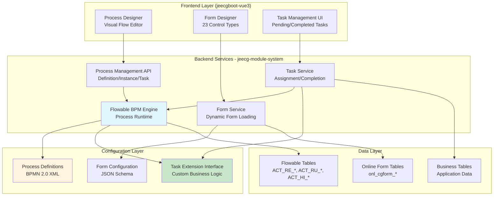
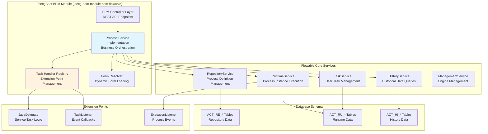
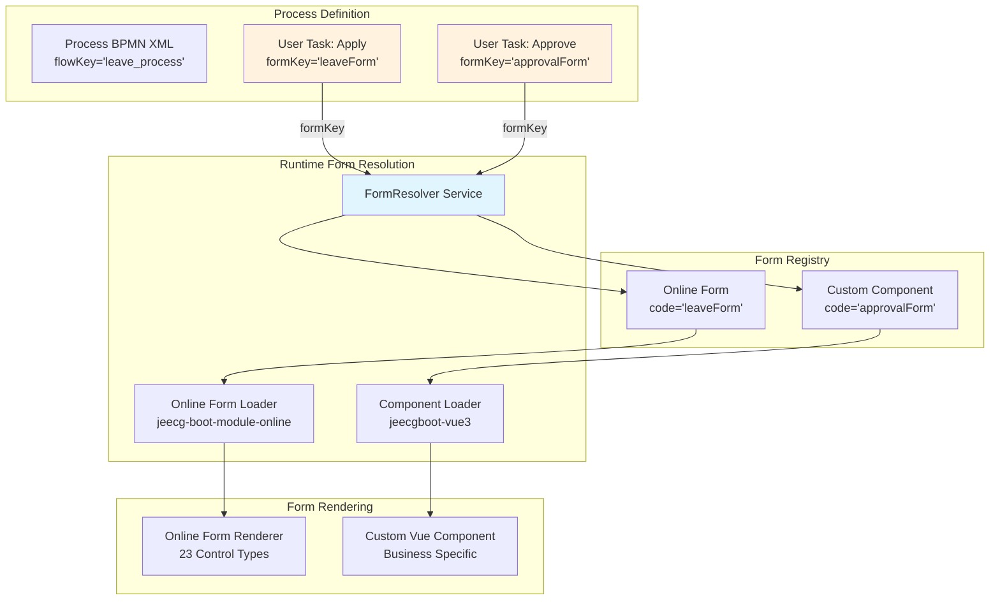

<!-- source: DeepWiki mcp.deepwiki.com · repo jeecgboot/JeecgBoot · page 5.6 BPM Workflow & Process Designer · fetched 2026-10-29 -->

# BPM Workflow & Process Designer

Relevant source files

The following files were used as context for generating this wiki page:

- [README-AI.md](README-AI.md)
- [README.en-US.md](README.en-US.md)
- [README.ja-JP.md](README.ja-JP.md)
- [README.md](README.md)
- [jeecg-boot/CLAUDE.md](jeecg-boot/CLAUDE.md)
- [jeecg-boot/README.md](jeecg-boot/README.md)
- [jeecg-boot/jeecg-module-system/jeecg-system-biz/pom.xml](jeecg-boot/jeecg-module-system/jeecg-system-biz/pom.xml)
- [jeecg-boot/jeecg-module-system/jeecg-system-biz/src/main/java/org/jeecg/config/jimureport/JimuDragExternalServiceImpl.java](jeecg-boot/jeecg-module-system/jeecg-system-biz/src/main/java/org/jeecg/config/jimureport/JimuDragExternalServiceImpl.java)
- [jeecg-boot/jeecg-module-system/jeecg-system-biz/src/main/java/org/jeecg/config/jimureport/JimuReportTokenService.java](jeecg-boot/jeecg-module-system/jeecg-system-biz/src/main/java/org/jeecg/config/jimureport/JimuReportTokenService.java)
- [jeecg-boot/jeecg-module-system/jeecg-system-start/pom.xml](jeecg-boot/jeecg-module-system/jeecg-system-start/pom.xml)
- [jeecg-boot/jeecg-module-system/jeecg-system-start/src/test/java/org/jeecg/modules/system/test/SysUserApiTest.java](jeecg-boot/jeecg-module-system/jeecg-system-start/src/test/java/org/jeecg/modules/system/test/SysUserApiTest.java)
- [jeecg-boot/jeecg-server-cloud/jeecg-visual/jeecg-cloud-test/jeecg-cloud-test-more/pom.xml](jeecg-boot/jeecg-server-cloud/jeecg-visual/jeecg-cloud-test/jeecg-cloud-test-more/pom.xml)
- [jeecgboot-vue3/README.md](jeecgboot-vue3/README.md)

## Purpose and Scope

This page documents JeecgBoot's BPM (Business Process Management) workflow engine integration and process designer capabilities. The platform uses the **Flowable** engine to provide visual process design, business approval workflows, and form-process integration. This feature enables low-code workflow development where developers can design process flows visually and implement business logic through minimal coding using a "loose coupling" pattern between forms and processes.

For AI-powered workflow orchestration with LLM integration, see [AI Flow Orchestration](#3.4). For form creation and configuration, see [Form Designer & Validation](#5.4). For report generation workflows, see [Report & Dashboard Designer](#5.5).

**Sources**: [README.md:47-48](), [jeecg-boot/README.md:33](), [README.en-US.md:45]()

---

## Architecture Overview

JeecgBoot's BPM architecture implements a **loose coupling pattern** between processes and forms, separating business process logic from data presentation. This design ensures workflow confidentiality while reducing development overhead.

### High-Level BPM System Architecture

**Key Design Principles:**

1. **Form-Process Separation**: Forms and processes are configured independently and linked at runtime via `formKey` [README.md:47-48]().
2. **Minimal Code Development**: Business logic is implemented through task extension interfaces [jeecg-boot/README.md:33]().
3. **Visual Process Design**: BPMN 2.0 compliant visual designer eliminates XML editing [jeecg-boot/README.md:67]().
4. **Flexible Form Association**: Multiple form types supported, including Online Forms and Custom Components [README.md:47-48]().

**Sources**: [README.md:47-48](), [jeecg-boot/README.md:33](), [jeecg-boot/CLAUDE.md:57](), [jeecg-boot/CLAUDE.md:63]()

---

## Flowable BPM Engine Integration

JeecgBoot integrates the **Flowable** open-source workflow engine, a BPMN 2.0 compliant process engine that provides comprehensive workflow capabilities.

### Flowable Component Architecture

### Key Integration Points

| Component | Purpose | Configuration Location |
|-----------|---------|----------------------|
| **RepositoryService** | Deploy and manage process definitions | `jeecg-boot-module-bpm-flowable` |
| **RuntimeService** | Start process instances, manage variables | `jeecg-boot-module-bpm-flowable` |
| **TaskService** | Assign, claim, complete tasks | `jeecg-boot-module-bpm-flowable` |
| **HistoryService** | Query completed processes and tasks | `jeecg-boot-module-bpm-flowable` |
| **TaskHandlerRegistry** | Register custom task handlers | Extension interface registration |

**Sources**: [jeecg-boot/CLAUDE.md:57](), [jeecg-boot/README.md:33](), [README.md:47-48]()

---

## Process Designer

The visual process designer provides a BPMN 2.0 compliant interface for drawing workflow diagrams without writing XML manually.

### AI-Assisted Design (Skills)
With the introduction of **AI Skills**, JeecgBoot now supports "one-sentence process drawing" via the `jeecg-bpmn` skill, which converts natural language descriptions into Flowable BPMN 2.0 XML [README.md:37](), [jeecg-boot/README.md:67]().

### BPMN 2.0 Element Support

| Element Type | Description | Use Case |
|--------------|-------------|----------|
| **Start Event** | Process entry point | Trigger workflow start |
| **User Task** | Manual approval/review step | Human task requiring action |
| **Service Task** | Automated execution | Call Java service, send notification |
| **Gateway (Exclusive)** | Conditional branching | Route based on approval result |
| **Gateway (Parallel)** | Concurrent execution | Execute multiple branches simultaneously |
| **End Event** | Process completion | Terminate workflow |

**Design Workflow:**
1. Use **AI Skills** (`jeecg-bpmn`) to generate the initial BPMN XML from a prompt [jeecg-boot/README.md:67]().
2. Open the **Process Designer** to refine the flow visually.
3. Configure element properties (assignee, form, listeners).
4. Save and deploy to the Flowable engine.

**Sources**: [README.md:37](), [jeecg-boot/README.md:67](), [README.en-US.md:30]()

---

## Form-Process Separation Pattern

JeecgBoot implements **loose coupling** between forms and workflows, allowing independent development and flexible association via `formKey`.

### Form Association Architecture

### Form Association Methods

| Method | Configuration | Use Case | Development Effort |
|--------|---------------|----------|-------------------|
| **Online Form** | `formKey` references online form code | Standard data entry forms | Zero code [README.md:35]() |
| **Custom Component** | `formKey` references Vue component path | Complex business logic forms | Custom Vue development |
| **AI Form** | `jeecg-desform` / `jeecg-onlform` | Rapid prototyping | Zero code (AI Generated) [jeecg-boot/README.md:64-66]() |

**Sources**: [README.md:47-48](), [jeecg-boot/README.md:33](), [jeecg-boot/README.md:64-66]()

---

## Task Node Configuration

Each task node in the process can be configured with assignees, listeners, and business logic handlers.

### Task Extension Interface
JeecgBoot provides task interfaces for developers to write business logic [README.md:47-48](). This allows for:
- **Pre-execution logic**: Triggered before a task is created.
- **Post-execution logic**: Triggered after a task is completed.
- **Assignment logic**: Dynamic calculation of task assignees.

### Assignment Strategies
1. **Direct User**: Fixed user ID.
2. **Role/Group**: Candidates from specific roles.
3. **Expression**: `${initiator}` or other variables.
4. **Task Listener**: Custom Java logic to determine assignees at runtime.

**Sources**: [README.md:47-48](), [jeecg-boot/README.md:33]()

---

## Integration with Low-Code Modules

The BPM engine is deeply integrated with the JeecgBoot ecosystem:

| Feature | Module | Integration Detail |
|---------|--------|-------------------|
| **Online Coding** | `jeecg-boot-module-online` | BPM uses Online Form metadata to render approval forms [jeecg-boot/CLAUDE.md:138-143](). |
| **AI Skills** | `jeecg-bpmn` | Generates BPMN 2.0 XML from natural language [jeecg-boot/README.md:67](). |
| **System Auth** | `jeecg-module-system` | Uses `SysUser` and `SysRole` for task assignment [jeecg-boot/CLAUDE.md:43](). |
| **AI Flow** | `jeecg-boot-module-airag-flow` | Orchestrates AI agents and LLM nodes [jeecg-boot/CLAUDE.md:58](). |

### Module Structure for BPM
- `jeecg-boot-module-bpm-flowable`: Core BPM implementation [jeecg-boot/CLAUDE.md:57]().
- `jeecg-boot-module-joa-flowable`: OA specific workflow implementations [jeecg-boot/CLAUDE.md:53]().
- `jeecg-boot-module-mindesflow-flowable`: Simplified flow designer [jeecg-boot/CLAUDE.md:63]().

**Sources**: [jeecg-boot/CLAUDE.md:53-63](), [jeecg-boot/README.md:67](), [README.md:47-48]()

---

