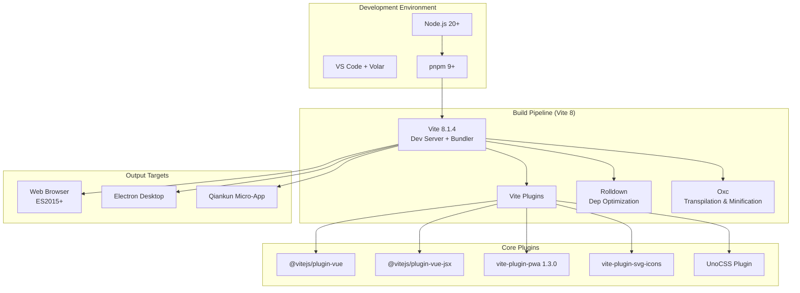
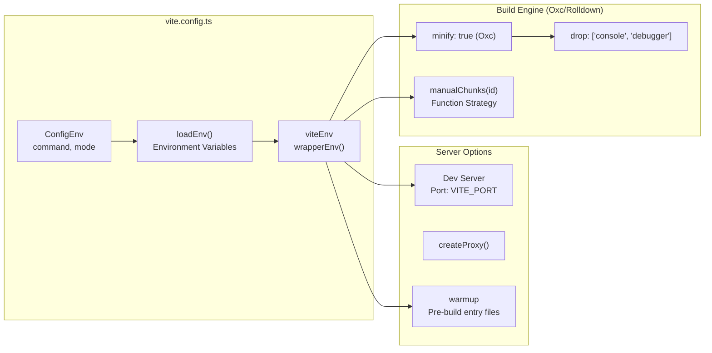
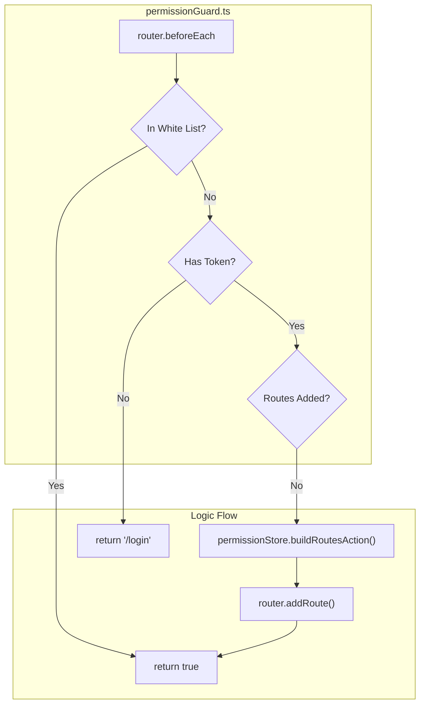

<!-- source: DeepWiki mcp.deepwiki.com · repo jeecgboot/JeecgBoot · page 6 Frontend Development · fetched 2026-10-29 -->

# Frontend Development

<details>
<summary>Relevant source files</summary>

The following files were used as context for generating this wiki page:

- [jeecgboot-vue3/VITE8-UPGRADE-LOG.md](jeecgboot-vue3/VITE8-UPGRADE-LOG.md)
- [jeecgboot-vue3/build/config/themeConfig.ts](jeecgboot-vue3/build/config/themeConfig.ts)
- [jeecgboot-vue3/package.json](jeecgboot-vue3/package.json)
- [jeecgboot-vue3/pnpm-lock.yaml](jeecgboot-vue3/pnpm-lock.yaml)
- [jeecgboot-vue3/src/router/guard/paramMenuGuard.ts](jeecgboot-vue3/src/router/guard/paramMenuGuard.ts)
- [jeecgboot-vue3/src/router/guard/permissionGuard.ts](jeecgboot-vue3/src/router/guard/permissionGuard.ts)
- [jeecgboot-vue3/src/router/index.ts](jeecgboot-vue3/src/router/index.ts)
- [jeecgboot-vue3/src/settings/projectSetting.ts](jeecgboot-vue3/src/settings/projectSetting.ts)
- [jeecgboot-vue3/src/store/modules/app.ts](jeecgboot-vue3/src/store/modules/app.ts)
- [jeecgboot-vue3/src/store/modules/defIndex.ts](jeecgboot-vue3/src/store/modules/defIndex.ts)
- [jeecgboot-vue3/src/store/modules/errorLog.ts](jeecgboot-vue3/src/store/modules/errorLog.ts)
- [jeecgboot-vue3/src/store/modules/locale.ts](jeecgboot-vue3/src/store/modules/locale.ts)
- [jeecgboot-vue3/src/store/modules/lock.ts](jeecgboot-vue3/src/store/modules/lock.ts)
- [jeecgboot-vue3/src/store/modules/multipleTab.ts](jeecgboot-vue3/src/store/modules/multipleTab.ts)
- [jeecgboot-vue3/src/utils/getConfigByMenuType.ts](jeecgboot-vue3/src/utils/getConfigByMenuType.ts)
- [jeecgboot-vue3/src/views/super/online/cgform/auto/comp/superquery/SuperQuery.vue](jeecgboot-vue3/src/views/super/online/cgform/auto/comp/superquery/SuperQuery.vue)
- [jeecgboot-vue3/types/config.d.ts](jeecgboot-vue3/types/config.d.ts)
- [jeecgboot-vue3/vite.config.ts](jeecgboot-vue3/vite.config.ts)

</details>


This page provides comprehensive guidance for frontend development in JeecgBoot, covering project setup, build configuration, component development patterns, and the modular architecture. It serves as a practical reference for developers working with the Vue 3 + TypeScript + Vite stack.

For architectural overview and system design, see [Frontend Architecture](#2.3). For deployment and production configuration, see [Environment Configuration](#9.2).

---

## Technology Stack Overview

JeecgBoot's frontend is built on modern web technologies optimized for performance and developer experience. The project recently underwent a significant upgrade to **Vite 8**, **Pinia 3**, and **Vue Router 5**.

### Core Framework Stack

| Technology | Version | Purpose |
|-----------|---------|---------|
| Vue | 3.5.39 | Reactive UI framework with Composition API |
| TypeScript | 5.9.3 | Type-safe development |
| Vite | 8.1.4 | Next-generation build tool using Rolldown and Oxc |
| Pinia | 3.0.4 | State management |
| Vue Router | 5.1.0 | Client-side routing with return-value guards |
| Ant Design Vue | 4.2.6 | UI component library |
| VXE Table | 4.13.31 | Advanced data grid |

### Build and Development Tools



**Sources:** [jeecgboot-vue3/package.json:25-180](), [jeecgboot-vue3/vite.config.ts:161-172](), [jeecgboot-vue3/VITE8-UPGRADE-LOG.md:42-52]()

---

## Project Structure

The frontend follows a standard Vue 3 project layout with additional directories for JeecgBoot-specific functionality.

```
jeecgboot-vue3/
├── src/
│   ├── views/              # Page components
│   ├── components/         # Reusable components
│   ├── store/              # Pinia stores (v3 syntax)
│   ├── router/             # Vue Router configuration (v5 syntax)
│   ├── utils/              # Utility functions
│   ├── hooks/              # Composition API hooks
│   ├── api/                # API service layer
│   └── settings/           # Project & Design settings
├── build/
│   ├── vite/               # Vite plugin configurations
│   ├── config/             # Theme & constant config
│   └── generate/           # Build-time code generation
├── types/                  # TypeScript type definitions
├── package.json            # Dependencies and scripts
└── vite.config.ts          # Vite 8 configuration
```

### Path Aliases

The project configures path aliases for clean imports. Note that for Vite 8 compatibility, some internal configuration files use relative paths to avoid resolution issues during build.

| Alias | Resolves To | Usage |
|-------|-------------|-------|
| `/@/` or `@/` | `src/` | Main source directory |
| `/#/` or `#/` | `types/` | TypeScript definitions |

**Sources:** [jeecgboot-vue3/vite.config.ts:50-88](), [jeecgboot-vue3/VITE8-UPGRADE-LOG.md:10-10]()

---

## Build Configuration

### Vite 8 Configuration Architecture

Vite 8 introduces **Rolldown** for dependency optimization and **Oxc** for minification, replacing older esbuild-based workflows.



### Manual Chunk Strategy

With the upgrade to Vite 8/Rolldown, `manualChunks` must be defined as a function. It maps dependencies to specific chunks to optimize loading performance.

```typescript
// From vite.config.ts:122-135
manualChunks(id: string) {
  const normalizedId = id.replace(/\\/g, '/');
  if (!normalizedId.includes('node_modules/')) {
    return;
  }
  const segments = normalizedId.split('node_modules/').pop()!.split('/');
  const pkgName = segments[0].startsWith('@') ? `${segments[0]}/${segments[1]}` : segments[0];
  const packageToChunk: Record<string, string> = {
    vue: 'vue-vendor',
    'vue-router': 'vue-vendor',
    'emoji-mart-vue-fast': 'emoji-mart-vue-fast',
  };
  return packageToChunk[pkgName];
}
```

**Sources:** [jeecgboot-vue3/vite.config.ts:122-135](), [jeecgboot-vue3/VITE8-UPGRADE-LOG.md:11-11]()

---

## State Management (Pinia 3)

The project uses Pinia 3 for state management. Following the upgrade, all stores must use the `defineStore('id', { ... })` syntax (separate ID argument) to avoid runtime errors.

### Core Store Modules

| Store ID | File Path | Purpose |
|----------|-----------|---------|
| `app` | [src/store/modules/app.ts]() | Project configuration, dark mode, and layout state |
| `user` | [src/store/modules/user.ts]() | Authentication, user info, and tokens |
| `permission` | [src/store/modules/permission.ts]() | Dynamic route building and menu generation |
| `app-multiple-tab` | [src/store/modules/multipleTab.ts]() | Multi-tab navigation state and caching |
| `defIndex` | [src/store/modules/defIndex.ts]() | User-specific default homepage settings |

**Sources:** [jeecgboot-vue3/src/store/modules/app.ts:31-31](), [jeecgboot-vue3/src/store/modules/multipleTab.ts:90-90](), [jeecgboot-vue3/VITE8-UPGRADE-LOG.md:81-81]()

---

## Routing & Navigation (Vue Router 5)

JeecgBoot utilizes Vue Router 5 with a dynamic route injection system based on backend permissions.

### Navigation Guards

Navigation guards have been migrated from `next()` callbacks to **return-value style** for Vue Router 5 compatibility.



**Sources:** [jeecgboot-vue3/src/router/guard/permissionGuard.ts:39-192](), [jeecgboot-vue3/VITE8-UPGRADE-LOG.md:95-104]()

---

## Theming and Design

The frontend supports dynamic theme switching (Light/Dark) and primary color customization.

### Theme Configuration

Themes are managed through `projectSetting.ts` and `themeConfig.ts`. Build-time placeholders are generated to ensure the CSS variables are available before the application loads.

- **Default Theme:** Sidebar mode with preset colors [src/settings/projectSetting.ts:16-22]().
- **Dark Mode:** Managed via `darkMode` setting and stored in `localStorage` under `APP_DARK_MODE_KEY_` [src/store/modules/app.ts:44-59]().
- **Color Generation:** Uses `@ant-design/colors` to generate shades for the primary theme color [jeecgboot-vue3/build/config/themeConfig.ts:20-33]().

**Sources:** [jeecgboot-vue3/src/settings/projectSetting.ts:16-51](), [jeecgboot-vue3/src/utils/getConfigByMenuType.ts:8-49](), [jeecgboot-vue3/build/config/themeConfig.ts:1-81]()

---

## Child Pages

For detailed information on specific frontend subsystems, refer to the following child pages:

- [Project Structure & Configuration](#6.1) — Detailed project organization, Vite environment variables, and alias setup.
- [PWA Implementation](#6.2) — Service worker configuration, caching strategies, and offline support.
- [Component Development](#6.3) — Guide to developing custom components, including Table and Form component libraries.
- [Utility Functions & Helpers](#6.4) — Core utility reference including `deepMerge` and dynamic module loaders.
- [State Management & Routing](#6.5) — Deep dive into Pinia store implementations and the dynamic permission-based routing system.

---

