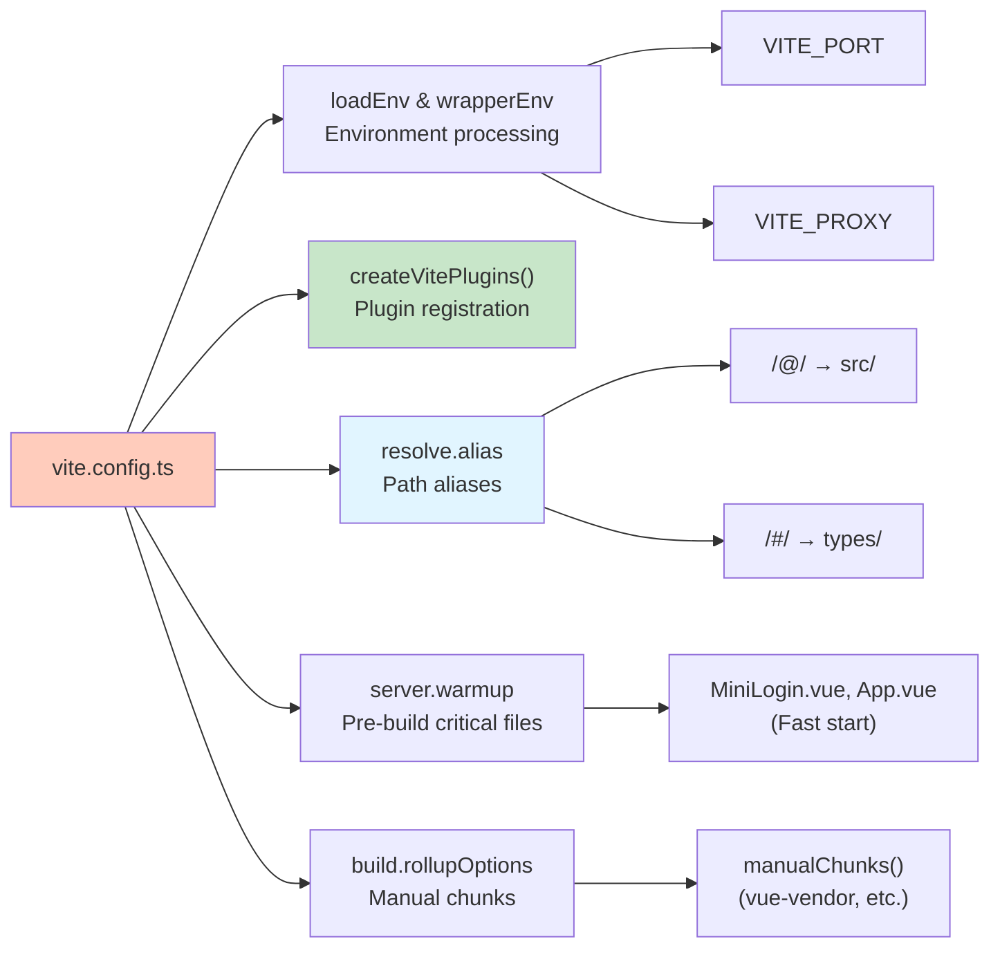

<!-- source: DeepWiki mcp.deepwiki.com · repo jeecgboot/JeecgBoot · page 6.1 Project Structure & Configuration · fetched 2026-10-29 -->

# Project Structure & Configuration

Relevant source files

The following files were used as context for generating this wiki page:

- [.gitignore](.gitignore)
- [jeecgboot-vue3/.env.development](jeecgboot-vue3/.env.development)
- [jeecgboot-vue3/.env.production](jeecgboot-vue3/.env.production)
- [jeecgboot-vue3/.gitignore](jeecgboot-vue3/.gitignore)
- [jeecgboot-vue3/.npmrc](jeecgboot-vue3/.npmrc)
- [jeecgboot-vue3/CLAUDE.md](jeecgboot-vue3/CLAUDE.md)
- [jeecgboot-vue3/build/config/themeConfig.ts](jeecgboot-vue3/build/config/themeConfig.ts)
- [jeecgboot-vue3/src/App.vue](jeecgboot-vue3/src/App.vue)
- [jeecgboot-vue3/src/components/Drawer/src/BasicDrawer.vue](jeecgboot-vue3/src/components/Drawer/src/BasicDrawer.vue)
- [jeecgboot-vue3/src/components/Drawer/src/props.ts](jeecgboot-vue3/src/components/Drawer/src/props.ts)
- [jeecgboot-vue3/src/components/Form/src/jeecg/components/JCategorySelect.vue](jeecgboot-vue3/src/components/Form/src/jeecg/components/JCategorySelect.vue)
- [jeecgboot-vue3/src/components/Form/src/jeecg/components/JPopup.vue](jeecgboot-vue3/src/components/Form/src/jeecg/components/JPopup.vue)
- [jeecgboot-vue3/src/components/Form/src/jeecg/components/JUpload/JUpload.vue](jeecgboot-vue3/src/components/Form/src/jeecg/components/JUpload/JUpload.vue)
- [jeecgboot-vue3/src/settings/projectSetting.ts](jeecgboot-vue3/src/settings/projectSetting.ts)
- [jeecgboot-vue3/src/utils/getConfigByMenuType.ts](jeecgboot-vue3/src/utils/getConfigByMenuType.ts)
- [jeecgboot-vue3/src/views/super/online/cgform/auto/comp/superquery/SuperQuery.vue](jeecgboot-vue3/src/views/super/online/cgform/auto/comp/superquery/SuperQuery.vue)
- [jeecgboot-vue3/types/config.d.ts](jeecgboot-vue3/types/config.d.ts)
- [jeecgboot-vue3/vite.config.ts](jeecgboot-vue3/vite.config.ts)

This page documents the frontend project structure and build configuration for the `jeecgboot-vue3` application. It covers directory organization, build system setup, path alias configuration, environment variables, and the monorepo module system.

For backend module structure, see [Backend Module Structure](#2.2). For build and deployment configuration, see [PWA Implementation](#6.2) and [Environment Configuration](#9.2).

---

## Overview

The frontend project is a Vue 3 + TypeScript + Vite application located in the `jeecgboot-vue3/` directory. It uses a modern build toolchain with hot module replacement (HMR) for development and optimized production builds using the Oxc minifier and Rolldown-compatible configurations.

**Key Technologies:**
- **Build Tool**: Vite 6.x (transitioning to Vite 8 features like Oxc) [jeecgboot-vue3/vite.config.ts:110-112]()
- **Framework**: Vue 3.5+ [jeecgboot-vue3/CLAUDE.md:7]()
- **Language**: TypeScript 5.x [jeecgboot-vue3/CLAUDE.md:7]()
- **Package Manager**: pnpm 9+ [jeecgboot-vue3/CLAUDE.md:7]()
- **UI Library**: Ant Design Vue 4.x [jeecgboot-vue3/CLAUDE.md:7]()

---

## Project Directory Structure

```mermaid
graph TB
    root["jeecgboot-vue3/"]
    
    root --> src["src/"]
    root --> build["build/"]
    root --> types["types/"]
    root --> public["public/"]
    root --> config["Configuration Files"]
    
    src --> views["views/<br/>Page components"]
    src --> components["components/<br/>Reusable components"]
    src --> router["router/<br/>Route definitions"]
    src --> store["store/<br/>Pinia state management"]
    src --> api["api/<br/>API definitions"]
    src --> utils["utils/<br/>Utility functions"]
    src --> hooks["hooks/<br/>Composition functions"]
    src --> settings["settings/<br/>Global settings"]
    
    build --> vite["vite/<br/>Vite plugin configs"]
    build --> generate["generate/<br/>Theme generation"]
    build --> script["script/<br/>Post-build scripts"]
    
    vite --> plugin["plugin/index.ts<br/>Plugin registration"]
    vite --> proxy["proxy.ts<br/>Dev proxy config"]
    
    config --> pkgjson["package.json<br/>Dependencies & scripts"]
    config --> viteconfig["vite.config.ts<br/>Build configuration"]
    config --> envfiles[".env files<br/>Environment variables"]
    
    types --> configd["config.d.ts<br/>Configuration types"]
    
    style src fill:#e1f5ff
    style build fill:#fff3e0
    style config fill:#c8e6c9
```

**Sources:** [jeecgboot-vue3/vite.config.ts:1-151](), [jeecgboot-vue3/CLAUDE.md:151-165]()

---

## Configuration Files

### package.json & Commands

The project uses `pnpm` for package management and defines several build and maintenance scripts.

| Script | Command | Purpose |
|---------|---------|---------|
| `dev` | `vite` | Starts dev server (port 3100) [jeecgboot-vue3/CLAUDE.md:12]() |
| `build` | `vite build` | Production build (output: `dist/`) [jeecgboot-vue3/CLAUDE.md:13]() |
| `build:docker` | `vite build --mode docker` | Docker production build [jeecgboot-vue3/CLAUDE.md:14]() |
| `clean:cache` | - | Clears Vite cache [jeecgboot-vue3/CLAUDE.md:28]() |
| `reinstall` | - | Clean reinstall of all dependencies [jeecgboot-vue3/CLAUDE.md:30]() |

**Sources:** [jeecgboot-vue3/CLAUDE.md:9-31]()

---

### vite.config.ts - Build Configuration

The central Vite configuration file controls the build process, plugins, and optimizations. It utilizes `loadEnv` to inject environment-specific variables into the build process [jeecgboot-vue3/vite.config.ts:25]().

**Key Configuration Details:**

1.  **Path Aliases**:
    The project uses both `/@/` and `@/` to point to `src/`, and `/#/` and `#/` to point to `types/` [jeecgboot-vue3/vite.config.ts:70-87]().

2.  **Server Warmup**:
    To improve initial page load during development, specific files like `MiniLogin.vue` and `App.vue` are pre-built using the `warmup` configuration [jeecgboot-vue3/vite.config.ts:98-107]().

3.  **Code Splitting (Manual Chunks)**:
    Dependencies are split into chunks to optimize browser caching. Libraries like `vue` and `vue-router` are grouped into `vue-vendor` [jeecgboot-vue3/vite.config.ts:122-135]().

4.  **Minification**:
    Production builds use the Oxc minifier (in Vite 8+) to drop `console` and `debugger` statements [jeecgboot-vue3/vite.config.ts:137-139]().

5.  **Dependency Optimization**:
    Certain CJS modules like `clipboard` and `dayjs` plugins are explicitly included in `optimizeDeps` to ensure they are pre-bundled as ESM [jeecgboot-vue3/vite.config.ts:174-192]().

**Sources:** [jeecgboot-vue3/vite.config.ts:1-200]()

---

## Environment Variables

The project supports multiple environment files to manage configurations across development, production, and containerized deployments.

| File | Description |
|------|-------------|
| `.env.development` | Local development with Mock support [jeecgboot-vue3/CLAUDE.md:129]() |
| `.env.production` | Standard production build [jeecgboot-vue3/.env.production:1-38]() |
| `.env.docker` | Configuration for Docker-based deployments [jeecgboot-vue3/CLAUDE.md:131]() |

**Key Variables in `.env.production`:**
- `VITE_GLOB_API_URL`: The base path for API requests (e.g., `/jeecgboot`) [jeecgboot-vue3/.env.production:16]().
- `VITE_GLOB_DOMAIN_URL`: The full backend URL (e.g., `http://127.0.0.1:8080/jeecg-boot`) [jeecgboot-vue3/.env.production:19]().
- `VITE_GLOB_ICONIFY_USE_TYPE`: Configures whether to use `local` or `online` icon sets [jeecgboot-vue3/.env.production:37]().

**Sources:** [jeecgboot-vue3/.env.production:1-38](), [jeecgboot-vue3/CLAUDE.md:126-135]()

---

## Project Settings & Theming

Global project behavior and UI settings are defined in `src/settings/projectSetting.ts`.

### Project Configuration (`ProjectConfig`)
The `setting` object defines core behaviors:
- **Permission Mode**: Defaults to `BACK` (backend-managed menus) [jeecgboot-vue3/src/settings/projectSetting.ts:39]().
- **Theme Color**: Dynamically determined by the `menuType` via `getConfigByMenuType` [jeecgboot-vue3/src/settings/projectSetting.ts:49]().
- **Layout Elements**: Controls visibility of the Logo, Footer, and AI icons [jeecgboot-vue3/src/settings/projectSetting.ts:65-72]().

### Dynamic Theme Calculation
The `getConfigByMenuType` function returns specific color schemes based on the layout mode (Sidebar, Top Menu, Mix, etc.) [jeecgboot-vue3/src/utils/getConfigByMenuType.ts:8-14]().

| Menu Type | Theme Color | Side Bar Color |
|-----------|-------------|----------------|
| `SIDEBAR` | `APP_PRESET_COLOR_LIST[1]` | `SIDE_BAR_BG_COLOR_LIST[7]` |
| `MIX` | `APP_PRESET_COLOR_LIST[2]` | `SIDE_BAR_BG_COLOR_LIST[3]` |

**Sources:** [jeecgboot-vue3/src/settings/projectSetting.ts:22-201](), [jeecgboot-vue3/src/utils/getConfigByMenuType.ts:8-49](), [jeecgboot-vue3/build/config/themeConfig.ts:7-8]()

---

## Monorepo & External Packages

The project integrates external modules from the Jeecg monorepo, specifically `@jeecg/online` and `@jeecg/aiflow`. These are treated as external dependencies to avoid CJS/ESM compatibility issues during Vite's dependency optimization phase [jeecgboot-vue3/CLAUDE.md:95-98]().

### Bootstrap Sequence
The application initialization in `src/main.ts` follows a strict sequence to ensure these modules are ready:
1.  `createApp`
2.  `setupStore` (Pinia)
3.  `registerPackages` (Injects `@jeecg/online` and `@jeecg/aiflow`)
4.  `registerGlobComp` (Registers core Ant Design components)
5.  `setupRouter` & `guards`

**Sources:** [jeecgboot-vue3/CLAUDE.md:43-46](), [jeecgboot-vue3/vite.config.ts:163]()

---

## TypeScript Definitions

Core configuration types are defined in `types/config.d.ts`, providing interfaces for `ProjectConfig`, `MenuSetting`, and `GlobEnvConfig`.

- `GlobEnvConfig`: Maps environment variables from `.env` files to TypeScript properties [jeecgboot-vue3/types/config.d.ts:175-207]().
- `ProjectConfig`: Defines the structure for the runtime project configuration [jeecgboot-vue3/types/config.d.ts:87-144]().

**Sources:** [jeecgboot-vue3/types/config.d.ts:1-207]()

---

